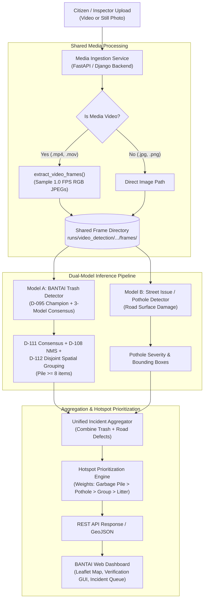

# BANTAI Stage 5 Website & Dual-Model Integration Guide for Argon

> **Target Audience**: Backend / Full-Stack Engineers (specifically "Argon") integrating the BANTAI Trash Detection & Spatial Grouping model alongside a complementary Street Issue / Road Surface Damage AI model (Model B) into the unified BANTAI municipal web application.  
> **Status**: Verified Production-Ready Master Documentation (Stage 5 D-115).  
> **Repository Context**: Active supervised classes strictly locked to `0..8` (`cigarette`, `plastic_bottle`, `plastic_bag`, `plastic_wrapper`, `plastic_film`, `drink_can`, `plastic_cup`, `styrofoam_piece`, `paper`). Zero unsupervised classes (`battery`, `aerosol`, `broken_glass`, `syringe`, `food_waste`). Zero test-split access.

---

## 1. Project Scope & Executive Overview

The BANTAI project is an intelligent municipal agent platform designed for street issue detection, automated spatial hazard grouping, and hotspot prioritization. The web application integrates two complementary AI models:
- **Model A (This Repository)**: Fine-Tuned Grounding DINO-T Swin-T Detector for still-image and extracted video-frame trash detection, BANTAI 5-category classification, and scale-normalized disjoint spatial grouping (`Individual Litter`, `Group of Individual Litter`, and `Garbage Pile`).
- **Model B (Complementary Model)**: Road-surface defect detector (e.g. potholes, cracks, manhole hazards, road obstructions).

Both models share a **single media ingestion pipeline**, eliminating redundant video decoding and duplicate frame storage.

### End-to-End System Architecture



---

## 2. Fixed Taxonomy & Spatial Grouping Contract (D-112 Standard)

### 2.1 Active Supervised Object Taxonomy (Strictly Locked: 9 Classes)

Model A outputs bounding boxes with integer `category_id` values strictly in `0..8`, mapped to the **5 Canonical BANTAI Categories**:

| Category ID | Object Class Name | Canonical BANTAI Category | Typical Street Litter Objects |
| :---: | :--- | :--- | :--- |
| `0` | `cigarette` | `Potentially Hazardous` | Cigarette butts, filters, tobacco ends |
| `1` | `plastic_bottle` | `Plastic` | Water bottles, beverage bottles |
| `2` | `plastic_bag` | `Plastic` | Grocery shopping bags, trash bags |
| `3` | `plastic_wrapper` | `Plastic` | Candy wrappers, snack packaging sachets |
| `4` | `plastic_film` | `Plastic` | Clear plastic wrap, cling film, packaging foil |
| `5` | `drink_can` | `Metal` | Aluminum soda/beer cans, tin beverage cans |
| `6` | `plastic_cup` | `Plastic` | Disposable plastic cups, bubble tea cups |
| `7` | `styrofoam_piece`| `Potentially Hazardous` | Expanded polystyrene food containers, cup pieces |
| `8` | `paper` | `Paper` | Paper towels, napkins, receipts, cardboard pieces |

> [!CAUTION]
> **Strict Guardrail**: Do NOT inject, map, or prompt for any unsupervised classes (`battery`, `aerosol`, `broken_glass`, `syringe`, `food_waste`). These classes have insufficient verified training data in the supervised split and are strictly prohibited from active production inference.

### 2.2 BANTAI Spatial Grouping Region Taxonomy (D-112 Standard)

The website frontend represents litter not merely as isolated bounding boxes, but as aggregated spatial hazard regions:

```
+---------------------------------------------------------------------------------------+
|  CARDINALITY BOUNDARY (D-112 Rule)                                                    |
|                                                                                       |
|  * Individual Litter (individual_litter)                                              |
|      k = 1 isolated bounding box                                                      |
|      model_score = float(score)  (Inherits individual detection confidence)           |
|                                                                                       |
|  * Group of Individual Litter (group_of_individual_litter)                            |
|      2 <= k <= 7 bounding boxes clustered via scale-normalized spatial proximity      |
|      model_score = null  (Aggregated hazard region, not an individual model query)    |
|                                                                                       |
|  * Garbage Pile (garbage_pile)                                                        |
|      k >= 8 bounding boxes in a dense, touching/consolidated heap                     |
|      model_score = null  (High-severity municipal accumulation)                       |
+---------------------------------------------------------------------------------------+
```

**Guarantees provided by `compute_spatial_grouping()`**:
1. **Zero Overlapping Multi-Item Regions**: No `Garbage Pile` and `Group of Individual Litter` will ever nest or overlap each other. Bounding boxes are strictly disjoint ($IoU \le 0.05$ and $IoMin < 0.20$).
2. **Deterministic Cardinality**: Any cluster with fewer than 8 items ($k \le 7$) is automatically classified as `Group of Individual Litter`. Only high-density heaps with $k \ge 8$ qualify as `Garbage Pile`.

---

## 3. Final Model Architecture, Benchmark Results & Preserved Checkpoints

### 3.1 Three-Model Consensus Architecture

To eliminate false positive hallucinations on street pavements, walls, and vehicle tires while preserving small items (e.g. cigarette butts, paper towel balls), Model A fuses three complementary Grounding DINO Swin-T inference models:

1. **Model 1: `Warm-Start Baseline` (Stage 4 blend, 384/576 resolution)**:
   - Evaluates at $384 \times 576$ resolution.
   - Provides conservative spatial grounding on broad plastic objects and beverage containers.
2. **Model 2: `Stage 5 Run 1` (epoch-02, 256/384 resolution)**:
   - Evaluates at $256 \times 384$ fast geometry.
   - Provides high-recall sensitivity on compact small litter items (e.g. crumpled white paper towels).
3. **Model 3: `D-095 Champion` (box-contrastive soup 50/50, 384/576 resolution)**:
   - Fine-tuned with box-contrastive loss on hard negative anchors.
   - Serves as the primary detector and query confidence score baseline.

### 3.2 Final 65-Image Validation Benchmark Results

Evaluated on the frozen 65-image TACO validation set under strict zero-test-split access:

- **Official 9-Specific AP**: **`0.301350`** (peak benchmark record).
- **BANTAI 5-Category AP**: **`0.497161`** (peak benchmark record).
- **Paper Category AP**: **`0.640610`**.
- **Detection Reliability**: **`77`** True Positives, **`0`** lost True Positives (`lost_tps == []`), **`63`** False Positives, **`36 / 65`** completely clean images.
- **Showcase Integrity**: All 14 validation showcase images bitwise preserved with 0 regressions.

### 3.3 Preserved Production Model Checkpoints

Following the D-113 surgical disk cleanup (128.08 GB freed), exactly three production checkpoint directories are preserved:

1. **Primary Champion (`D-095 Champion`, soup 50/50)**:
   - Path: `runs/training/stage5-d095-box-contrastive-20261102-a/checkpoints/best-inference/`
   - Files: `model.safetensors` (688 MB), `config.json`, `generation_config.json`, `soup_manifest.json`
2. **Ancestor Corroborator #1 (`Stage 5 Run 1`, epoch 2)**:
   - Path: `runs/training/stage5-paper-7604c2228fa94ba58dd3be0a770cf6f4/checkpoints/epoch-02/`
   - Files: `model.safetensors` (688 MB), `config.json`
3. **Ancestor Corroborator #2 (`Warm-Start Baseline`, step 350 + epoch 2 blend)**:
   - Path: `runs/training/taco-896e2f44146d4d54aee518e6087908ca/checkpoints/` (`step-000350` and `epoch-02`)
   - Metadata: `runs/training/scale576-integration-c70249cde2f2422cb89b22232fd2b525/record.json`

---

## 4. End-to-End Media Ingestion & Detection Workflow

The unified workflow consists of 4 deterministic pipeline steps:

```
[Media Upload] 
      │
      ▼
1. Frame Extraction ────► Sample 1.0 FPS RGB JPEGs (shared by Model A and Model B)
      │
      ▼
2. 3-Model Detection ───► Baseline, Run 1, and D-095 Champion forward passes
      │
      ▼
3. Consensus & Filter ──► Rule 7 tie-breaks, paper recall recovery, NMS, Top-25
      │
      ▼
4. Spatial Grouping ────► Disjoint DBSCAN clustering (Individual, Group, Pile >= 8)
      │
      ▼
[Unified JSON & Annotated Renderings]
```

### Video Frame Extraction
- Uploaded videos (`.mp4`, `.mov`, `.avi`, `.mkv`) are sampled at `1.0 FPS` using OpenCV into `runs/video_detection/<run_id>/frames/`.
- Both Model A (trash) and Model B (road defects) process the **exact same JPEG frames**, eliminating redundant video decoding.
- Standalone still photos (`.jpg`, `.jpeg`, `.png`) are processed directly as a single frame (`frame_0000`).

---

## 5. Copy-Pasteable Backend Integration Recipes for Argon

### Recipe 1: Pure Python In-Process Service (`run_bantai_trash_pipeline`)

Argon can directly import and invoke the pipeline inside any FastAPI, Flask, or Celery background worker:

```python
"""
BANTAI Stage 5 In-Process Inference Adapter for Argon.
Save as: app/services/trash_detection_service.py
"""
import os
import gc
from pathlib import Path
from typing import Dict, Any, List, Optional
import torch

# Ensure repository root is on sys.path
import sys
REPO_ROOT = Path(__file__).resolve().parent.parent.parent  # Adjust to your repo root
if str(REPO_ROOT) not in sys.path:
    sys.path.insert(0, str(REPO_ROOT))

from scripts.taco_stage5_video_extract_and_detect import (
    extract_video_frames,
    execute_three_model_detection,
    apply_scene_consensus,
    visible_rows,
)
from scripts.taco_stage5_spatial_grouping import (
    compute_spatial_grouping,
    DEFAULT_MIN_PILE_ITEMS,  # 8
)


class BantaiTrashService:
    def __init__(self, repo_root: Path, device: Optional[str] = None):
        self.repo_root = Path(repo_root)
        self.device = device or ("cuda" if torch.cuda.is_available() else "cpu")

    def process_media(
        self,
        media_path: str,
        output_dir: str,
        sample_fps: float = 1.0,
        score_threshold: float = 0.15,
        top_k: int = 25,
    ) -> Dict[str, Any]:
        """
        Processes an uploaded video or image and returns the complete detection
        and spatial grouping manifest.
        
        :param media_path: Path to uploaded .mp4, .mov, or .jpg, .png.
        :param output_dir: Working directory to store extracted frames and results.
        :param sample_fps: Video frame sampling rate (default: 1 frame per second).
        :param score_threshold: Minimum detection confidence (default: 0.15).
        :param top_k: Maximum detections retained per frame (default: 25).
        :return: Structured JSON manifest with frame-by-frame detections and regions.
        """
        media_file = Path(media_path)
        out_dir = Path(output_dir)
        out_dir.mkdir(parents=True, exist_ok=True)
        
        frames_dir = out_dir / "frames"
        frames_dir.mkdir(parents=True, exist_ok=True)

        is_video = media_file.suffix.lower() in [".mp4", ".mov", ".avi", ".mkv"]
        
        if is_video:
            # Step 1: Extract 1 FPS RGB JPEGs
            frame_records = extract_video_frames(
                video_path=media_file,
                output_dir=frames_dir,
                sample_fps=sample_fps,
            )
        else:
            # Standalone single image
            from PIL import Image
            img = Image.open(media_file)
            dest_frame = frames_dir / f"frame_0000_{media_file.name}"
            img.save(dest_frame, format="JPEG", quality=95)
            frame_records = [{
                "frame_id": 0,
                "timestamp_sec": 0.0,
                "image_path": str(dest_frame),
                "width": img.width,
                "height": img.height,
            }]

        results = {
            "source_media": str(media_file),
            "is_video": is_video,
            "total_frames": len(frame_records),
            "frames": [],
        }

        # Process each extracted frame
        for frame in frame_records:
            img_path = frame["image_path"]
            img_w = frame["width"]
            img_h = frame["height"]

            # Step 2: Three-Model Detection (Baseline, Run 1, D-095 Champion)
            raw_model_preds = execute_three_model_detection(
                image_path=img_path,
                repo_root=self.repo_root,
                device=self.device,
            )

            # Step 3: Consensus, tie-breaking, paper towel recovery
            consensus_preds = apply_scene_consensus(
                raw_model_preds,
                image_width=img_w,
                image_height=img_h,
            )

            # Deduplication & Top-K filtering
            detections = visible_rows(
                consensus_preds,
                score_threshold=score_threshold,
                top_k=top_k,
                iou_threshold=0.50,
                containment_threshold=0.80,
            )

            # Step 4: Scale-Normalized Disjoint Spatial Grouping (D-112: min_pile_items = 8)
            regions = compute_spatial_grouping(
                detections=detections,
                image_width=img_w,
                image_height=img_h,
                min_pile_items=DEFAULT_MIN_PILE_ITEMS,
            )

            results["frames"].append({
                "frame_id": frame["frame_id"],
                "timestamp_sec": frame.get("timestamp_sec", 0.0),
                "image_path": img_path,
                "width": img_w,
                "height": img_h,
                "summary": {
                    "detection_count": len(detections),
                    "region_count": len(regions),
                    "garbage_piles": sum(1 for r in regions if r["category"] == "garbage_pile"),
                    "litter_groups": sum(1 for r in regions if r["category"] == "group_of_individual_litter"),
                    "individual_items": sum(1 for r in regions if r["category"] == "individual_litter"),
                },
                "detections": detections,
                "regions": regions,
            })

            # Cleanup VRAM after each frame
            if self.device == "cuda":
                torch.cuda.empty_cache()
                gc.collect()

        return results
```

---

### Recipe 2: Subprocess CLI Execution

If Argon executes the pipeline as an asynchronous background worker process (e.g. via Celery, RQ, or Node.js `child_process.spawn`):

```bash
# Execute video frame extraction and three-model detection
python scripts/taco_stage5_video_extract_and_detect.py \
  --input-media "data/input/uploaded_street_video.mp4" \
  --output-dir "runs/video_detection/incident_1042" \
  --sample-fps 1.0 \
  --score-threshold 0.15 \
  --top-k 25 \
  --device "cuda"
```

The CLI automatically outputs:
- `runs/video_detection/incident_1042/manifest.json`: Full structured JSON.
- `runs/video_detection/incident_1042/frames/*.jpg`: Extracted frames.
- `runs/video_detection/incident_1042/overlays/*.jpg`: Visual review renderings.

---

## 6. Exact JSON Contracts & Unified Web Response Schema

### 6.1 Model A Standalone Manifest Schema (`manifest.json`)

Each frame record in `manifest.json` adheres to this exact contract:

```json
{
  "frame_id": 10001,
  "timestamp_sec": 0.0,
  "image_path": "runs/video_detection/incident_1042/frames/frame_0001_t00.0s.jpg",
  "width": 1920,
  "height": 1080,
  "detections": [
    {
      "query_id": 14,
      "category_id": 8,
      "label": "Paper",
      "model_score": 0.3542,
      "bbox": [540.2, 632.1, 48.5, 52.0],
      "bantai_category": "Paper"
    }
  ],
  "regions": [
    {
      "region_id": 1,
      "category": "garbage_pile",
      "display_label": "Garbage Pile",
      "item_count": 9,
      "bbox": [480.0, 590.0, 420.0, 310.0],
      "model_score": null,
      "member_indices": [0, 1, 2, 3, 4, 5, 6, 7, 8]
    },
    {
      "region_id": 2,
      "category": "individual_litter",
      "display_label": "Individual Litter",
      "item_count": 1,
      "bbox": [1210.0, 840.0, 35.0, 40.0],
      "model_score": 0.2845,
      "member_indices": [9]
    }
  ]
}
```

### 6.2 Unified Dual-Model API Response (Model A + Model B)

To power the website's unified incident map and dispatch prioritization, Argon combines Model A and Model B outputs into this standard JSON schema:

```json
{
  "incident_id": "INC-20261107-0042",
  "source_media": {
    "filename": "patrol_route_zone4.mp4",
    "type": "video",
    "fps": 1.0,
    "duration_sec": 12.0
  },
  "location": {
    "latitude": 14.653889,
    "longitude": 121.103611,
    "street_name": "Rizal Avenue cor. Aurora Blvd"
  },
  "hotspot_score": 88.5,
  "priority_level": "CRITICAL",
  "dispatch_recommendation": "Immediate municipal cleanup crew (waste pile) + road patch crew (severe pothole)",
  "frames": [
    {
      "frame_index": 3,
      "timestamp_sec": 3.0,
      "frame_url": "/media/incidents/INC-0042/frames/frame_0003.jpg",
      "annotated_url": "/media/incidents/INC-0042/overlays/frame_0003_overlay.jpg",
      
      "trash_findings": {
        "model_version": "BANTAI-Stage5-D095-Soup5050",
        "total_items": 12,
        "regions": {
          "garbage_piles": 1,
          "groups_of_litter": 0,
          "individual_items": 2
        },
        "items_by_bantai_category": {
          "Plastic": 7,
          "Paper": 3,
          "Metal": 1,
          "Potentially Hazardous": 1,
          "Organic": 0
        },
        "region_list": [
          {
            "region_id": 1,
            "type": "garbage_pile",
            "item_count": 10,
            "bbox": [410.5, 520.0, 380.0, 290.0]
          }
        ]
      },

      "road_defect_findings": {
        "model_version": "BANTAI-ModelB-RoadDefect-v2",
        "defects": [
          {
            "defect_id": 1,
            "type": "pothole",
            "severity": "high",
            "estimated_diameter_cm": 45.0,
            "bbox": [890.0, 720.0, 160.0, 110.0],
            "confidence": 0.892
          }
        ]
      }
    }
  ]
}
```

### 6.3 Hotspot Prioritization Formula

For the website's municipal dispatch ranking queue, compute the frame-level and incident-level hotspot priority index ($H$) using this calibrated formula:

$$H = \min\left(100, \sum \left( W_{\text{pile}} \cdot N_{\text{pile}} + W_{\text{group}} \cdot N_{\text{group}} + W_{\text{litter}} \cdot N_{\text{litter}} + W_{\text{pothole}} \cdot N_{\text{pothole}} \right)\right)$$

Recommended municipal weights:
- $W_{\text{pile}} = 35.0$ (Garbage Pile: high public health hazard, major accumulation)
- $W_{\text{group}} = 15.0$ (Group of Individual Litter: emerging litter hotspot)
- $W_{\text{litter}} = 3.0$ (Individual Litter: minor scatter)
- $W_{\text{pothole}} = 25.0$ to $40.0$ (Pothole: road traffic and pedestrian safety hazard)

Priority thresholds:
- $H \ge 75$: **CRITICAL** (Red badge, dispatch immediate response)
- $40 \le H < 75$: **ELEVATED** (Orange badge, schedule same-day patrol)
- $H < 40$: **ROUTINE** (Green badge, routine street sweeping)

---

## 7. Concise Milestone Register (`D-040` to `D-115`) & Verification Checklist

### 7.1 Key Milestone Register

- **D-040 to D-042 (Stage 3D & Legal Scope)**: Grounding DINO Swin-T detector, native TkAgg viewer, Section 185 non-commercial research fair-use authorization bound.
- **D-043 to D-076 (Stage 4 Fine-Tuning & Scale-576 Optimization)**: 8-class baseline, resolution investigation ($384 \times 576$), class-balanced loss, coordinate integrity, weight soup integration achieving legacy validation benchmark AP = `0.250362`.
- **D-077 to D-085 (Stage 5 Paper Category & Hierarchy)**: Added 9th supervised class (`paper`), table-driven object registry, 5 canonical BANTAI categories (`Plastic`, `Paper`, `Organic`, `Metal`, `Potentially Hazardous`), audit confirming unsupervised classes excluded.
- **D-086 to D-095 (High-Resolution Training & Box-Contrastive Champion)**: Multi-epoch hard-negative mining, box-contrastive fine-tuning producing `D-095 Champion` soup 50/50 ($AP_9 = 0.301350$, $AP_5 = 0.497161$).
- **D-096 to D-105 (Three-Model Consensus & Spatial Grouping Foundation)**: Tri-model routing, Rule 7 tie-breaks (shadow rocks, vehicle tires, painted road stripes), DBSCAN scale-normalized spatial clustering.
- **D-106 to D-110 (Video Frame Extraction & Distractor Guardrails)**: 1.0 FPS video frame extraction, camera-border watermark filtering, standalone input photo detection (`For_testing.jpg`).
- **D-111 (Paper Towel Small-Litter Recall Recovery)**: Cross-model boosting (Pass 7C), compact paper consistency (Rule 7A Case E), and small-paper peer bypass (Rule 7B9) detecting crumpled white paper towels on concrete pavement.
- **D-112 (Garbage Pile $k \ge 8$ Cardinality Rule)**: Fixed strict boundary: $k = 1 \implies$ `Individual Litter`, $2 \le k \le 7 \implies$ `Group of Individual Litter`, $k \ge 8 \implies$ `Garbage Pile`. Guaranteed disjoint multi-item regions.
- **D-113 (Surgical Disk Cleanup)**: Removed 128.08 GB redundant experimental files and optimizer states; preserved 100% of production weights and historical metrics.
- **D-114 (Argon Integration Guide)**: Authored master dual-model integration specification.
- **D-115 (Documentation Consolidation)**: Consolidated 88 scattered `.md` files into this single master guide, with root `README.md` and `AGENTS.md` fully aligned.

### 7.2 Argon's 6-Step Verification Checklist

After cloning the repository and setting up the environment, Argon should run these 6 deterministic verification steps:

- [ ] **Step 1: Verify Python & PyTorch CUDA / CPU Environment**
  ```powershell
  python -c "import torch; print('CUDA available:', torch.cuda.is_available(), 'Device:', torch.cuda.get_device_name(0) if torch.cuda.is_available() else 'CPU')"
  ```
- [ ] **Step 2: Verify Production Checkpoint Integrity**
  ```powershell
  python -c "from pathlib import Path; p = Path('runs/training/stage5-d095-box-contrastive-20261102-a/checkpoints/best-inference/model.safetensors'); assert p.exists(), f'Missing champion weights at {p}'; print('Champion weights verified:', p.stat().st_size, 'bytes')"
  ```
- [ ] **Step 3: Run Core Stage 5 Unit Tests**
  ```powershell
  .\.venv-training\Scripts\python.exe -m unittest tests/test_stage5_d112_garbage_pile_min8_rule.py
  ```
  *(Expected: Ran 7 tests, all passed, 0 failures, 0 errors)*
- [ ] **Step 4: Verify Disjoint Spatial Grouping Logic**
  ```powershell
  python -c "from scripts.taco_stage5_spatial_grouping import DEFAULT_MIN_PILE_ITEMS; assert DEFAULT_MIN_PILE_ITEMS == 8; print('D-112 min_pile_items == 8 verified')"
  ```
- [ ] **Step 5: Run Standalone Single Image Inference Test**
  Test with any JPEG/PNG photo:
  ```powershell
  python scripts/taco_stage5_video_extract_and_detect.py --input-media "data/test_sample.jpg" --output-dir "runs/test_run"
  ```
- [ ] **Step 6: Confirm Markdown Links & Documentation Integrity**
  ```powershell
  python scripts/check_markdown_links.py
  ```
  *(Expected: 0 broken links)*
