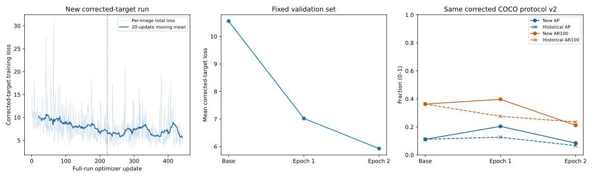
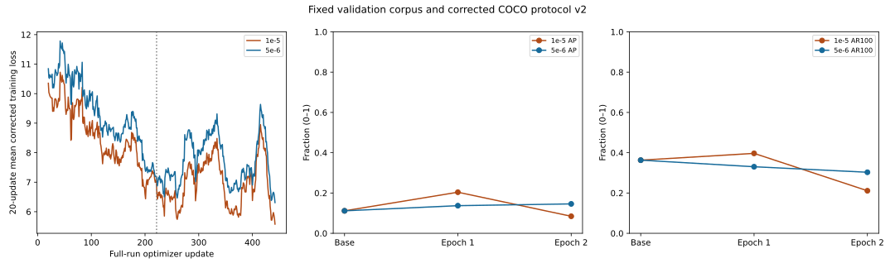
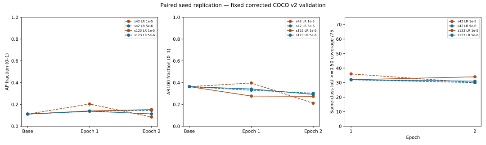

# BANTAI Phase 4: 8-Class Real-Image Fine-Tuning & Scale-576 Optimization

> **Scope**: Section 185 academic-use governance, 8-class TACO dataset loader, warm-start fine-tuning, scale-576 resolution experiments, class-balanced loss, cigarette learning-rate boosting, and model soup weight integration (`D-041` through `D-069`).  
> **Status**: Completed & Production Benchmark Established (Legacy 8-Class AP = `0.250362` / `0.265563`).

---

## Table of Contents
1. [Executive Overview & Governance (Section 185 Academic-Use Authorization)](#1-executive-overview--governance-section-185-academic-use-authorization)
2. [8-Class TACO Dataset Loader & Coordinate Integrity](#2-8-class-taco-dataset-loader--coordinate-integrity)
3. [Warm-Start Baseline Training & First Real-Image Run](#3-warm-start-baseline-training--first-real-image-run)
4. [Diagnostics, Preflight Validation & Corrected Retraining](#4-diagnostics-preflight-validation--corrected-retraining)
5. [Learning Rate & Optimization Experiments](#5-learning-rate--optimization-experiments)
6. [Scale-576 Resolution Experiment & Resolution Replication](#6-scale-576-resolution-experiment--resolution-replication)
7. [Material Hierarchy, Cigarette LR Boost & Class Balancing](#7-material-hierarchy-cigarette-lr-boost--class-balancing)
8. [Model Soup Weight Integration & Legacy Validation Benchmark Achievement](#8-model-soup-weight-integration--legacy-validation-benchmark-achievement)
9. [Multi-Seed Replication, Small-Object Audit & Visual Review](#9-multi-seed-replication-small-object-audit--visual-review)
10. [Phase 4 Milestone Register (D-041 through D-069)](#10-phase-4-milestone-register-d-041-through-d-069)

---

## 1. Executive Overview & Governance (Section 185 Academic-Use Authorization)

Phase 4 transitioned the repository from synthetic qualification to real-world waste photo training under the owner's explicit Section 185 Philippine Intellectual Property Code non-commercial academic research declaration (`D-042`).

Key Invariants Maintained Throughout Phase 4:
- **8 Active Supervised Classes**: `cigarette`, `plastic_bottle`, `plastic_bag`, `plastic_wrapper`, `plastic_film`, `drink_can`, `plastic_cup`, `styrofoam_piece`.
- **Strict Split Hygiene**: 221 training images (637 boxes) and 47 validation images. Zero test-split access.
- **Coordinate Frame Integrity**: Stored raster coordinates without EXIF transposition.

### Legal Governance Record
# Stage 4 local academic-use record — 2026-10-19

This records the owner's latest declaration and the documented basis for the existing Stage 4 run; it is not a new preparation phase. The exact corpus is the unchanged strict-clean v1 **221 training / 397 objects and 47 validation / 75 objects**. The local machine-readable record binds all 268 image IDs and split/source hashes. Test photos remain unused.

## Actual owner declaration

The owner states that BANTAI is non-commercial and academic; training/evaluation occur locally on the owner's computer; TACO photographs/annotations will not be published, redistributed or uploaded to cloud services; and the owner authorizes the local fine-tuning workflow. The owner explicitly requested a documented Section 185 analysis and execution if supportable. This chat declaration is the evidence; no signature, rightsholder permission, institutional approval or lawyer's opinion was supplied or is claimed.

## Sources and four-factor application

The [TACO maintainer README](https://github.com/pedropro/TACO/blob/master/README.md) expressly describes the images/annotations as supporting training and evaluation of detection algorithms. The [authors' paper](https://arxiv.org/abs/2003.06975) describes the litter dataset and segmentation experiments. These support research-purpose compatibility, not blanket photo licensing. Retain citation: Pedro F. Proença and Pedro Simões, *TACO: Trash Annotations in Context for Litter Detection*, 2020, arXiv:2003.06975.

[RA 8293 Section 185](https://lawphil.net/statutes/repacts/ra1997/ra_8293_1997.html), with [RA 10372 Section 12's amendment](https://lawphil.net/statutes/repacts/ra2013/ra_10372_2013.html), provides the research/fair-use framework. [IPOPHL's guidance](https://www.ipophil.gov.ph/news/ipophl-releases-statutory-fair-use-guidelines-to-clarify-rules-on-copyright-exceptions/?news_page=2) calls for considering all four factors; non-commercial status alone is insufficient. The following is an evidence-based project assessment, not a definitive legal determination:

| Factor | Application to this specific use |
| --- | --- |
| Purpose/character | Non-commercial local academic object-localization experiments, consistent with TACO's documented purpose. Analytical model fitting/evaluation differs from publishing photographs. Favors the claim; research is not automatic immunity. |
| Nature | Litter scenes are informational, but photographic composition and annotation selection can be protected expression. Factual coordinates alone do not exhaust database/compilation interests. Mixed/uncertain; public availability is not public domain. |
| Amount/substantiality | Whole images and associated annotations are consumed to preserve spatial context and valid boxes. Only the established train/validation subset is used, for a bounded two-epoch experiment. Entire-photo copying weighs against the claim despite technical necessity; a small fraction of TACO alone is not decisive. |
| Market/value | No image/annotation distribution, commercial service or public substitute corpus is created. This limits substitution risk. No market study or per-image licensing-market evidence was supplied; potential licensing and model-related markets remain uncertain. |

For annotations/database interests, the same limited analytical use is assessed to the extent protectable selection/arrangement is reproduced. [Sections 173 and 175](https://lawphil.net/statutes/repacts/ra1997/ra_8293_1997.html) distinguish original compilations from mere data; neither makes all annotations automatically unrestricted. Preserve original metadata, credits and ODbL notices. No contractual waiver, foreign-law exemption or resolution of every individual photograph's license is claimed. Existing missing/generic-CC/ODbL strings remain unchanged.

## Decision and scope

On the declared facts, the research-purpose evidence, necessity of spatial context and strict local non-substitutive use provide a **defensible, limited Section 185 fair-use claim**, while the whole-image and market uncertainties remain. The owner authorizes this workflow; this record does not purport to grant rights or certify legal clearance. A conclusive court/institutional determination is not asserted. The workflow may proceed on this documented exception claim without inventing a positive license ledger.

The machine record uses `bantai.training-rights.v2`: workflow authorization is true; photo/database clearance flags remain false; rightsholder permission, institutional approval and definitive clearance are explicitly `not_claimed`. The assessment digest and genuine sources are mandatory. Legacy v1 permission/clearance records retain their existing semantics. This is an auditable distinction, not a disabled gate.

Authorized: original-coordinate preflight, pinned-model baseline, measured GPU pilot, two epochs and same-protocol validation on the exact bound train/validation corpus, entirely local. Preserve originals, notices, inference settings, taxonomy and splits. Keep corpus, predictions and experimental checkpoints in ignored local paths; no photo/annotation/weight publication or cloud transfer is authorized. Any later commercial use, publication, transfer, expanded corpus or different purpose requires a fresh assessment. A known contrary restriction or rightsholder objection must be addressed rather than hidden by this record.


---

## 2. 8-Class TACO Dataset Loader & Coordinate Integrity

# Stage 4 Step 1B — Coordinate correction, 2026-10-20

The owner authorizes correction of the two Step 1 coordinate defects, independent
regression checks and validation-only reevaluation. No optimizer updates, test
split access, promotion, Step 2 visual analysis or additional fine-tuning occurs.
Starting branch: `feat/stage4-real-image-training`, HEAD `087e361`; PR #18 lineage
is retained. The pre-existing owner edit to `config/detection.json` is preserved.

## Root causes and corrections

Transformers 4.51.3 normalizes processed annotations to the padded canvas, while
Grounding DINO proposals/predictions use the valid image frame. Native source
evidence is `GroundingDinoModel.generate_encoder_output_proposals` (division by
valid width/height), decoder reference scaling by valid ratios, and the native
processor's direct original-size prediction scaling.

`training_smoke.valid_image_loss_targets` verifies the processor's padded targets
and original image/category identities, then multiplies boxes by
`[padded_w/valid_w, padded_h/valid_h, padded_w/valid_w, padded_h/valid_h]`.
It independently checks the result against original COCO coordinates normalized
by original width/height. Both real-data `collate` and synthetic `prepare_batch`
use this helper. Other label metadata, source annotations and pixel inputs remain
unchanged. The existing adapter supplies these labels to both native loss branches.

`taco_evaluation.decode_predictions` now scales native normalized corners directly
by original width/height, then clips/rejects invalid boxes. The former additional
padding expansion is removed. Protocol `bantai.taco-evaluation.v2` explicitly names
the box frame; prompt, class scores, argmax, top 100, NMS-off and confidence rules
are unchanged. Functional inference, adapter code, architecture and coefficients
are unchanged.

For original 640x320, COCO `[160,80,160,80]`, resized 384x192 and padded 384x384,
loss targets are now `[.375,.375,.25,.25]`, replacing the incorrect
`[.375,.1875,.25,.125]`. The independently specified native prediction decodes
to the original box; the old decoder produced `[160,160,160,160]`.

## Software verification

New `tests/test_taco_coordinates.py` has eight processor/native-loss tests:
landscape, portrait and padded square; independently specified coordinates;
all eight class IDs; multiple/small/bottom/right-edge objects; legitimate clipping
and invalid-width rejection; pixel footprint/mask alignment; empty/identity checks;
native proposal/reference semantics; zero regression loss in both native branches;
and perfect AP50=1 versus wrong-frame AP50=0. Predictions are not copied from
processed targets. Native postprocessing is a separate oracle.

Actual commands in the existing isolated environment:

```powershell
.venv-training/Scripts/python.exe -B -m unittest discover -s tests -p test_taco_coordinates.py -v
.venv-training/Scripts/python.exe -B work/step1b/check_regressions.py
.venv-training/Scripts/python.exe -B work/step1b/check_software.py
.venv-training/Scripts/python.exe -B work/step1b/evaluate_baseline.py
```

The `work/step1b` scripts/logs are ignored local execution evidence, not distributed
project entry points. The regression harness loads original functions from
`087e361` into temporary in-memory modules, without replacing source/library files.
All eight corrected tests pass. Original targets and original decoder each produce
five failure events including subtests, independently; neither variant errors.
The initial clipping fixture used an out-of-domain center of 1.2 and was correctly
rejected; it was corrected to valid-domain boundary/zero-width cases without
relaxing prediction validation.

Broader discovery: **168 tests, 165 passed, zero failures/errors, three skipped**.
One skip is the existing Windows symlink privilege limitation. Two toy optimizer
tests are explicitly skipped for this task's no-update boundary. The local harness
guards AdamW/SGD steps and redirects trainer output to a temporary directory.
Do not run unfiltered optimizer tests under this boundary. No dependency changes.

## Validation evidence and historical comparison

New private record:
`runs/training/step1b-evaluation-c8b127d8bf364c7dbb735795cd81c06d/record.json`.
`baseline-corrected.json` retains complete local diagnostics; the original Stage 4
run and its JSON/checkpoints are unchanged. This is a new evaluation, not a rewrite
of historical evidence. Source fingerprints, v2 protocol, dataset/rights hashes,
runtime and original checkpoint hashes are bound in the record.

The pinned pretrained baseline ran on GTX 1660 Ti, FP32, batch 1, 256/384 resize,
384-square padding, identical eight-class prompt and the same 47 validation images /
75 annotations. Source hashes/orientation and rights gates passed. Exactly 47 photo
reads; zero optimizer updates; no test loader. No cloud/upload/publication.

Metrics are fractions, not percentages. Historical values used incorrect geometry.

| Model / evaluation | AP | AP50 | AP75 | AR100 |
| --- | ---: | ---: | ---: | ---: |
| Pretrained, historical v1 | 0.000298934 | 0.001329652 | 0 | 0.007884615 |
| Pretrained, corrected v2 | 0.111576016 | 0.158252880 | 0.135975042 | 0.363077235 |
| Epoch 1, historical v1 | 0.000006713 | 0.000016781 | 0 | 0.003846154 |
| Epoch 1, corrected v2 | blocked | blocked | blocked | blocked |
| Epoch 2, historical v1 | 0.000057591 | 0.000138055 | 0.000052946 | 0.015576923 |
| Epoch 2, corrected v2 | blocked | blocked | blocked | blocked |

| Class | Validation objects | Corrected pretrained AP | Corrected pretrained AR100 |
| --- | ---: | ---: | ---: |
| cigarette | 24 | 0.014851485 | 0.012500000 |
| plastic_bottle | 8 | 0.038241717 | 0.400000000 |
| plastic_bag | 2 | 0.236228623 | 0.550000000 |
| plastic_wrapper | 11 | 0.094467223 | 0.490909091 |
| plastic_film | 13 | 0.001574350 | 0.076923077 |
| drink_can | 7 | 0.108415842 | 0.214285714 |
| plastic_cup | 5 | 0.340655617 | 0.600000000 |
| styrofoam_piece | 5 | 0.058173267 | 0.560000000 |

Corrected baseline small-object AP/AR100 are both zero. Medium AP is 0.005940594.
Corrected baseline validation loss is 10.553226 versus historical 19.348786 at
identical pretrained weights: target semantics changed, so this is not learning.
Allocator peak: 951,008,768 allocated / 1,019,215,872 reserved bytes. Evaluation
lifecycle was 73.316 seconds including model loading, hashing and publication;
this is not isolated throughput and excludes initial environment preflight.

All 42,300 baseline query scores and category IDs match historical values exactly;
maximum score difference is zero. Invalid clipped boxes drop from 14,703 to zero.
The same 47 IDs and 4,700 retained predictions are present. Geometry, rather than
score/prompt changes, explains the corrected baseline measurement difference.

### Checkpoint comparison blocker

Both epoch bundles pass all ten historical artifact hashes. However,
`verify_checkpoint` rejects a context containing the corrected three source
fingerprints and v2 protocol: **Incomplete checkpoint or changed
dataset/rights/settings/runtime/source**. The historical replay additionally
requires exact original `source_identity`. No optimizer/checkpoint restore or
model loading was attempted for those bundles under the changed context.

Per the owner's explicit stop-if-source-binding-blocks rule, this part is stopped.
The checkpoint verifier, adapter manifest and historical evidence are unchanged;
passing the old context as if it described corrected execution is not a solution.
A separately approved evaluation-only provenance contract that verifies historical
weights while recording the new evaluator is required before the epoch comparison.
This must not relax training-resume integrity or rewrite historical manifests.

### Score suppression and limitations

Historical all-query score distributions (same 42,300 queries per model):

| Model | Median | P99 | Maximum | Queries >=0.25 |
| --- | ---: | ---: | ---: | ---: |
| Pretrained (also identical corrected scores) | 0.019574 | 0.187558 | 0.596656 | 216 |
| Epoch 1, historical | 0.029931 | 0.069502 | 0.184526 | 0 |
| Epoch 2, historical | 0.031275 | 0.067896 | 0.123536 | 0 |

The high-score tail contracted, while the median increased. Suppression above the
diagnostic threshold is real; its cause is not isolated. Corrected epoch geometry
and class AP remain unmeasured. Earlier weights were trained against incorrect
targets; an evaluation fix cannot undo that. Tiny validation classes, positive-only
strict-clean selection and low resolution limit conclusions. Successful geometry
tests and higher baseline AP do not establish adequate detection accuracy.

## Preservation and next action

The preservation snapshot covers 490 existing files, including all historical run
artifacts, original pretrained snapshot, train/validation source photographs,
export metadata excluding test JSON, taxonomy, owner settings, private rights
record and project source/docs. Package inventory records 38 training packages.
Final checks passed: zero unexpected file differences and all 38 package versions
unchanged, allowing only the explicitly changed source/docs files. The original
annotation/source and dataset context still match the historical contract. All 97
relative links checked in changed Markdown files resolve. No test JSON/photo is opened.

Changed project scope: three training/evaluation modules, the new coordinate tests,
this report, README current-state notice, handoff and decision register. Local probe
scripts/logs and generated evaluation JSON remain ignored. No commit, push, merge
or checkpoint promotion is performed in Step 1B.

**Next proposed action:** qualify an explicit evaluation-only provenance path for
the two historical checkpoints, then finish the fixed comparison before Step 2.
No further training or visual analysis is started by this task.


---

## 3. Warm-Start Baseline Training & First Real-Image Run

# Stage 4 — Real-image fine-tuning and initial evaluation

## Current outcome

**Update under D-042:** [the first real-image run](PHASE_4_EIGHT_CLASS_FINE_TUNING.md) completed two epochs, real coordinate/memory checks, complete checkpoints and same-protocol baseline/final evaluation. The owner-authorized [qualified academic-use claim](PHASE_4_EIGHT_CLASS_FINE_TUNING.md) is documented without claiming permission or definitive legal clearance. Validation loss fell, but AP deteriorated; the experimental checkpoint is not promoted. Test data/inference/original weights remain preserved. The earlier blocked-rights implementation record below is retained as history, not the current run status.

## Initial implementation outcome (historical)

Owner authorization D-041 supersedes Stage 3D's stop-before-real-data boundary, subject to the owner's explicit image-use condition. This is one continuous implementation stage, not a new assessment phase. Branch `feat/stage4-real-image-training` builds directly on Stage 3D `22bcdbc` (open PR #17), carrying the unmerged Stage 3A–3D work above fetched main `077657c`.

Implementation commit `601bb81` is published in [PR #18 targeting main](https://github.com/Piyaya-hub/BANTAI-Modeling-/pull/18). It remains unmerged; only code/docs are published, with no dataset/model artifacts or implied rights approval.

The runnable loader, corrected-objective trainer, pilot, progress, complete resumable checkpoints and fixed validation evaluator are implemented. **Real-photo processing, the pilot, 2–3 epochs and real validation metrics remain BLOCKED by missing documented photo/annotation-use authorization. No fine-tuned TACO checkpoint exists.** Metadata inspection does not clear rights. No test photographs or test split JSON are loaded by these commands. Existing source data, eight labels, split exports, inference settings/environment, pretrained cache and Stage 3D adapter are preserved. The owner's local `config/detection.json` edits remain excluded from commits.

## Files and behavior

| File | Purpose |
| --- | --- |
| [taco_training_data.py](../scripts/taco_training_data.py) | Verify original annotation/export/taxonomy hashes, bind train/validation IDs to an explicit rights record, load external stored-raster RGB photos read-only, reject changed/missing/unsafe sources and invalid/crowd/ignored targets, and verify preprocessing coordinates/counts/classes. |
| [train_taco.py](../scripts/train_taco.py) | Rights gate, all-photo coordinate preflight, unchanged-pretrained validation, bounded real-image memory pilot, discard pilot weights/optimizer, then 2–3 epochs from the unchanged base; validation/checkpoints/progress and strict status reports. |
| [training_checkpoint.py](../scripts/training_checkpoint.py) | Native HF model/processor plus adapter context, AdamW state, Python/NumPy/CPU/CUDA RNG, deterministic epoch order and next-batch/global-step position. Immutable artifacts, complete hash manifest last, latest pointer only after completion. |
| [taco_evaluation.py](../scripts/taco_evaluation.py) | Fixed ordinary-subword class scoring, inverse geometry, COCO bbox metrics, raw query diagnostics and annotations-relative errors. Separate from the existing inference postprocessor. |
| [qualify_taco_trainer.py](../scripts/qualify_taco_trainer.py) | Actual pinned-model CUDA update/save/reload/continued-update qualification using generated images only. |
| [test_taco_training.py](../tests/test_taco_training.py) | Rights/no-read gates, source/annotation failures, geometry/span decoding, empty predictions, metrics, RNG/optimizer continuation and toy-update epoch/resume orchestration. |
| [taco_training_rights.example.json](../config/taco_training_rights.example.json) | Deliberately unapproved template; no inferred permissions. Actual evidence stays in ignored local paths. |
| [requirements-training-evaluation.txt](../requirements-training-evaluation.txt) | Only additional training-environment package: PyPI Windows CPython 3.11 x64 `pycocotools==2.0.10`, exact wheel SHA-256. No base package reinstall. |

COCO area is retained as segmentation/object area; it is not replaced with bounding-box area. Boxes remain `[x,y,width,height]` on the original stored raster, with no EXIF transpose, annotation clipping or silent object removal. All 268 train/validation photographs must decode, match recorded file hashes/dimensions/orientation, and preserve all target identities and coordinates through resizing/padding **before any optimizer update**. This geometric check does not substitute for human annotation correctness review.

## Initial rights check — historical blocking gate

Metadata-only reinspection of the unchanged export on 2026-10-19 found:

| Split | Images / objects | Missing license | Unspecified `CC` | OpenLitterMap ODbL notice |
| --- | ---: | ---: | ---: | ---: |
| Train | 221 / 397 | 133 | 22 | 66 |
| Validation | 47 / 75 | 28 | 8 | 11 |
| Required scope | **268 / 472** | **161** | **30** | **77** |

The preserved source records contain Flickr URLs, but neither an image-by-image permission ledger nor an approved institutional/legal use basis was supplied. No Flickr images were downloaded or opened during this check. The [TACO README](https://github.com/pedropro/TACO/blob/master/README.md) identifies Flickr-hosted photographs; its [MIT software license](https://github.com/pedropro/TACO/blob/master/LICENSE) does not establish blanket photo permission. The [original Zenodo record](https://zenodo.org/records/3587843) did not expose usable photo/annotation authorization in its rendered Rights section. `CC` lacks variant/version and attribution details. The [ODbL text](https://opendatacommons.org/licenses/odbl/1-0/) distinguishes database rights from individual contents, so its presence alone does not establish photo rights. These are unresolved evidence gaps, not a legal conclusion that the intended use is prohibited.

**Required owner input:** documented permission or an appropriately approved lawful-use basis covering every retained training and validation photo **and** annotation/database use for this local academic experiment. Identify the actual approving rightsholder/institutional/legal authority, approval date, basis/evidence reference, permitted scope and obligations (credits/notices, restrictions, retention). Publication, cloud transfer and redistribution are outside this request. Generic instruction to proceed, repository MIT, an unspecified CC string, or filling an example with invented facts does not satisfy this gate. An approved lawful-use basis may be recorded instead of individual licenses when the authorized review actually covers this scope.

The rights record binds to the exact manifest, original annotation digest, split digests and IDs. It requires explicit photo and annotation/database clearance and the scope `local_academic_train_validation_no_publication`. This is an auditable owner declaration, not software verification of legal validity or automatic implementation of every obligation. Resolve operational obligations before marking it approved; the trainer never uploads/publishes or exports annotated copies. No real-image bytes or model loads occur if the record is absent/unapproved/mismatched. Test split permission is not requested because it remains untouched.

## Fixed initial experiment

- Pinned `IDEA-Research/grounding-dino-tiny`, revision `a2bb814dd30d776dcf7e30523b00659f4f141c71`, Transformers 4.51.3, local cache only, custom kernels disabled; `.venv-training` only.
- Every supervised loss goes through the unchanged verified `EncoderOutputAdapter`; plain model forwards are never passed labels. Native loss formula/weights, 900 queries, detached decoder initialization, architecture and eight ordered prompt spans stay unchanged.
- FP32, frozen vision/BERT parameters; native training/eval module modes, no augmentation, AMP, scheduler or accumulation. AdamW LR `1e-5`, weight decay `1e-4`, `foreach=false`, global clip norm 1, seed 42, workers 0.
- Default batch 1; aspect-preserving shortest edge 256 / longest edge 384, then bottom/right square padding to 384. Fixed padding protects the 900-proposal requirement even for narrow photos. It changes neither aspect ratio nor target alignment. Lower resolution limits tiny-object evaluation; it is a bounded initial experiment, not an optimized default. Explicit batch 2 is permitted by the adapter but not qualified at this real-photo resolution.
- Pretrained baseline first, then default three pilot updates on the most object-dense training photos (tie by image ID). Require finite losses/gradients/updated weights and nonzero encoder proposal/box updates; record memory on each step, reset allocator peaks for pilot/full run. Abort/report OOM or instability without changing settings. Pilot weights/optimizer are discarded before the full run.
- Default two epochs: 442 full-run updates at batch 1, plus three discarded pilot updates. Three epochs require explicit `--epochs 3` from the outset. Same fixed validation protocol runs on all 47 validation photos before training and after each epoch. Test images are never used. No checkpoint is automatically promoted to inference.

GPU progress prints epoch/batch/total, training loss and allocator peak; validation has per-image progress and epoch AP/loss summaries. Step timing includes synchronization/gradient audits; report lifecycle time includes hashing, preflight, model loads, pilot, baseline, training, validation and checkpoints. This is not a steady-state throughput benchmark. CUDA allocator measurements exclude desktop/driver allocations; actual real-photo peak/time remain unrun.

### Evaluation protocol

Mean sigmoid score over each class's ordinary subwords, one argmax class per query, no NMS, score floor 0, highest-scoring 100 **valid** boxes globally per image. Invert the saved padded/resized frame to original xywh and clip predictions only to image bounds; do not clip ground truth. Preserve all 900 raw query records with query IDs, raw incomplete/unmapped phrases (ordinary tokens above 0.10), scores and box validity separately. Raw phrase threshold does not filter AP predictions. This evaluation-only rule does not change inference prompts/thresholds or raw phrase mapping.

[COCO evaluator conventions](https://github.com/cocodataset/cocoapi/blob/master/PythonAPI/pycocotools/cocoeval.py): bbox AP@[.50:.95], AP50/AP75, area metrics and AR1/10/100; per-class AP/AR/support. Source COCO object/segmentation areas remain the ground-truth area convention. Undefined metrics are JSON null. `pycocotools` loading handles zero detections explicitly. Saved annotation-relative diagnostics use fixed score 0.25 / IoU 0.5 for unmatched predictions, wrong classes, duplicates and missed annotations. Those thresholds are protocol choices, not validation-selected settings or calibrated correctness probabilities. Neither annotations-relative errors nor synthetic metric fixtures establish visible-photo truth; human raw-phrase/box/error review remains pending.

Validation bag support is only two objects/two images; cup five objects/four images and styrofoam five objects/five images. Results will be noisy, selection-biased toward strict-clean scenes and will not establish pile/group capabilities or annotation completeness. Excluded/unlabeled whole images remain quarantined, never silently used as training negatives. No export, taxonomy, split or excluded-object policy is changed.

## Commands

Use the preserved Windows environment. The new evaluator wheel was downloaded/installed once, with no dependencies changed:

```powershell
.venv-training/Scripts/python.exe -m pip download --no-deps --only-binary=:all: --dest work/stage4-wheels pycocotools==2.0.10
.venv-training/Scripts/python.exe -m pip install --no-deps --no-index --find-links work/stage4-wheels --require-hashes -r requirements-training-evaluation.txt
.venv-training/Scripts/python.exe -m pip check
.venv-training/Scripts/python.exe -m unittest discover -s tests -v
.venv-training/Scripts/python.exe scripts/qualify_taco_trainer.py --determinism-probe
.venv-training/Scripts/python.exe scripts/qualify_taco_trainer.py
```

The wheel hash is `03c3aacec2a6aa5171016303a539d07a7b22a34557456eadf0eb40853bdd813e`; compare the [PyPI release metadata](https://pypi.org/pypi/pycocotools/2.0.10/json). Existing package pins remain in [the original training lock](../requirements-training-windows.lock.txt). The additional hash pin is Windows/CPython 3.11 specific. Never apply it to inference `.venv`.

Prepare the local approval record without opening photographs (the parent directory must exist):

```powershell
New-Item -ItemType Directory -Force work/stage4 | Out-Null
.venv-training/Scripts/python.exe scripts/train_taco.py --write-context work/stage4/dataset_context.json
@'
import json
from pathlib import Path
record = json.loads(Path('config/taco_training_rights.example.json').read_text())
record['dataset'] = json.loads(Path('work/stage4/dataset_context.json').read_text())
Path('work/stage4/rights.json').write_text(json.dumps(record, indent=2), encoding='utf-8')
'@ | .venv-training/Scripts/python.exe -
```

The generated record remains **unapproved**. Supply actual reviewed evidence/obligations before setting clearance fields and `approved=true`. Then, only after the rights gate is satisfied:

```powershell
.venv-training/Scripts/python.exe scripts/train_taco.py --rights work/stage4/rights.json --epochs 2 --batch-size 1 --shortest-edge 256 --longest-edge 384 --pilot-steps 3 --checkpoint-every 50 --device cuda
```

Each invocation creates a fresh ignored `runs/training/taco-<uuid>/`. Reports contain actual contract/settings/source/runtime/rights provenance; `baseline.json`, `pilot.json`, epoch validation JSON, `steps.jsonl`, immutable checkpoints and `latest_checkpoint.json` preserve evidence. Failed/incomplete checkpoint folders are never published as latest; previous complete checkpoints/predictions remain. No annotated images or image copies are generated. Safe interrupt sets an interrupted report; unsaved steps since the last checkpoint must be replayed.

Resume a **complete interrupted-run** periodic checkpoint, with identical options/environment/source/dataset/rights file bytes, using its concrete path:

```powershell
.venv-training/Scripts/python.exe scripts/train_taco.py --rights work/stage4/rights.json --epochs 2 --batch-size 1 --shortest-edge 256 --longest-edge 384 --pilot-steps 3 --checkpoint-every 50 --device cuda --resume runs/training/taco-<original-id>/checkpoints/step-000050
```

Resume verifies every checkpoint artifact before native HF loading, reconstructs the adapter and checks its context, restores optimizer/RNG/sampler position, rechecks actual-photo coordinates, and creates a new run linked to the source checkpoint. Baseline/pilot evidence is carried inside hashed checkpoint artifacts and reused; pilot is not repeated. Only remaining updates run. Epoch loss means in the new report cover observed remaining batches, not invented losses for already completed batches. A fully completed checkpoint, changed epoch budget/options/rights/code/runtime or sampler inconsistency is rejected; cross-version continuation and extending completed runs are not qualified. No scheduler/scaler exists to restore. Stage 3D adapter manifest's `resume_supported=false` still describes that older weights-only format; the new outer `bantai.training-checkpoint.v1` explicitly supports complete trainer continuation.

## Executed evidence and acceptance

- Metadata-only context generation succeeded; 221/397 train and 47/75 validation counts and original/split/taxonomy hashes matched. No test split read.
- Actual default trainer invocation without `--rights` returned **2**, report `taco-0cf6636982b14ac59c27e464e114e7c3/report.json`: `blocked_rights`, zero source-photo reads and zero optimizer steps. Subsequent unit-fixture report IDs are generated-image orchestration evidence, not TACO runs.
- Repeating that command against final source produced `taco-bfbbf57e8eb640978f561601b8334acf`, again exit **2**, zero photo reads/updates and `blocked_rights`.
- Focused tests initially exposed ordering assumptions in two test assertions (ranking ties and score order); assertions were corrected to compare identities/coordinates and error sets. No dataset/model correction followed from these fixture failures.
- Full suite: **158 run, 157 passed, one existing Windows privilege skip**. Fourteen new tests cover explicit rights/source/geometry/metric/checkpoint paths. Toy-update orchestration completes two generated-image epochs and resumes from a mid-epoch periodic checkpoint, yielding exactly matching CPU toy weights; this is software evidence only.
- Pinned CUDA synthetic trainer qualification: final measured run and preservation summary are recorded below. This does not prove real-photo memory fit, convergence or real validation accuracy.

Final actual Windows CUDA run: `stage4-synthetic-76903099b57f453da9514e6a06fce128`, **passed**, GTX 1660 Ti / 6,442,450,944 bytes total, observed driver **472.19**. It used generated eight-object imagery, FP32 batch 1 and 256/384 resize with 384-square padding. Four actual optimizer updates were executed: first step, uninterrupted second step, a repeated second step in the same model, and restored second step after HF reconstruction. First total loss was **16.3935146**; all continuation losses and complete raw components/cardinality diagnostics stay in the ignored report. First-step decoder CE/L1/GIoU were 2.501658 / 0.196366 / 0.833594; encoder CE/L1/GIoU were 3.259469 / 0.131314 / 0.782835. Encoder projection/box-head gradient norms were 3.96639 / 6.70193 and maximum updates about `1.00136e-5`; all trainable gradients/updated weights were finite and frozen weights remained exact.

Saved model parameters, optimizer state, complete RNG state and processor batch tensors restored **exactly before the update**. Resumed loss/components matched the uninterrupted branch; final parameter maximum difference was **4.097819e-8**, **not bitwise identical**. The same-model repeated-update control differed by **8.381903e-8**, showing that reconstruction is not required for small backward differences. CPU toy continuation was exact. Direct and adapted decoder predictions at identical weights were exactly equal. Adapter context and position restored successfully; unchanged base snapshot hashes passed. Synthetic COCO scoring ran end to end but its numbers are fixture outcomes, not trash-detection performance.

The uninterrupted, same-model repeated and reconstructed second-step total losses were each **15.7687292**. This synthetic loss reduction is a wiring observation, not evidence of real-photo learning or generalization.

Measured lifecycle **53.7992 seconds** includes loading/hashing, generated preprocessing, four updates with gradient audits, native checkpoint save/reload, the same-model control, decoder comparison and synthetic evaluation. No separate steady-state throughput benchmark was performed. Peak allocator use across that lifecycle: **2,847,563,264 bytes allocated (2.652 GiB)** / **2,971,664,384 reserved (2.768 GiB)**. Peaks were not reset between reload and initial steps. These values do not qualify actual-photo memory fit or batch two.

### Recorded failures and numerical qualification limits

Preliminary generated runs `745fdc0e804b4538b7b086f211c807d4` and `03525680a23a4831a3da340cfc62be44` passed the initial check. Repeat `876922e55d504d4db2307694903bb1d3` **failed** the provisional absolute `1e-7` post-update bound: maximum difference `1.005828e-7`, despite exact resumed loss and finite updates. This failure is retained; selecting an earlier passing run would not establish repeatability.

A controlled strict-determinism probe identified **`grid_sampler_2d_backward_cuda` has no deterministic implementation**, consistent with [PyTorch's CUDA backward documentation](https://docs.pytorch.org/docs/2.7/generated/torch.nn.functional.grid_sample.html). Final independent probe `b4b1193673ac478180c809b487db69dc` completed with zero optimizer updates. Its exact reproducible command is above. The final continuation check therefore separately requires exact pre-update weight/optimizer/RNG/batch restoration, loss difference at most `1e-5`, and FP32 post-update closeness (`atol=2e-7`, `rtol=1e-6`), recording bitwise equality separately. The absolute term is roughly two FP32 epsilons, with a magnitude-scaled relative term; the same-model control and all observed differences are reported rather than claiming deterministic CUDA training. No loss, coefficients, model precision or training method was changed to pass this check.

Diagnostic attempt `4da0e721f7ea41d692c2fe0c68117dcc` also **failed** when a raw safetensors state load omitted tied decoder aliases. Only that new control used this load path; the real trainer already used native HF reconstruction successfully. The control now uses safetensors' shared-tensor-aware `load_model`, preserving ties and strict checks. Attempt `07bff54b988e415b9ee7a1f452a77893` **failed with CUDA OOM** on its resumed forward after combining an intentionally failing backward diagnostic and continuation in one process (4.24 GiB allocator use at the error). The probe is now isolated in a separate process; the final unchanged-resolution/model continuation above passed. These diagnostic failures are preserved and do not establish a real-photo VRAM result. No automatic resolution/batch/architecture fallback or installed-library patch occurred.

Preservation probe (`work/stage4/integrity.json`) passed for seven protected file hashes, including owner detection edits, original adapter and strict-clean manifest; all existing training package versions and the complete inference package inventory matched their pre-implementation snapshot. The only addition was `pycocotools==2.0.10` inside `.venv-training`; `pip check` passed. All 235 local Markdown links resolved and `git diff --check` passed. Generated reports/checkpoints, wheel and private approval records stay ignored. No photos were processed outside generated fixtures; no annotated images were exported or dataset/model artifacts published.

| Acceptance | State |
| --- | --- |
| Corrected objective/encoder updates and unchanged decoder inference | PASS on generated-image pinned CUDA check; Stage 3D preserved |
| Loader span/coordinate batching and inverse geometry | PASS on generated photographs; actual TACO preflight UNRUN |
| Native checkpoint, optimizer/RNG/sampler continuation | PASS on CPU fixtures and pinned CUDA generated images within recorded tolerance |
| COCO bbox/class/empty-result evaluator | PASS on controlled fixtures; real metrics UNRUN |
| Original data/splits/taxonomy/inference/adapter preservation | Checked separately; no image exports or publication |
| Rights condition covering 268 photos/472 annotations | BLOCKED; actual evidence/approved basis required |
| Real-image pilot, actual memory, 2–3 epochs and baseline comparison | UNRUN until rights condition passes |
| Human source/annotation/raw phrase/error review | PENDING; no observations invented |

This implementation can proceed directly to the requested run once the explicit rights condition is resolved; no new standalone preparation stage or training-method decision is proposed. Stop for OOM, nonfinite values, missing gradients/updates or invariant failures rather than changing architecture, objective, coefficients, precision or data silently.


### First Real-Image Run Findings
# Stage 4 — First local real-image run

The existing Stage 4 pipeline **completed two real-image epochs** under D-042, using the [documented owner-authorized academic-use claim](PHASE_4_EIGHT_CLASS_FINE_TUNING.md). This is execution evidence within Stage 4, not another preparation phase. Runtime/data/checkpoint gates passed. **Validation detection AP deteriorated despite lower loss: this checkpoint is experimental and is not approved for promotion.**

## Corpus, rights and preservation

Run: `taco-1698bcb46b85435786dd2a199910910f`, local Windows GTX 1660 Ti (6144 MiB), driver 472.19, PyTorch CUDA 11.8, Transformers 4.51.3 in the existing `.venv-training`. Model is the exact pinned Grounding DINO Tiny revision `a2bb814dd30d776dcf7e30523b00659f4f141c71`, with the unchanged Stage 3D encoder-output adapter and native loss formula/coefficients. No installed library or inference pipeline is patched.

Train: 221 photographs / 397 objects. Validation: the same 47 photographs / 75 objects for baseline and both epochs. All 268 passed actual source-file hash, stored-raster size/orientation and processor box/count/span checks before optimizer updates. No test split JSON or test photograph is loaded by the trainer. Originals, class order, splits and inference configuration remain unchanged.

The owner's declaration and a balanced Section 185 record support a limited local academic exception claim. `work/stage4-real/rights.json` binds the exact corpus and assessment: workflow authorization true, photo/database clearance false, third-party permission/institutional approval/definitive clearance explicitly not claimed. The actual record and all corpus/model artifacts stay ignored and local. No source photographs, raw annotations, raw prediction files or checkpoints are published or sent to cloud services.

Initial preflight detected **external formatting drift** in `annotations.json`: current SHA-256 `6dce30703959153e3207a7174c3326585d9593438f7af855689a0e2000ac50b9`, recorded original `ac1ec605c9e1fcda767970de3457c69b4a43b62c02aca8c4c80f51d1b5ae8449`. Parsing strictly and using default `json.dumps` reconstructs the exact originally hashed byte stream, proving retained content and order match; newline normalization alone did not. The source/export files were not rewritten. The loader accepts only that cryptographically verified reconstruction, records both hashes, and still rejects changed annotation values. All original split hashes remain matched. This was a pre-update integrity stop, not an ignored model failure.

## Exact execution

```powershell
.venv-training/Scripts/python.exe -m unittest discover -s tests -p test_taco_training.py -v
.venv-training/Scripts/python.exe scripts/train_taco.py --rights work/stage4-real/rights.json --epochs 2 --batch-size 1 --shortest-edge 256 --longest-edge 384 --pilot-steps 3 --checkpoint-every 50 --device cuda
.venv-training/Scripts/python.exe -m unittest discover -s tests -v
```

The private rights record is an actual owner-declaration record, not a reusable grant of permission for another user/corpus. Gate schema and factor/source requirements are in [the loader](../scripts/taco_training_data.py); do not turn legacy permission flags true to imitate an exception claim.

Configuration: FP32, frozen vision/BERT backbones, batch 1, aspect-preserving 256/384 resize and bottom/right padding to 384 square; seed 42; AdamW LR `1e-5`, weight decay `1e-4`, `foreach=false`, clip norm 1; no augmentation, scheduler, AMP, accumulation or workers. Pilot and baseline use only authorized train/validation data. The three pilot steps passed; pilot weights and optimizer were discarded, then the full experiment restarted from the unchanged base. No settings were changed to improve detection counts.

Evaluation follows [the previously fixed Stage 4 protocol](PHASE_4_EIGHT_CLASS_FINE_TUNING.md): mean ordinary-subword sigmoid scores, single argmax class/query, no NMS, score floor zero and top 100 valid predictions per image; same inverse geometry, original COCO annotations and COCO bbox metrics. Model-score and AP percentages are not interchangeable. Raw phrases and all query diagnostics remain local. Annotation-relative error counts are automated comparisons, not human judgments of every visible object.

## Verification and limits

Focused tests: **16 passed**. Full suite: **160 run, 159 passed, one existing Windows privilege skip**. New tests cover accurate v2 exception semantics/evidence binding, legacy gate preservation, exact source-format reconstruction and rejection of substantive change. Earlier CUDA synthetic investigations were not repeated. Full unit tests ran concurrently with part of epoch 1; lifecycle timing is not an isolated throughput benchmark.

Checkpoints are immutable native HF model/processor bundles plus adapter context, optimizer/RNG/epoch/batch state and experiment evidence. The latest pointer is published only after the complete artifact manifest. The existing [resume contract and exact-byte requirements](PHASE_4_EIGHT_CLASS_FINE_TUNING.md) apply; preserve the local rights record and bound assessment bytes. This run is not automatically promoted into inference, and test evaluation remains unauthorized/unrun.

Low resolution, strict-clean positive-scene selection and very small validation classes limit conclusions. Human source/box/raw-phrase error review remains pending on the local machine; no photographs are uploaded to obtain agent visual review. Completing optimizer steps or reducing loss does not establish improved detection performance.

## Completed results

Process exit **0**, report status **completed**, **442 full-run updates** (221 per epoch), plus **three discarded pilot updates**. The report counts 854 authorized photo reads: 268 preflight + 47 baseline + 3 pilot + 442 training + 94 epoch validation. A subsequent saved-checkpoint replay read the same 47 validation photos, made no optimizer updates and used no test photos. Training source corresponds to code commit `c8c7102`; the recorded source fingerprints match the run.

| Loss measurement | Baseline | Epoch 1 | Epoch 2 |
| --- | ---: | ---: | ---: |
| Mean training total, one image per batch | — | 14.304753 | 12.103961 |
| Mean validation total per image | 19.348786 | 13.320138 | 12.133389 |

Pilot totals were 10.433875, 11.014774 and 11.890447 on three different dense training images; they are not a same-image convergence curve. Full-run loss ranges were 7.515423–37.338787 and 7.866044–29.871866 for epochs 1/2. All losses/gradients/updated trainable weights were finite, supervised encoder heads updated, and frozen parameter hashes remained unchanged.

Mean unweighted component losses across each epoch:

| Epoch | Decoder CE | Decoder L1 | Decoder GIoU | Encoder CE | Encoder L1 | Encoder GIoU |
| --- | ---: | ---: | ---: | ---: | ---: | ---: |
| 1 | 2.615250 | 0.122103 | 0.641084 | 2.633336 | 0.124029 | 0.647378 |
| 2 | 2.146493 | 0.108298 | 0.590290 | 2.190691 | 0.105200 | 0.590762 |

The original 2/5/2 class/L1/GIoU coefficients apply to each branch; cardinality diagnostics are retained but are not optimized components. No native uncorrected model-with-labels objective was invoked.

### Same-protocol validation comparison

All values below are **fractions on [0,1]**, not percentages or model-score thresholds. AP is COCO bbox AP@[.50:.95]. Baseline and both checkpoints use the same 47 images/75 annotations and fixed prompt, resize/padding, class decoding, top-100 and evaluator settings.

| Metric | Unchanged pretrained | Epoch 1 | Final epoch 2 |
| --- | ---: | ---: | ---: |
| AP | 0.000298934 | 0.000006713 | 0.000057591 |
| AP50 | 0.001329652 | 0.000016781 | 0.000138055 |
| AP75 | 0 | 0 | 0.000052946 |
| AR100 | 0.007884615 | 0.003846154 | 0.015576923 |

Additional area metrics remain in local JSON. Both baseline and final AP for small and medium objects were zero. Final AR100 increased slightly while precision/AP remained extremely low. No settings were selected to make these numbers look better.

| Class | Validation annotations / images | Baseline AP | Final AP |
| --- | ---: | ---: | ---: |
| cigarette | 24 / 7 | 0 | 0 |
| plastic_bottle | 8 / 8 | 0 | 0 |
| plastic_bag | 2 / 2 | 0 | 0 |
| plastic_wrapper | 11 / 11 | 0 | 0 |
| plastic_film | 13 / 9 | 0.000792079 | 0.000371488 |
| drink_can | 7 / 7 | 0 | 0 |
| plastic_cup | 5 / 4 | 0 | 0.000089236 |
| styrofoam_piece | 5 / 5 | 0.001599391 | 0 |

At the fixed diagnostic operating score **0.25**, IoU **0.5**, the baseline matched 2 annotations, missed 73, and had 189 unmatched predictions and 3 wrong-class predictions. Epochs 1/2 produced no predictions above that score and missed all 75 annotations. AP still evaluates lower-score predictions, so small nonzero AP is compatible with this result. These are annotation-relative software counts, not human confirmation of all visible litter or true physical object counts. Low score suppression/localization/class errors require local review before any longer experiment; the cause is not established here. No prompt, thresholds, taxonomy, dataset or objective was changed in response.

### Actual resource and timing measurements

- Real pilot: peak **2,559,891,968 allocated / 2,722,103,296 reserved bytes** = **2.384 / 2.535 GiB**.
- Full training/epoch-validation lifecycle after reset: **2,558,043,648 / 2,726,297,600 bytes** = **2.382 / 2.539 GiB**. Baseline/pilot counters are separate; these are PyTorch allocator peaks, not total device usage. Batch 1 at the specified resolution fitted; higher resolutions, batch 2, AMP and unfrozen training are unrun.
- Entire trainer: **449.386 seconds (7.490 minutes)** including environment/hash checks, actual-photo preflight, model loads, baseline, pilot, 442 updates, two validations and native checkpoint writes/hashes. Sum of individual update timings including gradient audits: **110.295 / 121.320 seconds** for epochs 1/2; these exclude preprocessing, checkpoint IO and validation.
- Baseline / epoch-1 / epoch-2 evaluation scope: **23.302 / 16.856 / 18.703 seconds**, including data reads, preprocessing, adapted validation loss, decoding and COCO metrics. No isolated warm-up/throughput claim.

### Checkpoint and replay

Final local bundle:

```text
runs/training/taco-1698bcb46b85435786dd2a199910910f/checkpoints/epoch-02/
```

`latest_checkpoint.json` points there with `epoch=2`, `next_batch=0`, `global_step=442`. Periodic steps 50/100/150/200/250/300/350/400 and epoch-1 checkpoints remain local. The final bundle contains model safetensors, processor, adapter manifest, optimizer/RNG/position state, complete experiment evidence and hashes. No experimental weights are loaded by existing inference.

Read-only native HF reload and replay on **all 47 validation images** passed after training. Metrics, all stored predictions, all raw query records and mean adapted loss matched the pre-save evaluation **exactly**. It verified all ten final checkpoint artifact hashes, adapter context and current code identity, performed zero updates and saved `checkpoint_replay.json`; lifecycle **42.603 seconds**, measured separately. The local probe command was `.venv-training/Scripts/python.exe work/stage4-real/replay_checkpoint.py`; it uses the versioned `load_model`, `verify_checkpoint`, rights-gated loader and `evaluate` helpers, with no test loader or optimizer. The earlier checkpoint continuation qualification remains applicable; no new synthetic investigation was run.

Private evidence files under the run directory: `report.json`, `baseline.json`, `pilot.json`, `steps.jsonl`, `validation-epoch-1.json`, `validation-epoch-2.json`, `checkpoint_replay.json`, `preservation_checks.json`, checkpoint manifests and latest pointer. Their exact metrics/diagnostics are authoritative over rounded documentation values. They are ignored, not published with this report.

Final preservation audit passed for nine protected inference/settings/adapter/taxonomy/export files, original snapshot and inference package inventory. All ten checkpoint bundles passed every recorded artifact hash. The final optimizer has **558 parameter states, each at step 442**, with Python, NumPy, CPU Torch and CUDA RNG records present. No package was installed or changed in this execution task. The owner's pre-existing local detection edit, including unrelated trailing whitespace, remains untouched and excluded from commits.

Final checks also confirmed steps 1–442 without gaps, exact once-per-epoch coverage of all 221 training IDs, identical 47 validation IDs and 42,300 raw query records in each evaluation, strict run JSON, and all **251 local Markdown links** resolving. Scoped whitespace checks exclude the owner's unrelated detection edit. No photographs or raw annotations were required to leave the computer for these checks.

**Remaining outcome:** no runtime blocker to this completed experiment. Detection quality has not passed acceptance; no checkpoint promotion, test evaluation, extended run or optimization implementation was performed. Review results locally before authorizing changes; no additional preparation phase is created.


---

## 4. Diagnostics, Preflight Validation & Corrected Retraining

# Stage 4 — Corrected fine-tuning performance investigation

## 1. Executive summary

Diagnostic-only investigation, completed 2026-10-21, owner authorization D-049. No training,
optimizer updates, model loading, new forward passes or test-split access.

**Epoch 2's largest demonstrated failure is loss of correct-class candidates,
not a general loss of spatial box coverage.** All-900 any-class coverage at
IoU >=0.50 improves from 55 to 57 of 75 annotations, while same-class coverage
falls from 36 to 30. For both bag annotations and two previously detected
styrofoam annotations, well-aligned boxes remain, but no overlapping correctly
assigned-class candidate survives even among all 900 queries. Lowering a score
threshold cannot recover those missing class assignments.

AP drops from 0.203932 to 0.084500 and AR100 from 0.396766 to 0.211229.
Bag and styrofoam AP collapse to zero, and cup AP declines; other classes improve
or remain stable. Score changes are mixed: P99 decreases, but maximum score,
queries >=0.25 and matched-annotation count at 0.25 increase. Neither uniform
score suppression, a universal ranking collapse nor the old coordinate bug
explains the results.

This establishes output-level mechanisms, **not a proven optimization cause**.
Overfitting, catastrophic forgetting, an excessive learning rate and frozen
backbones remain hypotheses. A single-variable learning-rate comparison is the
recommended next proposal, subject to owner approval; it is not implemented.

## 2. Experimental comparability and provenance


The corrected run was discovered through
`work/corrected-retrain/experiment.json` → `training-result.json`, then checked
against the completed-run report and checkpoint audit:
`runs/training/taco-312e568703a54f98a7c8f4b87b29cd39`.
The historical directory is not used as the corrected model source.
Corrected epoch manifests identify global steps 221 and 442 and match their
previously recorded manifest hashes. The unchanged strict verifier checked all
checkpoint artifacts with their own original context; no state was restored.

Every historical/corrected contract field matches except the reviewed corrected
source fingerprints and already approved v2 evaluation protocol. No unintended
configuration difference was found. Both new evaluation metric/loss records match
the corresponding completed-run epoch summaries. The saved pretrained metrics,
loss, predictions and all raw queries exactly match the anchored corrected
baseline. COCO metrics were recomputed from saved predictions; no forward pass
was needed. New evaluation hashes are captured for this investigation's replay
and preservation audit; this is local integrity evidence, not a signed provenance
claim.

Fixed configuration: pretrained Grounding DINO Tiny revision
`a2bb814dd30d776dcf7e30523b00659f4f141c71`, seed 42, batch 1, shortest/longest
256/384, fixed 384-square padding, FP32, AdamW LR 1e-5 / weight decay 1e-4,
foreach false, clip norm 1; frozen vision/text backbones; 221 training /
47 validation images; unchanged eight-class taxonomy/prompt; no augmentation,
scheduler, accumulation or workers. The three pilot updates were discarded
before loading the original pretrained snapshot for the full run. Sources,
original weights, dataset, rights record and native adapter/loss remain verified.
See [controlled-run evidence](PHASE_4_EIGHT_CLASS_FINE_TUNING.md) and
[coordinate correction](PHASE_4_EIGHT_CLASS_FINE_TUNING.md).

All aggregate comparisons below use `bantai.taco-evaluation.v2`, mean ordinary
subword sigmoid class scores, single argmax class/query, no NMS, score floor zero,
top 100 valid predictions per image, COCO bbox IoU .50:.05:.95. All AP/recall values
are fractions on [0,1]. Diagnostic sweeps never modify these settings.


| Model | AP | AP50 | AP75 | AR100 |
| --- | --- | --- | --- | --- |
| Pretrained | 0.111576 | 0.158253 | 0.135975 | 0.363077 |
| Corrected E1 | 0.203932 | 0.254720 | 0.239987 | 0.396766 |
| Corrected E2 | 0.084500 | 0.107561 | 0.095599 | 0.211229 |

## 3. Confidence scores and candidate ranking

These sigmoid-derived model scores are not calibrated correctness probabilities
or accuracy. Each state has 42,300 raw queries (900 per image). Threshold counts
below use **>=**, including equality. Full raw/top-100 distributions and sweeps
are retained separately in private `diagnostics.json`.


| Model | Min | Median | P90 | P95 | P99 | Max |
| --- | --- | --- | --- | --- | --- | --- |
| Pretrained | 0.000902 | 0.019574 | 0.053525 | 0.081858 | 0.187558 | 0.596656 |
| Corrected E1 | 0.000888 | 0.008768 | 0.024703 | 0.038765 | 0.107758 | 0.343288 |
| Corrected E2 | 0.000949 | 0.008959 | 0.024777 | 0.037465 | 0.091586 | 0.376415 |

| Model | >=0.05 | >=0.10 | >=0.15 | >=0.20 | >=0.25 |
| --- | --- | --- | --- | --- | --- |
| Pretrained | 4740 | 1524 | 723 | 376 | 216 |
| Corrected E1 | 1472 | 483 | 206 | 86 | 16 |
| Corrected E2 | 1272 | 358 | 177 | 95 | 54 |

E2 suppresses part of the upper-middle score distribution: counts at 0.05,
0.10 and 0.15 and P95/P99 decline. Median/P90 rise slightly, and counts at 0.20/
0.25 and the maximum rise. Both trained states have lower median, P90, P95, P99 and maximum scores than
pretrained; their minimum-score changes are mixed. A global monotonic score rescaling would preserve
within-class AP ranking under this zero-floor protocol; absolute score shrinkage
alone does not explain the AP decline.

Per-class distributions below condition on each query's **winning assigned
class**, not its ground-truth class. Group membership changes across epochs,
so these are not matched-query probability trajectories. Non-winning class logits
were not saved; margins and alternate-class probabilities cannot be measured.


| Class | State | Queries | Median | P90 | P95 | P99 | Max | >=0.25 |
| --- | --- | --- | --- | --- | --- | --- | --- | --- |
| cigarette | Pretrained | 262 | 0.021084 | 0.055673 | 0.083591 | 0.152067 | 0.324497 | 1 |
| cigarette | Corrected E1 | 8865 | 0.007965 | 0.022476 | 0.032464 | 0.064710 | 0.239240 | 0 |
| cigarette | Corrected E2 | 22650 | 0.008920 | 0.023689 | 0.034109 | 0.066077 | 0.277122 | 1 |
| plastic_bottle | Pretrained | 4858 | 0.019380 | 0.062428 | 0.108329 | 0.277664 | 0.461679 | 56 |
| plastic_bottle | Corrected E1 | 2487 | 0.009432 | 0.035267 | 0.072063 | 0.206823 | 0.343288 | 7 |
| plastic_bottle | Corrected E2 | 1177 | 0.009576 | 0.039023 | 0.078254 | 0.248308 | 0.376415 | 12 |
| plastic_bag | Pretrained | 3514 | 0.022523 | 0.059508 | 0.092661 | 0.203323 | 0.412574 | 20 |
| plastic_bag | Corrected E1 | 1050 | 0.009622 | 0.027835 | 0.039985 | 0.158689 | 0.231075 | 0 |
| plastic_bag | Corrected E2 | 496 | 0.009241 | 0.022551 | 0.030831 | 0.065740 | 0.102404 | 0 |
| plastic_wrapper | Pretrained | 5814 | 0.018204 | 0.050583 | 0.078348 | 0.181197 | 0.416231 | 24 |
| plastic_wrapper | Corrected E1 | 3224 | 0.009047 | 0.024360 | 0.036471 | 0.094053 | 0.261348 | 4 |
| plastic_wrapper | Corrected E2 | 931 | 0.012726 | 0.040303 | 0.071428 | 0.236832 | 0.337949 | 9 |
| plastic_film | Pretrained | 2662 | 0.030332 | 0.097458 | 0.142371 | 0.273868 | 0.462033 | 39 |
| plastic_film | Corrected E1 | 10890 | 0.009198 | 0.030535 | 0.053353 | 0.140182 | 0.270841 | 3 |
| plastic_film | Corrected E2 | 10395 | 0.009117 | 0.027305 | 0.046146 | 0.145169 | 0.329006 | 29 |
| drink_can | Pretrained | 61 | 0.044719 | 0.149324 | 0.180304 | 0.210240 | 0.218516 | 0 |
| drink_can | Corrected E1 | 24 | 0.028594 | 0.146404 | 0.164710 | 0.215441 | 0.230461 | 0 |
| drink_can | Corrected E2 | 34 | 0.014632 | 0.084299 | 0.137256 | 0.266029 | 0.295823 | 1 |
| plastic_cup | Pretrained | 9490 | 0.019783 | 0.053311 | 0.081268 | 0.174150 | 0.430635 | 23 |
| plastic_cup | Corrected E1 | 3647 | 0.010780 | 0.035345 | 0.058014 | 0.132986 | 0.288202 | 2 |
| plastic_cup | Corrected E2 | 1416 | 0.010801 | 0.041478 | 0.064839 | 0.152669 | 0.289484 | 2 |
| styrofoam_piece | Pretrained | 15639 | 0.018243 | 0.044590 | 0.061787 | 0.138189 | 0.596656 | 53 |
| styrofoam_piece | Corrected E1 | 12113 | 0.008261 | 0.017961 | 0.025097 | 0.056126 | 0.227507 | 0 |
| styrofoam_piece | Corrected E2 | 5201 | 0.008177 | 0.016894 | 0.023761 | 0.056735 | 0.179966 | 0 |

At fixed score >=0.05, official top100, same-class greedy matching at IoU
>=0.50, the following groups show the score/IoU relationship. “Unmatched”
means no annotation overlap >=0.10 under this diagnostic, not human-confirmed
false positives. Full quantiles are in JSON. These are different sets of detections
across epochs, so their medians are not paired changes.


| State | Group | Queries | Median score | P99 score | Median IoU |
| --- | --- | --- | --- | --- | --- |
| Pretrained | matched | 28 | 0.297601 | 0.420369 | 0.815385 |
| Pretrained | duplicate | 45 | 0.121229 | 0.318151 | 0.677985 |
| Pretrained | wrong_class | 342 | 0.168583 | 0.414732 | 0.708160 |
| Pretrained | localization_overlap_010_to_050 | 987 | 0.091224 | 0.291777 | 0.259903 |
| Pretrained | unmatched_prediction | 2689 | 0.076354 | 0.346294 | 0.000000 |
| Corrected E1 | matched | 28 | 0.208072 | 0.287190 | 0.861255 |
| Corrected E1 | duplicate | 27 | 0.097995 | 0.203806 | 0.777833 |
| Corrected E1 | wrong_class | 296 | 0.133611 | 0.280071 | 0.784209 |
| Corrected E1 | localization_overlap_010_to_050 | 402 | 0.074539 | 0.191004 | 0.280760 |
| Corrected E1 | unmatched_prediction | 719 | 0.068098 | 0.201941 | 0.000000 |
| Corrected E2 | matched | 26 | 0.211218 | 0.333390 | 0.756292 |
| Corrected E2 | duplicate | 19 | 0.080809 | 0.183140 | 0.729866 |
| Corrected E2 | wrong_class | 215 | 0.136229 | 0.336697 | 0.802148 |
| Corrected E2 | localization_overlap_010_to_050 | 268 | 0.072702 | 0.199306 | 0.247749 |
| Corrected E2 | unmatched_prediction | 744 | 0.068405 | 0.209195 | 0.000000 |

Useful-candidate ranking uses the highest-scoring same-class candidate with IoU
>=0.50 for each annotation, not a claim that query IDs represent the same object
across checkpoints. Among 23 annotations with such a candidate
in both epochs, rank improves for 15, worsens for 3
and is unchanged for 5. All-900 same-class coverage loses 13
annotations and gains seven. Top100 same-class coverage loses 11 and gains nine.
Thus there are localized ranking failures, but disappearance of correctly assigned
useful candidates is stronger evidence than a blanket ranking-collapse claim.
Within-class dataset-wide ranking also affects AP and is not fully summarized by
these within-image ranks.


## 4. Per-class detection and class assignment

AP50 is recomputed from the same COCO precision tensor at IoU .50, all areas,
maxDets 100. AR100 uses the original multi-IoU definition. Class counts and
per-class matching counts below refer to annotations, not calibrated classification
accuracy.


| Class | Train objects/images | Val objects | Base AP | E1 AP | E2 AP |
| --- | --- | --- | --- | --- | --- |
| cigarette | 110/30 | 24 | 0.014851 | 0.020136 | 0.025458 |
| plastic_bottle | 44/35 | 8 | 0.038242 | 0.096181 | 0.103595 |
| plastic_bag | 9/9 | 2 | 0.236229 | 0.677759 | 0.000000 |
| plastic_wrapper | 58/53 | 11 | 0.094467 | 0.118247 | 0.135371 |
| plastic_film | 97/85 | 13 | 0.001574 | 0.016310 | 0.026429 |
| drink_can | 39/31 | 7 | 0.108416 | 0.118812 | 0.118812 |
| plastic_cup | 16/16 | 5 | 0.340656 | 0.432673 | 0.266337 |
| styrofoam_piece | 24/20 | 5 | 0.058173 | 0.151337 | 0.000000 |

| Class | Base AP50 | E1 AP50 | E2 AP50 | Base AR100 | E1 AR100 | E2 AR100 |
| --- | --- | --- | --- | --- | --- | --- |
| cigarette | 0.049505 | 0.050588 | 0.053022 | 0.012500 | 0.050000 | 0.079167 |
| plastic_bottle | 0.051105 | 0.136787 | 0.111259 | 0.400000 | 0.462500 | 0.337500 |
| plastic_bag | 0.297480 | 0.752475 | 0.000000 | 0.550000 | 0.950000 | 0.000000 |
| plastic_wrapper | 0.149874 | 0.144790 | 0.199483 | 0.490909 | 0.272727 | 0.372727 |
| plastic_film | 0.003556 | 0.026081 | 0.041275 | 0.076923 | 0.384615 | 0.446154 |
| drink_can | 0.143564 | 0.148515 | 0.148515 | 0.214286 | 0.114286 | 0.114286 |
| plastic_cup | 0.464008 | 0.616146 | 0.306931 | 0.600000 | 0.560000 | 0.340000 |
| styrofoam_piece | 0.106931 | 0.162376 | 0.000000 | 0.560000 | 0.380000 | 0.000000 |

| Class | Base matches .05 | E1 matches .05 | E2 matches .05 | Base matches .25 | E1 matches .25 | E2 matches .25 |
| --- | --- | --- | --- | --- | --- | --- |
| cigarette | 1 | 2 | 5 | 1 | 0 | 1 |
| plastic_bottle | 4 | 5 | 3 | 4 | 1 | 2 |
| plastic_bag | 2 | 2 | 0 | 1 | 0 | 0 |
| plastic_wrapper | 9 | 4 | 6 | 4 | 1 | 3 |
| plastic_film | 2 | 8 | 9 | 1 | 0 | 1 |
| drink_can | 2 | 1 | 1 | 0 | 0 | 1 |
| plastic_cup | 4 | 4 | 2 | 3 | 2 | 1 |
| styrofoam_piece | 4 | 2 | 0 | 4 | 0 | 0 |

All eight AP values improve from pretrained to E1. From E1 to E2, bag,
styrofoam and cup AP decline; cigarette, bottle, wrapper and film AP improve;
can AP is unchanged. Recall is mixed and is not implied by AP changes.
Bag AP's 0.677759→0 alone contributes about -0.084720 to the aggregate
-0.119432 AP change; styrofoam contributes -0.018917 and cup -0.020792.
Other classes offset part of that decline. Bag evidence rests on only two
validation annotations; macro-averaging gives it the same class weight as
cigarette's 24 annotations.

Recurring wrong-class overlaps at >=0.05 / IoU >=0.50 are shown below.
Counts are repeated queries, not independent mistakes or unique objects;
the best-overlapping annotation is the reference.


| GT → predicted | Base queries | E1 queries | E2 queries |
| --- | --- | --- | --- |
| plastic_wrapper → plastic_film | 13 | 46 | 48 |
| styrofoam_piece → plastic_film | 16 | 29 | 23 |
| plastic_bag → plastic_film | 1 | 10 | 10 |
| drink_can → plastic_bottle | 33 | 23 | 8 |
| drink_can → plastic_film | 6 | 22 | 21 |
| plastic_bottle → plastic_film | 10 | 17 | 23 |
| plastic_cup → plastic_film | 4 | 9 | 12 |

These are annotation-relative category confusions. Visual similarity of the
materials and annotation completeness still require human review; they are not
inferred from the category names alone.

## 5. Localization, duplicates and concrete regression cases

Candidate coverage counts each annotation with at least one qualifying candidate;
it is an oracle-availability measure, not one-to-one recall. All900 results include
very weak candidates outside official top100.


| Candidate scope | Base coverage .50/.75 | E1 coverage .50/.75 | E2 coverage .50/.75 | Base median best IoU | E1 median best IoU | E2 median best IoU |
| --- | --- | --- | --- | --- | --- | --- |
| best_any_all900 | 53/37 | 55/39 | 57/41 | 0.702275 | 0.770327 | 0.788216 |
| best_same_all900 | 32/21 | 36/23 | 30/17 | 0.233969 | 0.451579 | 0.324410 |
| best_any_top100 | 48/37 | 53/39 | 56/39 | 0.702275 | 0.770327 | 0.766352 |
| best_same_top100 | 28/21 | 31/21 | 29/16 | 0.053224 | 0.371666 | 0.063863 |

Paired per-annotation best any-class IoU improves for 50 annotations and
worsens for 25 (mean change +0.023826). Best same-class IoU improves for 41,
worsens for 27 and is unchanged for seven, but its mean change is -0.081919:
large class-specific losses outweigh many small gains. Matched-set median IoU
falls 0.861255→0.756292, while wrong-class-overlap median IoU rises
0.784209→0.802148. This combination supports class-assignment failures with
some localization degradation, not a universal inability to place boxes.

The following annotation-level cases isolate the distinction. Zero same-class
IoU means no correctly assigned candidate overlaps that annotation, not necessarily
that the class is never predicted anywhere in the image.


| Image | Annotation | Class | E1 best same IoU | E2 best same IoU | E2 best any IoU | E1 useful rank | E2 useful rank |
| --- | --- | --- | --- | --- | --- | --- | --- |
| 208 | 88 | styrofoam_piece | 0.916965 | 0.000000 | 0.930837 | 2 | — |
| 236 | 96 | styrofoam_piece | 0.975801 | 0.000000 | 0.986003 | 4 | — |
| 263 | 106 | styrofoam_piece | 0.499241 | 0.000000 | 0.965105 | — | — |
| 464 | 177 | styrofoam_piece | 0.525028 | 0.347737 | 0.978424 | 335 | — |
| 776 | 258 | plastic_bag | 0.968015 | 0.000000 | 0.964086 | 2 | — |
| 833 | 303 | plastic_bag | 0.939137 | 0.000000 | 0.968691 | 3 | — |
| 906 | 324 | styrofoam_piece | 0.006491 | 0.002298 | 0.743943 | — | — |

| State | Invalid saved boxes | Boundary-touching boxes | Duplicates .05 | Wrong-class queries .05 | Low-overlap queries .05 | Unmatched queries .05 |
| --- | --- | --- | --- | --- | --- | --- |
| Pretrained | 0 | 7182 | 45 | 342 | 987 | 2689 |
| Corrected E1 | 0 | 6141 | 27 | 296 | 402 | 719 |
| Corrected E2 | 0 | 5374 | 19 | 215 | 268 | 744 |

Duplicate counts decrease at the fixed view threshold, so increased duplicate
count is not the measured primary regression. Counts depend on scores and do not
prove the underlying proposals ceased duplicating objects. All saved boxes are
valid and within original-image bounds. Boundary-touching boxes cannot be
classified as clipped versus naturally on-edge: the pre-clipping normalized
boxes were not saved. There is no evidence here that the previous coordinate
defect returned; current source identity and the independent coordinate tests pass.

## 6. Training and validation losses, gradients and numerical behavior

Both new epochs use corrected targets. Historical padded-target training losses
are not mixed into these comparisons. Classification means below are the native
CE/focal-loss components, not classification accuracy. Encoder and decoder
components retain their original coefficients (classification 2, L1 5, GIoU 2).


| Epoch | Train total | Val total | Decoder cls | Decoder L1 | Decoder GIoU | Encoder cls | Encoder L1 | Encoder GIoU |
| --- | --- | --- | --- | --- | --- | --- | --- | --- |
| 1 | 8.569587 | 7.019476 | 1.596428 | 0.035419 | 0.236439 | 1.764385 | 0.081487 | 0.395276 |
| 2 | 6.903368 | 5.926001 | 1.220535 | 0.029247 | 0.218400 | 1.452690 | 0.064501 | 0.325692 |

| Epoch | Preclip norm min | Median | P99 | Max | Clipped steps |
| --- | --- | --- | --- | --- | --- |
| 1 | 37.510464 | 114.219307 | 867.433313 | 1463.960449 | 221 |
| 2 | 33.288670 | 84.110298 | 993.875891 | 1619.742065 | 221 |

Every training loss component decreases in mean. The preclip gradient norm is
large and variable, and all 442 steps invoke norm-1 clipping; the median falls
while the maximum increases. Saved losses, norms and encoder probe updates are
finite. The unchanged trainer audits all trainable gradients/updated weights,
positive encoder-head updates and frozen hashes; the completed run passed.
These observations do not establish numerical divergence or an excessive learning
rate. Two encoder probes are recorded, not a complete per-layer gradient history.

Lower total validation loss can coexist with worse AP because the weighted native
matching/token/box objective is different from ranked, macro-averaged, multi-IoU
detection AP. Improvements on common targets/background or box losses can coexist
with loss of correct class assignments on rare classes. That is a supported
explanation of the mismatch, not a measured decomposition of validation loss.
**Per-image validation component losses and logits were not saved**, so their
contributions cannot be recovered from total loss alone. No additional forward
pass was necessary for the conclusions above. Existing
[training/validation curves](assets/taco_stage4_corrected_retrain_curves.svg)
remain unchanged.

## 7. Representative local visual-review cases

The existing four-panel `ComparisonWindow` is reused without editing any existing
source. A local launcher verifies this investigation's recorded hashes and corrected
run manifests before passing the original validation image, ground truth, pretrained
rows and corrected epoch rows to it. The window title explicitly identifies the
corrected run; historical epoch predictions are never substituted. Existing
`taco_visual_review.py` terminal default and `--gui` behavior remain byte-identical.

Local PowerShell command, from the repository root:

```powershell
.\.venv-training\Scripts\python.exe -B .\work\corrected-diagnosticsiewer.py --gui --image-id 776
```

Without `--gui`, this launcher prints verified corrected-run AP/AR100 only.
All 47 validation IDs remain accessible. Diagnostic filters, zoom/pan, boxes,
scores, raw-phrase tables and explicit human notes reuse the existing GUI.
No annotated-image copies are saved. The launcher and evidence are local ignored
artifacts, not a published replacement entry point.

The deterministic sample covers class-size extremes, E1 improvements, E2
regressions, missing/wrong-class/duplicate/weak candidates, plus every bag/styrofoam
validation image. It is not a prevalence sample. Reasons below are automated;
**human photo-level confirmation remains pending for every case**. Native rendering
checks establish source/overlay identity and controls, not correctness of visible
material labels or completeness of annotations. No image/screenshot was uploaded
for agent interpretation.


| Validation ID | Automated selection reason |
| --- | --- |
| 155 | smallest normalized bbox for cigarette |
| 1250 | smallest normalized bbox for plastic_bottle |
| 776 | smallest normalized bbox for plastic_bag; bag/styrofoam epoch-2 AP collapse |
| 407 | smallest normalized bbox for plastic_wrapper |
| 144 | smallest normalized bbox for plastic_film; epoch1 improves over pretrained at score floor zero |
| 1182 | smallest normalized bbox for drink_can |
| 1076 | smallest normalized bbox for plastic_cup |
| 906 | smallest normalized bbox for styrofoam_piece; bag/styrofoam epoch-2 AP collapse |
| 777 | most annotated objects; most threshold-hidden annotations at .25 |
| 42 | pretrained beats epoch1 at score floor zero |
| 113 | epoch2 deteriorates versus epoch1 at score floor zero |
| 464 | largest wrong_class count across models at diagnostic .05; bag/styrofoam epoch-2 AP collapse |
| 466 | largest localization_overlap_010_to_050 count across models at diagnostic .05; largest duplicate count across models at diagnostic .05 |
| 1014 | largest unmatched_prediction count across models at diagnostic .05 |
| 1161 | median normalized bbox for cigarette |
| 1243 | median normalized bbox for plastic_bottle |
| 208 | bag/styrofoam epoch-2 AP collapse |
| 236 | bag/styrofoam epoch-2 AP collapse |
| 263 | bag/styrofoam epoch-2 AP collapse |
| 833 | bag/styrofoam epoch-2 AP collapse |

## 8. Confirmed observations, supported hypotheses and unresolved questions

**Confirmed:** experiment settings and sources match the intended corrected run;
any-class box availability improves while same-class availability declines;
rare-class AP collapses explain most aggregate AP loss; score shifts are mixed;
all training loss means decrease; no recorded numerical failure; diagnostics
and native replay use only authorized validation images/saved predictions.

**Supported hypotheses, not established causes:**

- Optimization trajectory sensitivity: one additional epoch at the fixed recipe
  changes assignments and loses rare-class coverage despite better losses.
  A learning-rate comparison can test sensitivity; “too high” is not yet measured.
- Class imbalance: training annotations range from 9 bags to 110 cigarettes;
  bag, styrofoam and cup have limited support. E2 winning-query composition shifts
  strongly toward cigarette (8,865→22,650), while styrofoam falls
  12,113→5,201 and bag 1,050→496. This is consistent with assignment drift,
  but counts of weak queries are not object prevalence or proof of imbalance
  causing the regression.
- Resolution limits: actual recorded resize geometry gives 14 of 75 annotation
  boxes a short side below four pixels, including two below two pixels
  (minimum 1.631031). Small-object difficulty is plausible, but unchanged resolution
  alone cannot explain the temporal E1→E2 class collapse.
- Frozen-backbone capacity may limit adaptation; no frozen/unfrozen comparison
  exists, so this remains weakly supported as a cause of this regression.

**Unresolved:** overfitting versus optimization/class-assignment drift, learning-rate
sensitivity, seed variance, per-class logit margins, validation component changes,
unclipped box geometry, and human material/annotation judgments. Lower validation
loss does not rule out AP overfitting, but it also does not prove it. Forgetting
of the model's broader pretrained capabilities was not evaluated; “catastrophic
forgetting” is not established.

## 9. Preservation and verification


The saved-only audit verified 603 protected file hashes
before and after analysis: original authorized photos, annotations/splits, snapshot,
source/configuration/test files, private rights assessment, historical results and
checkpoints, corrected run and earlier corrected-run evidence. No original file
was rewritten. Strict training-resume verification is unchanged.

On continuation on 2026-10-21, the checkout was at external commit `c79d513`.
A fresh comparison of all 603 prior protected files found 602 unchanged and one
pre-existing difference: `config/detection.json`. Its current bytes are preserved.
This production inference configuration is not the direct eight-class training
prompt or the saved evaluation protocol. The local diagnostic launcher now checks
an exact reviewed prior/current hash pair for this file, recorded in
`continuation-2026-10-21.json`; every other protected file must retain its original
hash. No generalized source exception, training-resume change, historical manifest
rewrite or original configuration edit was introduced. The initial replay attempt
correctly stopped on this difference before opening any photograph. The earlier
20-image native completion below predates this continuation; it is not human
confirmation.
The final terminal-only corrected replay passed on 2026-10-21, printing the
verified pretrained/E1/E2 AP and AR100 with exit code 0 and no image rendering.

Software checks: eight existing coordinate tests, 18 existing viewer/diagnostic
tests and 19 existing provenance tests passed; three new local diagnostic fixtures
passed (quantiles/threshold equality, class-versus-geometry/rank separation, literal
per-class AP50 oracle). Initial module-style provenance test invocation hit its
existing sibling-import requirement; rerunning with `unittest discover -s tests`
passed all 19 without source edits. No optimizer-bearing test was run.

Native corrected-viewer checks: passed 20 selected validation images, source overlays, raw-phrase tables, shared pan/wheel zoom, all900 mode and all47 navigation; normal closure.
Human visual confirmation remains pending. No new inference or training was used.

Private evidence directory: `runs/training/corrected-diagnostics-629e30fb299f442698de14650b279c6c`.
`diagnostics.json` contains all score/class distributions and losses;
`annotation-detail.json` contains every annotation's candidate IoUs/ranks and paired
changes; `matching-detail.json` preserves all six diagnostic score floors;
`protected-before.json` and `verification.json` record integrity. Native display
evidence is separate under `viewer-*/display.json`. Stored scores and raw phrases
are never replaced with inferred confidence. Exact JSON values are authoritative
over rounded tables. Rights uncertainties remain as documented in
[the unchanged limited-use assessment](PHASE_4_EIGHT_CLASS_FINE_TUNING.md).

## 10. Recommended next controlled experiment — proposal only

| Rank | Single changed factor | Diagnostic value | Complexity / limit |
| --- | --- | --- | --- |
| 1 | Learning rate 1e-5 → 5e-6 | Tests whether reduced step size preserves E2 class coverage and detection metrics | Low code change; same two epochs, seed, optimizer, data and remaining settings; does not alone prove overfitting |
| 2 | Seed only, retain the original corrected recipe | Tests whether rare-class collapse and E1 advantage repeat | Low implementation cost; another full bounded run; one extra seed still gives limited uncertainty estimates |
| 3 | Shortest-edge resize only, with longest edge/padding unchanged | Tests small-object visibility sensitivity | Memory preflight required; affected images depend on aspect ratio; not the leading explanation for bag/styrofoam collapse |
| 4 | One explicitly designed sampling-balance policy only | Tests class-support sensitivity | More design complexity with mixed-class images; repeated-image exposure must be controlled and recorded |
| 5 | One backbone-freezing policy only | Tests representational limitations | Highest memory/implementation cost; little direct evidence that it explains this epoch-specific failure |

For proposal 1, start again from the original pinned pretrained snapshot, keep the
same 221/47 split, two epochs, batch 1, 256/384 resize/padding, seed 42, frozen
backbones, losses, weight decay, clipping and corrected v2 evaluation. Retain the
three-step discarded pilot. Compare both epochs with this completed run using AP,
AR100, each class's AP/recall, score-floor-zero same-class coverage and fixed
0.05/0.25 matches, especially bags/styrofoam/cups. A recovered E2 outcome would
support learning-rate sensitivity; failure would weaken that particular remedy,
not identify a unique cause. Do not judge success solely by loss, score maxima or
two rare bag annotations.

**Stop:** diagnostic analysis is complete. No proposed experiment has been
implemented, no checkpoint promoted, and no commit/push/merge performed.
Owner review and approval are required before any new training.


### Corrected Retraining Record
# Stage 4 — Controlled corrected-target restart

Owner authorization D-048, 2026-10-20. Exactly one fresh two-epoch experiment is
authorized, with no automatic retry/tuning, historical checkpoint resume, test
access, promotion or Git publication.

**Completed once, process exit 0:** three discarded pilot updates, then exactly
442 full-run updates and two validations. Corrected epoch 1 improved AP to
**0.203932** and AR100 to **0.396766** versus pretrained **0.111576 / 0.363077**.
Epoch 2 regressed to **0.084500 / 0.211229** despite lower loss. No checkpoint is
promoted. Training stopped after the second epoch and final validation.

Experiment/preflight/comparison evidence:
`runs/training/corrected-retrain-72650648148549ccb8aa8a176f9c5b0b/`.
New trainer run:
`runs/training/taco-312e568703a54f98a7c8f4b87b29cd39/`.
Both new epoch bundles are under that run's `checkpoints/epoch-01/` and
`checkpoints/epoch-02/`; historical bundles remain separate and unchanged.
Branch `feat/stage4-real-image-training` retains the prior uncommitted corrections,
GUI opt-in and owner `config/detection.json` changes. No commit, push or merge.

The existing trainer, adapter, checkpoint verifier, evaluation protocol and
historical compatibility policy remain unchanged. The local execution harness
`work/corrected-retrain/experiment.py` adds only experiment safeguards: preflight
tests with updates blocked, protected-file hashes, exact baseline comparison
before the pilot, original-snapshot-only loading, and an exclusive one-attempt
marker. It invokes the existing trainer with the original fixed arguments and
does not alter targets, gradients, optimizer, sampler or evaluation.

The corrected real-image collator calls `valid_image_loss_targets`, normalizing
COCO boxes by original valid-image dimensions rather than padding. The Stage 3D
adapter passes that same target list to the unchanged native criterion's decoder
and encoder branches. Independent coordinate tests cover both branches and native
proposal/postprocessor oracles. See [coordinate correction](PHASE_4_EIGHT_CLASS_FINE_TUNING.md).

The existing [limited academic-use assessment](PHASE_4_EIGHT_CLASS_FINE_TUNING.md) and
private v2 rights gate remain mandatory and unchanged. Owner authorization is
not third-party permission, institutional approval or definitive rights clearance.
Only the exact 221 training/47 validation images are authorized for this run.

## Interpretation and next decision

Corrected geometry improved first-epoch detection under the controlled settings:
AP, AP50, AP75 and AR100 exceed both pretrained and historical epoch 1. AP75
improved from 0.135975 pretrained / 0.149016 historical epoch 1 to 0.239987,
supporting better ranked class-aware localization at stricter IoU, not proof
that every box or material label improved. All eight class AP values exceed
pretrained after corrected epoch 1, but wrapper/can/cup/styrofoam recall remains
below pretrained. At score 0.05, it matches 28 annotations, the same as pretrained
and more than historical epoch 1's 17; three additional compatible retained
candidates lie below 0.05. COCO AP and fixed-threshold match counts measure
different behavior.

The first-epoch aggregate gain is sensitive to rare classes. The two bag
annotations produce AP 0.677759; their class alone contributes about 0.055191
of the overall AP gain of 0.092356 versus pretrained. The small-object AP remains
low (0.019802 after epoch 1, 0.036337 after epoch 2), although the earlier models
had zero small-object AP. Positive-only scene selection, 47 validation images,
75 annotations and one seed do not establish generalization or robustness.

The second epoch worsens AP and recall versus epoch 1 and pretrained. Compared
with historical epoch 2, its AP is slightly higher (0.084500 versus 0.066215),
but AR100 is lower (0.211229 versus 0.235395). Bag AP/recall collapse to zero,
styrofoam AP/recall also fall to zero, and cup AP/recall decline; several other
classes improve. These shifts explain the aggregate regression more precisely
than saying every class got worse. Mean decoder and encoder regression losses
decrease, but that does not establish improved held-out detection. Corrected
validation loss falls 7.019476 to 5.926001 while AP declines.

Score suppression is reduced relative to the historical high-score collapse,
but not eliminated relative to pretrained. The new epochs retain 16 and 54
queries >=0.25 (historical: zero each; pretrained: 216), and their maxima exceed
the historical maxima. Both new score medians, P99s and maxima remain below
pretrained. Epoch 2 has a higher maximum and more >=0.25 queries than epoch 1,
yet worse AP/recall; its P99 decreases. Thus a single score summary or threshold
cannot explain the deterioration, and lowering a display threshold is not a
model repair. At 0.25 only 4/9 annotations match in new epochs 1/2, versus
18 pretrained. Counts and scores are not accuracy or calibrated correctness.

**Next decision:** the evidence supports proposing another bounded,
single-variable optimization experiment after owner review; it does not support
extending this run or promoting either checkpoint. A lower-learning-rate
comparison is a plausible proposal for the observed epoch-to-epoch degradation,
with all other variables and corrected protocol held fixed. Its benefit and the
cause of the regression remain unproven; no new learning rate or experiment is
approved or executed here. Human photo/phrase review remains pending, and the
apparent first-epoch advantage needs confirmation beyond this single small
validation set. Await owner review.

## Fixed experiment

Original pretrained Grounding DINO Tiny revision
`a2bb814dd30d776dcf7e30523b00659f4f141c71`; two epochs, 221 training images /
397 annotations, 47 validation images / 75 annotations; batch 1; shortest 256 /
longest 384 with 384-square padding; FP32; AdamW learning rate `1e-5`, weight decay
`1e-4`, `foreach=False`, clip norm 1; seed 42; vision and text backbones frozen.
Existing eight-class prompt, 900 queries, native loss coefficients and Stage 3D
adapter are retained. No augmentation, scheduler, gradient accumulation or workers.
The real-image pilot has three steps; its model/optimizer are discarded before
full training reloads the original snapshot. Historical weights are never loaded
for training. COCO evaluation is the corrected v2 protocol.

The local harness invokes the unchanged trainer with:

```powershell
.venv-training/Scripts/python.exe -B scripts/train_taco.py --rights work/stage4-real/rights.json --epochs 2 --batch-size 1 --shortest-edge 256 --longest-edge 384 --pilot-steps 3 --checkpoint-every 50 --device cuda
```

This records the executed argument set, not authorization to repeat the run.

## Mandatory preflight evidence

- Full guarded discovery: 205 tests, 202 passed, zero failures/errors, three skips.
  All eight independent coordinate tests ran and passed; the two toy optimizer
  tests were deliberately excluded before updates, and one existing Windows
  symlink fixture lacked privilege. Logs and exact test IDs are retained locally.
- Original valid-image target oracles, native decoder/postprocessor coordinates,
  pixel-mask/padding alignment and zero box losses in both encoder/decoder
  branches passed. No optimizer step was allowed during preflight.
- Dataset/split/original-annotation identities, taxonomy, unchanged private rights
  record and bound academic-use assessment passed the existing gates.
- Source fingerprints match the reviewed Step 1B corrections exactly. The
  historical report, both epoch bundles and saved corrected results passed the
  unchanged anchored replay verification.
- Original snapshot hashes, adapter/native-source manifest, FP32 parameters and
  frozen parameter selection matched. Existing `.venv-training` package inventory
  and dependency checks matched the historical environment. Actual CUDA device:
  NVIDIA GeForce GTX 1660 Ti, 6,442,450,944 bytes, PyTorch CUDA 11.8.
- All 221 training and 47 validation images passed actual source hash, stored
  raster identity, dimensions/orientation and corrected collator checks.
- Read-only pretrained validation exactly matched **all metrics, all predictions,
  all 42,300 raw queries and corrected-target loss**, not only rounded AP:
  AP `0.111576016`, AP50 `0.158252880`, validation loss `10.553226`.
- Preflight consumed 315 authorized photo reads (268 geometry checks + 47
  validation), zero optimizer updates and zero test-photo reads. Its lifecycle was
  114.023 seconds; peak allocated/reserved memory 951,008,768 / 1,019,215,872 bytes.
  All protected files remained unchanged.

The PowerShell redirected preflight log contains a `NativeCommandError` wrapper
for tqdm's stderr output; the Python record reached `status=passed` and the terminal
printed `PREFLIGHT PASSED`, with no Python traceback or failed verification.
Training uses direct process output. The harness also compares the trainer's own
fresh baseline exactly before allowing its pilot to begin.

## Same-protocol comparison

All detection metrics are fractions on the 0–1 scale. AP is COCO bbox AP@[.50:.95], AR100 averages recall over the same IoU range. Every row uses corrected protocol `bantai.taco-evaluation.v2`, the same 47 images/75 annotations, score floor zero and top 100 predictions per image.

| Model | AP | AP50 | AP75 | AR100 | Corrected-target validation loss |
| --- | --- | --- | --- | --- | --- |
| Pretrained | 0.111576 | 0.158253 | 0.135975 | 0.363077 | 10.553226 |
| Historical epoch 1 | 0.126627 | 0.176343 | 0.149016 | 0.275363 | 9.312350 |
| Historical epoch 2 | 0.066215 | 0.106098 | 0.073386 | 0.235395 | 10.211304 |
| Corrected epoch 1 | 0.203932 | 0.254720 | 0.239987 | 0.396766 | 7.019476 |
| Corrected epoch 2 | 0.084500 | 0.107561 | 0.095599 | 0.211229 | 5.926001 |

## Scores and fixed-threshold diagnostics

These are model scores, not accuracy or calibrated correctness probabilities. Matches use saved official top-100 candidates, same-class greedy IoU >=0.50; this diagnostic is separate from COCO AP. Each model has 42,300 saved queries.

| Model | Median score | P99 score | Maximum score | Queries >=0.25 | Matched /75 at 0.05 | Matched /75 at 0.25 |
| --- | --- | --- | --- | --- | --- | --- |
| Pretrained | 0.019574 | 0.187558 | 0.596656 | 216 | 28 | 18 |
| Historical epoch 1 | 0.029931 | 0.069502 | 0.184526 | 0 | 17 | 0 |
| Historical epoch 2 | 0.031275 | 0.067896 | 0.123536 | 0 | 14 | 0 |
| Corrected epoch 1 | 0.008768 | 0.107758 | 0.343288 | 16 | 28 | 4 |
| Corrected epoch 2 | 0.008959 | 0.091586 | 0.376415 | 54 | 26 | 9 |

## Class-level AP and recall

Column order: pretrained, historical epochs 1/2, corrected epochs 1/2. Counts are validation annotations, not independent physical-object estimates.

| Class (objects) | Base AP | Hist E1 AP | Hist E2 AP | New E1 AP | New E2 AP |
| --- | --- | --- | --- | --- | --- |
| cigarette (24) | 0.014851 | 0.019802 | 0.024752 | 0.020136 | 0.025458 |
| plastic_bottle (8) | 0.038242 | 0.105851 | 0.044347 | 0.096181 | 0.103595 |
| plastic_bag (2) | 0.236229 | 0.517162 | 0.283663 | 0.677759 | 0.000000 |
| plastic_wrapper (11) | 0.094467 | 0.000071 | 0.001015 | 0.118247 | 0.135371 |
| plastic_film (13) | 0.001574 | 0.000000 | 0.000307 | 0.016310 | 0.026429 |
| drink_can (7) | 0.108416 | 0.011881 | 0.000000 | 0.118812 | 0.118812 |
| plastic_cup (5) | 0.340656 | 0.308746 | 0.175631 | 0.432673 | 0.266337 |
| styrofoam_piece (5) | 0.058173 | 0.049505 | 0.000000 | 0.151337 | 0.000000 |

| Class | Base AR100 | Hist E1 AR100 | Hist E2 AR100 | New E1 AR100 | New E2 AR100 |
| --- | --- | --- | --- | --- | --- |
| cigarette | 0.012500 | 0.016667 | 0.020833 | 0.050000 | 0.079167 |
| plastic_bottle | 0.400000 | 0.600000 | 0.487500 | 0.462500 | 0.337500 |
| plastic_bag | 0.550000 | 0.800000 | 0.800000 | 0.950000 | 0.000000 |
| plastic_wrapper | 0.490909 | 0.009091 | 0.036364 | 0.272727 | 0.372727 |
| plastic_film | 0.076923 | 0.000000 | 0.038462 | 0.384615 | 0.446154 |
| drink_can | 0.214286 | 0.057143 | 0.000000 | 0.114286 | 0.114286 |
| plastic_cup | 0.600000 | 0.480000 | 0.500000 | 0.560000 | 0.340000 |
| styrofoam_piece | 0.560000 | 0.240000 | 0.000000 | 0.380000 | 0.000000 |

## Training losses and curves

Historical training losses use the old padded targets and are not directly comparable. Only the new corrected-target training losses are tabulated here. All validation losses above were computed with corrected targets, including the historical checkpoints.

| New epoch | Updates | Mean training loss | Minimum | Maximum | Update/audit seconds |
| --- | --- | --- | --- | --- | --- |
| 1 | 221 | 8.569587 | 3.699923 | 31.023689 | 115.886556 |
| 2 | 221 | 6.903368 | 3.207014 | 20.759693 | 115.852465 |

| New epoch | Decoder CE | Decoder L1 | Decoder GIoU | Encoder CE | Encoder L1 | Encoder GIoU |
| --- | --- | --- | --- | --- | --- | --- |
| 1 | 1.596428 | 0.035419 | 0.236439 | 1.764385 | 0.081487 | 0.395276 |
| 2 | 1.220535 | 0.029247 | 0.218400 | 1.452690 | 0.064501 | 0.325692 |



## Measured runtime and checkpoint integrity

- Trainer lifecycle: 444.615 seconds; includes preflight, baseline, pilot, training, validation and checkpoint IO.
- Pilot peak allocated/reserved: 2,559,891,968 / 2,722,103,296 bytes.
- Full training/validation peak allocated/reserved: 2,558,043,648 / 2,726,297,600 bytes. PyTorch allocator peaks, not total GPU usage.
- Baseline / epoch-1 / epoch-2 evaluation seconds: 24.175 / 16.702 / 17.451.
- 10 immutable checkpoint bundles passed all recorded file hashes. Final optimizer: 558 parameter states, every state at step 442; RNG states present.
- Exactly 442 sequential full-run updates and seeded once-per-epoch coverage of all 221 training IDs; three separate discarded pilot updates. Trainer photo reads: 854.
- All 471 protected file hashes match the preflight inventory, including authorized original photos, annotations/splits, historical artifacts, snapshot, scripts, configuration and rights evidence.
- Every saved metric table was independently recomputed exactly from saved predictions without model execution.

The three pilot losses were 9.022902, 9.009389 and 10.639625 on different dense
training images; they are wiring/memory checks, not a convergence curve.
The full-run frozen-parameter hashes passed after each epoch. Every step passed
finite-loss/gradient/updated-weight checks and supervised encoder-head update
checks. Final state contains optimizer, Python/NumPy/CPU/CUDA RNG and exact
epoch/batch position; `latest_checkpoint.json` points to epoch 2, step 442.
The strict resume verifier, installed libraries, model architecture and loss
coefficients were not modified.

The comparison audit also checked every contract field against the historical
run: the only differences are the reviewed corrected implementation fingerprints
and the already approved v2 evaluation protocol. Snapshot, prompt, labels,
optimizer settings, seed, packages/runtime, adapter context, corpus and rights
context match. Actual rights-file bytes are separately hashed, retaining the
existing distinction between that file and the legacy gate fingerprint.

Local evidence includes `preflight.json`, `software-results.json`,
`software-tests.txt`, `preflight-geometry.json`, `preflight-baseline.json`,
`protected-before.json`, `training-attempt.json`, `training-baseline-gate.json`,
`training-result.json`, `post-training-preservation.json`, `comparison.json` and
`annotation-diagnostics.json` in the experiment directory. The trainer directory
retains `report.json`, `baseline.json`, `pilot.json`, `steps.jsonl`, both epoch
evaluations, the latest pointer and immutable checkpoint manifests/artifacts.
Exact unrounded values and fingerprints in these files are authoritative.
`work/corrected-retrain/analyze_run.py` performs saved-result-only comparisons,
checks every new checkpoint, reads only the new final optimizer state on CPU,
and produces the numeric loss/metric chart. It does not load model parameters
or rerun inference. All photos, annotations, raw predictions, checkpoints and
rights records remain local; the chart contains only aggregate numeric metrics.


---

## 5. Learning Rate & Optimization Experiments

# Stage 4 — Controlled learning-rate experiment, 5e-6

## Objective, result and isolated variable

D-050 authorized 2026-10-21; completed 2026-10-22. Exactly one fresh two-epoch run completed, exit 0,
at learning rate **5e-6**, compared with the corrected **1e-5** reference.
There were three discarded real-image pilot updates and exactly 442 full-run
updates. Training stopped after epoch 2 and final validation. No promotion,
test access, additional tuning, dependency changes, uploads or Git operations.

New run: `runs/training/taco-dd541c3972834a64a16771df44a7e891`.
Experiment/preflight/comparison: `runs/training/lr5e6-7d3cd8dad9064aa9949fb2da4bf421c0`.
Reference run: `runs/training/taco-312e568703a54f98a7c8f4b87b29cd39`.
The reference is the corrected-target experiment, not the earlier flawed-target
historical run. Original epochs and the reference E1 checkpoint are preserved.

The selected learning rate is the only experimental configuration change.
The audited contracts otherwise match exactly after accounting for the explicit
`learning_rate` settings field and the minimal trainer source change. The
[prior diagnostic report](PHASE_4_EIGHT_CLASS_FINE_TUNING.md) supplies the
fixed candidate-matching definitions; the [reference report](PHASE_4_EIGHT_CLASS_FINE_TUNING.md)
supplies the original run evidence. This is one seed/run, not definitive proof
that learning rate caused the earlier regression.

## Measured outcome and interpretation

**5e-6 is better at epoch 2 than 1e-5, but worse at epoch 1; it is not an
overall replacement for the stronger 1e-5 epoch-1 checkpoint.** At epoch 1,
AP/AR100 are 0.137099/0.330432 versus 0.203932/0.396766 for 1e-5.
At epoch 2, they are 0.145952/0.302977 versus 0.084500/0.211229 for 1e-5.
The new epoch-2 differences are +0.061452 AP and +0.091748 AR100 against the
same-epoch reference. All four trained states remain experimental.

Within 5e-6, epoch-2 AP rises by 0.008854, avoiding the prior AP collapse,
but AR100 falls by 0.027455. AP50 and AP75 also fall (0.182086→0.174521 and
0.164359→0.158049). Thus stability improves specifically for aggregate AP,
not uniformly across localization thresholds, recall or classes. Compared with
pretrained, new epoch 2 has higher AP but lower AR100. No validated operating
precision/recall acceptance threshold exists, so this is not evidence of adequate
deployment quality or “acceptable” precision at a selected score cutoff.

Correct-class all900 coverage still declines 32→30 annotations, while any-class
coverage rises 54→56. Top100 correct-class coverage stays 27; top100 any-class
coverage rises 52→53. At epoch 2, all900 same-class coverage equals the 1e-5
reference's 30, and top100 same-class coverage is lower than its 29. Fixed
same-class matches at score 0.05 remain 25→25 and at 0.25 remain 5→5, versus
26/9 in the 1e-5 epoch-2 reference. The lower rate therefore does not resolve
the class-coverage problem or improve every threshold-specific detection count.

Bag and styrofoam no longer collapse to zero AP in epoch 2: they retain
0.252475 and 0.207921, versus zero for both in the 1e-5 epoch-2 reference.
Bottle/cup AP are also higher than that reference; wrapper/film AP are lower,
cigarette AP is slightly lower, and can AP is unchanged. Within the new run,
bag and cup AP still decline in epoch 2, while cigarette/bottle/wrapper/film/can/
styrofoam improve. Only two bag annotations and five styrofoam annotations
support those estimates; changes in a few detections strongly affect macro AP.

Confidence behavior remains mixed. Compared with 1e-5 epoch 2, 5e-6 epoch 2
has higher median/P90/P95/P99 scores but a lower maximum and fewer queries
>=0.25 (15 versus 54). Within 5e-6, the median rises slightly while P90/P95/P99
decline; queries >=0.25 decline 21→15. Score magnitude is not calibrated
correctness, and neither score maxima nor threshold counts establish AP quality.

All losses/gradients/updated weights remain finite, but both experiments already
passed those numerical checks. Every new step still invokes norm-1 clipping.
Training and corrected validation losses decrease across epochs; their values
are higher than the same-epoch 1e-5 losses even though the new epoch-2 AP is
better. This again shows that lower native loss alone does not select the best
detector. The evidence supports learning-rate sensitivity of this optimization
trajectory; it does not establish learning rate as the sole cause of the prior
regression, or rule out seed variance, class imbalance and metric sensitivity.


## Preflight and minimal implementation

The original trainer hardcoded LR 1e-5. `--learning-rate` now defaults to 1e-5,
rejects nonfinite/nonpositive values, and passes the chosen value to each AdamW
creation and immutable settings/optimizer checkpoint context. Weight decay,
clipping, frozen parameter selection and every other optimization parameter
are unchanged. The exact source diff and prior trainer bytes remain local.

Four added regression tests passed: actual AdamW groups/default/frozen filtering,
invalid-rate rejection before dataset access, CLI-to-optimizer/checkpoint context
wiring, and strict context rejection when the learning rate changes. No fixture
optimizer updates were needed. Full guarded discovery: **209 tests, 206 passed,
zero failures/errors, three skips** (two toy optimizer fixtures excluded before
updates; one Windows symlink privilege limitation). All eight coordinate tests ran.

The first read-only preflight process ended mid-validation without a completed
baseline result or any optimizer update. Its initial record/log are preserved;
completed software and 268 image checks were retained. An explicit read-only
continuation rechecked protected inputs, runtime, data, rights and original
snapshot, then ran all 47 validation images to completion. No extra pilot or
training run was created. The partial log shows six completed validation
iterations; its exact photo-read count is unavailable and must not be inferred
from that progress counter.

The completed pretrained check exactly matches all recorded predictions,
42,300 raw queries, metrics and corrected-target loss: AP 0.111576016,
AP50 0.158252880, loss 10.553226. The trainer's own fresh baseline is checked
again before its first pilot update. All 221 training/47 validation originals
passed source hash, raster dimensions/orientation and corrected valid-image target
checks. Actual pinned FP32 model, frozen parameter set, Stage 3D/native-source
manifest, CUDA GTX 1660 Ti, package inventory, dataset/splits/taxonomy and private
rights gate matched the reference. The limited academic-use record remains
unchanged and does not claim permission, institutional approval or definitive
legal clearance; see [the assessment](PHASE_4_EIGHT_CLASS_FINE_TUNING.md).

Strict checkpoint/resume verification and historical manifests/policies are
unchanged. Source-pinned historical TACO replay entry points correctly reject the
new trainer fingerprint; no policy was silently regenerated. Reference artifacts
are verified with their genuine original contexts. The new run binds its own
source hashes and LR in every immutable checkpoint. Normal BANTAI inference and
the owner's production detection settings are unchanged.

## Exact training configuration

Original Grounding DINO Tiny snapshot revision
`a2bb814dd30d776dcf7e30523b00659f4f141c71`; seed 42; two epochs; 221 training
images/397 annotations and 47 validation images/75 annotations; batch 1; shortest
256/longest 384 with fixed 384-square padding; FP32; AdamW LR 5e-6, weight decay
1e-4, foreach false, gradient clipping norm 1; vision/text backbones frozen;
unchanged eight-class order/prompt/tokenizer, verified Stage 3D adapter, native
loss coefficients and 900 queries; no augmentation, scheduler, gradient
accumulation or workers. Pilot weights/optimizer were discarded and the full
run loaded the original pretrained snapshot again. No fine-tuned state resumed.

Recorded trainer arguments (not authorization to repeat):

```powershell
.venv-training/Scripts/python.exe -B scripts/train_taco.py --rights work/stage4-real/rights.json --epochs 2 --batch-size 1 --learning-rate 5e-6 --shortest-edge 256 --longest-edge 384 --pilot-steps 3 --checkpoint-every 50 --device cuda
```

## Overall same-protocol comparison

Every row uses corrected COCO protocol `bantai.taco-evaluation.v2` on the same
47 validation images/75 annotations, score floor zero, top100 valid predictions,
single argmax class/query, mean ordinary-subword sigmoid scores, no NMS and bbox
IoU .50:.05:.95. Metrics are fractions on [0,1], not accuracy or calibrated score
probabilities. Validation losses all use corrected valid-image targets.


| State | AP | AP50 | AP75 | AR100 | Validation loss |
| --- | --- | --- | --- | --- | --- |
| Pretrained | 0.111576 | 0.158253 | 0.135975 | 0.363077 | 10.553226 |
| 1e-5 E1 | 0.203932 | 0.254720 | 0.239987 | 0.396766 | 7.019476 |
| 1e-5 E2 | 0.084500 | 0.107561 | 0.095599 | 0.211229 | 5.926001 |
| 5e-6 E1 | 0.137099 | 0.182086 | 0.164359 | 0.330432 | 7.520370 |
| 5e-6 E2 | 0.145952 | 0.174521 | 0.158049 | 0.302977 | 6.444531 |

## Per-class AP, AP50 and recall

Validation annotation support is unchanged; rare-class estimates remain unstable.

| Class (annotations) | Pretrained | 1e-5 E1 | 1e-5 E2 | 5e-6 E1 | 5e-6 E2 |
| --- | --- | --- | --- | --- | --- |
| cigarette (24) | 0.014851 | 0.020136 | 0.025458 | 0.020116 | 0.025116 |
| plastic_bottle (8) | 0.038242 | 0.096181 | 0.103595 | 0.078044 | 0.143604 |
| plastic_bag (2) | 0.236229 | 0.677759 | 0.000000 | 0.454455 | 0.252475 |
| plastic_wrapper (11) | 0.094467 | 0.118247 | 0.135371 | 0.026708 | 0.053725 |
| plastic_film (13) | 0.001574 | 0.016310 | 0.026429 | 0.012116 | 0.020279 |
| drink_can (7) | 0.108416 | 0.118812 | 0.118812 | 0.000000 | 0.118812 |
| plastic_cup (5) | 0.340656 | 0.432673 | 0.266337 | 0.388111 | 0.345686 |
| styrofoam_piece (5) | 0.058173 | 0.151337 | 0.000000 | 0.117239 | 0.207921 |

Table metric: **AP**.

| Class (annotations) | Pretrained | 1e-5 E1 | 1e-5 E2 | 5e-6 E1 | 5e-6 E2 |
| --- | --- | --- | --- | --- | --- |
| cigarette (24) | 0.049505 | 0.050588 | 0.053022 | 0.050289 | 0.050681 |
| plastic_bottle (8) | 0.051105 | 0.136787 | 0.111259 | 0.108677 | 0.190193 |
| plastic_bag (2) | 0.297480 | 0.752475 | 0.000000 | 0.504950 | 0.252475 |
| plastic_wrapper (11) | 0.149874 | 0.144790 | 0.199483 | 0.059048 | 0.081801 |
| plastic_film (13) | 0.003556 | 0.026081 | 0.041275 | 0.017178 | 0.026182 |
| drink_can (7) | 0.143564 | 0.148515 | 0.148515 | 0.000000 | 0.148515 |
| plastic_cup (5) | 0.464008 | 0.616146 | 0.306931 | 0.559807 | 0.438401 |
| styrofoam_piece (5) | 0.106931 | 0.162376 | 0.000000 | 0.156739 | 0.207921 |

Table metric: **AP50**.

| Class (annotations) | Pretrained | 1e-5 E1 | 1e-5 E2 | 5e-6 E1 | 5e-6 E2 |
| --- | --- | --- | --- | --- | --- |
| cigarette (24) | 0.012500 | 0.050000 | 0.079167 | 0.033333 | 0.054167 |
| plastic_bottle (8) | 0.400000 | 0.462500 | 0.337500 | 0.462500 | 0.462500 |
| plastic_bag (2) | 0.550000 | 0.950000 | 0.000000 | 0.450000 | 0.500000 |
| plastic_wrapper (11) | 0.490909 | 0.272727 | 0.372727 | 0.254545 | 0.163636 |
| plastic_film (13) | 0.076923 | 0.384615 | 0.446154 | 0.323077 | 0.369231 |
| drink_can (7) | 0.214286 | 0.114286 | 0.114286 | 0.000000 | 0.114286 |
| plastic_cup (5) | 0.600000 | 0.560000 | 0.340000 | 0.580000 | 0.560000 |
| styrofoam_piece (5) | 0.560000 | 0.380000 | 0.000000 | 0.540000 | 0.200000 |

Table metric: **AR100**.

## Correct-class versus any-class candidate coverage

Oracle candidate coverage counts annotations with at least one valid candidate
at IoU >=0.50 or >=0.75, with no score floor; it is not one-to-one recall.
All900 includes weak candidates outside the official top100. Fixed-threshold
matches use score-ranked same-class greedy IoU >=0.50, as in the prior diagnostic
report; this is separate from COCO's multi-IoU matching. None of these diagnostic
thresholds changes official AP evaluation.


| State | Same-class all900 .50/.75 | Any-class all900 .50/.75 | Same-class top100 .50/.75 | Any-class top100 .50/.75 | Matches .05 | Matches .25 |
| --- | --- | --- | --- | --- | --- | --- |
| Pretrained | 32/21 | 53/37 | 28/21 | 48/37 | 28 | 18 |
| 1e-5 E1 | 36/23 | 55/39 | 31/21 | 53/39 | 28 | 4 |
| 1e-5 E2 | 30/17 | 57/41 | 29/16 | 56/39 | 26 | 9 |
| 5e-6 E1 | 32/23 | 54/37 | 27/19 | 52/36 | 25 | 5 |
| 5e-6 E2 | 30/17 | 56/41 | 27/16 | 53/40 | 25 | 5 |

Per-class counts below use IoU >=0.50. “Wrong queries” counts repeated
official-top100 predictions at score >=0.05 with a wrong assigned class against
their best-overlapping annotation. It is not a unique-object count or a
human-confirmed material judgment. Complete 0/.05/.10/.15/.20/.25 diagnostics and
wrong-class pair counts are retained in local JSON.


| Class | State | Same/any all900 | Same/any top100 | Matches .05/.25 | Wrong queries .05 |
| --- | --- | --- | --- | --- | --- |
| cigarette | Pretrained | 3/5 | 1/1 | 1/1 | 0 |
| cigarette | 1e-5 E1 | 5/5 | 4/4 | 2/0 | 1 |
| cigarette | 1e-5 E2 | 8/8 | 7/7 | 5/1 | 1 |
| cigarette | 5e-6 E1 | 3/5 | 2/3 | 1/0 | 0 |
| cigarette | 5e-6 E2 | 5/7 | 4/4 | 3/0 | 1 |
| plastic_bottle | Pretrained | 4/8 | 4/8 | 4/4 | 41 |
| plastic_bottle | 1e-5 E1 | 6/8 | 5/8 | 5/1 | 39 |
| plastic_bottle | 1e-5 E2 | 3/8 | 3/8 | 3/2 | 34 |
| plastic_bottle | 5e-6 E1 | 6/8 | 5/8 | 5/1 | 31 |
| plastic_bottle | 5e-6 E2 | 5/8 | 5/8 | 5/2 | 33 |
| plastic_bag | Pretrained | 2/2 | 2/2 | 2/1 | 18 |
| plastic_bag | 1e-5 E1 | 2/2 | 2/2 | 2/0 | 17 |
| plastic_bag | 1e-5 E2 | 0/2 | 0/2 | 0/0 | 12 |
| plastic_bag | 5e-6 E1 | 2/2 | 1/2 | 1/1 | 15 |
| plastic_bag | 5e-6 E2 | 1/2 | 1/2 | 1/1 | 11 |
| plastic_wrapper | Pretrained | 11/11 | 9/11 | 9/4 | 88 |
| plastic_wrapper | 1e-5 E1 | 6/11 | 5/11 | 4/1 | 86 |
| plastic_wrapper | 1e-5 E2 | 6/11 | 6/11 | 6/3 | 60 |
| plastic_wrapper | 5e-6 E1 | 7/11 | 5/11 | 4/0 | 73 |
| plastic_wrapper | 5e-6 E2 | 3/11 | 3/11 | 3/0 | 67 |
| plastic_film | Pretrained | 2/10 | 2/9 | 2/1 | 47 |
| plastic_film | 1e-5 E1 | 9/12 | 8/11 | 8/0 | 24 |
| plastic_film | 1e-5 E2 | 10/11 | 10/11 | 9/1 | 14 |
| plastic_film | 5e-6 E1 | 6/11 | 6/11 | 6/0 | 32 |
| plastic_film | 5e-6 E2 | 9/11 | 8/11 | 7/0 | 18 |
| drink_can | Pretrained | 2/7 | 2/7 | 2/0 | 81 |
| drink_can | 1e-5 E1 | 1/7 | 1/7 | 1/0 | 65 |
| drink_can | 1e-5 E2 | 1/7 | 1/7 | 1/1 | 41 |
| drink_can | 5e-6 E1 | 0/7 | 0/7 | 0/0 | 59 |
| drink_can | 5e-6 E2 | 1/7 | 1/7 | 1/0 | 53 |
| plastic_cup | Pretrained | 4/5 | 4/5 | 4/3 | 19 |
| plastic_cup | 1e-5 E1 | 4/5 | 4/5 | 4/2 | 14 |
| plastic_cup | 1e-5 E2 | 2/5 | 2/5 | 2/1 | 21 |
| plastic_cup | 5e-6 E1 | 4/5 | 4/5 | 4/2 | 14 |
| plastic_cup | 5e-6 E2 | 4/5 | 4/5 | 4/1 | 13 |
| styrofoam_piece | Pretrained | 4/5 | 4/5 | 4/4 | 48 |
| styrofoam_piece | 1e-5 E1 | 3/5 | 2/5 | 2/0 | 50 |
| styrofoam_piece | 1e-5 E2 | 0/5 | 0/5 | 0/0 | 32 |
| styrofoam_piece | 5e-6 E1 | 4/5 | 4/5 | 4/1 | 40 |
| styrofoam_piece | 5e-6 E2 | 2/5 | 1/5 | 1/1 | 37 |

## Confidence-score behavior

Raw-query distributions use 42,300 winning-class scores per state. Counts use
**>=** (including equality). Sigmoid-derived scores are neither accuracy nor
calibrated correctness probabilities. Per-class groups contain winning assigned
classes and change membership between states; they do not measure the alternate
class logits/margins, which were not saved.


| State | Median | P90 | P95 | P99 | Maximum |
| --- | --- | --- | --- | --- | --- |
| Pretrained | 0.019574 | 0.053525 | 0.081858 | 0.187558 | 0.596656 |
| 1e-5 E1 | 0.008768 | 0.024703 | 0.038765 | 0.107758 | 0.343288 |
| 1e-5 E2 | 0.008959 | 0.024777 | 0.037465 | 0.091586 | 0.376415 |
| 5e-6 E1 | 0.011358 | 0.029667 | 0.044466 | 0.113798 | 0.341122 |
| 5e-6 E2 | 0.011610 | 0.028919 | 0.042770 | 0.099546 | 0.354828 |

| State | >=.05 | >=.10 | >=.15 | >=.20 | >=.25 |
| --- | --- | --- | --- | --- | --- |
| Pretrained | 4740 | 1524 | 723 | 376 | 216 |
| 1e-5 E1 | 1472 | 483 | 206 | 86 | 16 |
| 1e-5 E2 | 1272 | 358 | 177 | 95 | 54 |
| 5e-6 E1 | 1743 | 532 | 218 | 65 | 21 |
| 5e-6 E2 | 1569 | 418 | 164 | 67 | 15 |

| Class median / P99 | Pretrained | 1e-5 E1 | 1e-5 E2 | 5e-6 E1 | 5e-6 E2 |
| --- | --- | --- | --- | --- | --- |
| cigarette | 0.021084 / 0.152067 | 0.007965 / 0.064710 | 0.008920 / 0.066077 | 0.009823 / 0.073287 | 0.010471 / 0.072274 |
| plastic_bottle | 0.019380 / 0.277664 | 0.009432 / 0.206823 | 0.009576 / 0.248308 | 0.011416 / 0.181579 | 0.011606 / 0.173771 |
| plastic_bag | 0.022523 / 0.203323 | 0.009622 / 0.158689 | 0.009241 / 0.065740 | 0.012381 / 0.129505 | 0.012619 / 0.067172 |
| plastic_wrapper | 0.018204 / 0.181197 | 0.009047 / 0.094053 | 0.012726 / 0.236832 | 0.010734 / 0.097359 | 0.012575 / 0.095778 |
| plastic_film | 0.030332 / 0.273868 | 0.009198 / 0.140182 | 0.009117 / 0.145169 | 0.013282 / 0.145323 | 0.012042 / 0.142683 |
| drink_can | 0.044719 / 0.210240 | 0.028594 / 0.215441 | 0.014632 / 0.266029 | 0.030026 / 0.167114 | 0.017990 / 0.217667 |
| plastic_cup | 0.019783 / 0.174150 | 0.010780 / 0.132986 | 0.010801 / 0.152669 | 0.012383 / 0.115227 | 0.013161 / 0.103066 |
| styrofoam_piece | 0.018243 / 0.138189 | 0.008261 / 0.056126 | 0.008177 / 0.056735 | 0.010594 / 0.064864 | 0.011200 / 0.054327 |

## Training behavior, losses and stability

All training/validation losses here use corrected targets. Lower native loss
does not imply better ranked detection AP. The classification/L1/GIoU components
below are unweighted means; the unchanged native coefficients are 2/5/2 for each
decoder/encoder branch. Saved validation evidence contains total loss, not its
component breakdown. Validation components are not inferred from total loss.


| State | Train total | Decoder cls | Decoder L1 | Decoder GIoU | Encoder cls | Encoder L1 | Encoder GIoU |
| --- | --- | --- | --- | --- | --- | --- | --- |
| 1e-5 E1 | 8.569587 | 1.596428 | 0.035419 | 0.236439 | 1.764385 | 0.081487 | 0.395276 |
| 1e-5 E2 | 6.903368 | 1.220535 | 0.029247 | 0.218400 | 1.452690 | 0.064501 | 0.325692 |
| 5e-6 E1 | 9.357347 | 1.786997 | 0.036589 | 0.240249 | 1.927312 | 0.087050 | 0.415019 |
| 5e-6 E2 | 7.653082 | 1.368065 | 0.034094 | 0.230865 | 1.625928 | 0.068516 | 0.345159 |

| 5e-6 epoch | Updates | Train loss min/max | Preclip norm median/max | Clipped steps | Update/audit seconds |
| --- | --- | --- | --- | --- | --- |
| 1 | 221 | 4.049695 / 31.922646 | 119.216133 / 1475.423706 | 221 | 113.772668 |
| 2 | 221 | 3.386027 / 24.059389 | 92.871819 / 494.589111 | 221 | 115.554945 |

Every update passed the existing finite-loss/gradient/updated-weight checks,
positive encoder-probe gradient/update checks and epoch frozen-parameter hashes.
Actual observed optimizer groups were checked at both pilot and full-run creation;
both epoch optimizer state files were read on CPU without restoring training and
contain LR 5e-6, weight decay 1e-4, foreach false and every state at steps 221/442.
Large/clipped gradients alone do not establish instability or that LR is causal.
AP/AR100 and class coverage must be assessed alongside these losses.




## Runtime, checkpoint integrity and preservation

- Trainer lifecycle: 25971.807 seconds, including its own
  coordinate preflight, baseline, pilot, training, validation and checkpoint IO.
  The runtime log records an approximately three-hour wall-clock gap during the
  trainer's coordinate preflight, before any optimizer update. This is elapsed
  lifecycle evidence, not an active-compute or throughput benchmark. Separate
  per-update/audit timings above exclude this gap and most IO/preprocessing.
  After that gap, the trainer's own baseline still matched the recorded outputs
  exactly before its pilot and fresh full-run initialization.
- Pilot peak allocated/reserved: 2,559,891,968 /
  2,722,103,296 bytes.
- Full-run peak allocated/reserved: 2,558,043,648 /
  2,726,297,600 bytes. PyTorch allocator peaks, not total GPU memory.
- Exactly 442 sequential full-run updates, with seeded once-per-epoch coverage of
  all 221 training IDs; three separate discarded pilot updates; 854
  trainer photo reads. Extra read-only preflight reads are recorded separately.
- 10 immutable checkpoint bundles passed all recorded
  artifact hashes. Both epoch bundles have complete optimizer and RNG states;
  final latest pointer is epoch 2, step 442. All five saved COCO metric tables
  recomputed exactly from saved predictions.
- All 612 protected file hashes match the
  preflight inventory, including prior checkpoints/results/diagnostics, source
  dataset, original snapshot, owner configuration and the current qualified code.
- No test split, dataset edits, taxonomy/prompt change, augmentation/rebalancing,
  additional epochs, dependency installation, normal-inference change, checkpoint
  promotion, private-artifact publication or automatic Git operation occurred.

Private evidence includes `prior_train_taco.py`, `source-change.patch`,
`protected-before.json`, `software-results.json`, `software-tests.txt`,
`preflight-before-interruption.json`, `preflight-geometry.json`,
`preflight-continuation.json`, `preflight-baseline.json`, `preflight.json`,
`training-attempt.json`, `baseline-gate.json`, `training-result.json`,
`post-training-preservation.json`, `comparison.json` and `diagnostic-detail.json`.
The trainer run preserves report/baseline/pilot/steps, both full validation
records, latest pointer and checkpoint manifests/artifacts. Exact unrounded JSON
values are authoritative over the tables. No annotated-image export was created;
the SVG contains only aggregate numeric curves. Human photo-level confirmation
is still pending, not implied by metrics.


## Next experiment — proposal only; await owner review

Preserve the 1e-5 epoch-1 checkpoint as the strongest measured aggregate result,
without promoting it. The present evidence does not justify another automatic LR
reduction, a longer run, or combined changes to sampling, resolution or backbones.

The next proposed experiment is a **seed-only replication at fixed LR 5e-6**:
change seed 42 to 43 and retain the same two epochs, original pretrained snapshot,
221/47 split, three-step discarded pilot, batch/resize/padding, frozen backbones,
optimizer/loss, taxonomy/prompt and corrected v2 evaluation. This tests whether
the absence of aggregate AP collapse and the bag/styrofoam retention repeat under
a different stochastic trajectory. Measure both epochs, all class AP/recall,
score-floor-zero same/any-class coverage and unchanged 0.05/0.25 matches.
One additional seed would still give limited uncertainty estimates; it would
not independently identify a unique mechanism or establish superiority across
learning rates. A broader paired-seed study would require separate authorization.

This is a recommendation for owner review, not an approved or implemented
experiment. No further training, test evaluation, checkpoint promotion,
automatic optimization, commit, push or merge follows this completed run.


---

## 6. Scale-576 Resolution Experiment & Resolution Replication

# Stage 4: controlled 384/576 training (D-057)

Owner-authorized single attempt, 2026-10-23. Observed status: **completed**.

Only the trainer CLI upper bound changed from 512 to 576 in its conditional and error message. Defaults remain 256/384. Regression fixtures and this private experiment harness add no model, loss, architecture, preprocessing, GUI or evaluation changes.

Authorization: original pinned SNAPSHOT, seed42, LR1e-5, batch1, FP32, TF32 disabled, AdamW weight decay1e-4/foreachFalse, clip1, frozen vision/text backbones, native Stage3D adapter, corrected COCO v2, 221 train/47 validation. Input shortest384/longest576 with576-square padding. Exactly three discarded pilot updates and442 full updates permitted. No automatic retry/fallback. Rights remain the owner-recorded local academic Section185 basis, not definitive rights clearance.

Private audit: [scale576-experiment-0b2a846e659a429cbe8a65c1ca0444e1](../runs/training/scale576-experiment-0b2a846e659a429cbe8a65c1ca0444e1/record.json); [source diff](../runs/training/scale576-experiment-0b2a846e659a429cbe8a65c1ca0444e1/source-change.patch); [protected inventory](../runs/training/scale576-experiment-0b2a846e659a429cbe8a65c1ca0444e1/protected-before.json); [test log](../runs/training/scale576-experiment-0b2a846e659a429cbe8a65c1ca0444e1/software-tests.txt).

## Gates and preservation

| Gate | Observed result |
| --- | --- |
| 1 | passed |
| 2 | passed |
| 3 | passed |
| 4 | passed |
| 5 | passed |

Optimizer updates started/completed: 445/445. Software suite:231 tests,228 passed,zero failures/errors; two toy optimizer-update fixtures excluded and one Windows privilege skip. AdamW/SGD steps blocked in the suite; all eight independent coordinate tests and both new scale tests passed.

Protected post-run audit: `{"unchanged": true, "changed": [], "files": 1766}`.

Trainer run: [taco-896e2f44146d4d54aee518e6087908ca](../runs/training/taco-896e2f44146d4d54aee518e6087908ca/report.json). Exact fresh high-scale pretrained metrics/loss/predictions and42,300 raw queries matched D-056 before updates, after all268 authorized-photo coordinate checks. Pilot weights and optimizer were released; both loads matched the original pretrained parameter hash. Seed42 was reset before full Epoch1 batch0. Ten checkpoint bundles verified; final optimizer step442 across558 parameters; both epoch orders matched seed42. Frozen hashes and snapshot unchanged.

## Overall saved COCO v2 and validation loss

All seven explicitly enumerated states are included (the request calls these six). AP values are fractions, not percentages. Validation loss uses each state's recorded input scale.

| State | AP | AP50 | AP75 | AP_small | AP_medium | AP_large | AR1 | AR10 | AR100 | macro_AP_excluding_bag | mean_loss_per_image |
| --- | --- | --- | --- | --- | --- | --- | --- | --- | --- | --- | --- |
| pretrained_low | 0.111576 | 0.158253 | 0.135975 | 0.000000 | 0.005941 | 0.129427 | 0.294386 | 0.363077 | 0.363077 | 0.093769 | 10.553226 |
| pretrained_high | 0.147847 | 0.179470 | 0.165594 | 0.000000 | 0.007261 | 0.172653 | 0.299178 | 0.416109 | 0.426109 | 0.095418 | 9.720814 |
| D048_E1_low | 0.203932 | 0.254720 | 0.239987 | 0.019802 | 0.008101 | 0.240848 | 0.354968 | 0.388393 | 0.396766 | 0.136242 | 7.019476 |
| D048_E2_low | 0.084500 | 0.107561 | 0.095599 | 0.036337 | 0.011626 | 0.110052 | 0.160668 | 0.197728 | 0.211229 | 0.096572 | 5.926001 |
| D055_E1_high | 0.247003 | 0.295777 | 0.279521 | 0.029208 | 0.013996 | 0.295150 | 0.414916 | 0.462543 | 0.474763 | 0.152161 | 6.795396 |
| D057_E1_high | 0.249891 | 0.286853 | 0.264765 | 0.060891 | 0.033495 | 0.303687 | 0.388094 | 0.465611 | 0.488141 | 0.181629 | 5.323725 |
| D057_E2_high | 0.170508 | 0.196086 | 0.179972 | 0.075112 | 0.048109 | 0.206941 | 0.281064 | 0.350527 | 0.370118 | 0.190859 | 4.613316 |

## Training loss, gradients, memory and time

The six weighted loss terms are decoder/encoder CE, L1 (`loss_bbox`) and GIoU. Cardinality errors are additional native diagnostics, not weighted loss components.

### D048

Wall time including preflight/evaluation/checkpoints: 444.62s. Pilot allocated/reserved peaks: {'peak_allocated_bytes': 2559891968, 'peak_reserved_bytes': 2722103296}; full update allocated/reserved peaks: {'peak_allocated_bytes': 2558043648, 'peak_reserved_bytes': 2726297600}. Per-step reset peaks for D-057 are in `step-memory.json`; reference D-048 memory is its recorded cumulative peak.

Pilot update time: 1.70s; full update time: 231.74s. These include gradient audits but exclude photo loading, evaluation and checkpoint writes.

| Epoch | Quantity | Mean | Min | Max |
| --- | --- | --- | --- | --- |
| 1 | total loss | 8.569587 | 3.699923 | 31.023689 |
| 1 | loss_ce | 1.596428 | 0.544500 | 7.998923 |
| 1 | loss_bbox | 0.035419 | 0.004392 | 0.182184 |
| 1 | loss_giou | 0.236439 | 0.022307 | 1.033811 |
| 1 | cardinality_error | 898.203620 | 870.000000 | 899.000000 |
| 1 | loss_ce_enc | 1.764385 | 0.499364 | 8.011110 |
| 1 | loss_bbox_enc | 0.081487 | 0.008859 | 0.343700 |
| 1 | loss_giou_enc | 0.395276 | 0.075953 | 1.116167 |
| 1 | cardinality_error_enc | 898.203620 | 870.000000 | 899.000000 |
| 1 | gradient norm before clip | 147.016106 | 37.510464 | 1463.960449 |
| 1 | model.enc_output.weight | 7.164117 | 2.198709 | 57.568714 |
| 1 | model.encoder_output_bbox_embed.layers.2.weight | 27.447915 | 2.398377 | 153.864334 |
| 2 | total loss | 6.903368 | 3.207014 | 20.759693 |
| 2 | loss_ce | 1.220535 | 0.426467 | 4.348992 |
| 2 | loss_bbox | 0.029247 | 0.002133 | 0.163311 |
| 2 | loss_giou | 0.218400 | 0.008819 | 0.973127 |
| 2 | cardinality_error | 898.203620 | 870.000000 | 899.000000 |
| 2 | loss_ce_enc | 1.452690 | 0.557864 | 5.487482 |
| 2 | loss_bbox_enc | 0.064501 | 0.006094 | 0.293884 |
| 2 | loss_giou_enc | 0.325692 | 0.044010 | 1.034226 |
| 2 | cardinality_error_enc | 898.203620 | 870.000000 | 899.000000 |
| 2 | gradient norm before clip | 130.388697 | 33.288670 | 1619.742065 |
| 2 | model.enc_output.weight | 5.862709 | 1.964009 | 56.508945 |
| 2 | model.encoder_output_bbox_embed.layers.2.weight | 26.194640 | 3.792454 | 129.454956 |

### D057

Wall time including preflight/evaluation/checkpoints: 570.63s. Pilot allocated/reserved peaks: {'peak_allocated_bytes': 3812504064, 'peak_reserved_bytes': 4127195136}; full update allocated/reserved peaks: {'peak_allocated_bytes': 3815761920, 'peak_reserved_bytes': 4223664128}. Per-step reset peaks for D-057 are in `step-memory.json`; reference D-048 memory is its recorded cumulative peak.

Pilot update time: 2.32s; full update time: 326.72s. These include gradient audits but exclude photo loading, evaluation and checkpoint writes.

| Epoch | Quantity | Mean | Min | Max |
| --- | --- | --- | --- | --- |
| 1 | total loss | 7.221199 | 2.813112 | 27.022503 |
| 1 | loss_ce | 1.466496 | 0.391168 | 5.695916 |
| 1 | loss_bbox | 0.024775 | 0.004298 | 0.162392 |
| 1 | loss_giou | 0.186784 | 0.015933 | 0.907675 |
| 1 | cardinality_error | 898.203620 | 870.000000 | 899.000000 |
| 1 | loss_ce_enc | 1.544411 | 0.470225 | 7.584177 |
| 1 | loss_bbox_enc | 0.041213 | 0.006967 | 0.231202 |
| 1 | loss_giou_enc | 0.247938 | 0.042487 | 0.957622 |
| 1 | cardinality_error_enc | 898.203620 | 870.000000 | 899.000000 |
| 1 | gradient norm before clip | 138.493792 | 29.428591 | 1208.323364 |
| 1 | model.enc_output.weight | 6.600240 | 1.952748 | 75.997795 |
| 1 | model.encoder_output_bbox_embed.layers.2.weight | 25.783131 | 2.631623 | 195.506989 |
| 2 | total loss | 5.795386 | 2.257177 | 18.608345 |
| 2 | loss_ce | 1.094042 | 0.386736 | 4.368857 |
| 2 | loss_bbox | 0.020422 | 0.000712 | 0.164244 |
| 2 | loss_giou | 0.165921 | 0.001559 | 0.936534 |
| 2 | cardinality_error | 898.203620 | 870.000000 | 899.000000 |
| 2 | loss_ce_enc | 1.277268 | 0.375797 | 4.786035 |
| 2 | loss_bbox_enc | 0.035093 | 0.004343 | 0.176409 |
| 2 | loss_giou_enc | 0.221675 | 0.033287 | 0.952707 |
| 2 | cardinality_error_enc | 898.203620 | 870.000000 | 899.000000 |
| 2 | gradient norm before clip | 120.277795 | 28.358583 | 1741.689941 |
| 2 | model.enc_output.weight | 4.934398 | 1.835723 | 22.232281 |
| 2 | model.encoder_output_bbox_embed.layers.2.weight | 25.657309 | 2.724703 | 132.274277 |

## Locked size bins and cigarettes

75 independent GT objects remain in original256/384 bins14/10/15/36. Coverage uses any overlapping valid argmax query at IoU>=0.5, with inclusive score floors; same-class and any-class are separate. This is nonexclusive GT coverage, not COCO precision/recall. `top100` uses the original stable score rank, and `all900` is diagnostic. Floor0 shows low-score candidates and is not a proposed operating threshold.

### all900 @ 0.05

| State | extremely small <4 any/same | very small 4–<8 any/same | small 8–<16 any/same | larger ≥16 any/same |
| --- | --- | --- | --- | --- |
| D048_E1_low | 0/0 | 4/1 | 10/6 | 35/21 |
| D048_E2_low | 1/1 | 5/2 | 11/7 | 35/16 |
| D055_E1_high | 0/0 | 8/4 | 13/6 | 35/23 |
| D057_E1_high | 2/2 | 7/4 | 13/7 | 34/21 |
| D057_E2_high | 6/6 | 9/6 | 13/9 | 34/14 |

| State | Cigarette N24 any/same | Image777 N7 any/same | Other N17 any/same | Cigarette bins N13/7/4 any/same |
| --- | --- | --- | --- | --- |
| D048_E1_low | 2/2 | 0/0 | 2/2 | 0/0, 1/1, 1/1 |
| D048_E2_low | 5/5 | 1/1 | 4/4 | 1/1, 2/2, 2/2 |
| D055_E1_high | 8/5 | 3/0 | 5/5 | 0/0, 5/4, 3/1 |
| D057_E1_high | 9/8 | 2/1 | 7/7 | 2/2, 4/4, 3/2 |
| D057_E2_high | 15/15 | 5/5 | 10/10 | 6/6, 6/6, 3/3 |

### all900 @ 0.0

| State | extremely small <4 any/same | very small 4–<8 any/same | small 8–<16 any/same | larger ≥16 any/same |
| --- | --- | --- | --- | --- |
| D048_E1_low | 1/1 | 4/1 | 14/8 | 36/26 |
| D048_E2_low | 2/2 | 5/2 | 14/9 | 36/17 |
| D055_E1_high | 1/1 | 9/5 | 15/9 | 36/28 |
| D057_E1_high | 5/5 | 9/6 | 14/11 | 36/27 |
| D057_E2_high | 8/8 | 10/7 | 14/10 | 36/22 |

| State | Cigarette N24 any/same | Image777 N7 any/same | Other N17 any/same | Cigarette bins N13/7/4 any/same |
| --- | --- | --- | --- | --- |
| D048_E1_low | 5/5 | 2/2 | 3/3 | 1/1, 1/1, 3/3 |
| D048_E2_low | 8/8 | 3/3 | 5/5 | 2/2, 2/2, 4/4 |
| D055_E1_high | 11/7 | 5/1 | 6/6 | 1/1, 6/5, 4/1 |
| D057_E1_high | 15/14 | 5/4 | 10/10 | 5/5, 6/5, 4/4 |
| D057_E2_high | 19/19 | 7/7 | 12/12 | 8/8, 7/7, 4/4 |

### top100 @ 0.05

| State | extremely small <4 any/same | very small 4–<8 any/same | small 8–<16 any/same | larger ≥16 any/same |
| --- | --- | --- | --- | --- |
| D048_E1_low | 0/0 | 4/1 | 10/6 | 35/21 |
| D048_E2_low | 1/1 | 5/2 | 11/7 | 35/16 |
| D055_E1_high | 0/0 | 8/4 | 13/6 | 35/23 |
| D057_E1_high | 2/2 | 7/4 | 13/7 | 34/21 |
| D057_E2_high | 6/6 | 9/6 | 13/9 | 34/14 |

| State | Cigarette N24 any/same | Image777 N7 any/same | Other N17 any/same | Cigarette bins N13/7/4 any/same |
| --- | --- | --- | --- | --- |
| D048_E1_low | 2/2 | 0/0 | 2/2 | 0/0, 1/1, 1/1 |
| D048_E2_low | 5/5 | 1/1 | 4/4 | 1/1, 2/2, 2/2 |
| D055_E1_high | 8/5 | 3/0 | 5/5 | 0/0, 5/4, 3/1 |
| D057_E1_high | 9/8 | 2/1 | 7/7 | 2/2, 4/4, 3/2 |
| D057_E2_high | 15/15 | 5/5 | 10/10 | 6/6, 6/6, 3/3 |

### top100 @ 0.0

| State | extremely small <4 any/same | very small 4–<8 any/same | small 8–<16 any/same | larger ≥16 any/same |
| --- | --- | --- | --- | --- |
| D048_E1_low | 0/0 | 4/1 | 13/8 | 36/22 |
| D048_E2_low | 2/2 | 5/2 | 13/8 | 36/17 |
| D055_E1_high | 0/0 | 9/5 | 14/6 | 36/27 |
| D057_E1_high | 3/3 | 9/5 | 14/9 | 36/25 |
| D057_E2_high | 6/6 | 10/7 | 14/9 | 36/18 |

| State | Cigarette N24 any/same | Image777 N7 any/same | Other N17 any/same | Cigarette bins N13/7/4 any/same |
| --- | --- | --- | --- | --- |
| D048_E1_low | 4/4 | 2/2 | 2/2 | 0/0, 1/1, 3/3 |
| D048_E2_low | 7/7 | 2/2 | 5/5 | 2/2, 2/2, 3/3 |
| D055_E1_high | 10/6 | 5/1 | 5/5 | 0/0, 6/5, 4/1 |
| D057_E1_high | 13/10 | 5/2 | 8/8 | 3/3, 6/5, 4/2 |
| D057_E2_high | 17/16 | 6/5 | 11/11 | 6/6, 7/7, 4/3 |

## Per-class AP/AR100 and disjoint GT states

States below use all900 at0.05 and sum to75 independently for each checkpoint.

### D055_E1_high

Overall states: `{"wrong_class_only": 23, "correct_class": 33, "no_qualifying_localization": 19}`.

| Class | AP | AR100 | correct | wrong only | no qualifying localization |
| --- | --- | --- | --- | --- | --- |
| cigarette | 0.031416 | 0.075000 | 5 | 3 | 16 |
| plastic_bottle | 0.109898 | 0.575000 | 5 | 3 | 0 |
| plastic_bag | 0.910891 | 0.950000 | 2 | 0 | 0 |
| plastic_wrapper | 0.071429 | 0.409091 | 5 | 6 | 0 |
| plastic_film | 0.017526 | 0.446154 | 7 | 3 | 3 |
| drink_can | 0.177970 | 0.242857 | 2 | 5 | 0 |
| plastic_cup | 0.358376 | 0.620000 | 4 | 1 | 0 |
| styrofoam_piece | 0.298515 | 0.480000 | 3 | 2 | 0 |

### D057_E1_high

Overall states: `{"wrong_class_only": 22, "correct_class": 34, "no_qualifying_localization": 19}`.

| Class | AP | AR100 | correct | wrong only | no qualifying localization |
| --- | --- | --- | --- | --- | --- |
| cigarette | 0.051306 | 0.179167 | 8 | 1 | 15 |
| plastic_bottle | 0.189688 | 0.600000 | 5 | 3 | 0 |
| plastic_bag | 0.727723 | 0.950000 | 2 | 0 | 0 |
| plastic_wrapper | 0.041171 | 0.290909 | 4 | 7 | 0 |
| plastic_film | 0.028424 | 0.530769 | 7 | 2 | 4 |
| drink_can | 0.118812 | 0.114286 | 1 | 6 | 0 |
| plastic_cup | 0.404797 | 0.640000 | 4 | 1 | 0 |
| styrofoam_piece | 0.437207 | 0.600000 | 3 | 2 | 0 |

### D057_E2_high

Overall states: `{"wrong_class_only": 27, "no_qualifying_localization": 13, "correct_class": 35}`.

| Class | AP | AR100 | correct | wrong only | no qualifying localization |
| --- | --- | --- | --- | --- | --- |
| cigarette | 0.082558 | 0.350000 | 15 | 0 | 9 |
| plastic_bottle | 0.180281 | 0.337500 | 3 | 5 | 0 |
| plastic_bag | 0.028053 | 0.500000 | 0 | 2 | 0 |
| plastic_wrapper | 0.128053 | 0.254545 | 3 | 8 | 0 |
| plastic_film | 0.033685 | 0.584615 | 9 | 0 | 4 |
| drink_can | 0.118812 | 0.114286 | 1 | 6 | 0 |
| plastic_cup | 0.386139 | 0.380000 | 2 | 3 | 0 |
| styrofoam_piece | 0.406483 | 0.440000 | 2 | 3 | 0 |

## Paired transitions and interpretation

### D055_E1_high -> D057_E1_high

Rows are prior states; columns are following states.

| Prior / following | correct_class | wrong_class_only | no_qualifying_localization |
| --- | --- | --- | --- |
| correct_class | 29 | 4 | 0 |
| wrong_class_only | 3 | 18 | 2 |
| no_qualifying_localization | 2 | 0 | 17 |

Previously sub0.05 cigarette candidates gaining same-class coverage at0.05 (GT IDs): `[313]`. Cigarette same-class losses: `[]`. All four conditions' matrices/GT IDs are in comparison.json.

### D057_E1_high -> D057_E2_high

Rows are prior states; columns are following states.

| Prior / following | correct_class | wrong_class_only | no_qualifying_localization |
| --- | --- | --- | --- |
| correct_class | 24 | 10 | 0 |
| wrong_class_only | 5 | 17 | 0 |
| no_qualifying_localization | 6 | 0 | 13 |

Previously sub0.05 cigarette candidates gaining same-class coverage at0.05 (GT IDs): `[279, 284, 314, 498]`. Cigarette same-class losses: `[]`. All four conditions' matrices/GT IDs are in comparison.json.

Best new epoch by AP: D057_E1_high, AP0.249891 vs inference-only scaling0.247003; AR1000.488141 vs0.474763. Epoch2 AP delta vs new Epoch1: -0.079383. This is one seed and the same47-image validation set; no test or independent confirmation is claimed. The stated hypothesis requires comparison with the inference-only scale result, not merely with low-scale pretrained output. No checkpoint is promoted.

The hypothesis receives partial support. FP32 training fits the GPU. Relative to D-055, Epoch1 improves AP by only0.002888 and correct-class coverage33→34/75, with five gains and four class regressions. The original <4px group gains two correct-class objects;4–<8px same-class coverage stays4/10, while any-class coverage falls8→7. This is a modest aggregate gain with mixed paired outcomes, not uniform superiority.

Epoch2 improves cigarette same-class coverage8→15/24 (D-055:5/24), including image777 from1→5/7 (D-055:0/7), and other images7→10/17 (D-055:5/17). Floor0 candidate coverage is14→19/24, so four correct-class candidates still remain below0.05 at Epoch2. Four previously sub0.05 candidates gain qualifying coverage between new epochs: GT279/284/314/498. Original <4px cigarette coverage rises to6/13;4–<8px to6/7 and8–<16px to3/4. These are overlapping-candidate coverage counts, not independent detections or calibrated correctness.

Epoch2 is not an overall repair: total correct-class coverage34→35 conceals11 gains and10 losses. Large-bin same-class coverage falls21→14/36 while tiny/small-bin coverage improves. Seven-class AP excluding bag rises0.181629→0.190859 even as official eight-class AP falls0.249891→0.170508. Bag AP falls0.727723→0.028053 on only two GTs; its contribution to the aggregate AP delta is approximately−0.087459, outweighing positive net contributions from other classes. Rare-class sensitivity helps explain the AP reversal, but does not erase the paired regressions or falling AR100. Wrapper AP is worse than D-055 at Epoch1 (0.041171 vs0.071429), then improves to0.128053 at Epoch2 while its AR100 stays below D-055 (0.254545 vs0.409091). Scale-matched training does not consistently resolve wrapper confusion.

Mean training loss is lower than the low-scale reference in both epochs (7.221199/5.795386 vs8.569587/6.903368), with lower mean encoder/decoder CE, L1 and GIoU. Loss reduction does not establish better overall validation quality. Full-update peak allocated/reserved memory rises from about2.38/2.54 GiB to3.55/3.93 GiB; trainer wall time rises444.62→570.63s on this machine. Timings include audit/checkpoint overhead and are descriptive, not a controlled speed benchmark.

Artifacts: [comparison JSON](../runs/training/scale576-experiment-0b2a846e659a429cbe8a65c1ca0444e1/comparison.json), [metrics CSV](../runs/training/scale576-experiment-0b2a846e659a429cbe8a65c1ca0444e1/metrics-comparison.csv), [per-object CSV](../runs/training/scale576-experiment-0b2a846e659a429cbe8a65c1ca0444e1/per-object-comparison.csv), [per-object JSON](../runs/training/scale576-experiment-0b2a846e659a429cbe8a65c1ca0444e1/per-object-comparison.json). Per-object CSV includes all five trained states,75 GTs and all four conditions (1,500 rows), query IDs, scores, IoUs, classes, coverage and locked bins.

## Stop state

No test-split access, dependency changes, annotated exports, checkpoint promotion, commits, pushes or merges. Stop for owner review; no further run or retry authorized. Final documentation/link/diff verification is recorded separately in the experiment audit. Earlier stop notices in historical documents describe their respective completed tasks. D-057 supersedes their no-follow-up authorization for this single attempt only.


---

## 7. Material Hierarchy, Cigarette LR Boost & Class Balancing

# D-065: saved-prediction material/hazard hierarchy

Owner authorization: the latest attached D-065 replaces the earlier top-backbone-unfreezing request. This execution is a reversible diagnostic mapping of saved predictions, not training or evidence of new visual material recognition. No model was loaded or executed, CUDA initialized, backward pass or optimizer update performed in this hierarchy task. All 60 checkpoints, the six core training SOURCES and `config/taco_taxonomy.v1.json` remain byte-for-byte unchanged. Official eight-class `bantai.taco-evaluation.v2` remains no-NMS, and all seven saved official metric dictionaries reproduce exactly on CPU. No test.json or test photos were opened; no photos were decoded by the metric audit. Native replay reads validation photos only. No commit, push, merge or checkpoint promotion.

Historical interruption, separate from this zero-model task: the earlier D-065 vision-unfreeze attempt stopped after 10 optimizer updates / 11 training forwards, with no validation forwards or new checkpoint bundles, when its stage-3 query-weight gradient was zero. Its private stopped record is retained at `runs/training/taco-vision-unfreeze-9452eb4dc47044a9a76cb232fe921b45/record.json`; it was not resumed. It supplies none of the results below.

Measured integrated-blend result: raw eight-class AP 0.265563 / coverage 38 of 75; raw four-material AP 0.309859 / 55 of 75; raw three-material AP 0.311858 / 58 of 75. These are different category tasks. Four-material class-aware IoU yields AP 0.318226 / 54 of 75; adding containment yields AP 0.313529 / 49 of 75. At .05, four-material containment changes strict TP/FP/FN from raw 55/1097/20 to 49/597/26: precision rises from 0.047743 to 0.075851 while recall falls from 0.733333 to 0.653333. Cigarettes fall from 15/24 to 14/24, with Image 777 remaining 5/7. GT259 has no qualifying wrapper query in any of the seven eight-class raw states, but material agreement is recovered in the mapped raw views. The four-material blend recovers nine of the fixed ten regressions (the plastic objects); the polymer scheme also accepts the remaining Styrofoam/plastic confusion and covers all ten. This relabels class agreement; it does not repair subtype predictions.

## Diagnostic architecture and labels

Specific predicted class -> deterministic category mapping -> optional same-effective-category duplicate/containment suppression -> matching/display. Original query IDs, raw phrases, ranks, scores, boxes and specific IDs/names remain available. Each mapped row carries `specific_class`, `hazard_flag`, specific `material`, mapped name and label, e.g. `plastic_waste [plastic_bottle]`. Cigarette's hazard flag is a taxonomy rule, not a new pixel-level chemical/hazard measurement. In the polymer scheme, Styrofoam retains its specific `polystyrene_foam` material metadata while belonging to `plastic_polymer_waste`.

| Specific class | 4-material category | 3-material category | Material | Hazard |
| --- | --- | --- | --- | --- |
| cigarette | hazardous_cigarette | hazardous_cigarette | cellulose_acetate_filter | True |
| plastic_bottle | plastic_waste | plastic_polymer_waste | plastic | False |
| plastic_bag | plastic_waste | plastic_polymer_waste | plastic | False |
| plastic_wrapper | plastic_waste | plastic_polymer_waste | plastic | False |
| plastic_film | plastic_waste | plastic_polymer_waste | plastic | False |
| drink_can | metal_waste | metal_waste | metal | False |
| plastic_cup | plastic_waste | plastic_polymer_waste | plastic | False |
| styrofoam_piece | styrofoam_waste | plastic_polymer_waste | polystyrene_foam | False |

NMS has five selectable modes: historical raw, class-agnostic IoU .50, class-aware IoU .50, agnostic IoU .50 + containment .80, and class-aware IoU .50 + containment .80. Greedy order is score descending then numeric query ID ascending. Only already-kept queries suppress: IoU >= .50 or, for containment modes, intersection/minimum area >= .80. Empty-area boxes have IoMin zero. Class-aware modes compare active mapped IDs after remapping. Suppressed rows stay in saved JSON. Containment can hide a distinct object inside a larger box; agnostic containment can also hide cigarettes inside background/plastic boxes. Defaults remain official eight classes and raw queries.

The GUI **Taxonomy view** selector applies to both standard and per-object views. Mapped tables retain subtype and hazard flag. Standard `best_GT` chooses an annotation in the same active mapped category; historical official view retains its original best-overlap behavior. Per-object `best_same`, agreement, coverage and green/magenta colors use the active category; green means annotation-relative material agreement, not a correct original subtype. Source/threshold selection precedes NMS and standard first-K drawing; per-object drawing remains GT-prioritized. Switching back restores the historical view from unchanged raw rows.

## Evaluation method and comparability

Seven states, three taxonomies, three audit suppression settings = 63 metric cases. Audit settings are raw, class-aware IoU .50, and class-aware IoU .50 + containment .80 (both agnostic options are additionally checked in the GUI). AP uses all valid 900 saved winning-class queries, remapped before optional image-wide NMS, then a global top100 per image, with no score floor. COCO uses the same original-pixel GT areas, IoU .50:.05:.95 and maxDets 1/10/100. Mapped calculations use their actual 4/3 category lists in an isolated CPU helper; the official evaluator is untouched. Post-NMS top100 may include lower-ranked queries beyond the original official pool. These are diagnostic metrics; mapped AP changes the task and class averaging and is not evidence that eight-class detection improved.

Coverage is non-exclusive: any same-effective-category candidate at score >= .05 and IoU >= .50. Denominators remain 75 GTs, 24 cigarettes and 7 Image-777 cigarettes. Strict matching uses all retained-after-NMS valid queries, no top-K cap, inclusive score thresholds .05/.07/.10/.12, score-descending/query-ID-ascending greedy assignment to the highest-IoU unmatched same-category GT (GT-ID ascending ties). Each query and GT can contribute at most one TP. FP means unmatched relative to these annotations, not independently confirmed trash/background. P=TP/(TP+FP), R=TP/(TP+FN), F1=2PR/(P+R), zero when undefined. COCO AP and this IoU-.50 matching are distinct calculations.

Private evidence: [material-hierarchy-6574f73514444b9d8207615e453432b3](../runs/training/material-hierarchy-6574f73514444b9d8207615e453432b3/record.json), [full summary](../runs/training/material-hierarchy-6574f73514444b9d8207615e453432b3/hierarchy-summary.json), [metrics CSV](../runs/training/material-hierarchy-6574f73514444b9d8207615e453432b3/metrics-coverage.csv), [strict matching CSV](../runs/training/material-hierarchy-6574f73514444b9d8207615e453432b3/strict-matching.csv), [per-image one-to-one assignments](../runs/training/material-hierarchy-6574f73514444b9d8207615e453432b3/matching-ledger.json). Per-GT outcomes and suppression proofs are separate JSONs for every case.

## Recomputed metrics and candidate coverage

Every value below is diagnostic, including the raw eight-class rows independently reproduced from saved official predictions. `Reg` counts the fixed ten D-058 losses; it does not select a new regression set.

### step0

| Taxonomy | NMS | AP | AP50 | AP75 | AP_small | AP_medium | AP_large | AR100 | GT /75 | Cig /24 | 777 cig /7 | Reg /10 |
| --- | --- | --- | --- | --- | --- | --- | --- | --- | --- | --- | --- | --- |
| 8-specific | raw | 0.147847 | 0.179470 | 0.165594 | 0.000000 | 0.007261 | 0.172653 | 0.426109 | 29 | 3 | 0 | 7 |
| 8-specific | aware IoU | 0.151613 | 0.186414 | 0.169392 | 0.024752 | 0.007261 | 0.177113 | 0.396893 | 28 | 3 | 0 | 7 |
| 8-specific | aware+containment | 0.145398 | 0.180046 | 0.161610 | 0.024752 | 0.007261 | 0.167982 | 0.324642 | 24 | 3 | 0 | 5 |
| 4-material | raw | 0.091754 | 0.140007 | 0.109086 | 0.000000 | 0.085931 | 0.129830 | 0.414709 | 46 | 3 | 0 | 10 |
| 4-material | aware IoU | 0.096211 | 0.151371 | 0.113697 | 0.024752 | 0.077008 | 0.135675 | 0.400687 | 45 | 3 | 0 | 10 |
| 4-material | aware+containment | 0.066513 | 0.112054 | 0.077241 | 0.024752 | 0.044004 | 0.089676 | 0.226712 | 24 | 3 | 0 | 5 |
| 3-material | raw | 0.100939 | 0.160597 | 0.118245 | 0.000000 | 0.125122 | 0.156312 | 0.328878 | 47 | 3 | 0 | 10 |
| 3-material | aware IoU | 0.104628 | 0.172220 | 0.122436 | 0.024752 | 0.117987 | 0.160285 | 0.306277 | 46 | 3 | 0 | 10 |
| 3-material | aware+containment | 0.066615 | 0.116640 | 0.081134 | 0.024752 | 0.056106 | 0.095634 | 0.169913 | 21 | 3 | 0 | 4 |

### step221

| Taxonomy | NMS | AP | AP50 | AP75 | AP_small | AP_medium | AP_large | AR100 | GT /75 | Cig /24 | 777 cig /7 | Reg /10 |
| --- | --- | --- | --- | --- | --- | --- | --- | --- | --- | --- | --- | --- |
| 8-specific | raw | 0.249891 | 0.286853 | 0.264765 | 0.060891 | 0.033495 | 0.303687 | 0.488141 | 34 | 8 | 1 | 10 |
| 8-specific | aware IoU | 0.251114 | 0.289699 | 0.265512 | 0.060891 | 0.026804 | 0.305672 | 0.478446 | 34 | 8 | 1 | 10 |
| 8-specific | aware+containment | 0.247988 | 0.286621 | 0.262522 | 0.056436 | 0.021731 | 0.301347 | 0.447662 | 32 | 8 | 1 | 9 |
| 4-material | raw | 0.221300 | 0.271487 | 0.223513 | 0.060891 | 0.121296 | 0.322762 | 0.412466 | 47 | 8 | 1 | 10 |
| 4-material | aware IoU | 0.235707 | 0.296522 | 0.238776 | 0.060891 | 0.113547 | 0.343506 | 0.399485 | 46 | 8 | 1 | 10 |
| 4-material | aware+containment | 0.222599 | 0.280377 | 0.224576 | 0.056436 | 0.104880 | 0.322711 | 0.322241 | 40 | 8 | 1 | 9 |
| 3-material | raw | 0.181161 | 0.253119 | 0.182446 | 0.060891 | 0.204662 | 0.267501 | 0.356151 | 49 | 8 | 1 | 10 |
| 3-material | aware IoU | 0.201471 | 0.287372 | 0.202931 | 0.060891 | 0.193369 | 0.298942 | 0.335949 | 48 | 8 | 1 | 10 |
| 3-material | aware+containment | 0.194568 | 0.276856 | 0.195718 | 0.056436 | 0.135041 | 0.290638 | 0.304383 | 43 | 8 | 1 | 10 |

### step350

| Taxonomy | NMS | AP | AP50 | AP75 | AP_small | AP_medium | AP_large | AR100 | GT /75 | Cig /24 | 777 cig /7 | Reg /10 |
| --- | --- | --- | --- | --- | --- | --- | --- | --- | --- | --- | --- | --- |
| 8-specific | raw | 0.262337 | 0.288625 | 0.278353 | 0.065773 | 0.033448 | 0.315487 | 0.428890 | 34 | 14 | 4 | 1 |
| 8-specific | aware IoU | 0.264278 | 0.291515 | 0.279465 | 0.064851 | 0.035750 | 0.317831 | 0.417520 | 34 | 14 | 4 | 1 |
| 8-specific | aware+containment | 0.263979 | 0.290119 | 0.279965 | 0.063366 | 0.031784 | 0.317512 | 0.404259 | 31 | 13 | 4 | 1 |
| 4-material | raw | 0.300493 | 0.361440 | 0.318400 | 0.065773 | 0.136507 | 0.419243 | 0.478464 | 54 | 14 | 4 | 9 |
| 4-material | aware IoU | 0.312422 | 0.383584 | 0.328950 | 0.064851 | 0.133654 | 0.436975 | 0.452518 | 53 | 14 | 4 | 9 |
| 4-material | aware+containment | 0.309328 | 0.379896 | 0.324913 | 0.063366 | 0.133610 | 0.431532 | 0.425355 | 49 | 13 | 4 | 9 |
| 3-material | raw | 0.303410 | 0.385760 | 0.330505 | 0.065773 | 0.231992 | 0.440741 | 0.497385 | 57 | 14 | 4 | 10 |
| 3-material | aware IoU | 0.320051 | 0.414440 | 0.346385 | 0.064851 | 0.227991 | 0.467365 | 0.478066 | 56 | 14 | 4 | 10 |
| 3-material | aware+containment | 0.314597 | 0.407098 | 0.338240 | 0.063366 | 0.173541 | 0.461626 | 0.444859 | 52 | 13 | 4 | 10 |

### step442

| Taxonomy | NMS | AP | AP50 | AP75 | AP_small | AP_medium | AP_large | AR100 | GT /75 | Cig /24 | 777 cig /7 | Reg /10 |
| --- | --- | --- | --- | --- | --- | --- | --- | --- | --- | --- | --- | --- |
| 8-specific | raw | 0.170508 | 0.196086 | 0.179972 | 0.075112 | 0.048109 | 0.206941 | 0.370118 | 35 | 15 | 5 | 0 |
| 8-specific | aware IoU | 0.171547 | 0.198829 | 0.179815 | 0.075597 | 0.041596 | 0.208649 | 0.348091 | 35 | 15 | 5 | 0 |
| 8-specific | aware+containment | 0.170884 | 0.196494 | 0.180236 | 0.073515 | 0.033351 | 0.208031 | 0.335351 | 31 | 14 | 5 | 0 |
| 4-material | raw | 0.245494 | 0.307580 | 0.251203 | 0.075112 | 0.139148 | 0.344764 | 0.419661 | 53 | 15 | 5 | 9 |
| 4-material | aware IoU | 0.253183 | 0.321813 | 0.256585 | 0.075597 | 0.133164 | 0.356322 | 0.392273 | 52 | 15 | 5 | 9 |
| 4-material | aware+containment | 0.248451 | 0.314558 | 0.250185 | 0.073515 | 0.128626 | 0.349039 | 0.361664 | 47 | 14 | 5 | 9 |
| 3-material | raw | 0.225596 | 0.308955 | 0.235367 | 0.075112 | 0.239391 | 0.321230 | 0.419156 | 56 | 15 | 5 | 10 |
| 3-material | aware IoU | 0.236705 | 0.329312 | 0.243931 | 0.075597 | 0.230632 | 0.338241 | 0.397817 | 55 | 15 | 5 | 10 |
| 3-material | aware+containment | 0.232524 | 0.323531 | 0.237878 | 0.073515 | 0.224622 | 0.330440 | 0.365242 | 51 | 14 | 5 | 10 |

### blend_350_442_2575

| Taxonomy | NMS | AP | AP50 | AP75 | AP_small | AP_medium | AP_large | AR100 | GT /75 | Cig /24 | 777 cig /7 | Reg /10 |
| --- | --- | --- | --- | --- | --- | --- | --- | --- | --- | --- | --- | --- |
| 8-specific | raw | 0.265563 | 0.292911 | 0.280572 | 0.071254 | 0.045737 | 0.316106 | 0.403085 | 38 | 15 | 5 | 1 |
| 8-specific | aware IoU | 0.271819 | 0.300309 | 0.285942 | 0.070770 | 0.042460 | 0.323961 | 0.447845 | 38 | 15 | 5 | 1 |
| 8-specific | aware+containment | 0.271327 | 0.298607 | 0.286629 | 0.069554 | 0.033153 | 0.323431 | 0.428374 | 34 | 14 | 5 | 1 |
| 4-material | raw | 0.309859 | 0.376847 | 0.325922 | 0.071254 | 0.137069 | 0.431522 | 0.486877 | 55 | 15 | 5 | 9 |
| 4-material | aware IoU | 0.318226 | 0.392823 | 0.332585 | 0.070770 | 0.133884 | 0.443791 | 0.461012 | 54 | 15 | 5 | 9 |
| 4-material | aware+containment | 0.313529 | 0.385907 | 0.327215 | 0.069554 | 0.128363 | 0.436743 | 0.427839 | 49 | 14 | 5 | 9 |
| 3-material | raw | 0.311858 | 0.402402 | 0.335028 | 0.071254 | 0.236609 | 0.451775 | 0.508874 | 58 | 15 | 5 | 10 |
| 3-material | aware IoU | 0.323889 | 0.424671 | 0.346181 | 0.070770 | 0.231720 | 0.470310 | 0.489177 | 57 | 15 | 5 | 10 |
| 3-material | aware+containment | 0.319689 | 0.419253 | 0.341115 | 0.069554 | 0.224227 | 0.462727 | 0.453571 | 53 | 14 | 5 | 10 |

### cb_step350

| Taxonomy | NMS | AP | AP50 | AP75 | AP_small | AP_medium | AP_large | AR100 | GT /75 | Cig /24 | 777 cig /7 | Reg /10 |
| --- | --- | --- | --- | --- | --- | --- | --- | --- | --- | --- | --- | --- |
| 8-specific | raw | 0.258631 | 0.295110 | 0.279307 | 0.063749 | 0.042538 | 0.309946 | 0.463523 | 37 | 13 | 4 | 4 |
| 8-specific | aware IoU | 0.260191 | 0.297625 | 0.280524 | 0.062511 | 0.037135 | 0.312084 | 0.446384 | 37 | 13 | 4 | 4 |
| 8-specific | aware+containment | 0.260280 | 0.296880 | 0.281470 | 0.060891 | 0.028542 | 0.312384 | 0.437209 | 33 | 12 | 4 | 4 |
| 4-material | raw | 0.294172 | 0.358102 | 0.319390 | 0.063749 | 0.140196 | 0.413102 | 0.466605 | 53 | 13 | 4 | 9 |
| 4-material | aware IoU | 0.307233 | 0.381549 | 0.334047 | 0.062511 | 0.139153 | 0.431690 | 0.448191 | 52 | 13 | 4 | 9 |
| 4-material | aware+containment | 0.301152 | 0.372852 | 0.325981 | 0.060891 | 0.137867 | 0.422486 | 0.412695 | 47 | 12 | 4 | 9 |
| 3-material | raw | 0.292763 | 0.381693 | 0.326912 | 0.063749 | 0.238078 | 0.427197 | 0.481475 | 56 | 13 | 4 | 10 |
| 3-material | aware IoU | 0.311523 | 0.414566 | 0.345693 | 0.062511 | 0.236571 | 0.456376 | 0.471248 | 55 | 13 | 4 | 10 |
| 3-material | aware+containment | 0.302297 | 0.401798 | 0.331917 | 0.060891 | 0.177482 | 0.445245 | 0.429582 | 50 | 12 | 4 | 10 |

### cb_step442

| Taxonomy | NMS | AP | AP50 | AP75 | AP_small | AP_medium | AP_large | AR100 | GT /75 | Cig /24 | 777 cig /7 | Reg /10 |
| --- | --- | --- | --- | --- | --- | --- | --- | --- | --- | --- | --- | --- |
| 8-specific | raw | 0.242594 | 0.268843 | 0.255444 | 0.065016 | 0.050450 | 0.288197 | 0.377770 | 36 | 14 | 4 | 2 |
| 8-specific | aware IoU | 0.246654 | 0.273638 | 0.258874 | 0.064252 | 0.047845 | 0.293420 | 0.422610 | 36 | 14 | 4 | 2 |
| 8-specific | aware+containment | 0.246426 | 0.272741 | 0.260069 | 0.062942 | 0.035371 | 0.293472 | 0.409869 | 32 | 13 | 4 | 2 |
| 4-material | raw | 0.270574 | 0.330970 | 0.283113 | 0.065016 | 0.138870 | 0.375982 | 0.447202 | 53 | 14 | 4 | 9 |
| 4-material | aware IoU | 0.281306 | 0.350703 | 0.292871 | 0.064252 | 0.136815 | 0.391475 | 0.420856 | 52 | 14 | 4 | 9 |
| 4-material | aware+containment | 0.277216 | 0.344108 | 0.290017 | 0.062942 | 0.131320 | 0.385789 | 0.389606 | 47 | 13 | 4 | 9 |
| 3-material | raw | 0.261300 | 0.343801 | 0.278689 | 0.065016 | 0.235582 | 0.371662 | 0.455411 | 56 | 14 | 4 | 10 |
| 3-material | aware IoU | 0.277730 | 0.374410 | 0.293326 | 0.064252 | 0.232534 | 0.397702 | 0.435462 | 55 | 14 | 4 | 10 |
| 3-material | aware+containment | 0.274145 | 0.369267 | 0.289673 | 0.062942 | 0.225197 | 0.391586 | 0.401371 | 51 | 13 | 4 | 10 |

## One-to-one matching at all four score floors

These TP counts can differ from non-exclusive coverage. All queries above the floor are counted; duplicate and low-quality candidates remain FP unless NMS suppresses them.

### step0

| Taxonomy | NMS | Score floor | TP | FP | FN | Precision | Recall | F1 |
| --- | --- | --- | --- | --- | --- | --- | --- | --- |
| 8-specific | raw | 0.05 | 29 | 4865 | 46 | 0.005926 | 0.386667 | 0.011672 |
| 8-specific | raw | 0.07 | 29 | 2983 | 46 | 0.009628 | 0.386667 | 0.018788 |
| 8-specific | raw | 0.1 | 27 | 1740 | 48 | 0.015280 | 0.360000 | 0.029316 |
| 8-specific | raw | 0.12 | 27 | 1271 | 48 | 0.020801 | 0.360000 | 0.039330 |
| 8-specific | aware IoU | 0.05 | 28 | 2122 | 47 | 0.013023 | 0.373333 | 0.025169 |
| 8-specific | aware IoU | 0.07 | 28 | 1371 | 47 | 0.020014 | 0.373333 | 0.037992 |
| 8-specific | aware IoU | 0.1 | 27 | 856 | 48 | 0.030578 | 0.360000 | 0.056367 |
| 8-specific | aware IoU | 0.12 | 27 | 669 | 48 | 0.038793 | 0.360000 | 0.070039 |
| 8-specific | aware+containment | 0.05 | 24 | 1002 | 51 | 0.023392 | 0.320000 | 0.043597 |
| 8-specific | aware+containment | 0.07 | 24 | 718 | 51 | 0.032345 | 0.320000 | 0.058752 |
| 8-specific | aware+containment | 0.1 | 23 | 487 | 52 | 0.045098 | 0.306667 | 0.078632 |
| 8-specific | aware+containment | 0.12 | 22 | 416 | 53 | 0.050228 | 0.293333 | 0.085770 |
| 4-material | raw | 0.05 | 46 | 4848 | 29 | 0.009399 | 0.613333 | 0.018515 |
| 4-material | raw | 0.07 | 44 | 2968 | 31 | 0.014608 | 0.586667 | 0.028507 |
| 4-material | raw | 0.1 | 43 | 1724 | 32 | 0.024335 | 0.573333 | 0.046688 |
| 4-material | raw | 0.12 | 43 | 1255 | 32 | 0.033128 | 0.573333 | 0.062637 |
| 4-material | aware IoU | 0.05 | 45 | 1709 | 30 | 0.025656 | 0.600000 | 0.049207 |
| 4-material | aware IoU | 0.07 | 43 | 1059 | 32 | 0.039020 | 0.573333 | 0.073067 |
| 4-material | aware IoU | 0.1 | 42 | 634 | 33 | 0.062130 | 0.560000 | 0.111851 |
| 4-material | aware IoU | 0.12 | 42 | 485 | 33 | 0.079696 | 0.560000 | 0.139535 |
| 4-material | aware+containment | 0.05 | 24 | 464 | 51 | 0.049180 | 0.320000 | 0.085258 |
| 4-material | aware+containment | 0.07 | 24 | 327 | 51 | 0.068376 | 0.320000 | 0.112676 |
| 4-material | aware+containment | 0.1 | 23 | 212 | 52 | 0.097872 | 0.306667 | 0.148387 |
| 4-material | aware+containment | 0.12 | 23 | 185 | 52 | 0.110577 | 0.306667 | 0.162544 |
| 3-material | raw | 0.05 | 47 | 4847 | 28 | 0.009604 | 0.626667 | 0.018917 |
| 3-material | raw | 0.07 | 47 | 2965 | 28 | 0.015604 | 0.626667 | 0.030450 |
| 3-material | raw | 0.1 | 45 | 1722 | 30 | 0.025467 | 0.600000 | 0.048860 |
| 3-material | raw | 0.12 | 44 | 1254 | 31 | 0.033898 | 0.586667 | 0.064093 |
| 3-material | aware IoU | 0.05 | 46 | 1549 | 29 | 0.028840 | 0.613333 | 0.055090 |
| 3-material | aware IoU | 0.07 | 46 | 949 | 29 | 0.046231 | 0.613333 | 0.085981 |
| 3-material | aware IoU | 0.1 | 44 | 551 | 31 | 0.073950 | 0.586667 | 0.131343 |
| 3-material | aware IoU | 0.12 | 43 | 414 | 32 | 0.094092 | 0.573333 | 0.161654 |
| 3-material | aware+containment | 0.05 | 21 | 317 | 54 | 0.062130 | 0.280000 | 0.101695 |
| 3-material | aware+containment | 0.07 | 21 | 212 | 54 | 0.090129 | 0.280000 | 0.136364 |
| 3-material | aware+containment | 0.1 | 20 | 137 | 55 | 0.127389 | 0.266667 | 0.172414 |
| 3-material | aware+containment | 0.12 | 20 | 118 | 55 | 0.144928 | 0.266667 | 0.187793 |

### step221

| Taxonomy | NMS | Score floor | TP | FP | FN | Precision | Recall | F1 |
| --- | --- | --- | --- | --- | --- | --- | --- | --- |
| 8-specific | raw | 0.05 | 34 | 1033 | 41 | 0.031865 | 0.453333 | 0.059545 |
| 8-specific | raw | 0.07 | 32 | 585 | 43 | 0.051864 | 0.426667 | 0.092486 |
| 8-specific | raw | 0.1 | 26 | 296 | 49 | 0.080745 | 0.346667 | 0.130982 |
| 8-specific | raw | 0.12 | 24 | 202 | 51 | 0.106195 | 0.320000 | 0.159468 |
| 8-specific | aware IoU | 0.05 | 34 | 757 | 41 | 0.042984 | 0.453333 | 0.078522 |
| 8-specific | aware IoU | 0.07 | 32 | 449 | 43 | 0.066528 | 0.426667 | 0.115108 |
| 8-specific | aware IoU | 0.1 | 26 | 242 | 49 | 0.097015 | 0.346667 | 0.151603 |
| 8-specific | aware IoU | 0.12 | 24 | 167 | 51 | 0.125654 | 0.320000 | 0.180451 |
| 8-specific | aware+containment | 0.05 | 32 | 555 | 43 | 0.054514 | 0.426667 | 0.096677 |
| 8-specific | aware+containment | 0.07 | 30 | 353 | 45 | 0.078329 | 0.400000 | 0.131004 |
| 8-specific | aware+containment | 0.1 | 25 | 200 | 50 | 0.111111 | 0.333333 | 0.166667 |
| 8-specific | aware+containment | 0.12 | 23 | 144 | 52 | 0.137725 | 0.306667 | 0.190083 |
| 4-material | raw | 0.05 | 47 | 1020 | 28 | 0.044049 | 0.626667 | 0.082312 |
| 4-material | raw | 0.07 | 46 | 571 | 29 | 0.074554 | 0.613333 | 0.132948 |
| 4-material | raw | 0.1 | 42 | 280 | 33 | 0.130435 | 0.560000 | 0.211587 |
| 4-material | raw | 0.12 | 38 | 188 | 37 | 0.168142 | 0.506667 | 0.252492 |
| 4-material | aware IoU | 0.05 | 46 | 615 | 29 | 0.069592 | 0.613333 | 0.125000 |
| 4-material | aware IoU | 0.07 | 45 | 334 | 30 | 0.118734 | 0.600000 | 0.198238 |
| 4-material | aware IoU | 0.1 | 42 | 152 | 33 | 0.216495 | 0.560000 | 0.312268 |
| 4-material | aware IoU | 0.12 | 38 | 97 | 37 | 0.281481 | 0.506667 | 0.361905 |
| 4-material | aware+containment | 0.05 | 40 | 355 | 35 | 0.101266 | 0.533333 | 0.170213 |
| 4-material | aware+containment | 0.07 | 39 | 200 | 36 | 0.163180 | 0.520000 | 0.248408 |
| 4-material | aware+containment | 0.1 | 36 | 95 | 39 | 0.274809 | 0.480000 | 0.349515 |
| 4-material | aware+containment | 0.12 | 34 | 67 | 41 | 0.336634 | 0.453333 | 0.386364 |
| 3-material | raw | 0.05 | 49 | 1018 | 26 | 0.045923 | 0.653333 | 0.085814 |
| 3-material | raw | 0.07 | 48 | 569 | 27 | 0.077796 | 0.640000 | 0.138728 |
| 3-material | raw | 0.1 | 44 | 278 | 31 | 0.136646 | 0.586667 | 0.221662 |
| 3-material | raw | 0.12 | 40 | 186 | 35 | 0.176991 | 0.533333 | 0.265781 |
| 3-material | aware IoU | 0.05 | 48 | 582 | 27 | 0.076190 | 0.640000 | 0.136170 |
| 3-material | aware IoU | 0.07 | 47 | 318 | 28 | 0.128767 | 0.626667 | 0.213636 |
| 3-material | aware IoU | 0.1 | 44 | 143 | 31 | 0.235294 | 0.586667 | 0.335878 |
| 3-material | aware IoU | 0.12 | 40 | 89 | 35 | 0.310078 | 0.533333 | 0.392157 |
| 3-material | aware+containment | 0.05 | 43 | 323 | 32 | 0.117486 | 0.573333 | 0.195011 |
| 3-material | aware+containment | 0.07 | 42 | 176 | 33 | 0.192661 | 0.560000 | 0.286689 |
| 3-material | aware+containment | 0.1 | 39 | 78 | 36 | 0.333333 | 0.520000 | 0.406250 |
| 3-material | aware+containment | 0.12 | 37 | 53 | 38 | 0.411111 | 0.493333 | 0.448485 |

### step350

| Taxonomy | NMS | Score floor | TP | FP | FN | Precision | Recall | F1 |
| --- | --- | --- | --- | --- | --- | --- | --- | --- |
| 8-specific | raw | 0.05 | 34 | 1190 | 41 | 0.027778 | 0.453333 | 0.052348 |
| 8-specific | raw | 0.07 | 30 | 606 | 45 | 0.047170 | 0.400000 | 0.084388 |
| 8-specific | raw | 0.1 | 25 | 273 | 50 | 0.083893 | 0.333333 | 0.134048 |
| 8-specific | raw | 0.12 | 22 | 184 | 53 | 0.106796 | 0.293333 | 0.156584 |
| 8-specific | aware IoU | 0.05 | 34 | 977 | 41 | 0.033630 | 0.453333 | 0.062615 |
| 8-specific | aware IoU | 0.07 | 30 | 505 | 45 | 0.056075 | 0.400000 | 0.098361 |
| 8-specific | aware IoU | 0.1 | 25 | 232 | 50 | 0.097276 | 0.333333 | 0.150602 |
| 8-specific | aware IoU | 0.12 | 22 | 158 | 53 | 0.122222 | 0.293333 | 0.172549 |
| 8-specific | aware+containment | 0.05 | 31 | 741 | 44 | 0.040155 | 0.413333 | 0.073200 |
| 8-specific | aware+containment | 0.07 | 28 | 418 | 47 | 0.062780 | 0.373333 | 0.107486 |
| 8-specific | aware+containment | 0.1 | 24 | 199 | 51 | 0.107623 | 0.320000 | 0.161074 |
| 8-specific | aware+containment | 0.12 | 21 | 143 | 54 | 0.128049 | 0.280000 | 0.175732 |
| 4-material | raw | 0.05 | 54 | 1170 | 21 | 0.044118 | 0.720000 | 0.083141 |
| 4-material | raw | 0.07 | 51 | 585 | 24 | 0.080189 | 0.680000 | 0.143460 |
| 4-material | raw | 0.1 | 46 | 252 | 29 | 0.154362 | 0.613333 | 0.246649 |
| 4-material | raw | 0.12 | 44 | 162 | 31 | 0.213592 | 0.586667 | 0.313167 |
| 4-material | aware IoU | 0.05 | 53 | 878 | 22 | 0.056928 | 0.706667 | 0.105368 |
| 4-material | aware IoU | 0.07 | 50 | 427 | 25 | 0.104822 | 0.666667 | 0.181159 |
| 4-material | aware IoU | 0.1 | 46 | 171 | 29 | 0.211982 | 0.613333 | 0.315068 |
| 4-material | aware IoU | 0.12 | 44 | 106 | 31 | 0.293333 | 0.586667 | 0.391111 |
| 4-material | aware+containment | 0.05 | 49 | 564 | 26 | 0.079935 | 0.653333 | 0.142442 |
| 4-material | aware+containment | 0.07 | 47 | 301 | 28 | 0.135057 | 0.626667 | 0.222222 |
| 4-material | aware+containment | 0.1 | 43 | 123 | 32 | 0.259036 | 0.573333 | 0.356846 |
| 4-material | aware+containment | 0.12 | 41 | 80 | 34 | 0.338843 | 0.546667 | 0.418367 |
| 3-material | raw | 0.05 | 57 | 1167 | 18 | 0.046569 | 0.760000 | 0.087760 |
| 3-material | raw | 0.07 | 54 | 582 | 21 | 0.084906 | 0.720000 | 0.151899 |
| 3-material | raw | 0.1 | 49 | 249 | 26 | 0.164430 | 0.653333 | 0.262735 |
| 3-material | raw | 0.12 | 47 | 159 | 28 | 0.228155 | 0.626667 | 0.334520 |
| 3-material | aware IoU | 0.05 | 56 | 862 | 19 | 0.061002 | 0.746667 | 0.112790 |
| 3-material | aware IoU | 0.07 | 53 | 417 | 22 | 0.112766 | 0.706667 | 0.194495 |
| 3-material | aware IoU | 0.1 | 49 | 164 | 26 | 0.230047 | 0.653333 | 0.340278 |
| 3-material | aware IoU | 0.12 | 47 | 99 | 28 | 0.321918 | 0.626667 | 0.425339 |
| 3-material | aware+containment | 0.05 | 52 | 541 | 23 | 0.087690 | 0.693333 | 0.155689 |
| 3-material | aware+containment | 0.07 | 50 | 278 | 25 | 0.152439 | 0.666667 | 0.248139 |
| 3-material | aware+containment | 0.1 | 46 | 111 | 29 | 0.292994 | 0.613333 | 0.396552 |
| 3-material | aware+containment | 0.12 | 44 | 69 | 31 | 0.389381 | 0.586667 | 0.468085 |

### step442

| Taxonomy | NMS | Score floor | TP | FP | FN | Precision | Recall | F1 |
| --- | --- | --- | --- | --- | --- | --- | --- | --- |
| 8-specific | raw | 0.05 | 35 | 1083 | 40 | 0.031306 | 0.466667 | 0.058676 |
| 8-specific | raw | 0.07 | 31 | 547 | 44 | 0.053633 | 0.413333 | 0.094946 |
| 8-specific | raw | 0.1 | 27 | 246 | 48 | 0.098901 | 0.360000 | 0.155172 |
| 8-specific | raw | 0.12 | 23 | 167 | 52 | 0.121053 | 0.306667 | 0.173585 |
| 8-specific | aware IoU | 0.05 | 35 | 900 | 40 | 0.037433 | 0.466667 | 0.069307 |
| 8-specific | aware IoU | 0.07 | 31 | 471 | 44 | 0.061753 | 0.413333 | 0.107452 |
| 8-specific | aware IoU | 0.1 | 27 | 216 | 48 | 0.111111 | 0.360000 | 0.169811 |
| 8-specific | aware IoU | 0.12 | 23 | 143 | 52 | 0.138554 | 0.306667 | 0.190871 |
| 8-specific | aware+containment | 0.05 | 31 | 724 | 44 | 0.041060 | 0.413333 | 0.074699 |
| 8-specific | aware+containment | 0.07 | 29 | 400 | 46 | 0.067599 | 0.386667 | 0.115079 |
| 8-specific | aware+containment | 0.1 | 26 | 193 | 49 | 0.118721 | 0.346667 | 0.176871 |
| 8-specific | aware+containment | 0.12 | 22 | 133 | 53 | 0.141935 | 0.293333 | 0.191304 |
| 4-material | raw | 0.05 | 53 | 1065 | 22 | 0.047406 | 0.706667 | 0.088852 |
| 4-material | raw | 0.07 | 49 | 529 | 26 | 0.084775 | 0.653333 | 0.150077 |
| 4-material | raw | 0.1 | 45 | 228 | 30 | 0.164835 | 0.600000 | 0.258621 |
| 4-material | raw | 0.12 | 41 | 149 | 34 | 0.215789 | 0.546667 | 0.309434 |
| 4-material | aware IoU | 0.05 | 52 | 806 | 23 | 0.060606 | 0.693333 | 0.111468 |
| 4-material | aware IoU | 0.07 | 48 | 390 | 27 | 0.109589 | 0.640000 | 0.187135 |
| 4-material | aware IoU | 0.1 | 45 | 157 | 30 | 0.222772 | 0.600000 | 0.324910 |
| 4-material | aware IoU | 0.12 | 41 | 94 | 34 | 0.303704 | 0.546667 | 0.390476 |
| 4-material | aware+containment | 0.05 | 47 | 592 | 28 | 0.073552 | 0.626667 | 0.131653 |
| 4-material | aware+containment | 0.07 | 45 | 296 | 30 | 0.131965 | 0.600000 | 0.216346 |
| 4-material | aware+containment | 0.1 | 42 | 128 | 33 | 0.247059 | 0.560000 | 0.342857 |
| 4-material | aware+containment | 0.12 | 39 | 78 | 36 | 0.333333 | 0.520000 | 0.406250 |
| 3-material | raw | 0.05 | 56 | 1062 | 19 | 0.050089 | 0.746667 | 0.093881 |
| 3-material | raw | 0.07 | 52 | 526 | 23 | 0.089965 | 0.693333 | 0.159265 |
| 3-material | raw | 0.1 | 48 | 225 | 27 | 0.175824 | 0.640000 | 0.275862 |
| 3-material | raw | 0.12 | 44 | 146 | 31 | 0.231579 | 0.586667 | 0.332075 |
| 3-material | aware IoU | 0.05 | 55 | 794 | 20 | 0.064782 | 0.733333 | 0.119048 |
| 3-material | aware IoU | 0.07 | 51 | 380 | 24 | 0.118329 | 0.680000 | 0.201581 |
| 3-material | aware IoU | 0.1 | 48 | 149 | 27 | 0.243655 | 0.640000 | 0.352941 |
| 3-material | aware IoU | 0.12 | 44 | 87 | 31 | 0.335878 | 0.586667 | 0.427184 |
| 3-material | aware+containment | 0.05 | 51 | 565 | 24 | 0.082792 | 0.680000 | 0.147612 |
| 3-material | aware+containment | 0.07 | 49 | 274 | 26 | 0.151703 | 0.653333 | 0.246231 |
| 3-material | aware+containment | 0.1 | 46 | 114 | 29 | 0.287500 | 0.613333 | 0.391489 |
| 3-material | aware+containment | 0.12 | 43 | 66 | 32 | 0.394495 | 0.573333 | 0.467391 |

### blend_350_442_2575

| Taxonomy | NMS | Score floor | TP | FP | FN | Precision | Recall | F1 |
| --- | --- | --- | --- | --- | --- | --- | --- | --- |
| 8-specific | raw | 0.05 | 38 | 1114 | 37 | 0.032986 | 0.506667 | 0.061940 |
| 8-specific | raw | 0.07 | 34 | 557 | 41 | 0.057530 | 0.453333 | 0.102102 |
| 8-specific | raw | 0.1 | 29 | 252 | 46 | 0.103203 | 0.386667 | 0.162921 |
| 8-specific | raw | 0.12 | 25 | 164 | 50 | 0.132275 | 0.333333 | 0.189394 |
| 8-specific | aware IoU | 0.05 | 38 | 927 | 37 | 0.039378 | 0.506667 | 0.073077 |
| 8-specific | aware IoU | 0.07 | 34 | 478 | 41 | 0.066406 | 0.453333 | 0.115843 |
| 8-specific | aware IoU | 0.1 | 29 | 218 | 46 | 0.117409 | 0.386667 | 0.180124 |
| 8-specific | aware IoU | 0.12 | 25 | 142 | 50 | 0.149701 | 0.333333 | 0.206612 |
| 8-specific | aware+containment | 0.05 | 34 | 735 | 41 | 0.044213 | 0.453333 | 0.080569 |
| 8-specific | aware+containment | 0.07 | 32 | 404 | 43 | 0.073394 | 0.426667 | 0.125245 |
| 8-specific | aware+containment | 0.1 | 28 | 191 | 47 | 0.127854 | 0.373333 | 0.190476 |
| 8-specific | aware+containment | 0.12 | 24 | 132 | 51 | 0.153846 | 0.320000 | 0.207792 |
| 4-material | raw | 0.05 | 55 | 1097 | 20 | 0.047743 | 0.733333 | 0.089650 |
| 4-material | raw | 0.07 | 51 | 540 | 24 | 0.086294 | 0.680000 | 0.153153 |
| 4-material | raw | 0.1 | 47 | 234 | 28 | 0.167260 | 0.626667 | 0.264045 |
| 4-material | raw | 0.12 | 43 | 146 | 32 | 0.227513 | 0.573333 | 0.325758 |
| 4-material | aware IoU | 0.05 | 54 | 833 | 21 | 0.060879 | 0.720000 | 0.112266 |
| 4-material | aware IoU | 0.07 | 50 | 402 | 25 | 0.110619 | 0.666667 | 0.189753 |
| 4-material | aware IoU | 0.1 | 47 | 162 | 28 | 0.224880 | 0.626667 | 0.330986 |
| 4-material | aware IoU | 0.12 | 43 | 94 | 32 | 0.313869 | 0.573333 | 0.405660 |
| 4-material | aware+containment | 0.05 | 49 | 597 | 26 | 0.075851 | 0.653333 | 0.135922 |
| 4-material | aware+containment | 0.07 | 47 | 300 | 28 | 0.135447 | 0.626667 | 0.222749 |
| 4-material | aware+containment | 0.1 | 44 | 128 | 31 | 0.255814 | 0.586667 | 0.356275 |
| 4-material | aware+containment | 0.12 | 41 | 78 | 34 | 0.344538 | 0.546667 | 0.422680 |
| 3-material | raw | 0.05 | 58 | 1094 | 17 | 0.050347 | 0.773333 | 0.094540 |
| 3-material | raw | 0.07 | 54 | 537 | 21 | 0.091371 | 0.720000 | 0.162162 |
| 3-material | raw | 0.1 | 50 | 231 | 25 | 0.177936 | 0.666667 | 0.280899 |
| 3-material | raw | 0.12 | 46 | 143 | 29 | 0.243386 | 0.613333 | 0.348485 |
| 3-material | aware IoU | 0.05 | 57 | 820 | 18 | 0.064994 | 0.760000 | 0.119748 |
| 3-material | aware IoU | 0.07 | 53 | 391 | 22 | 0.119369 | 0.706667 | 0.204239 |
| 3-material | aware IoU | 0.1 | 50 | 154 | 25 | 0.245098 | 0.666667 | 0.358423 |
| 3-material | aware IoU | 0.12 | 46 | 87 | 29 | 0.345865 | 0.613333 | 0.442308 |
| 3-material | aware+containment | 0.05 | 53 | 571 | 22 | 0.084936 | 0.706667 | 0.151645 |
| 3-material | aware+containment | 0.07 | 51 | 278 | 24 | 0.155015 | 0.680000 | 0.252475 |
| 3-material | aware+containment | 0.1 | 48 | 114 | 27 | 0.296296 | 0.640000 | 0.405063 |
| 3-material | aware+containment | 0.12 | 45 | 65 | 30 | 0.409091 | 0.600000 | 0.486486 |

### cb_step350

| Taxonomy | NMS | Score floor | TP | FP | FN | Precision | Recall | F1 |
| --- | --- | --- | --- | --- | --- | --- | --- | --- |
| 8-specific | raw | 0.05 | 37 | 1209 | 38 | 0.029695 | 0.493333 | 0.056018 |
| 8-specific | raw | 0.07 | 32 | 613 | 43 | 0.049612 | 0.426667 | 0.088889 |
| 8-specific | raw | 0.1 | 28 | 283 | 47 | 0.090032 | 0.373333 | 0.145078 |
| 8-specific | raw | 0.12 | 24 | 185 | 51 | 0.114833 | 0.320000 | 0.169014 |
| 8-specific | aware IoU | 0.05 | 37 | 961 | 38 | 0.037074 | 0.493333 | 0.068966 |
| 8-specific | aware IoU | 0.07 | 32 | 504 | 43 | 0.059701 | 0.426667 | 0.104746 |
| 8-specific | aware IoU | 0.1 | 28 | 239 | 47 | 0.104869 | 0.373333 | 0.163743 |
| 8-specific | aware IoU | 0.12 | 24 | 159 | 51 | 0.131148 | 0.320000 | 0.186047 |
| 8-specific | aware+containment | 0.05 | 33 | 716 | 42 | 0.044059 | 0.440000 | 0.080097 |
| 8-specific | aware+containment | 0.07 | 31 | 405 | 44 | 0.071101 | 0.413333 | 0.121331 |
| 8-specific | aware+containment | 0.1 | 27 | 203 | 48 | 0.117391 | 0.360000 | 0.177049 |
| 8-specific | aware+containment | 0.12 | 24 | 140 | 51 | 0.146341 | 0.320000 | 0.200837 |
| 4-material | raw | 0.05 | 53 | 1193 | 22 | 0.042536 | 0.706667 | 0.080242 |
| 4-material | raw | 0.07 | 49 | 596 | 26 | 0.075969 | 0.653333 | 0.136111 |
| 4-material | raw | 0.1 | 46 | 265 | 29 | 0.147910 | 0.613333 | 0.238342 |
| 4-material | raw | 0.12 | 41 | 168 | 34 | 0.196172 | 0.546667 | 0.288732 |
| 4-material | aware IoU | 0.05 | 52 | 840 | 23 | 0.058296 | 0.693333 | 0.107549 |
| 4-material | aware IoU | 0.07 | 49 | 410 | 26 | 0.106754 | 0.653333 | 0.183521 |
| 4-material | aware IoU | 0.1 | 46 | 169 | 29 | 0.213953 | 0.613333 | 0.317241 |
| 4-material | aware IoU | 0.12 | 41 | 104 | 34 | 0.282759 | 0.546667 | 0.372727 |
| 4-material | aware+containment | 0.05 | 47 | 527 | 28 | 0.081882 | 0.626667 | 0.144838 |
| 4-material | aware+containment | 0.07 | 45 | 275 | 30 | 0.140625 | 0.600000 | 0.227848 |
| 4-material | aware+containment | 0.1 | 42 | 118 | 33 | 0.262500 | 0.560000 | 0.357447 |
| 4-material | aware+containment | 0.12 | 38 | 75 | 37 | 0.336283 | 0.506667 | 0.404255 |
| 3-material | raw | 0.05 | 56 | 1190 | 19 | 0.044944 | 0.746667 | 0.084784 |
| 3-material | raw | 0.07 | 52 | 593 | 23 | 0.080620 | 0.693333 | 0.144444 |
| 3-material | raw | 0.1 | 49 | 262 | 26 | 0.157556 | 0.653333 | 0.253886 |
| 3-material | raw | 0.12 | 44 | 165 | 31 | 0.210526 | 0.586667 | 0.309859 |
| 3-material | aware IoU | 0.05 | 55 | 822 | 20 | 0.062714 | 0.733333 | 0.115546 |
| 3-material | aware IoU | 0.07 | 52 | 400 | 23 | 0.115044 | 0.693333 | 0.197343 |
| 3-material | aware IoU | 0.1 | 49 | 162 | 26 | 0.232227 | 0.653333 | 0.342657 |
| 3-material | aware IoU | 0.12 | 44 | 97 | 31 | 0.312057 | 0.586667 | 0.407407 |
| 3-material | aware+containment | 0.05 | 50 | 498 | 25 | 0.091241 | 0.666667 | 0.160514 |
| 3-material | aware+containment | 0.07 | 48 | 254 | 27 | 0.158940 | 0.640000 | 0.254642 |
| 3-material | aware+containment | 0.1 | 45 | 107 | 30 | 0.296053 | 0.600000 | 0.396476 |
| 3-material | aware+containment | 0.12 | 41 | 65 | 34 | 0.386792 | 0.546667 | 0.453039 |

### cb_step442

| Taxonomy | NMS | Score floor | TP | FP | FN | Precision | Recall | F1 |
| --- | --- | --- | --- | --- | --- | --- | --- | --- |
| 8-specific | raw | 0.05 | 36 | 1177 | 39 | 0.029678 | 0.480000 | 0.055901 |
| 8-specific | raw | 0.07 | 31 | 597 | 44 | 0.049363 | 0.413333 | 0.088193 |
| 8-specific | raw | 0.1 | 27 | 275 | 48 | 0.089404 | 0.360000 | 0.143236 |
| 8-specific | raw | 0.12 | 25 | 177 | 50 | 0.123762 | 0.333333 | 0.180505 |
| 8-specific | aware IoU | 0.05 | 36 | 970 | 39 | 0.035785 | 0.480000 | 0.066605 |
| 8-specific | aware IoU | 0.07 | 31 | 509 | 44 | 0.057407 | 0.413333 | 0.100813 |
| 8-specific | aware IoU | 0.1 | 27 | 243 | 48 | 0.100000 | 0.360000 | 0.156522 |
| 8-specific | aware IoU | 0.12 | 25 | 159 | 50 | 0.135870 | 0.333333 | 0.193050 |
| 8-specific | aware+containment | 0.05 | 32 | 753 | 43 | 0.040764 | 0.426667 | 0.074419 |
| 8-specific | aware+containment | 0.07 | 30 | 422 | 45 | 0.066372 | 0.400000 | 0.113852 |
| 8-specific | aware+containment | 0.1 | 26 | 208 | 49 | 0.111111 | 0.346667 | 0.168285 |
| 8-specific | aware+containment | 0.12 | 24 | 144 | 51 | 0.142857 | 0.320000 | 0.197531 |
| 4-material | raw | 0.05 | 53 | 1160 | 22 | 0.043693 | 0.706667 | 0.082298 |
| 4-material | raw | 0.07 | 48 | 580 | 27 | 0.076433 | 0.640000 | 0.136558 |
| 4-material | raw | 0.1 | 45 | 257 | 30 | 0.149007 | 0.600000 | 0.238727 |
| 4-material | raw | 0.12 | 42 | 160 | 33 | 0.207921 | 0.560000 | 0.303249 |
| 4-material | aware IoU | 0.05 | 52 | 853 | 23 | 0.057459 | 0.693333 | 0.106122 |
| 4-material | aware IoU | 0.07 | 48 | 415 | 27 | 0.103672 | 0.640000 | 0.178439 |
| 4-material | aware IoU | 0.1 | 45 | 176 | 30 | 0.203620 | 0.600000 | 0.304054 |
| 4-material | aware IoU | 0.12 | 42 | 102 | 33 | 0.291667 | 0.560000 | 0.383562 |
| 4-material | aware+containment | 0.05 | 47 | 585 | 28 | 0.074367 | 0.626667 | 0.132956 |
| 4-material | aware+containment | 0.07 | 45 | 300 | 30 | 0.130435 | 0.600000 | 0.214286 |
| 4-material | aware+containment | 0.1 | 42 | 131 | 33 | 0.242775 | 0.560000 | 0.338710 |
| 4-material | aware+containment | 0.12 | 40 | 81 | 35 | 0.330579 | 0.533333 | 0.408163 |
| 3-material | raw | 0.05 | 56 | 1157 | 19 | 0.046167 | 0.746667 | 0.086957 |
| 3-material | raw | 0.07 | 51 | 577 | 24 | 0.081210 | 0.680000 | 0.145092 |
| 3-material | raw | 0.1 | 48 | 254 | 27 | 0.158940 | 0.640000 | 0.254642 |
| 3-material | raw | 0.12 | 45 | 157 | 30 | 0.222772 | 0.600000 | 0.324910 |
| 3-material | aware IoU | 0.05 | 55 | 841 | 20 | 0.061384 | 0.733333 | 0.113285 |
| 3-material | aware IoU | 0.07 | 51 | 405 | 24 | 0.111842 | 0.680000 | 0.192090 |
| 3-material | aware IoU | 0.1 | 48 | 169 | 27 | 0.221198 | 0.640000 | 0.328767 |
| 3-material | aware IoU | 0.12 | 45 | 95 | 30 | 0.321429 | 0.600000 | 0.418605 |
| 3-material | aware+containment | 0.05 | 51 | 562 | 24 | 0.083197 | 0.680000 | 0.148256 |
| 3-material | aware+containment | 0.07 | 49 | 279 | 26 | 0.149390 | 0.653333 | 0.243176 |
| 3-material | aware+containment | 0.1 | 46 | 119 | 29 | 0.278788 | 0.613333 | 0.383333 |
| 3-material | aware+containment | 0.12 | 44 | 70 | 31 | 0.385965 | 0.586667 | 0.465608 |

## Image 777: GT259 wrapper, cigarettes and nested q4

GT259 is evaluated at IoU >= .50 / score >= .05. Best overlap is not necessarily the highest-score query. `best_any` below uses largest IoU, then score/query-ID tie-breaks; `best_same` uses the same criterion restricted to the active category. Full outcomes retain every overlap. Cigarette coverage is in the metric tables; strict cigarette TP and GT259 assignment at all thresholds are in the summary/CSV.

| State | Taxonomy | NMS | GT259 covered | Best any overlap | Best same active category |
| --- | --- | --- | --- | --- | --- |
| step0 | 8-specific | raw | False | q33 plastic_bottle, s=0.142832, IoU=0.938934 | q51 plastic_wrapper, s=0.135903, IoU=0.444955 |
| step0 | 8-specific | aware IoU | False | q9 plastic_bag, s=0.279489, IoU=0.880026 | q51 plastic_wrapper, s=0.135903, IoU=0.444955 |
| step0 | 8-specific | aware+containment | False | q9 plastic_bag, s=0.279489, IoU=0.880026 | q23 plastic_wrapper, s=0.139582, IoU=0.335981 |
| step0 | 4-material | raw | True | q33 plastic_waste [plastic_bottle], s=0.142832, IoU=0.938934 | q33 plastic_waste [plastic_bottle], s=0.142832, IoU=0.938934 |
| step0 | 4-material | aware IoU | True | q1 plastic_waste [plastic_bottle], s=0.397668, IoU=0.878709 | q1 plastic_waste [plastic_bottle], s=0.397668, IoU=0.878709 |
| step0 | 4-material | aware+containment | True | q1 plastic_waste [plastic_bottle], s=0.397668, IoU=0.878709 | q1 plastic_waste [plastic_bottle], s=0.397668, IoU=0.878709 |
| step0 | 3-material | raw | True | q33 plastic_polymer_waste [plastic_bottle], s=0.142832, IoU=0.938934 | q33 plastic_polymer_waste [plastic_bottle], s=0.142832, IoU=0.938934 |
| step0 | 3-material | aware IoU | True | q1 plastic_polymer_waste [plastic_bottle], s=0.397668, IoU=0.878709 | q1 plastic_polymer_waste [plastic_bottle], s=0.397668, IoU=0.878709 |
| step0 | 3-material | aware+containment | True | q1 plastic_polymer_waste [plastic_bottle], s=0.397668, IoU=0.878709 | q1 plastic_polymer_waste [plastic_bottle], s=0.397668, IoU=0.878709 |
| step221 | 8-specific | raw | False | q1 plastic_bottle, s=0.251551, IoU=0.921028 | q9 plastic_wrapper, s=0.074958, IoU=0.282136 |
| step221 | 8-specific | aware IoU | False | q1 plastic_bottle, s=0.251551, IoU=0.921028 | q9 plastic_wrapper, s=0.074958, IoU=0.282136 |
| step221 | 8-specific | aware+containment | False | q1 plastic_bottle, s=0.251551, IoU=0.921028 | q9 plastic_wrapper, s=0.074958, IoU=0.282136 |
| step221 | 4-material | raw | True | q1 plastic_waste [plastic_bottle], s=0.251551, IoU=0.921028 | q1 plastic_waste [plastic_bottle], s=0.251551, IoU=0.921028 |
| step221 | 4-material | aware IoU | True | q1 plastic_waste [plastic_bottle], s=0.251551, IoU=0.921028 | q1 plastic_waste [plastic_bottle], s=0.251551, IoU=0.921028 |
| step221 | 4-material | aware+containment | True | q1 plastic_waste [plastic_bottle], s=0.251551, IoU=0.921028 | q1 plastic_waste [plastic_bottle], s=0.251551, IoU=0.921028 |
| step221 | 3-material | raw | True | q1 plastic_polymer_waste [plastic_bottle], s=0.251551, IoU=0.921028 | q1 plastic_polymer_waste [plastic_bottle], s=0.251551, IoU=0.921028 |
| step221 | 3-material | aware IoU | True | q1 plastic_polymer_waste [plastic_bottle], s=0.251551, IoU=0.921028 | q1 plastic_polymer_waste [plastic_bottle], s=0.251551, IoU=0.921028 |
| step221 | 3-material | aware+containment | True | q1 plastic_polymer_waste [plastic_bottle], s=0.251551, IoU=0.921028 | q1 plastic_polymer_waste [plastic_bottle], s=0.251551, IoU=0.921028 |
| step350 | 8-specific | raw | False | q0 plastic_bottle, s=0.280956, IoU=0.933830 | q11 plastic_wrapper, s=0.073877, IoU=0.260671 |
| step350 | 8-specific | aware IoU | False | q0 plastic_bottle, s=0.280956, IoU=0.933830 | q11 plastic_wrapper, s=0.073877, IoU=0.260671 |
| step350 | 8-specific | aware+containment | False | q0 plastic_bottle, s=0.280956, IoU=0.933830 | q11 plastic_wrapper, s=0.073877, IoU=0.260671 |
| step350 | 4-material | raw | True | q0 plastic_waste [plastic_bottle], s=0.280956, IoU=0.933830 | q0 plastic_waste [plastic_bottle], s=0.280956, IoU=0.933830 |
| step350 | 4-material | aware IoU | True | q0 plastic_waste [plastic_bottle], s=0.280956, IoU=0.933830 | q0 plastic_waste [plastic_bottle], s=0.280956, IoU=0.933830 |
| step350 | 4-material | aware+containment | True | q0 plastic_waste [plastic_bottle], s=0.280956, IoU=0.933830 | q0 plastic_waste [plastic_bottle], s=0.280956, IoU=0.933830 |
| step350 | 3-material | raw | True | q0 plastic_polymer_waste [plastic_bottle], s=0.280956, IoU=0.933830 | q0 plastic_polymer_waste [plastic_bottle], s=0.280956, IoU=0.933830 |
| step350 | 3-material | aware IoU | True | q0 plastic_polymer_waste [plastic_bottle], s=0.280956, IoU=0.933830 | q0 plastic_polymer_waste [plastic_bottle], s=0.280956, IoU=0.933830 |
| step350 | 3-material | aware+containment | True | q0 plastic_polymer_waste [plastic_bottle], s=0.280956, IoU=0.933830 | q0 plastic_polymer_waste [plastic_bottle], s=0.280956, IoU=0.933830 |
| step442 | 8-specific | raw | False | q0 plastic_bottle, s=0.282397, IoU=0.943702 | q13 plastic_wrapper, s=0.052556, IoU=0.259398 |
| step442 | 8-specific | aware IoU | False | q0 plastic_bottle, s=0.282397, IoU=0.943702 | q13 plastic_wrapper, s=0.052556, IoU=0.259398 |
| step442 | 8-specific | aware+containment | False | q0 plastic_bottle, s=0.282397, IoU=0.943702 | q13 plastic_wrapper, s=0.052556, IoU=0.259398 |
| step442 | 4-material | raw | True | q0 plastic_waste [plastic_bottle], s=0.282397, IoU=0.943702 | q0 plastic_waste [plastic_bottle], s=0.282397, IoU=0.943702 |
| step442 | 4-material | aware IoU | True | q0 plastic_waste [plastic_bottle], s=0.282397, IoU=0.943702 | q0 plastic_waste [plastic_bottle], s=0.282397, IoU=0.943702 |
| step442 | 4-material | aware+containment | True | q0 plastic_waste [plastic_bottle], s=0.282397, IoU=0.943702 | q0 plastic_waste [plastic_bottle], s=0.282397, IoU=0.943702 |
| step442 | 3-material | raw | True | q0 plastic_polymer_waste [plastic_bottle], s=0.282397, IoU=0.943702 | q0 plastic_polymer_waste [plastic_bottle], s=0.282397, IoU=0.943702 |
| step442 | 3-material | aware IoU | True | q0 plastic_polymer_waste [plastic_bottle], s=0.282397, IoU=0.943702 | q0 plastic_polymer_waste [plastic_bottle], s=0.282397, IoU=0.943702 |
| step442 | 3-material | aware+containment | True | q0 plastic_polymer_waste [plastic_bottle], s=0.282397, IoU=0.943702 | q0 plastic_polymer_waste [plastic_bottle], s=0.282397, IoU=0.943702 |
| blend_350_442_2575 | 8-specific | raw | False | q0 plastic_bottle, s=0.283106, IoU=0.941582 | q11 plastic_wrapper, s=0.056839, IoU=0.261201 |
| blend_350_442_2575 | 8-specific | aware IoU | False | q0 plastic_bottle, s=0.283106, IoU=0.941582 | q11 plastic_wrapper, s=0.056839, IoU=0.261201 |
| blend_350_442_2575 | 8-specific | aware+containment | False | q0 plastic_bottle, s=0.283106, IoU=0.941582 | q11 plastic_wrapper, s=0.056839, IoU=0.261201 |
| blend_350_442_2575 | 4-material | raw | True | q0 plastic_waste [plastic_bottle], s=0.283106, IoU=0.941582 | q0 plastic_waste [plastic_bottle], s=0.283106, IoU=0.941582 |
| blend_350_442_2575 | 4-material | aware IoU | True | q0 plastic_waste [plastic_bottle], s=0.283106, IoU=0.941582 | q0 plastic_waste [plastic_bottle], s=0.283106, IoU=0.941582 |
| blend_350_442_2575 | 4-material | aware+containment | True | q0 plastic_waste [plastic_bottle], s=0.283106, IoU=0.941582 | q0 plastic_waste [plastic_bottle], s=0.283106, IoU=0.941582 |
| blend_350_442_2575 | 3-material | raw | True | q0 plastic_polymer_waste [plastic_bottle], s=0.283106, IoU=0.941582 | q0 plastic_polymer_waste [plastic_bottle], s=0.283106, IoU=0.941582 |
| blend_350_442_2575 | 3-material | aware IoU | True | q0 plastic_polymer_waste [plastic_bottle], s=0.283106, IoU=0.941582 | q0 plastic_polymer_waste [plastic_bottle], s=0.283106, IoU=0.941582 |
| blend_350_442_2575 | 3-material | aware+containment | True | q0 plastic_polymer_waste [plastic_bottle], s=0.283106, IoU=0.941582 | q0 plastic_polymer_waste [plastic_bottle], s=0.283106, IoU=0.941582 |
| cb_step350 | 8-specific | raw | False | q0 plastic_bottle, s=0.287488, IoU=0.926461 | q10 plastic_wrapper, s=0.075737, IoU=0.267183 |
| cb_step350 | 8-specific | aware IoU | False | q0 plastic_bottle, s=0.287488, IoU=0.926461 | q10 plastic_wrapper, s=0.075737, IoU=0.267183 |
| cb_step350 | 8-specific | aware+containment | False | q0 plastic_bottle, s=0.287488, IoU=0.926461 | q10 plastic_wrapper, s=0.075737, IoU=0.267183 |
| cb_step350 | 4-material | raw | True | q0 plastic_waste [plastic_bottle], s=0.287488, IoU=0.926461 | q0 plastic_waste [plastic_bottle], s=0.287488, IoU=0.926461 |
| cb_step350 | 4-material | aware IoU | True | q0 plastic_waste [plastic_bottle], s=0.287488, IoU=0.926461 | q0 plastic_waste [plastic_bottle], s=0.287488, IoU=0.926461 |
| cb_step350 | 4-material | aware+containment | True | q0 plastic_waste [plastic_bottle], s=0.287488, IoU=0.926461 | q0 plastic_waste [plastic_bottle], s=0.287488, IoU=0.926461 |
| cb_step350 | 3-material | raw | True | q0 plastic_polymer_waste [plastic_bottle], s=0.287488, IoU=0.926461 | q0 plastic_polymer_waste [plastic_bottle], s=0.287488, IoU=0.926461 |
| cb_step350 | 3-material | aware IoU | True | q0 plastic_polymer_waste [plastic_bottle], s=0.287488, IoU=0.926461 | q0 plastic_polymer_waste [plastic_bottle], s=0.287488, IoU=0.926461 |
| cb_step350 | 3-material | aware+containment | True | q0 plastic_polymer_waste [plastic_bottle], s=0.287488, IoU=0.926461 | q0 plastic_polymer_waste [plastic_bottle], s=0.287488, IoU=0.926461 |
| cb_step442 | 8-specific | raw | False | q0 plastic_bottle, s=0.293842, IoU=0.933923 | q13 plastic_wrapper, s=0.058493, IoU=0.264527 |
| cb_step442 | 8-specific | aware IoU | False | q0 plastic_bottle, s=0.293842, IoU=0.933923 | q13 plastic_wrapper, s=0.058493, IoU=0.264527 |
| cb_step442 | 8-specific | aware+containment | False | q0 plastic_bottle, s=0.293842, IoU=0.933923 | q13 plastic_wrapper, s=0.058493, IoU=0.264527 |
| cb_step442 | 4-material | raw | True | q0 plastic_waste [plastic_bottle], s=0.293842, IoU=0.933923 | q0 plastic_waste [plastic_bottle], s=0.293842, IoU=0.933923 |
| cb_step442 | 4-material | aware IoU | True | q0 plastic_waste [plastic_bottle], s=0.293842, IoU=0.933923 | q0 plastic_waste [plastic_bottle], s=0.293842, IoU=0.933923 |
| cb_step442 | 4-material | aware+containment | True | q0 plastic_waste [plastic_bottle], s=0.293842, IoU=0.933923 | q0 plastic_waste [plastic_bottle], s=0.293842, IoU=0.933923 |
| cb_step442 | 3-material | raw | True | q0 plastic_polymer_waste [plastic_bottle], s=0.293842, IoU=0.933923 | q0 plastic_polymer_waste [plastic_bottle], s=0.293842, IoU=0.933923 |
| cb_step442 | 3-material | aware IoU | True | q0 plastic_polymer_waste [plastic_bottle], s=0.293842, IoU=0.933923 | q0 plastic_polymer_waste [plastic_bottle], s=0.293842, IoU=0.933923 |
| cb_step442 | 3-material | aware+containment | True | q0 plastic_polymer_waste [plastic_bottle], s=0.293842, IoU=0.933923 | q0 plastic_polymer_waste [plastic_bottle], s=0.293842, IoU=0.933923 |

The supplied rounded q4/q0 boxes have IoMin approximately 0.976 (the q4 top extends slightly above q0), rather than exactly 1.00; the containment .80 rule still applies. The following verifies the actual saved queries separately in every state. A query ID does not imply the same physical proposal across checkpoints. The listed suppression identity is the first higher-ranked kept query that qualifies, which may differ from q0.

| State | Taxonomy | NMS | q0 specific | q4 specific | q4 score | q4 kept | Suppressed by | IoU | IoMin |
| --- | --- | --- | --- | --- | --- | --- | --- | --- | --- |
| step0 | 4-material | raw | styrofoam_piece | plastic_film | 0.351312 | True | n/a | n/a | n/a |
| step0 | 4-material | aware IoU | styrofoam_piece | plastic_film | 0.351312 | True | n/a | n/a | n/a |
| step0 | 4-material | aware+containment | styrofoam_piece | plastic_film | 0.351312 | False | 1 | 0.013103 | 1.000000 |
| step221 | 4-material | raw | plastic_bottle | plastic_cup | 0.103849 | True | n/a | n/a | n/a |
| step221 | 4-material | aware IoU | plastic_bottle | plastic_cup | 0.103849 | True | n/a | n/a | n/a |
| step221 | 4-material | aware+containment | plastic_bottle | plastic_cup | 0.103849 | False | 1 | 0.101985 | 0.984097 |
| step350 | 4-material | raw | plastic_bottle | plastic_cup | 0.113526 | True | n/a | n/a | n/a |
| step350 | 4-material | aware IoU | plastic_bottle | plastic_cup | 0.113526 | True | n/a | n/a | n/a |
| step350 | 4-material | aware+containment | plastic_bottle | plastic_cup | 0.113526 | False | 0 | 0.096729 | 0.992545 |
| step442 | 4-material | raw | plastic_bottle | plastic_cup | 0.093863 | True | n/a | n/a | n/a |
| step442 | 4-material | aware IoU | plastic_bottle | plastic_cup | 0.093863 | True | n/a | n/a | n/a |
| step442 | 4-material | aware+containment | plastic_bottle | plastic_cup | 0.093863 | False | 0 | 0.095074 | 0.975658 |
| blend_350_442_2575 | 4-material | raw | plastic_bottle | plastic_cup | 0.099266 | True | n/a | n/a | n/a |
| blend_350_442_2575 | 4-material | aware IoU | plastic_bottle | plastic_cup | 0.099266 | True | n/a | n/a | n/a |
| blend_350_442_2575 | 4-material | aware+containment | plastic_bottle | plastic_cup | 0.099266 | False | 0 | 0.095618 | 0.978411 |
| cb_step350 | 4-material | raw | plastic_bottle | plastic_cup | 0.110149 | True | n/a | n/a | n/a |
| cb_step350 | 4-material | aware IoU | plastic_bottle | plastic_cup | 0.110149 | True | n/a | n/a | n/a |
| cb_step350 | 4-material | aware+containment | plastic_bottle | plastic_cup | 0.110149 | False | 0 | 0.098306 | 0.989729 |
| cb_step442 | 4-material | raw | plastic_bottle | plastic_cup | 0.099592 | True | n/a | n/a | n/a |
| cb_step442 | 4-material | aware IoU | plastic_bottle | plastic_cup | 0.099592 | True | n/a | n/a | n/a |
| cb_step442 | 4-material | aware+containment | plastic_bottle | plastic_cup | 0.099592 | False | 0 | 0.097543 | 0.978349 |

## Fixed ten D-058 E1-to-E2 losses

The historical set contains nine locked large-bin objects and one medium-bin object, not ten large objects. True below means candidate coverage at .05 in the active category. Material agreement can recover subtype confusions without fixing the original eight-class prediction. Full query/IoU evidence is in the [regression ledger](../runs/training/material-hierarchy-6574f73514444b9d8207615e453432b3/regression-ledger.json).

### 8-specific / none (raw queries)

| GT | Image | Specific GT | step0 | step221 | step350 | step442 | blend_350_442_2575 | cb_step350 | cb_step442 |
| --- | --- | --- | --- | --- | --- | --- | --- | --- | --- |
| 27 | 113 | plastic_bottle | False | True | False | False | False | True | False |
| 104 | 252 | plastic_wrapper | True | True | False | False | False | True | True |
| 177 | 464 | styrofoam_piece | True | True | False | False | False | False | False |
| 250 | 762 | plastic_wrapper | False | True | False | False | False | False | False |
| 258 | 776 | plastic_bag | True | True | False | False | False | False | False |
| 303 | 833 | plastic_bag | True | True | True | False | True | True | True |
| 404 | 1076 | plastic_cup | True | True | False | False | False | False | False |
| 414 | 1096 | plastic_bottle | True | True | False | False | False | False | False |
| 423 | 1126 | plastic_cup | True | True | False | False | False | True | False |
| 443 | 1156 | plastic_wrapper | False | True | False | False | False | False | False |

### 8-specific / class-aware IoU 0.50

| GT | Image | Specific GT | step0 | step221 | step350 | step442 | blend_350_442_2575 | cb_step350 | cb_step442 |
| --- | --- | --- | --- | --- | --- | --- | --- | --- | --- |
| 27 | 113 | plastic_bottle | False | True | False | False | False | True | False |
| 104 | 252 | plastic_wrapper | True | True | False | False | False | True | True |
| 177 | 464 | styrofoam_piece | True | True | False | False | False | False | False |
| 250 | 762 | plastic_wrapper | False | True | False | False | False | False | False |
| 258 | 776 | plastic_bag | True | True | False | False | False | False | False |
| 303 | 833 | plastic_bag | True | True | True | False | True | True | True |
| 404 | 1076 | plastic_cup | True | True | False | False | False | False | False |
| 414 | 1096 | plastic_bottle | True | True | False | False | False | False | False |
| 423 | 1126 | plastic_cup | True | True | False | False | False | True | False |
| 443 | 1156 | plastic_wrapper | False | True | False | False | False | False | False |

### 8-specific / class-aware IoU 0.50 + containment 0.80

| GT | Image | Specific GT | step0 | step221 | step350 | step442 | blend_350_442_2575 | cb_step350 | cb_step442 |
| --- | --- | --- | --- | --- | --- | --- | --- | --- | --- |
| 27 | 113 | plastic_bottle | False | True | False | False | False | True | False |
| 104 | 252 | plastic_wrapper | True | True | False | False | False | True | True |
| 177 | 464 | styrofoam_piece | False | False | False | False | False | False | False |
| 250 | 762 | plastic_wrapper | False | True | False | False | False | False | False |
| 258 | 776 | plastic_bag | True | True | False | False | False | False | False |
| 303 | 833 | plastic_bag | True | True | True | False | True | True | True |
| 404 | 1076 | plastic_cup | True | True | False | False | False | False | False |
| 414 | 1096 | plastic_bottle | False | True | False | False | False | False | False |
| 423 | 1126 | plastic_cup | True | True | False | False | False | True | False |
| 443 | 1156 | plastic_wrapper | False | True | False | False | False | False | False |

### 4-material / none (raw queries)

| GT | Image | Specific GT | step0 | step221 | step350 | step442 | blend_350_442_2575 | cb_step350 | cb_step442 |
| --- | --- | --- | --- | --- | --- | --- | --- | --- | --- |
| 27 | 113 | plastic_bottle | True | True | True | True | True | True | True |
| 104 | 252 | plastic_wrapper | True | True | True | True | True | True | True |
| 177 | 464 | styrofoam_piece | True | True | False | False | False | False | False |
| 250 | 762 | plastic_wrapper | True | True | True | True | True | True | True |
| 258 | 776 | plastic_bag | True | True | True | True | True | True | True |
| 303 | 833 | plastic_bag | True | True | True | True | True | True | True |
| 404 | 1076 | plastic_cup | True | True | True | True | True | True | True |
| 414 | 1096 | plastic_bottle | True | True | True | True | True | True | True |
| 423 | 1126 | plastic_cup | True | True | True | True | True | True | True |
| 443 | 1156 | plastic_wrapper | True | True | True | True | True | True | True |

### 4-material / class-aware IoU 0.50

| GT | Image | Specific GT | step0 | step221 | step350 | step442 | blend_350_442_2575 | cb_step350 | cb_step442 |
| --- | --- | --- | --- | --- | --- | --- | --- | --- | --- |
| 27 | 113 | plastic_bottle | True | True | True | True | True | True | True |
| 104 | 252 | plastic_wrapper | True | True | True | True | True | True | True |
| 177 | 464 | styrofoam_piece | True | True | False | False | False | False | False |
| 250 | 762 | plastic_wrapper | True | True | True | True | True | True | True |
| 258 | 776 | plastic_bag | True | True | True | True | True | True | True |
| 303 | 833 | plastic_bag | True | True | True | True | True | True | True |
| 404 | 1076 | plastic_cup | True | True | True | True | True | True | True |
| 414 | 1096 | plastic_bottle | True | True | True | True | True | True | True |
| 423 | 1126 | plastic_cup | True | True | True | True | True | True | True |
| 443 | 1156 | plastic_wrapper | True | True | True | True | True | True | True |

### 4-material / class-aware IoU 0.50 + containment 0.80

| GT | Image | Specific GT | step0 | step221 | step350 | step442 | blend_350_442_2575 | cb_step350 | cb_step442 |
| --- | --- | --- | --- | --- | --- | --- | --- | --- | --- |
| 27 | 113 | plastic_bottle | True | True | True | True | True | True | True |
| 104 | 252 | plastic_wrapper | True | True | True | True | True | True | True |
| 177 | 464 | styrofoam_piece | False | False | False | False | False | False | False |
| 250 | 762 | plastic_wrapper | False | True | True | True | True | True | True |
| 258 | 776 | plastic_bag | False | True | True | True | True | True | True |
| 303 | 833 | plastic_bag | True | True | True | True | True | True | True |
| 404 | 1076 | plastic_cup | True | True | True | True | True | True | True |
| 414 | 1096 | plastic_bottle | False | True | True | True | True | True | True |
| 423 | 1126 | plastic_cup | False | True | True | True | True | True | True |
| 443 | 1156 | plastic_wrapper | True | True | True | True | True | True | True |

### 3-material / none (raw queries)

| GT | Image | Specific GT | step0 | step221 | step350 | step442 | blend_350_442_2575 | cb_step350 | cb_step442 |
| --- | --- | --- | --- | --- | --- | --- | --- | --- | --- |
| 27 | 113 | plastic_bottle | True | True | True | True | True | True | True |
| 104 | 252 | plastic_wrapper | True | True | True | True | True | True | True |
| 177 | 464 | styrofoam_piece | True | True | True | True | True | True | True |
| 250 | 762 | plastic_wrapper | True | True | True | True | True | True | True |
| 258 | 776 | plastic_bag | True | True | True | True | True | True | True |
| 303 | 833 | plastic_bag | True | True | True | True | True | True | True |
| 404 | 1076 | plastic_cup | True | True | True | True | True | True | True |
| 414 | 1096 | plastic_bottle | True | True | True | True | True | True | True |
| 423 | 1126 | plastic_cup | True | True | True | True | True | True | True |
| 443 | 1156 | plastic_wrapper | True | True | True | True | True | True | True |

### 3-material / class-aware IoU 0.50

| GT | Image | Specific GT | step0 | step221 | step350 | step442 | blend_350_442_2575 | cb_step350 | cb_step442 |
| --- | --- | --- | --- | --- | --- | --- | --- | --- | --- |
| 27 | 113 | plastic_bottle | True | True | True | True | True | True | True |
| 104 | 252 | plastic_wrapper | True | True | True | True | True | True | True |
| 177 | 464 | styrofoam_piece | True | True | True | True | True | True | True |
| 250 | 762 | plastic_wrapper | True | True | True | True | True | True | True |
| 258 | 776 | plastic_bag | True | True | True | True | True | True | True |
| 303 | 833 | plastic_bag | True | True | True | True | True | True | True |
| 404 | 1076 | plastic_cup | True | True | True | True | True | True | True |
| 414 | 1096 | plastic_bottle | True | True | True | True | True | True | True |
| 423 | 1126 | plastic_cup | True | True | True | True | True | True | True |
| 443 | 1156 | plastic_wrapper | True | True | True | True | True | True | True |

### 3-material / class-aware IoU 0.50 + containment 0.80

| GT | Image | Specific GT | step0 | step221 | step350 | step442 | blend_350_442_2575 | cb_step350 | cb_step442 |
| --- | --- | --- | --- | --- | --- | --- | --- | --- | --- |
| 27 | 113 | plastic_bottle | True | True | True | True | True | True | True |
| 104 | 252 | plastic_wrapper | False | True | True | True | True | True | True |
| 177 | 464 | styrofoam_piece | False | True | True | True | True | True | True |
| 250 | 762 | plastic_wrapper | False | True | True | True | True | True | True |
| 258 | 776 | plastic_bag | False | True | True | True | True | True | True |
| 303 | 833 | plastic_bag | True | True | True | True | True | True | True |
| 404 | 1076 | plastic_cup | True | True | True | True | True | True | True |
| 414 | 1096 | plastic_bottle | False | True | True | True | True | True | True |
| 423 | 1126 | plastic_cup | False | True | True | True | True | True | True |
| 443 | 1156 | plastic_wrapper | True | True | True | True | True | True | True |

## Raw TACO versus validated Stage 2 support

Counts use raw source annotations (including unavailable/excluded images) and the existing Stage-2 export-decision ledger, not test.json or test photos. Raw total 4,784; Stage 2 total 538. Whole-image strict-clean exclusion and the exact eight-class taxonomy select a subset; these totals are not the number of training or validation GTs.

| Raw category | Raw supercategory | Raw annotations | Stage 2 annotations |
| --- | --- | --- | --- |
| Aluminium foil | Aluminium foil | 62 | 0 |
| Battery | Battery | 2 | 0 |
| Aluminium blister pack | Blister pack | 6 | 0 |
| Carded blister pack | Blister pack | 1 | 0 |
| Other plastic bottle | Bottle | 50 | 5 |
| Clear plastic bottle | Bottle | 285 | 56 |
| Glass bottle | Bottle | 104 | 0 |
| Plastic bottle cap | Bottle cap | 209 | 0 |
| Metal bottle cap | Bottle cap | 80 | 0 |
| Broken glass | Broken glass | 138 | 0 |
| Food Can | Can | 34 | 0 |
| Aerosol | Can | 10 | 0 |
| Drink can | Can | 229 | 54 |
| Toilet tube | Carton | 5 | 0 |
| Other carton | Carton | 93 | 0 |
| Egg carton | Carton | 11 | 0 |
| Drink carton | Carton | 45 | 0 |
| Corrugated carton | Carton | 64 | 0 |
| Meal carton | Carton | 30 | 0 |
| Pizza box | Carton | 3 | 0 |
| Paper cup | Cup | 67 | 0 |
| Disposable plastic cup | Cup | 104 | 24 |
| Foam cup | Cup | 13 | 0 |
| Glass cup | Cup | 6 | 0 |
| Other plastic cup | Cup | 2 | 0 |
| Food waste | Food waste | 8 | 0 |
| Glass jar | Glass jar | 6 | 0 |
| Plastic lid | Lid | 77 | 0 |
| Metal lid | Lid | 10 | 0 |
| Other plastic | Other plastic | 273 | 0 |
| Magazine paper | Paper | 12 | 0 |
| Tissues | Paper | 42 | 0 |
| Wrapping paper | Paper | 12 | 0 |
| Normal paper | Paper | 82 | 0 |
| Paper bag | Paper bag | 27 | 0 |
| Plastified paper bag | Paper bag | 0 | 0 |
| Plastic film | Plastic bag & wrapper | 451 | 125 |
| Six pack rings | Plastic bag & wrapper | 5 | 0 |
| Garbage bag | Plastic bag & wrapper | 31 | 4 |
| Other plastic wrapper | Plastic bag & wrapper | 260 | 61 |
| Single-use carrier bag | Plastic bag & wrapper | 61 | 9 |
| Polypropylene bag | Plastic bag & wrapper | 3 | 0 |
| Crisp packet | Plastic bag & wrapper | 39 | 22 |
| Spread tub | Plastic container | 9 | 0 |
| Tupperware | Plastic container | 4 | 0 |
| Disposable food container | Plastic container | 38 | 0 |
| Foam food container | Plastic container | 15 | 0 |
| Other plastic container | Plastic container | 6 | 0 |
| Plastic glooves | Plastic glooves | 4 | 0 |
| Plastic utensils | Plastic utensils | 37 | 0 |
| Pop tab | Pop tab | 99 | 0 |
| Rope & strings | Rope & strings | 29 | 0 |
| Scrap metal | Scrap metal | 20 | 0 |
| Shoe | Shoe | 7 | 0 |
| Squeezable tube | Squeezable tube | 7 | 0 |
| Plastic straw | Straw | 157 | 0 |
| Paper straw | Straw | 4 | 0 |
| Styrofoam piece | Styrofoam piece | 112 | 37 |
| Unlabeled litter | Unlabeled litter | 517 | 0 |
| Cigarette | Cigarette | 667 | 141 |

Paper here means the four source classes under supercategory `Paper`: 148 raw annotations, zero Stage-2 annotations. Paper bag, plastified paper bag, paper cup, paper straw and carton classes are listed separately above and also have zero validated support. Organic corresponds to source `Food waste`: 8 raw annotations, zero Stage-2 annotations. Neither is an approved Stage-4 class or has validated GT support, so neither can receive a measured Stage-4 AP/recall or be introduced by mapping. Zero support does not establish that such litter is absent in deployment. No unsupported sixth/fifth material categories are invented.

## Verification, boundaries and replay

Guarded full discoverable suite: 267 tests, 251 passed, 16 documented skips, zero failures/errors. Skips: 15 training-execution fixtures forbidden in this task and one Windows symlink-privilege fixture. Native Windows Tk: 4 cases (two saved choices x standard/per-object), each checking all 15 taxonomy/NMS combinations, Image 777, all 47 IDs, title/provenance labels, navigation, zoom/pan and per-object GT navigation/green agreement. Model loading/forward, CUDA initialization, backward/optimizer updates, checkpoint deserialization and annotated exports are blocked in checks. All saved JSON hashes are unchanged. Two additional focused native cases verify final per-annotation hazard columns and values after that table addition. Runtime checks are not human visual acceptance, which remains pending.

Integrity: all 60 bundles verified before and after; 1831 prior protected files rehashed unchanged, including the official taxonomy and six core source files. Each bundle is checked against its existing training contract and file hashes; checkpoint tensors are never deserialized. The manifest retains all existing choices without modification. Academic-use rights and uncertainties remain as documented in D-042.

Run from the project root. Close the first window before running the second command. Select **4 material/hazard categories (mapped)** (or the polymer view), then **class-aware IoU 0.50 + containment 0.80** in the toolbar; use all900 and .05 for the audit's coverage pool. Default standard drawing remains top5; select top10/15 as desired. All 47 validation images are selectable from the Image-777 start.

```powershell
Set-Location 'C:\Users\Justine\Documents\Python\Project Image-object Detection'
$review = 'runs/training/d060-saved-review/review-manifest.json'
$choice = '42 / 1e-5 @ 384/576 (350 vs 442 vs integrated)'
& .\.venv-training\Scripts\python.exe -B .\scripts\taco_visual_review.py --saved-review $review --run-choice $choice --gui --image-id 777
& .\.venv-training\Scripts\python.exe -B .\scripts\taco_visual_review.py --saved-review $review --run-choice $choice --gui --per-object --image-id 777
```

For the class-balanced trajectory use the same two commands with `$choice = '42 / 1e-5 @ 384/576 (class-balanced)'`; its panels are CB350, CB442 and CB25/75. Existing pretrained/E1/E2 and step350 choices retain their original behavior. No new manifest entries or checkpoint promotions are needed because taxonomy/NMS controls operate on every existing saved choice.


### Class-Balanced Damping
# Stage 4: pure-plastic-film-damped Epoch-2 continuation (D-064)

Owner-authorized controlled local experiment, 2026-10-25. Exact source: D-057 Epoch 1 step 221. Completed 221 updates in the original Epoch 2 order, two 47-image checkpoint evaluations and one 47-image in-memory blend evaluation (141 validation forwards total). No reference GPU reruns, test access, resampling, loss reweighting, commit, push, merge or checkpoint promotion. All six core training SOURCES files remain byte-for-byte unchanged.

Training metadata confirms 61/221 images (27.6%) have category set exactly {4} (plastic_film), 160 have at least one of the other seven classes, and 30 contain cigarette. Every pure-film batch uses LR 1e-6; all other batches, including all 30 cigarette images and mixed film/non-film images, use LR 1e-5. This is image-composition-dependent LR damping; it is not a balanced sampler or modified native loss. AdamW moments carry across batches, so damping scales the current complete update, including momentum/weight decay. The hypothesized causal role of film dominance is tested, not assumed proved.

Same pinned architecture/Stage 3D adapter, exact E1 model/AdamW/Python/NumPy/CPU/CUDA RNG restore, FP32, TF32 disabled, clip norm 1.0, epoch_batches(221,1,42,1), shortest 384/longest 576 and 576-square padding. Both checkpoint validations snapshot/restore RNG to preserve the training sequence. Official COCO v2 remains no-NMS; D-063 NMS is only a selectable saved-view diagnostic. The D-042 academic-use basis and uncertainty remain unchanged.

Private run: [taco-class-balanced-c3aadd78678548edaf6f8f409ad44044](../runs/training/taco-class-balanced-c3aadd78678548edaf6f8f409ad44044/record.json), [full comparison](../runs/training/taco-class-balanced-c3aadd78678548edaf6f8f409ad44044/class-balanced-summary.json), [ten-GT regression ledger](../runs/training/taco-class-balanced-c3aadd78678548edaf6f8f409ad44044/regression-ledger.json). Full evaluation JSONs, steps.jsonl (LR/categories/IDs/loss components), metrics/class/coverage/per-object CSVs and complete per-object JSON remain local.

## Measured result

CB Step 350 AP **0.258631**, Step 442 **0.242594**, and CB 25/75 blend **0.257303**. Cigarette coverage is 13/24, 14/24, 13/24; Image 777 coverage 4/7 for all three. The fixed ten-regression retention is 4/10, 2/10, 2/10; the nine-large subset is 3/9, 2/9, 2/9. This is partial recovery, not preservation of all desired gains.

At the midpoint, damping retains 4 of the historical ten losses versus 1 under constant LR, while cigarette coverage is 13 versus 14. At the endpoint it retains 2 versus 0, with AP 0.242594 versus 0.170508, but cigarette coverage 14 remains below constant E2's 15. Compared with global cosine decay, endpoint cigarette coverage improves from 10 to 14 and AP 0.221592 to 0.242594. Every one of the 30 cigarette batches received full LR; this does not guarantee retention of every validation cigarette.

The CB blend remains below D-061 blend AP 0.265563 and cigarette coverage 15/24, although it retains 2 of the ten historical regressions versus 1 and has higher AR100 (0.450380 versus 0.403085). Bag AP is 0.528524 versus 0.504950; wrapper AP is 0.105842 versus 0.154653. Overall coverage is 36/75 versus 38/75. These are competing gains/regressions on the same small validation set, not a universally superior checkpoint or proof that film-only batches caused the historical drift. No new default, further training or checkpoint promotion is selected.

## LR assignment totals

| Training image group | Batches | LR applied to every optimizer group |
| --- | --- | --- |
| Pure plastic_film only, category set {4} | 61 | 1e-6 |
| Any other class, including mixed film/non-film | 160 | 1e-5 |
| Cigarette subset of the 160 full-LR batches | 30 | 1e-5 |

All 221 log rows were checked against unchanged train.json. All five checkpoint steps happen to follow a full-LR batch; their last-batch LR column does not describe the entire epoch.

## Checkpoints and exact LR assignment

| Checkpoint | Position | Last-batch LR | Last-batch category IDs |
| --- | --- | --- | --- |
| step-000250 | {'epoch': 1, 'next_batch': 29, 'global_step': 250} | 1e-05 | [0] |
| step-000300 | {'epoch': 1, 'next_batch': 79, 'global_step': 300} | 1e-05 | [3, 7] |
| step-000350 | {'epoch': 1, 'next_batch': 129, 'global_step': 350} | 1e-05 | [5, 6] |
| step-000400 | {'epoch': 1, 'next_batch': 179, 'global_step': 400} | 1e-05 | [1] |
| epoch-02 | {'epoch': 2, 'next_batch': 0, 'global_step': 442} | 1e-05 | [5] |

The new contract binds the LR rule, exact 61/160/30 image-ID sets, source checkpoint/contract anchors, sampler, checkpoint/evaluation steps and validation RNG isolation. Saved optimizer counters equal 250/300/350/400/442 across all parameter states; all 558 trainable names and complete RNG state are retained. The blend is exactly 0.25*cb_step350+0.75*cb_step442 in CPU FP32 over 558 canonical trainable tensors; frozen persisted entries are bitwise identical and tied aliases preserved. No blended checkpoint is saved.

## Overall validation metrics

| State | AP | AP50 | AP75 | AP_small | AP_medium | AP_large | AR100 | seven_class_AP_excluding_plastic_bag | validation_loss |
| --- | --- | --- | --- | --- | --- | --- | --- | --- | --- |
| pretrained | 0.147847 | 0.179470 | 0.165594 | 0.000000 | 0.007261 | 0.172653 | 0.426109 | 0.095418 | 9.720814 |
| epoch-01 | 0.249891 | 0.286853 | 0.264765 | 0.060891 | 0.033495 | 0.303687 | 0.488141 | 0.181629 | 5.323725 |
| constant-350 | 0.262337 | 0.288625 | 0.278353 | 0.065773 | 0.033448 | 0.315487 | 0.428890 | 0.218249 | 4.880779 |
| constant-442 | 0.170508 | 0.196086 | 0.179972 | 0.075112 | 0.048109 | 0.206941 | 0.370118 | 0.190859 | 4.613316 |
| integrated | 0.265563 | 0.292911 | 0.280572 | 0.071254 | 0.045737 | 0.316106 | 0.403085 | 0.231365 | 4.659642 |
| cosine-442 | 0.221592 | 0.250303 | 0.241966 | 0.060891 | 0.042679 | 0.266250 | 0.407213 | 0.175050 | 5.151166 |
| cb_step350 | 0.258631 | 0.295110 | 0.279307 | 0.063749 | 0.042538 | 0.309946 | 0.463523 | 0.220556 | 5.055909 |
| cb_step442 | 0.242594 | 0.268843 | 0.255444 | 0.065016 | 0.050450 | 0.288197 | 0.377770 | 0.205115 | 4.763082 |
| cb_blend_2575 | 0.257303 | 0.291342 | 0.278200 | 0.062327 | 0.051883 | 0.306327 | 0.450380 | 0.218557 | 4.841995 |

Seven-class AP is the mean excluding plastic_bag. AP/AR are COCO fractions, not accuracy. Validation loss is the mean native loss per image. All six historical references reuse saved predictions/losses and reproduce their saved COCO metrics on CPU, without reference forwards.

## Eight-class AP / AR100

| Class | pretrained | epoch-01 | constant-350 | constant-442 | integrated | cosine-442 | cb_step350 | cb_step442 | cb_blend_2575 |
| --- | --- | --- | --- | --- | --- | --- | --- | --- | --- |
| cigarette | 0.014122 / 0.029167 | 0.051306 / 0.179167 | 0.076901 / 0.329167 | 0.082558 / 0.350000 | 0.081497 / 0.350000 | 0.067446 / 0.283333 | 0.066880 / 0.279167 | 0.086005 / 0.325000 | 0.084090 / 0.325000 |
| plastic_bottle | 0.053966 / 0.425000 | 0.189688 / 0.600000 | 0.236139 / 0.337500 | 0.180281 / 0.337500 | 0.193894 / 0.337500 | 0.166667 / 0.337500 | 0.194010 / 0.387500 | 0.175743 / 0.337500 | 0.193894 / 0.337500 |
| plastic_bag | 0.514851 / 0.700000 | 0.727723 / 0.950000 | 0.570957 / 1.000000 | 0.028053 / 0.500000 | 0.504950 / 0.500000 | 0.547383 / 0.950000 | 0.525157 / 1.000000 | 0.504950 / 0.500000 | 0.528524 / 1.000000 |
| plastic_wrapper | 0.074249 / 0.572727 | 0.041171 / 0.290909 | 0.029703 / 0.081818 | 0.128053 / 0.254545 | 0.154653 / 0.254545 | 0.022277 / 0.081818 | 0.054031 / 0.172727 | 0.108746 / 0.236364 | 0.105842 / 0.236364 |
| plastic_film | 0.002621 / 0.107692 | 0.028424 / 0.530769 | 0.025307 / 0.476923 | 0.033685 / 0.584615 | 0.029740 / 0.576923 | 0.024652 / 0.530769 | 0.024078 / 0.523077 | 0.028166 / 0.546154 | 0.026943 / 0.538462 |
| drink_can | 0.124851 / 0.214286 | 0.118812 / 0.114286 | 0.367162 / 0.385714 | 0.118812 / 0.114286 | 0.367162 / 0.385714 | 0.118812 / 0.114286 | 0.367162 / 0.385714 | 0.244554 / 0.257143 | 0.367162 / 0.385714 |
| plastic_cup | 0.335897 / 0.660000 | 0.404797 / 0.640000 | 0.386139 / 0.380000 | 0.386139 / 0.380000 | 0.386139 / 0.380000 | 0.419095 / 0.520000 | 0.431353 / 0.520000 | 0.386139 / 0.380000 | 0.345545 / 0.340000 |
| styrofoam_piece | 0.062220 / 0.700000 | 0.437207 / 0.600000 | 0.406391 / 0.440000 | 0.406483 / 0.440000 | 0.406466 / 0.440000 | 0.406401 / 0.440000 | 0.406377 / 0.440000 | 0.406451 / 0.440000 | 0.406428 / 0.440000 |

## Locked size-bin and cigarette coverage

Coverage is nonexclusive same-class GT coverage at score>=0.05, IoU>=0.50, NMS off. One query can cover multiple annotations; counts are not official COCO recall, accuracy or unique physical-object counts. Bins remain locked to the same 256/384 reference geometry used by D-058 (14/10/15/36 objects), not recomputed as 384/576 bins.

### all 900 @ 0.05

| State | Correct /75 | Cigarettes /24 | Image 777 /7 | extremely small <4 | very small 4–<8 | small 8–<16 | larger ≥16 |
| --- | --- | --- | --- | --- | --- | --- | --- |
| pretrained | 29 | 3 | 0 | 0/14 | 2/10 | 4/15 | 23/36 |
| epoch-01 | 34 | 8 | 1 | 2/14 | 4/10 | 7/15 | 21/36 |
| constant-350 | 34 | 14 | 4 | 5/14 | 6/10 | 8/15 | 15/36 |
| constant-442 | 35 | 15 | 5 | 6/14 | 6/10 | 9/15 | 14/36 |
| integrated | 38 | 15 | 5 | 6/14 | 6/10 | 9/15 | 17/36 |
| cosine-442 | 30 | 10 | 3 | 2/14 | 5/10 | 9/15 | 14/36 |
| cb_step350 | 37 | 13 | 4 | 4/14 | 6/10 | 10/15 | 17/36 |
| cb_step442 | 36 | 14 | 4 | 5/14 | 6/10 | 9/15 | 16/36 |
| cb_blend_2575 | 36 | 13 | 4 | 4/14 | 6/10 | 9/15 | 17/36 |

### top100 @ 0.05

| State | Correct /75 | Cigarettes /24 | Image 777 /7 | extremely small <4 | very small 4–<8 | small 8–<16 | larger ≥16 |
| --- | --- | --- | --- | --- | --- | --- | --- |
| pretrained | 29 | 3 | 0 | 0/14 | 2/10 | 4/15 | 23/36 |
| epoch-01 | 34 | 8 | 1 | 2/14 | 4/10 | 7/15 | 21/36 |
| constant-350 | 34 | 14 | 4 | 5/14 | 6/10 | 8/15 | 15/36 |
| constant-442 | 35 | 15 | 5 | 6/14 | 6/10 | 9/15 | 14/36 |
| integrated | 38 | 15 | 5 | 6/14 | 6/10 | 9/15 | 17/36 |
| cosine-442 | 30 | 10 | 3 | 2/14 | 5/10 | 9/15 | 14/36 |
| cb_step350 | 37 | 13 | 4 | 4/14 | 6/10 | 10/15 | 17/36 |
| cb_step442 | 36 | 14 | 4 | 5/14 | 6/10 | 9/15 | 16/36 |
| cb_blend_2575 | 36 | 13 | 4 | 4/14 | 6/10 | 9/15 | 17/36 |

## Fixed historical E1-to-E2 regression recovery

The requested ten-loss ledger is held fixed before this experiment: GT 27,104,177,250,258,303,404,414,423,443. Nine are in the locked >=16-pixel bin; GT 27 (plastic_bottle) is 8--<16. We report all ten requested regressions AND the nine-large subset rather than calling all ten large. Their saved E2 winning wrong classes include plastic_film on 8 of 10; that association does not establish the optimization cause. Correct below means a qualifying same-class query remains at all 900/0.05/IoU 0.50, not a human material judgment.

| State | Correct among ten /10 | Correct among large nine /9 |
| --- | --- | --- |
| pretrained | 7 | 7 |
| epoch-01 | 10 | 9 |
| constant-350 | 1 | 1 |
| constant-442 | 0 | 0 |
| integrated | 1 | 1 |
| cosine-442 | 2 | 2 |
| cb_step350 | 4 | 3 |
| cb_step442 | 2 | 2 |
| cb_blend_2575 | 2 | 2 |

| GT | Image | GT class | Locked bin | Constant E2 wrong class | CB350 correct | CB442 correct | CB blend correct |
| --- | --- | --- | --- | --- | --- | --- | --- |
| 27 | 113 | plastic_bottle | small 8–<16 | plastic_film | True | False | False |
| 104 | 252 | plastic_wrapper | larger ≥16 | plastic_film | True | True | True |
| 177 | 464 | styrofoam_piece | larger ≥16 | plastic_wrapper | False | False | False |
| 250 | 762 | plastic_wrapper | larger ≥16 | plastic_film | False | False | False |
| 258 | 776 | plastic_bag | larger ≥16 | plastic_film | False | False | False |
| 303 | 833 | plastic_bag | larger ≥16 | plastic_wrapper | True | True | True |
| 404 | 1076 | plastic_cup | larger ≥16 | plastic_film | False | False | False |
| 414 | 1096 | plastic_bottle | larger ≥16 | plastic_film | False | False | False |
| 423 | 1126 | plastic_cup | larger ≥16 | plastic_film | True | False | False |
| 443 | 1156 | plastic_wrapper | larger ≥16 | plastic_film | False | False | False |

## Passing-query context (diagnostic only)

| State | Passing all 47 at.05 | Passing Image 777 at.05 |
| --- | --- | --- |
| pretrained | 4894 | 86 |
| epoch-01 | 1067 | 26 |
| constant-350 | 1224 | 34 |
| constant-442 | 1118 | 29 |
| integrated | 1152 | 31 |
| cosine-442 | 1133 | 28 |
| cb_step350 | 1246 | 34 |
| cb_step442 | 1213 | 34 |
| cb_blend_2575 | 1218 | 32 |

Lower candidate counts alone do not establish fewer false positives. Saved-view NMS may further alter displayed counts/coverage; it does not change these no-NMS official metrics.

## Safeguards and evidence

All 55 prior bundles verified before and after; all 5 new bundles verified afterward (60 total). Protected audit: 2005 prior files unchanged, including prior run artifacts, pinned snapshot, original train/validation photos, source/rights metadata, six core files and dependency/ignore rules. Photo-preservation hashing is separate from dataset decodes: 221 training and 141 validation decodes. No test.json or test photos were opened. The only later prior-artifact edit is the specifically requested D-060 manifest extension, archived before modification.

Exact restore digests verify E1 model weights, AdamW moments/groups/order and all RNG state; training_state.pt is loaded with weights_only=True. All 221 LR assignments and category sets match unchanged train.json, 61 damped and 160 full-LR, including 30/30 full-LR cigarette batches. Frozen backbone hashes match E1 after every checkpoint and validation; validation preserves all parameters and restores RNG exactly. Blend sources have identical frozen persisted state; only trainable tensors are averaged. A separate blend process guarantees GPU context release after training; no reference is rerun and no integration weights are promoted or persisted.

Pre-training guarded suite: 254 tests, zero failures/errors, 16 explicit skips. Final suite/native GUI evidence is archived separately. Generated software fixtures are distinct from real training/validation evidence; human visual acceptance remains pending. Repeated comparisons on this 47-image validation set retain selection bias and do not establish generalization or a checkpoint-selection rule.

## Saved GUI replay

The main choice shows CB350, CB442 and CB 25/75 blend beside GT. The companion puts the saved D-061 blend beside CB442 and the CB blend. All nine previous choices remain unchanged. Both GUI modes retain the D-063 Diagnostic NMS selector with raw queries as default. Each command starts Image 777 with all 47 validation images selectable; close one window before launching the next.

```powershell
$review = "runs/training/d060-saved-review/review-manifest.json"
.venv-training/Scripts/python.exe -B scripts/taco_visual_review.py --saved-review $review --run-choice "42 / 1e-5 @ 384/576 (class-balanced)" --gui --image-id 777
.venv-training/Scripts/python.exe -B scripts/taco_visual_review.py --saved-review $review --run-choice "42 / 1e-5 @ 384/576 (class-balanced)" --gui --per-object --image-id 777
.venv-training/Scripts/python.exe -B scripts/taco_visual_review.py --saved-review $review --run-choice "42 / 1e-5 @ 384/576 (class-balanced vs integrated)" --gui --image-id 777
.venv-training/Scripts/python.exe -B scripts/taco_visual_review.py --saved-review $review --run-choice "42 / 1e-5 @ 384/576 (class-balanced vs integrated)" --gui --per-object --image-id 777
```

Final guarded unit suite: 255 tests, 239 passed, 16 documented skips, zero failures/errors. Native GUI evidence is recorded separately; human visual acceptance remains pending.

Native Windows Tk checks passed four cases (two choices, standard/per-object), including all three D-063 NMS modes per case (12 control subchecks). Image 777, all 47 selectable IDs, explicit labels, image/GT navigation and zoom/pan passed. Saved JSON hashes stayed unchanged. Model/GPU calls, weight reads and image exports were blocked. During the earlier model run, dataset decodes were 221 training and 141 validation; native replay subsequently reads validation originals only, without model forwards. Human visual acceptance remains pending. See native-results.json in the private run.


### Cigarette Learning Rate Boosting
# D-066: late-Epoch-2 cigarette-boosted continuation

Owner-authorized controlled continuation from the verified D-057 step-000350 checkpoint, exact position epoch 1 / next_batch 129 / global_step 350. Completed exactly 92 training forwards, backward passes and AdamW updates at steps 351..442, plus two 47-image validations (94 forwards). Reference predictions were reused with zero GPU reruns. No test.json or test photos were opened. The six core SOURCES and all 60 prior checkpoint bundles remain byte-for-byte unchanged. Two complete new bundles at step400 and step442 bring the verified total to 62. No commit, push, merge or checkpoint promotion.

This experiment tests the combined tiered-LR hypothesis; it does not establish that film batches or negative images caused the historical score changes. Training remains the unchanged eight-class native loss. Material/polymer mappings are saved-result diagnostics, not training-label changes or visual material recognition. The D-042 academic-use basis and its uncertainties remain unchanged.

## Exact continuation and safeguards

The source model parameter hash matches the independently recorded D-058 step350 hash. Model weights, all558 trainable tensor names/order, complete AdamW moments/groups and Python/NumPy/CPU/CUDA RNG restore exactly before any update. Backbones and text remain frozen, with frozen-parameter hashes checked at both new saves and validation. Same pinned Stage3D adapter, original `epoch_batches(221,1,42,1)[129:]`, batch size1, original photos, FP32, TF32 disabled, shortest384/longest576/square-pad576, and native clip norm1.0. Finite gradients and nonzero encoder-probe updates are checked by the unchanged core step. Validation snapshots/restores RNG and verifies unchanged parameters.

Full epoch composition is30 cigarette images,61 pure-film images,130 other non-cigarette images (221 total). The ACTUAL remaining suffix has11 cigarette,25 pure-film and56 other batches (92 total). Cigarette takes priority in mixed images. Before every native optimizer step, all param groups receive LR1.5e-5 / 1e-7 / 5e-6 respectively. No resampling, loss reweighting, optimizer-state reset or backbone unfreezing. AdamW momentum persists across tiers, so pure-film damping reduces a full momentum/weight-decay update, not just an isolated class gradient.

The prespecified blend is exactly0.50 * new cigarette-boost step442 +0.50 * original D-057 constant-LR step442. Averaging is CPU FP32 over the558 canonical trainable tensors only; frozen persisted entries are bitwise identical across sources, tied aliases are preserved, and no blended checkpoint is saved. Endpoint and blend each run exactly47 forwards, with no warmup/reference reruns; separate processes release CUDA memory between them.

Private run: [taco-cigarette-boost-8f99ae980978433694ac99f8c37b2273](../runs/training/taco-cigarette-boost-8f99ae980978433694ac99f8c37b2273/record.json); [comparison summary](../runs/training/taco-cigarette-boost-8f99ae980978433694ac99f8c37b2273/cigarette-boost-summary.json), [all24-cigarette ledger](../runs/training/taco-cigarette-boost-8f99ae980978433694ac99f8c37b2273/cigarette-ledger.json), [per-object outcomes](../runs/training/taco-cigarette-boost-8f99ae980978433694ac99f8c37b2273/cigarette-boost-per-object.json). Full evaluation JSONs, original-frame predictions, LR/gradient/update trace, metrics/coverage/taxonomy CSVs, and complete checkpoint restore/verification evidence remain local.

| Checkpoint | Position | AdamW step counters | Last-batch LR | Trainable tensors |
| --- | --- | --- | --- | --- |
| 400 | {'epoch': 1, 'next_batch': 179, 'global_step': 400} | 400 | 0.000005 | 558 |
| 442 | {'epoch': 2, 'next_batch': 0, 'global_step': 442} | 442 | 0.000005 | 558 |

## Official eight-class results

All official metrics retain `bantai.taco-evaluation.v2`, single winning class/query, global top100 valid predictions/image and no NMS or score floor. Seven-class AP is the arithmetic mean excluding plastic_bag; it is supplementary. Validation loss retains the eight-class native loss for both evaluated states.

| State | AP | AP50 | AP75 | AP_small | AP_medium | AP_large | AR100 | seven_class_AP_excluding_plastic_bag | validation_loss |
| --- | --- | --- | --- | --- | --- | --- | --- | --- | --- |
| constant-350 | 0.262337 | 0.288625 | 0.278353 | 0.065773 | 0.033448 | 0.315487 | 0.428890 | 0.218249 | 4.880779 |
| constant-442 | 0.170508 | 0.196086 | 0.179972 | 0.075112 | 0.048109 | 0.206941 | 0.370118 | 0.190859 | 4.613316 |
| integrated | 0.265563 | 0.292911 | 0.280572 | 0.071254 | 0.045737 | 0.316106 | 0.403085 | 0.231365 | 4.659642 |
| cig_boost_442 | 0.250675 | 0.276330 | 0.265333 | 0.064480 | 0.039871 | 0.300432 | 0.376967 | 0.214350 | 4.696627 |
| cig_boost_blend | 0.257129 | 0.283554 | 0.271279 | 0.057678 | 0.039979 | 0.308331 | 0.394606 | 0.221726 | 4.644986 |

New endpoint AP 0.250675; 50/50 blend AP 0.257129; previous integrated reference AP 0.265563. Endpoint and new blend cigarette coverage are 14/24 and 14/24, with Image777 4/7 and 4/7. These are measured validation comparisons with selection bias, not a generalization claim or automatic checkpoint choice.

This is a negative result for the proposed cigarette improvement: both new states have14/24 cigarette coverage and4/7 on Image777, below the old integrated reference15/24 and5/7. Neither exceeds its AP0.265563. Raw first15 coverage is only2/7 for both new states versus3/7 for the old integration. The requested top15 setting is implemented explicitly, but does not display all qualifying cigarettes under global score ordering. The per-object view and saved per-GT ledger expose the remaining query evidence. No checkpoint is selected or promoted.

## Per-class official AP / AR100

### constant-350

| Class | GT count | AP | AR100 |
| --- | --- | --- | --- |
| cigarette | 24 | 0.076901 | 0.329167 |
| plastic_bottle | 8 | 0.236139 | 0.337500 |
| plastic_bag | 2 | 0.570957 | 1.000000 |
| plastic_wrapper | 11 | 0.029703 | 0.081818 |
| plastic_film | 13 | 0.025307 | 0.476923 |
| drink_can | 7 | 0.367162 | 0.385714 |
| plastic_cup | 5 | 0.386139 | 0.380000 |
| styrofoam_piece | 5 | 0.406391 | 0.440000 |

### constant-442

| Class | GT count | AP | AR100 |
| --- | --- | --- | --- |
| cigarette | 24 | 0.082558 | 0.350000 |
| plastic_bottle | 8 | 0.180281 | 0.337500 |
| plastic_bag | 2 | 0.028053 | 0.500000 |
| plastic_wrapper | 11 | 0.128053 | 0.254545 |
| plastic_film | 13 | 0.033685 | 0.584615 |
| drink_can | 7 | 0.118812 | 0.114286 |
| plastic_cup | 5 | 0.386139 | 0.380000 |
| styrofoam_piece | 5 | 0.406483 | 0.440000 |

### integrated

| Class | GT count | AP | AR100 |
| --- | --- | --- | --- |
| cigarette | 24 | 0.081497 | 0.350000 |
| plastic_bottle | 8 | 0.193894 | 0.337500 |
| plastic_bag | 2 | 0.504950 | 0.500000 |
| plastic_wrapper | 11 | 0.154653 | 0.254545 |
| plastic_film | 13 | 0.029740 | 0.576923 |
| drink_can | 7 | 0.367162 | 0.385714 |
| plastic_cup | 5 | 0.386139 | 0.380000 |
| styrofoam_piece | 5 | 0.406466 | 0.440000 |

### cig_boost_442

| Class | GT count | AP | AR100 |
| --- | --- | --- | --- |
| cigarette | 24 | 0.077805 | 0.329167 |
| plastic_bottle | 8 | 0.204785 | 0.337500 |
| plastic_bag | 2 | 0.504950 | 0.500000 |
| plastic_wrapper | 11 | 0.029703 | 0.081818 |
| plastic_film | 13 | 0.028414 | 0.561538 |
| drink_can | 7 | 0.367162 | 0.385714 |
| plastic_cup | 5 | 0.386139 | 0.380000 |
| styrofoam_piece | 5 | 0.406442 | 0.440000 |

### cig_boost_blend

| Class | GT count | AP | AR100 |
| --- | --- | --- | --- |
| cigarette | 24 | 0.073669 | 0.350000 |
| plastic_bottle | 8 | 0.204785 | 0.337500 |
| plastic_bag | 2 | 0.504950 | 0.500000 |
| plastic_wrapper | 11 | 0.084653 | 0.163636 |
| plastic_film | 13 | 0.029176 | 0.600000 |
| drink_can | 7 | 0.367162 | 0.385714 |
| plastic_cup | 5 | 0.386139 | 0.380000 |
| styrofoam_piece | 5 | 0.406496 | 0.440000 |

## Candidate coverage and locked bins

Coverage uses any same-class query with score >=.05 and IoU >=.50, non-exclusive GT matching. It is not COCO recall or accuracy. Locked bins retain the exact D-058 256/384 reference geometry and denominators14/10/15/36; they are not recomputed at384/576. Standard first15 coverage uses score-ranked passing official-top100 candidates and raw NMS default. Per-object drawing prioritizes overlaps with the selected GT and is a different display ordering.

| State | Pool | GT /75 | Cig /24 | 777 /7 | 777 first15 /7 | 777 passing | <4 /14 | 4–<8 /10 | 8–<16 /15 | >=16 /36 |
| --- | --- | --- | --- | --- | --- | --- | --- | --- | --- | --- |
| constant-350 | all 900 (diagnostic) | 34 | 14 | 4 | 2 | 34 | 5 | 6 | 8 | 15 |
| constant-350 | official top100 | 34 | 14 | 4 | 2 | 34 | 5 | 6 | 8 | 15 |
| constant-442 | all 900 (diagnostic) | 35 | 15 | 5 | 3 | 29 | 6 | 6 | 9 | 14 |
| constant-442 | official top100 | 35 | 15 | 5 | 3 | 29 | 6 | 6 | 9 | 14 |
| integrated | all 900 (diagnostic) | 38 | 15 | 5 | 3 | 31 | 6 | 6 | 9 | 17 |
| integrated | official top100 | 38 | 15 | 5 | 3 | 31 | 6 | 6 | 9 | 17 |
| cig_boost_442 | all 900 (diagnostic) | 34 | 14 | 4 | 2 | 31 | 5 | 6 | 8 | 15 |
| cig_boost_442 | official top100 | 34 | 14 | 4 | 2 | 31 | 5 | 6 | 8 | 15 |
| cig_boost_blend | all 900 (diagnostic) | 36 | 14 | 4 | 2 | 30 | 5 | 6 | 9 | 16 |
| cig_boost_blend | official top100 | 36 | 14 | 4 | 2 | 30 | 5 | 6 | 9 | 16 |

## D-065 mapped material and polymer metrics

Raw no-NMS remapping of both GT and the same saved global-top100 predictions/image, no score floor, identical COCO settings/areas. These4/3-category tasks are different from official eight-class detection; higher mapped AP does not fix subtype predictions. Official metrics remain untouched. Existing GUI taxonomy and five diagnostic NMS options remain selectable and reversible; these mapped numbers do not apply diagnostic NMS.

| State | Taxonomy | AP | AP50 | AP75 | AP_small | AP_medium | AP_large | AR100 |
| --- | --- | --- | --- | --- | --- | --- | --- | --- |
| constant-350 | 8-specific | 0.262337 | 0.288625 | 0.278353 | 0.065773 | 0.033448 | 0.315487 | 0.428890 |
| constant-350 | 4-material | 0.300493 | 0.361440 | 0.318400 | 0.065773 | 0.136507 | 0.419243 | 0.478464 |
| constant-350 | 3-material | 0.303410 | 0.385760 | 0.330505 | 0.065773 | 0.231992 | 0.440741 | 0.497385 |
| constant-442 | 8-specific | 0.170508 | 0.196086 | 0.179972 | 0.075112 | 0.048109 | 0.206941 | 0.370118 |
| constant-442 | 4-material | 0.245494 | 0.307580 | 0.251203 | 0.075112 | 0.139148 | 0.344764 | 0.419661 |
| constant-442 | 3-material | 0.225596 | 0.308955 | 0.235367 | 0.075112 | 0.239391 | 0.321230 | 0.419156 |
| integrated | 8-specific | 0.265563 | 0.292911 | 0.280572 | 0.071254 | 0.045737 | 0.316106 | 0.403085 |
| integrated | 4-material | 0.309859 | 0.376847 | 0.325922 | 0.071254 | 0.137069 | 0.431522 | 0.486877 |
| integrated | 3-material | 0.311858 | 0.402402 | 0.335028 | 0.071254 | 0.236609 | 0.451775 | 0.508874 |
| cig_boost_442 | 8-specific | 0.250675 | 0.276330 | 0.265333 | 0.064480 | 0.039871 | 0.300432 | 0.376967 |
| cig_boost_442 | 4-material | 0.307638 | 0.373321 | 0.325317 | 0.064480 | 0.141296 | 0.429061 | 0.482951 |
| cig_boost_442 | 3-material | 0.309792 | 0.397893 | 0.336111 | 0.064480 | 0.239462 | 0.449750 | 0.503445 |
| cig_boost_blend | 8-specific | 0.257129 | 0.283554 | 0.271279 | 0.057678 | 0.039979 | 0.308331 | 0.394606 |
| cig_boost_blend | 4-material | 0.306513 | 0.372033 | 0.320583 | 0.057678 | 0.132939 | 0.429185 | 0.490082 |
| cig_boost_blend | 3-material | 0.308341 | 0.396540 | 0.329793 | 0.057678 | 0.230519 | 0.450164 | 0.512662 |

## Image777: all seven cigarette GTs, scores, ranks and IoUs

The purpose statement calls all seven localized, but its quoted GT283 IoU0.468 is below the fixed IoU0.50 correctness boundary. No new relaxed criterion is introduced. The highest-IoU cigarette query can differ from the highest-score qualifying localization. The table reports both without a score floor, then coverage at.05 and whether a qualifying query appears in the standard first15 drawn boxes. A below-.05 query is stored, not drawn at the default floor. A box cap15 cannot guarantee all cigarettes are drawn when other queries outrank them; the table gives the actual outcome.

| State | GT | Best-IoU q | Score | Rank | IoU | Highest aligned q | Score | Rank | IoU | Covered @.05 | Drawn first15 |
| --- | --- | --- | --- | --- | --- | --- | --- | --- | --- | --- | --- |
| constant-350 | 278 | 36 | 0.050408 | 34 | 0.870484 | 36 | 0.050408 | 34 | 0.870484 | True | False |
| constant-350 | 279 | 67 | 0.060135 | 22 | 0.744656 | 67 | 0.060135 | 22 | 0.744656 | True | False |
| constant-350 | 280 | 12 | 0.030205 | 85 | 0.871991 | 5 | 0.106792 | 6 | 0.853264 | True | True |
| constant-350 | 281 | 701 | 0.002279 | 888 | 0.561036 | 587 | 0.017031 | 229 | 0.518107 | False | False |
| constant-350 | 282 | 38 | 0.005241 | 722 | 0.537811 | 34 | 0.027806 | 98 | 0.530087 | False | False |
| constant-350 | 283 | 122 | 0.006848 | 604 | 0.689437 | 122 | 0.006848 | 604 | 0.689437 | False | False |
| constant-350 | 284 | 30 | 0.073511 | 13 | 0.785302 | 30 | 0.073511 | 13 | 0.785302 | True | True |
| constant-442 | 278 | 28 | 0.053679 | 25 | 0.881301 | 28 | 0.053679 | 25 | 0.881301 | True | False |
| constant-442 | 279 | 173 | 0.012061 | 309 | 0.794829 | 58 | 0.059589 | 17 | 0.767120 | True | False |
| constant-442 | 280 | 12 | 0.034520 | 62 | 0.851611 | 6 | 0.112753 | 3 | 0.844376 | True | True |
| constant-442 | 281 | 825 | 0.002462 | 865 | 0.876267 | 669 | 0.015506 | 231 | 0.537764 | False | False |
| constant-442 | 282 | 21 | 0.017191 | 208 | 0.585264 | 5 | 0.109173 | 4 | 0.520966 | True | True |
| constant-442 | 283 | 93 | 0.006655 | 584 | 0.769422 | 93 | 0.006655 | 584 | 0.769422 | False | False |
| constant-442 | 284 | 19 | 0.077522 | 9 | 0.776195 | 19 | 0.077522 | 9 | 0.776195 | True | True |
| integrated | 278 | 32 | 0.052704 | 29 | 0.877367 | 32 | 0.052704 | 29 | 0.877367 | True | False |
| integrated | 279 | 189 | 0.013614 | 273 | 0.806409 | 59 | 0.059266 | 20 | 0.763111 | True | False |
| integrated | 280 | 14 | 0.032971 | 69 | 0.858967 | 6 | 0.111749 | 3 | 0.845876 | True | True |
| integrated | 281 | 795 | 0.002210 | 883 | 0.793612 | 647 | 0.015248 | 250 | 0.529616 | False | False |
| integrated | 282 | 23 | 0.029291 | 89 | 0.576940 | 5 | 0.107911 | 5 | 0.502785 | True | True |
| integrated | 283 | 97 | 0.008332 | 474 | 0.730058 | 79 | 0.008667 | 449 | 0.536106 | False | False |
| integrated | 284 | 20 | 0.076084 | 9 | 0.780633 | 20 | 0.076084 | 9 | 0.780633 | True | True |
| cig_boost_442 | 278 | 40 | 0.053515 | 28 | 0.878449 | 40 | 0.053515 | 28 | 0.878449 | True | False |
| cig_boost_442 | 279 | 63 | 0.061413 | 21 | 0.755807 | 63 | 0.061413 | 21 | 0.755807 | True | False |
| cig_boost_442 | 280 | 12 | 0.030826 | 89 | 0.872847 | 5 | 0.112413 | 4 | 0.851223 | True | True |
| cig_boost_442 | 281 | 620 | 0.016865 | 231 | 0.554442 | 620 | 0.016865 | 231 | 0.554442 | False | False |
| cig_boost_442 | 282 | 33 | 0.004874 | 760 | 0.556695 | 23 | 0.029292 | 102 | 0.544677 | False | False |
| cig_boost_442 | 283 | 103 | 0.007698 | 569 | 0.698741 | 103 | 0.007698 | 569 | 0.698741 | False | False |
| cig_boost_442 | 284 | 22 | 0.077281 | 10 | 0.783850 | 22 | 0.077281 | 10 | 0.783850 | True | True |
| cig_boost_blend | 278 | 35 | 0.054919 | 28 | 0.877958 | 35 | 0.054919 | 28 | 0.877958 | True | False |
| cig_boost_blend | 279 | 59 | 0.061301 | 19 | 0.762789 | 59 | 0.061301 | 19 | 0.762789 | True | False |
| cig_boost_blend | 280 | 13 | 0.033260 | 71 | 0.859382 | 6 | 0.113612 | 3 | 0.847737 | True | True |
| cig_boost_blend | 281 | 647 | 0.016130 | 237 | 0.550516 | 647 | 0.016130 | 237 | 0.550516 | False | False |
| cig_boost_blend | 282 | 23 | 0.030973 | 83 | 0.572402 | 23 | 0.030973 | 83 | 0.572402 | False | False |
| cig_boost_blend | 283 | 94 | 0.010481 | 395 | 0.718852 | 94 | 0.010481 | 395 | 0.718852 | False | False |
| cig_boost_blend | 284 | 21 | 0.077186 | 9 | 0.780347 | 21 | 0.077186 | 9 | 0.780347 | True | True |

## All24 validation cigarettes (including Image1161 GT496)

Full query identities, ranks, scores, IoUs, retained/top100 flags and source boxes are in the ledger JSON/CSV. The best-IoU query here has no score floor.

| State | Image | GT | Best-IoU q | Score | Rank | IoU | Covered @.05 |
| --- | --- | --- | --- | --- | --- | --- | --- |
| constant-350 | 144 | 55 | 221 | 0.015001 | 161 | 0.058140 | False |
| constant-350 | 144 | 56 | 534 | 0.005372 | 663 | 0.270737 | False |
| constant-350 | 144 | 57 | 253 | 0.026836 | 48 | 0.155108 | False |
| constant-350 | 155 | 65 | 675 | 0.008992 | 695 | 0.016657 | False |
| constant-350 | 165 | 72 | 74 | 0.002587 | 838 | 0.857397 | True |
| constant-350 | 691 | 260 | 49 | 0.034384 | 72 | 0.764249 | False |
| constant-350 | 691 | 261 | 76 | 0.015758 | 191 | 0.874380 | True |
| constant-350 | 777 | 278 | 36 | 0.050408 | 34 | 0.870484 | True |
| constant-350 | 777 | 279 | 67 | 0.060135 | 22 | 0.744656 | True |
| constant-350 | 777 | 280 | 12 | 0.030205 | 85 | 0.871991 | True |
| constant-350 | 777 | 281 | 701 | 0.002279 | 888 | 0.561036 | False |
| constant-350 | 777 | 282 | 38 | 0.005241 | 722 | 0.537811 | False |
| constant-350 | 777 | 283 | 122 | 0.006848 | 604 | 0.689437 | False |
| constant-350 | 777 | 284 | 30 | 0.073511 | 13 | 0.785302 | True |
| constant-350 | 849 | 313 | 101 | 0.014728 | 275 | 0.685091 | True |
| constant-350 | 849 | 314 | 52 | 0.050655 | 54 | 0.523323 | True |
| constant-350 | 849 | 315 | 76 | 0.014345 | 282 | 0.687854 | True |
| constant-350 | 849 | 316 | 4 | 0.090842 | 10 | 0.736738 | True |
| constant-350 | 1161 | 495 | 9 | 0.126352 | 8 | 0.112853 | False |
| constant-350 | 1161 | 496 | 17 | 0.008610 | 414 | 0.644968 | False |
| constant-350 | 1161 | 497 | 7 | 0.150664 | 5 | 0.854203 | True |
| constant-350 | 1161 | 498 | 166 | 0.016887 | 149 | 0.666614 | True |
| constant-350 | 1161 | 499 | 11 | 0.121840 | 10 | 0.685770 | True |
| constant-350 | 1161 | 500 | 3 | 0.218973 | 3 | 0.836320 | True |
| constant-442 | 144 | 55 | 145 | 0.018700 | 94 | 0.053932 | False |
| constant-442 | 144 | 56 | 675 | 0.008003 | 451 | 0.245893 | False |
| constant-442 | 144 | 57 | 223 | 0.023229 | 62 | 0.128860 | False |
| constant-442 | 155 | 65 | 890 | 0.014432 | 347 | 0.019297 | False |
| constant-442 | 165 | 72 | 2 | 0.230083 | 2 | 0.845342 | True |
| constant-442 | 691 | 260 | 42 | 0.042427 | 48 | 0.697205 | False |
| constant-442 | 691 | 261 | 10 | 0.051829 | 35 | 0.866694 | True |
| constant-442 | 777 | 278 | 28 | 0.053679 | 25 | 0.881301 | True |
| constant-442 | 777 | 279 | 173 | 0.012061 | 309 | 0.794829 | True |
| constant-442 | 777 | 280 | 12 | 0.034520 | 62 | 0.851611 | True |
| constant-442 | 777 | 281 | 825 | 0.002462 | 865 | 0.876267 | False |
| constant-442 | 777 | 282 | 21 | 0.017191 | 208 | 0.585264 | True |
| constant-442 | 777 | 283 | 93 | 0.006655 | 584 | 0.769422 | False |
| constant-442 | 777 | 284 | 19 | 0.077522 | 9 | 0.776195 | True |
| constant-442 | 849 | 313 | 93 | 0.016857 | 227 | 0.717695 | True |
| constant-442 | 849 | 314 | 44 | 0.051268 | 49 | 0.562878 | True |
| constant-442 | 849 | 315 | 64 | 0.017185 | 213 | 0.643536 | True |
| constant-442 | 849 | 316 | 6 | 0.096537 | 10 | 0.736828 | True |
| constant-442 | 1161 | 495 | 8 | 0.127751 | 10 | 0.122348 | False |
| constant-442 | 1161 | 496 | 16 | 0.007706 | 445 | 0.705402 | False |
| constant-442 | 1161 | 497 | 7 | 0.154329 | 6 | 0.802659 | True |
| constant-442 | 1161 | 498 | 10 | 0.129574 | 9 | 0.608203 | True |
| constant-442 | 1161 | 499 | 9 | 0.130212 | 8 | 0.692140 | True |
| constant-442 | 1161 | 500 | 3 | 0.221116 | 3 | 0.882274 | True |
| integrated | 144 | 55 | 162 | 0.017086 | 114 | 0.047860 | False |
| integrated | 144 | 56 | 621 | 0.008818 | 399 | 0.254589 | False |
| integrated | 144 | 57 | 229 | 0.021677 | 66 | 0.131897 | False |
| integrated | 155 | 65 | 563 | 0.014248 | 370 | 0.012719 | False |
| integrated | 165 | 72 | 2 | 0.228714 | 2 | 0.840826 | True |
| integrated | 691 | 260 | 44 | 0.040375 | 51 | 0.728688 | False |
| integrated | 691 | 261 | 9 | 0.053769 | 35 | 0.868913 | True |
| integrated | 777 | 278 | 32 | 0.052704 | 29 | 0.877367 | True |
| integrated | 777 | 279 | 189 | 0.013614 | 273 | 0.806409 | True |
| integrated | 777 | 280 | 14 | 0.032971 | 69 | 0.858967 | True |
| integrated | 777 | 281 | 795 | 0.002210 | 883 | 0.793612 | False |
| integrated | 777 | 282 | 23 | 0.029291 | 89 | 0.576940 | True |
| integrated | 777 | 283 | 97 | 0.008332 | 474 | 0.730058 | False |
| integrated | 777 | 284 | 20 | 0.076084 | 9 | 0.780633 | True |
| integrated | 849 | 313 | 96 | 0.016190 | 233 | 0.730609 | True |
| integrated | 849 | 314 | 43 | 0.051643 | 46 | 0.545725 | True |
| integrated | 849 | 315 | 65 | 0.016816 | 222 | 0.670322 | True |
| integrated | 849 | 316 | 6 | 0.094164 | 11 | 0.737827 | True |
| integrated | 1161 | 495 | 10 | 0.128324 | 10 | 0.120393 | False |
| integrated | 1161 | 496 | 16 | 0.008127 | 430 | 0.703405 | False |
| integrated | 1161 | 497 | 105 | 0.004190 | 732 | 0.844972 | True |
| integrated | 1161 | 498 | 12 | 0.128749 | 8 | 0.602466 | True |
| integrated | 1161 | 499 | 11 | 0.128568 | 9 | 0.686664 | True |
| integrated | 1161 | 500 | 3 | 0.220908 | 3 | 0.872145 | True |
| cig_boost_442 | 144 | 55 | 537 | 0.012232 | 248 | 0.088234 | False |
| cig_boost_442 | 144 | 56 | 581 | 0.010177 | 355 | 0.243104 | False |
| cig_boost_442 | 144 | 57 | 238 | 0.029965 | 39 | 0.188497 | False |
| cig_boost_442 | 155 | 65 | 515 | 0.015558 | 349 | 0.013311 | False |
| cig_boost_442 | 165 | 72 | 2 | 0.231929 | 2 | 0.826688 | True |
| cig_boost_442 | 691 | 260 | 44 | 0.034887 | 70 | 0.709875 | False |
| cig_boost_442 | 691 | 261 | 76 | 0.015320 | 194 | 0.836213 | True |
| cig_boost_442 | 777 | 278 | 40 | 0.053515 | 28 | 0.878449 | True |
| cig_boost_442 | 777 | 279 | 63 | 0.061413 | 21 | 0.755807 | True |
| cig_boost_442 | 777 | 280 | 12 | 0.030826 | 89 | 0.872847 | True |
| cig_boost_442 | 777 | 281 | 620 | 0.016865 | 231 | 0.554442 | False |
| cig_boost_442 | 777 | 282 | 33 | 0.004874 | 760 | 0.556695 | False |
| cig_boost_442 | 777 | 283 | 103 | 0.007698 | 569 | 0.698741 | False |
| cig_boost_442 | 777 | 284 | 22 | 0.077281 | 10 | 0.783850 | True |
| cig_boost_442 | 849 | 313 | 106 | 0.015224 | 268 | 0.717575 | True |
| cig_boost_442 | 849 | 314 | 51 | 0.052148 | 54 | 0.517797 | True |
| cig_boost_442 | 849 | 315 | 67 | 0.015992 | 250 | 0.689662 | True |
| cig_boost_442 | 849 | 316 | 5 | 0.096562 | 11 | 0.727628 | True |
| cig_boost_442 | 1161 | 495 | 11 | 0.133613 | 8 | 0.116484 | False |
| cig_boost_442 | 1161 | 496 | 17 | 0.010880 | 312 | 0.657179 | False |
| cig_boost_442 | 1161 | 497 | 8 | 0.159580 | 5 | 0.849500 | True |
| cig_boost_442 | 1161 | 498 | 149 | 0.017729 | 148 | 0.671160 | True |
| cig_boost_442 | 1161 | 499 | 10 | 0.131743 | 9 | 0.687793 | True |
| cig_boost_442 | 1161 | 500 | 3 | 0.225457 | 3 | 0.850109 | True |
| cig_boost_blend | 144 | 55 | 500 | 0.017259 | 112 | 0.065184 | False |
| cig_boost_blend | 144 | 56 | 611 | 0.009489 | 372 | 0.264778 | False |
| cig_boost_blend | 144 | 57 | 230 | 0.023605 | 57 | 0.118633 | False |
| cig_boost_blend | 155 | 65 | 550 | 0.014729 | 360 | 0.012867 | False |
| cig_boost_blend | 165 | 72 | 2 | 0.229906 | 2 | 0.835492 | True |
| cig_boost_blend | 691 | 260 | 44 | 0.032659 | 68 | 0.754644 | False |
| cig_boost_blend | 691 | 261 | 8 | 0.051468 | 34 | 0.868612 | True |
| cig_boost_blend | 777 | 278 | 35 | 0.054919 | 28 | 0.877958 | True |
| cig_boost_blend | 777 | 279 | 59 | 0.061301 | 19 | 0.762789 | True |
| cig_boost_blend | 777 | 280 | 13 | 0.033260 | 71 | 0.859382 | True |
| cig_boost_blend | 777 | 281 | 647 | 0.016130 | 237 | 0.550516 | False |
| cig_boost_blend | 777 | 282 | 23 | 0.030973 | 83 | 0.572402 | False |
| cig_boost_blend | 777 | 283 | 94 | 0.010481 | 395 | 0.718852 | False |
| cig_boost_blend | 777 | 284 | 21 | 0.077186 | 9 | 0.780347 | True |
| cig_boost_blend | 849 | 313 | 100 | 0.016302 | 238 | 0.735897 | True |
| cig_boost_blend | 849 | 314 | 45 | 0.051291 | 52 | 0.537745 | True |
| cig_boost_blend | 849 | 315 | 64 | 0.016940 | 228 | 0.641505 | True |
| cig_boost_blend | 849 | 316 | 5 | 0.096654 | 10 | 0.727483 | True |
| cig_boost_blend | 1161 | 495 | 10 | 0.131524 | 9 | 0.121112 | False |
| cig_boost_blend | 1161 | 496 | 16 | 0.009542 | 368 | 0.700033 | False |
| cig_boost_blend | 1161 | 497 | 7 | 0.158128 | 5 | 0.822716 | True |
| cig_boost_blend | 1161 | 498 | 12 | 0.131589 | 8 | 0.600989 | True |
| cig_boost_blend | 1161 | 499 | 11 | 0.130460 | 10 | 0.688302 | True |
| cig_boost_blend | 1161 | 500 | 3 | 0.223740 | 4 | 0.868076 | True |

## Memory and verification

Training plus endpoint-validation peak: allocated 3.550 GiB, reserved 4.023 GiB, target 6.00 GiB. This is a whole-process peak, not a per-checkpoint measurement. Blend worker peak is separately recorded in blend-record.json. Frozen-parameter hashes remain unchanged. All60 prior plus2 new bundles were verified with their contexts/file hashes; complete new optimizer counters400/442 and saved RNG were checked on CPU. Of 2207 prior protected files, 2206 rehashed unchanged; the sole exception is a separately written historical GUI display record, detailed below. Existing11 replay choices remain exactly preserved when the new choice is added.

The conservative controller initially stopped after all92 updates/94 validations because `saved-review-085e285ada21461ab52f75003ad1b471/analysis.json` changed concurrently. Reconstructing its pending form from the current closed form reproduces the exact pre-run SHA-256: the ONLY changes are display_status pending->closed and addition of source_verified_photo_reads=16. All other JSON fields are cryptographically identical; all model/data/checkpoint artifacts are unchanged. The stopped controller record and display-transition-reconciliation.json are retained, and protected_after.unchanged remains false to preserve the observation. The record is completed only after this separate display-lifecycle reconciliation; the historical file was never rewritten and no update or validation was repeated. The replay loader independently repeats the reconstruction check.

Guarded full discoverable suite: 273 tests; 257 passed, 16 documented skips, zero failures/errors. Skips are15 training-execution fixtures prohibited during software verification and one Windows symlink-privilege fixture. Native Windows Tk: 2 saved-choice cases, standard/per-object at Image777, initial box cap15, all47 image IDs, official/material/polymer selectors and all five diagnostic NMS options, navigation/GT selection/zoom/pan. Replay blocks model loading/forward, CUDA initialization, backward/optimizer updates, checkpoint-state reads and annotated exports; saved JSON hashes unchanged. Automated runtime checks do not constitute human visual acceptance, which remains pending.

## Exact PowerShell replay commands

Run from the project root and close each window before launching the next. These commands explicitly set Box top K15. Default taxonomy remains official eight classes, threshold.05 and raw queries. Select **4 material/hazard categories (mapped)** in the toolbar to inspect material agreement; **3 material/hazard categories (polymer grouped)** and all five diagnostic NMS modes are also available. Use **all900 (diagnostic)** for the coverage pool; NMS alters which candidates remain and can hide true objects. All47 validation images are available from the Image777 start. The three prediction panels are the old D061 integrated state, the new endpoint, and the new50/50 blend.

```powershell
Set-Location 'C:\Users\Justine\Documents\Python\Project Image-object Detection'
$review = 'runs/training/d060-saved-review/review-manifest.json'
$choice = '42 / 1e-5 @ 384/576 (cigarette-boost vs integrated)'
& .\.venv-training\Scripts\python.exe -B .\scripts\taco_visual_review.py --saved-review $review --run-choice $choice --gui --image-id 777 --box-top-k 15
& .\.venv-training\Scripts\python.exe -B .\scripts\taco_visual_review.py --saved-review $review --run-choice $choice --gui --per-object --image-id 777 --box-top-k 15
```


### Score Calibration
# D-067: positive-confidence and absent-class auxiliary objective

Owner-authorized continuation from the verified D-057 step-000350 model/AdamW/RNG state: exactly92 forwards/backward passes/updates at steps351..442, preserving the suffix of epoch_batches(221,1,42,1), FP32, TF32 disabled, shortest384/longest576/square-pad576 and clip norm1.0. Both complete checkpoints, step400 and step442, were saved and verified. The endpoint cal_442 and prespecified cal_blend_2575 each received exactly47 validation forwards,94 total. The blend is0.25*original D-057 step350+0.75*cal_442, averaged in memory over558 canonical trainable tensors only. No reference GPU reruns, test.json or test-photo access, extra training, checkpoint promotion, commit, push or merge. The six core SOURCES and62 prior checkpoint bundles are unchanged;64 bundles verified in total.

This tests an auxiliary objective rather than replacing native focal loss. The native adapter and its loss/architecture remain unchanged; native checked_loss passes before adding auxiliary terms. The hypothesis linking focal weighting, query shifts and small-object scores is not assumed established. Model scores are not calibrated probabilities of correctness, despite the experimental name. The D-042 academic-use basis and uncertainty are unchanged.

Measured outcome: the combined objective is not achieved. Both new states retain15/24 cigarette coverage but lose Image777 coverage (4/7 versus old integration5/7); AP and strict F1 at.10 are lower. Image833 cigarette FP counts at.05 rise from12 to21/20, with maximum cigarette score0.078764 ->0.099080/0.090432. At.10, Image833 cigarette FP is zero in all three states, so that threshold does not establish a new suppression gain. On Image777, only GT280 has a qualifying cigarette query above.10 in either new state (0.134827/0.128243); none of the seven has one above.15. Other qualifying query scores remain low. This does not support promotion or further unrequested optimization.

## Exact objective and implementation

The isolated scripts are taco_score_calibration_epoch2.py and taco_score_calibration_loss.py. One adapter(model,batch) call supplies the unchanged native loss and900 predictions. The same pinned HF build_label_maps as the official decoder selects the eight ordinary subword spans, excluding delimiters/special tokens/masked tails. class_probs is mean(sigmoid(subword_logits)), shape[1,900,8]; class_logits is mean(subword_logits), same shape. sigmoid(mean(logits)) is not substituted for mean(sigmoid(logits)). Native predictions and GT boxes are both valid-image-normalized cxcywh, after the existing processor padding correction.

For each GT in processor order, choose argmax_q(IoU(pred_q,GT)+class_probs[q,GT_class]), with numeric query-ID-ascending ties. Selection and IoU are detached, so the auxiliary objective backpropagates through selected probabilities, not selection/box coordinates. Query reuse across GTs is allowed by this specified per-GT rule; it is not a one-to-one Hungarian assignment. Sum -w*log(p+1e-6) across GTs: cigarette1.5; classes1..7 weight.75 except plastic_film0. No minimum-IoU gate is added. Poorly localized/high-score queries can therefore be selected; the full selected IoU/query/score trace is retained.

For each class absent from the image, select queries with p strictly greater than.03 and compute -10*mean(log(1-p+1e-6)*p^2) over those selected queries, zero if none. Sum the per-class penalties. Present classes, including plastic_film when present, never receive this absent term; an absent plastic_film class does receive it. This selected-query mean makes the denominator explicit. Total loss=native+positive+absent. LR is8e-6 on67 remaining non-pure-film batches and1e-6 on25 pure-film batches; no resampling or per-class sampler. Original AdamW moments persist. Frozen backbones/text remain bitwise unchanged; finite gradients, encoder probes/nonzero updates, total-loss arithmetic and norm1 clipping are checked.

Exact source position is epoch1/next_batch129/global_step350. Source model hash matches independent D-058 step350 evidence, all558 original optimizer tensor names/order/moments/groups and Python/NumPy/CPU/CUDA RNG restore exactly. Validation snapshots/restores RNG and verifies unchanged weights. New optimizer counters are400/442; complete RNG and optimizer state are independently checked on CPU. Blend sources have bitwise-identical frozen entries and tied aliases are preserved; no blended checkpoint is saved. Endpoint and blend evaluation use separate GPU processes and no warmup forwards.

Private evidence: [taco-score-calibrated-246963f4958748b99627eb21318a97ad](../runs/training/taco-score-calibrated-246963f4958748b99627eb21318a97ad/record.json), [summary](../runs/training/taco-score-calibrated-246963f4958748b99627eb21318a97ad/score-calibration-summary.json), [strict assignments](../runs/training/taco-score-calibrated-246963f4958748b99627eb21318a97ad/strict-matching.json), [Image833 FP audit](../runs/training/taco-score-calibrated-246963f4958748b99627eb21318a97ad/image833-false-positives.json), [all24-cigarette ledger](../runs/training/taco-score-calibrated-246963f4958748b99627eb21318a97ad/cigarette-ledger.json). Full evaluation JSONs, class/coverage/threshold CSVs, per-GT diagnostics and92-step loss/selection/gradient trace remain local.

## Training objective trace

| Component | Mean over92 updates | Minimum | Maximum |
| --- | --- | --- | --- |
| native_loss | 5.712219 | 2.497808 | 16.254162 |
| loss_pos | 3.103495 | 0.000000 | 70.939301 |
| loss_absent | 0.055211 | 0.008220 | 0.181933 |
| loss | 8.870925 | 2.552066 | 79.181671 |
| gradient_norm_before_clip | 149.455305 | 46.958275 | 1199.681274 |

Nonzero-weight GT assignments: 128; 80 have selected IoU>=.50 at their training forward; mean IoU 0.583764. These are in-run training targets, not validation detections or independent accuracy. All class_probs/class_logits shapes are[1,900,8].

## Official eight-class metrics

Unchanged bantai.taco-evaluation.v2: single winning class/query, no NMS/no score floor, global100 valid predictions/image, COCO IoU.50:.05:.95. Validation loss is the native eight-class loss only, enabling comparison with previous states; auxiliary calibration terms are not silently added to official validation loss.

| State | AP | AP50 | AP75 | AP_small | AP_medium | AP_large | AR100 | seven_class_AP_excluding_plastic_bag | validation_loss |
| --- | --- | --- | --- | --- | --- | --- | --- | --- | --- |
| constant-350 | 0.262337 | 0.288625 | 0.278353 | 0.065773 | 0.033448 | 0.315487 | 0.428890 | 0.218249 | 4.880779 |
| constant-442 | 0.170508 | 0.196086 | 0.179972 | 0.075112 | 0.048109 | 0.206941 | 0.370118 | 0.190859 | 4.613316 |
| integrated | 0.265563 | 0.292911 | 0.280572 | 0.071254 | 0.045737 | 0.316106 | 0.403085 | 0.231365 | 4.659642 |
| cal_442 | 0.245944 | 0.269195 | 0.254929 | 0.069400 | 0.041752 | 0.294034 | 0.378056 | 0.208943 | 4.666729 |
| cal_blend_2575 | 0.251234 | 0.276185 | 0.263083 | 0.065847 | 0.042927 | 0.301944 | 0.380836 | 0.214989 | 4.718684 |

cal_442 AP 0.245944, blend AP 0.251234; previous integrated AP 0.265563. Cigarette coverage at.05: 15/24 and 15/24; Image777 4/7 and 4/7, versus old integration15/24 and5/7. This is one bounded validation experiment, not a checkpoint selection or generalization claim.

## Per-class official AP and AR100

### constant-350

| Class | GT count | AP | AR100 |
| --- | --- | --- | --- |
| cigarette | 24 | 0.076901 | 0.329167 |
| plastic_bottle | 8 | 0.236139 | 0.337500 |
| plastic_bag | 2 | 0.570957 | 1.000000 |
| plastic_wrapper | 11 | 0.029703 | 0.081818 |
| plastic_film | 13 | 0.025307 | 0.476923 |
| drink_can | 7 | 0.367162 | 0.385714 |
| plastic_cup | 5 | 0.386139 | 0.380000 |
| styrofoam_piece | 5 | 0.406391 | 0.440000 |

### constant-442

| Class | GT count | AP | AR100 |
| --- | --- | --- | --- |
| cigarette | 24 | 0.082558 | 0.350000 |
| plastic_bottle | 8 | 0.180281 | 0.337500 |
| plastic_bag | 2 | 0.028053 | 0.500000 |
| plastic_wrapper | 11 | 0.128053 | 0.254545 |
| plastic_film | 13 | 0.033685 | 0.584615 |
| drink_can | 7 | 0.118812 | 0.114286 |
| plastic_cup | 5 | 0.386139 | 0.380000 |
| styrofoam_piece | 5 | 0.406483 | 0.440000 |

### integrated

| Class | GT count | AP | AR100 |
| --- | --- | --- | --- |
| cigarette | 24 | 0.081497 | 0.350000 |
| plastic_bottle | 8 | 0.193894 | 0.337500 |
| plastic_bag | 2 | 0.504950 | 0.500000 |
| plastic_wrapper | 11 | 0.154653 | 0.254545 |
| plastic_film | 13 | 0.029740 | 0.576923 |
| drink_can | 7 | 0.367162 | 0.385714 |
| plastic_cup | 5 | 0.386139 | 0.380000 |
| styrofoam_piece | 5 | 0.406466 | 0.440000 |

### cal_442

| Class | GT count | AP | AR100 |
| --- | --- | --- | --- |
| cigarette | 24 | 0.070026 | 0.366667 |
| plastic_bottle | 8 | 0.163861 | 0.337500 |
| plastic_bag | 2 | 0.504950 | 0.500000 |
| plastic_wrapper | 11 | 0.029703 | 0.081818 |
| plastic_film | 13 | 0.027785 | 0.538462 |
| drink_can | 7 | 0.378878 | 0.400000 |
| plastic_cup | 5 | 0.386139 | 0.380000 |
| styrofoam_piece | 5 | 0.406211 | 0.420000 |

### cal_blend_2575

| Class | GT count | AP | AR100 |
| --- | --- | --- | --- |
| cigarette | 24 | 0.070446 | 0.345833 |
| plastic_bottle | 8 | 0.204785 | 0.337500 |
| plastic_bag | 2 | 0.504950 | 0.500000 |
| plastic_wrapper | 11 | 0.029703 | 0.081818 |
| plastic_film | 13 | 0.028509 | 0.561538 |
| drink_can | 7 | 0.378878 | 0.400000 |
| plastic_cup | 5 | 0.386139 | 0.380000 |
| styrofoam_piece | 5 | 0.406462 | 0.440000 |

## Material/polymer diagnostic COCO metrics

Remap GT and the same saved global100 predictions/image, no NMS/score floor; actual4/3-category COCO lists and original GT areas retained. Eight-class calculations independently reproduce saved official metrics. Mapped AP is a different category task and is not improved subtype recognition.

| State | Taxonomy | AP | AP50 | AP75 | AP_small | AP_medium | AP_large | AR100 |
| --- | --- | --- | --- | --- | --- | --- | --- | --- |
| constant-350 | 8-specific | 0.262337 | 0.288625 | 0.278353 | 0.065773 | 0.033448 | 0.315487 | 0.428890 |
| constant-350 | 4-material | 0.300493 | 0.361440 | 0.318400 | 0.065773 | 0.136507 | 0.419243 | 0.478464 |
| constant-350 | 3-material | 0.303410 | 0.385760 | 0.330505 | 0.065773 | 0.231992 | 0.440741 | 0.497385 |
| constant-442 | 8-specific | 0.170508 | 0.196086 | 0.179972 | 0.075112 | 0.048109 | 0.206941 | 0.370118 |
| constant-442 | 4-material | 0.245494 | 0.307580 | 0.251203 | 0.075112 | 0.139148 | 0.344764 | 0.419661 |
| constant-442 | 3-material | 0.225596 | 0.308955 | 0.235367 | 0.075112 | 0.239391 | 0.321230 | 0.419156 |
| integrated | 8-specific | 0.265563 | 0.292911 | 0.280572 | 0.071254 | 0.045737 | 0.316106 | 0.403085 |
| integrated | 4-material | 0.309859 | 0.376847 | 0.325922 | 0.071254 | 0.137069 | 0.431522 | 0.486877 |
| integrated | 3-material | 0.311858 | 0.402402 | 0.335028 | 0.071254 | 0.236609 | 0.451775 | 0.508874 |
| cal_442 | 8-specific | 0.245944 | 0.269195 | 0.254929 | 0.069400 | 0.041752 | 0.294034 | 0.378056 |
| cal_442 | 4-material | 0.309977 | 0.371092 | 0.321731 | 0.069400 | 0.129889 | 0.435362 | 0.489615 |
| cal_442 | 3-material | 0.314894 | 0.397029 | 0.333139 | 0.069400 | 0.225631 | 0.462017 | 0.519192 |
| cal_blend_2575 | 8-specific | 0.251234 | 0.276185 | 0.263083 | 0.065847 | 0.042927 | 0.301944 | 0.380836 |
| cal_blend_2575 | 4-material | 0.310492 | 0.371315 | 0.324194 | 0.065847 | 0.131100 | 0.435828 | 0.491971 |
| cal_blend_2575 | 3-material | 0.313668 | 0.395854 | 0.334722 | 0.065847 | 0.225015 | 0.460216 | 0.515278 |

## Candidate coverage and locked bins

Non-exclusive candidate coverage at score>=.05 and IoU>=.50; not COCO recall. Locked bins retain D-058 reference geometry256/384 and denominators14/10/15/36. Standard first15 coverage is separately calculated at the raw score-ranked official-top100 pool; per-object drawing uses GT-prioritized overlaps.

| State | Pool | GT /75 | Cig /24 | 777 /7 | 777 first15 /7 | <4 /14 | 4–<8 /10 | 8–<16 /15 | >=16 /36 |
| --- | --- | --- | --- | --- | --- | --- | --- | --- | --- |
| constant-350 | all 900 (diagnostic) | 34 | 14 | 4 | 2 | 5 | 6 | 8 | 15 |
| constant-350 | official top100 | 34 | 14 | 4 | 2 | 5 | 6 | 8 | 15 |
| constant-442 | all 900 (diagnostic) | 35 | 15 | 5 | 3 | 6 | 6 | 9 | 14 |
| constant-442 | official top100 | 35 | 15 | 5 | 3 | 6 | 6 | 9 | 14 |
| integrated | all 900 (diagnostic) | 38 | 15 | 5 | 3 | 6 | 6 | 9 | 17 |
| integrated | official top100 | 38 | 15 | 5 | 3 | 6 | 6 | 9 | 17 |
| cal_442 | all 900 (diagnostic) | 36 | 15 | 4 | 2 | 5 | 7 | 8 | 16 |
| cal_442 | official top100 | 36 | 15 | 4 | 2 | 5 | 7 | 8 | 16 |
| cal_blend_2575 | all 900 (diagnostic) | 37 | 15 | 4 | 2 | 5 | 7 | 9 | 16 |
| cal_blend_2575 | official top100 | 37 | 15 | 4 | 2 | 5 | 7 | 9 | 16 |

## Strict one-to-one Precision / Recall / F1

All valid900 saved winning-class queries, no NMS/global100 cap; threshold-inclusive score filtering. Per image, greedily assign descending score/query-ID ascending to the maximum-IoU unmatched GT in the active category, IoU>=.50, GT-ID ascending ties. One prediction and GT can each supply at most one TP. FP/FN are annotation-relative, not independently confirmed background. Metrics are micro-aggregated over47 images. Zero denominators yield0. Remapping occurs before assignment. These differ from both non-exclusive coverage and COCO multi-IoU matching.

### constant-350

| Taxonomy | Threshold | TP | FP | FN | Precision | Recall | F1 |
| --- | --- | --- | --- | --- | --- | --- | --- |
| 8-specific | 0.050000 | 34 | 1190 | 41 | 0.027778 | 0.453333 | 0.052348 |
| 8-specific | 0.080000 | 27 | 450 | 48 | 0.056604 | 0.360000 | 0.097826 |
| 8-specific | 0.100000 | 25 | 273 | 50 | 0.083893 | 0.333333 | 0.134048 |
| 8-specific | 0.120000 | 22 | 184 | 53 | 0.106796 | 0.293333 | 0.156584 |
| 8-specific | 0.150000 | 20 | 120 | 55 | 0.142857 | 0.266667 | 0.186047 |
| 8-specific | 0.200000 | 14 | 67 | 61 | 0.172840 | 0.186667 | 0.179487 |
| 4-material | 0.050000 | 54 | 1170 | 21 | 0.044118 | 0.720000 | 0.083141 |
| 4-material | 0.080000 | 48 | 429 | 27 | 0.100629 | 0.640000 | 0.173913 |
| 4-material | 0.100000 | 46 | 252 | 29 | 0.154362 | 0.613333 | 0.246649 |
| 4-material | 0.120000 | 44 | 162 | 31 | 0.213592 | 0.586667 | 0.313167 |
| 4-material | 0.150000 | 38 | 102 | 37 | 0.271429 | 0.506667 | 0.353488 |
| 4-material | 0.200000 | 33 | 48 | 42 | 0.407407 | 0.440000 | 0.423077 |
| 3-material | 0.050000 | 57 | 1167 | 18 | 0.046569 | 0.760000 | 0.087760 |
| 3-material | 0.080000 | 51 | 426 | 24 | 0.106918 | 0.680000 | 0.184783 |
| 3-material | 0.100000 | 49 | 249 | 26 | 0.164430 | 0.653333 | 0.262735 |
| 3-material | 0.120000 | 47 | 159 | 28 | 0.228155 | 0.626667 | 0.334520 |
| 3-material | 0.150000 | 42 | 98 | 33 | 0.300000 | 0.560000 | 0.390698 |
| 3-material | 0.200000 | 38 | 43 | 37 | 0.469136 | 0.506667 | 0.487179 |

### constant-442

| Taxonomy | Threshold | TP | FP | FN | Precision | Recall | F1 |
| --- | --- | --- | --- | --- | --- | --- | --- |
| 8-specific | 0.050000 | 35 | 1083 | 40 | 0.031306 | 0.466667 | 0.058676 |
| 8-specific | 0.080000 | 29 | 407 | 46 | 0.066514 | 0.386667 | 0.113503 |
| 8-specific | 0.100000 | 27 | 246 | 48 | 0.098901 | 0.360000 | 0.155172 |
| 8-specific | 0.120000 | 23 | 167 | 52 | 0.121053 | 0.306667 | 0.173585 |
| 8-specific | 0.150000 | 19 | 116 | 56 | 0.140741 | 0.253333 | 0.180952 |
| 8-specific | 0.200000 | 14 | 63 | 61 | 0.181818 | 0.186667 | 0.184211 |
| 4-material | 0.050000 | 53 | 1065 | 22 | 0.047406 | 0.706667 | 0.088852 |
| 4-material | 0.080000 | 47 | 389 | 28 | 0.107798 | 0.626667 | 0.183953 |
| 4-material | 0.100000 | 45 | 228 | 30 | 0.164835 | 0.600000 | 0.258621 |
| 4-material | 0.120000 | 41 | 149 | 34 | 0.215789 | 0.546667 | 0.309434 |
| 4-material | 0.150000 | 37 | 98 | 38 | 0.274074 | 0.493333 | 0.352381 |
| 4-material | 0.200000 | 32 | 45 | 43 | 0.415584 | 0.426667 | 0.421053 |
| 3-material | 0.050000 | 56 | 1062 | 19 | 0.050089 | 0.746667 | 0.093881 |
| 3-material | 0.080000 | 50 | 386 | 25 | 0.114679 | 0.666667 | 0.195695 |
| 3-material | 0.100000 | 48 | 225 | 27 | 0.175824 | 0.640000 | 0.275862 |
| 3-material | 0.120000 | 44 | 146 | 31 | 0.231579 | 0.586667 | 0.332075 |
| 3-material | 0.150000 | 41 | 94 | 34 | 0.303704 | 0.546667 | 0.390476 |
| 3-material | 0.200000 | 36 | 41 | 39 | 0.467532 | 0.480000 | 0.473684 |

### integrated

| Taxonomy | Threshold | TP | FP | FN | Precision | Recall | F1 |
| --- | --- | --- | --- | --- | --- | --- | --- |
| 8-specific | 0.050000 | 38 | 1114 | 37 | 0.032986 | 0.506667 | 0.061940 |
| 8-specific | 0.080000 | 30 | 411 | 45 | 0.068027 | 0.400000 | 0.116279 |
| 8-specific | 0.100000 | 29 | 252 | 46 | 0.103203 | 0.386667 | 0.162921 |
| 8-specific | 0.120000 | 25 | 164 | 50 | 0.132275 | 0.333333 | 0.189394 |
| 8-specific | 0.150000 | 22 | 113 | 53 | 0.162963 | 0.293333 | 0.209524 |
| 8-specific | 0.200000 | 17 | 59 | 58 | 0.223684 | 0.226667 | 0.225166 |
| 4-material | 0.050000 | 55 | 1097 | 20 | 0.047743 | 0.733333 | 0.089650 |
| 4-material | 0.080000 | 48 | 393 | 27 | 0.108844 | 0.640000 | 0.186047 |
| 4-material | 0.100000 | 47 | 234 | 28 | 0.167260 | 0.626667 | 0.264045 |
| 4-material | 0.120000 | 43 | 146 | 32 | 0.227513 | 0.573333 | 0.325758 |
| 4-material | 0.150000 | 39 | 96 | 36 | 0.288889 | 0.520000 | 0.371429 |
| 4-material | 0.200000 | 34 | 42 | 41 | 0.447368 | 0.453333 | 0.450331 |
| 3-material | 0.050000 | 58 | 1094 | 17 | 0.050347 | 0.773333 | 0.094540 |
| 3-material | 0.080000 | 51 | 390 | 24 | 0.115646 | 0.680000 | 0.197674 |
| 3-material | 0.100000 | 50 | 231 | 25 | 0.177936 | 0.666667 | 0.280899 |
| 3-material | 0.120000 | 46 | 143 | 29 | 0.243386 | 0.613333 | 0.348485 |
| 3-material | 0.150000 | 43 | 92 | 32 | 0.318519 | 0.573333 | 0.409524 |
| 3-material | 0.200000 | 38 | 38 | 37 | 0.500000 | 0.506667 | 0.503311 |

### cal_442

| Taxonomy | Threshold | TP | FP | FN | Precision | Recall | F1 |
| --- | --- | --- | --- | --- | --- | --- | --- |
| 8-specific | 0.050000 | 36 | 1634 | 39 | 0.021557 | 0.480000 | 0.041261 |
| 8-specific | 0.080000 | 29 | 601 | 46 | 0.046032 | 0.386667 | 0.082270 |
| 8-specific | 0.100000 | 27 | 363 | 48 | 0.069231 | 0.360000 | 0.116129 |
| 8-specific | 0.120000 | 25 | 239 | 50 | 0.094697 | 0.333333 | 0.147493 |
| 8-specific | 0.150000 | 22 | 135 | 53 | 0.140127 | 0.293333 | 0.189655 |
| 8-specific | 0.200000 | 16 | 73 | 59 | 0.179775 | 0.213333 | 0.195122 |
| 4-material | 0.050000 | 55 | 1615 | 20 | 0.032934 | 0.733333 | 0.063037 |
| 4-material | 0.080000 | 49 | 581 | 26 | 0.077778 | 0.653333 | 0.139007 |
| 4-material | 0.100000 | 47 | 343 | 28 | 0.120513 | 0.626667 | 0.202151 |
| 4-material | 0.120000 | 46 | 218 | 29 | 0.174242 | 0.613333 | 0.271386 |
| 4-material | 0.150000 | 41 | 116 | 34 | 0.261146 | 0.546667 | 0.353448 |
| 4-material | 0.200000 | 35 | 54 | 40 | 0.393258 | 0.466667 | 0.426829 |
| 3-material | 0.050000 | 58 | 1612 | 17 | 0.034731 | 0.773333 | 0.066476 |
| 3-material | 0.080000 | 52 | 578 | 23 | 0.082540 | 0.693333 | 0.147518 |
| 3-material | 0.100000 | 50 | 340 | 25 | 0.128205 | 0.666667 | 0.215054 |
| 3-material | 0.120000 | 49 | 215 | 26 | 0.185606 | 0.653333 | 0.289086 |
| 3-material | 0.150000 | 45 | 112 | 30 | 0.286624 | 0.600000 | 0.387931 |
| 3-material | 0.200000 | 40 | 49 | 35 | 0.449438 | 0.533333 | 0.487805 |

### cal_blend_2575

| Taxonomy | Threshold | TP | FP | FN | Precision | Recall | F1 |
| --- | --- | --- | --- | --- | --- | --- | --- |
| 8-specific | 0.050000 | 37 | 1498 | 38 | 0.024104 | 0.493333 | 0.045963 |
| 8-specific | 0.080000 | 30 | 553 | 45 | 0.051458 | 0.400000 | 0.091185 |
| 8-specific | 0.100000 | 27 | 342 | 48 | 0.073171 | 0.360000 | 0.121622 |
| 8-specific | 0.120000 | 24 | 224 | 51 | 0.096774 | 0.320000 | 0.148607 |
| 8-specific | 0.150000 | 21 | 133 | 54 | 0.136364 | 0.280000 | 0.183406 |
| 8-specific | 0.200000 | 15 | 71 | 60 | 0.174419 | 0.200000 | 0.186335 |
| 4-material | 0.050000 | 56 | 1479 | 19 | 0.036482 | 0.746667 | 0.069565 |
| 4-material | 0.080000 | 50 | 533 | 25 | 0.085763 | 0.666667 | 0.151976 |
| 4-material | 0.100000 | 47 | 322 | 28 | 0.127371 | 0.626667 | 0.211712 |
| 4-material | 0.120000 | 45 | 203 | 30 | 0.181452 | 0.600000 | 0.278638 |
| 4-material | 0.150000 | 40 | 114 | 35 | 0.259740 | 0.533333 | 0.349345 |
| 4-material | 0.200000 | 34 | 52 | 41 | 0.395349 | 0.453333 | 0.422360 |
| 3-material | 0.050000 | 59 | 1476 | 16 | 0.038436 | 0.786667 | 0.073292 |
| 3-material | 0.080000 | 53 | 530 | 22 | 0.090909 | 0.706667 | 0.161094 |
| 3-material | 0.100000 | 50 | 319 | 25 | 0.135501 | 0.666667 | 0.225225 |
| 3-material | 0.120000 | 48 | 200 | 27 | 0.193548 | 0.640000 | 0.297214 |
| 3-material | 0.150000 | 44 | 110 | 31 | 0.285714 | 0.586667 | 0.384279 |
| 3-material | 0.200000 | 39 | 47 | 36 | 0.453488 | 0.520000 | 0.484472 |

## Image777 cigarette scores, ranks and IoUs (GT278..284)

Best-IoU cigarette query is selected without a score floor, and may differ from the highest-score cigarette query with IoU>=.50. Both are shown to separate confidence from localization changes. A high-confidence query below IoU.50 is not counted correct. Raw first15 may omit qualifying low-ranked cigarettes; a cap15 does not guarantee all seven are drawn.

| State | GT | Best-IoU q | Score | Rank | IoU | Highest aligned q | Score | Rank | IoU | Covered @.05 | First15 covered |
| --- | --- | --- | --- | --- | --- | --- | --- | --- | --- | --- | --- |
| constant-350 | 278 | 36 | 0.050408 | 34 | 0.870484 | 36 | 0.050408 | 34 | 0.870484 | True | False |
| constant-350 | 279 | 67 | 0.060135 | 22 | 0.744656 | 67 | 0.060135 | 22 | 0.744656 | True | False |
| constant-350 | 280 | 12 | 0.030205 | 85 | 0.871991 | 5 | 0.106792 | 6 | 0.853264 | True | True |
| constant-350 | 281 | 701 | 0.002279 | 888 | 0.561036 | 587 | 0.017031 | 229 | 0.518107 | False | False |
| constant-350 | 282 | 38 | 0.005241 | 722 | 0.537811 | 34 | 0.027806 | 98 | 0.530087 | False | False |
| constant-350 | 283 | 122 | 0.006848 | 604 | 0.689437 | 122 | 0.006848 | 604 | 0.689437 | False | False |
| constant-350 | 284 | 30 | 0.073511 | 13 | 0.785302 | 30 | 0.073511 | 13 | 0.785302 | True | True |
| constant-442 | 278 | 28 | 0.053679 | 25 | 0.881301 | 28 | 0.053679 | 25 | 0.881301 | True | False |
| constant-442 | 279 | 173 | 0.012061 | 309 | 0.794829 | 58 | 0.059589 | 17 | 0.767120 | True | False |
| constant-442 | 280 | 12 | 0.034520 | 62 | 0.851611 | 6 | 0.112753 | 3 | 0.844376 | True | True |
| constant-442 | 281 | 825 | 0.002462 | 865 | 0.876267 | 669 | 0.015506 | 231 | 0.537764 | False | False |
| constant-442 | 282 | 21 | 0.017191 | 208 | 0.585264 | 5 | 0.109173 | 4 | 0.520966 | True | True |
| constant-442 | 283 | 93 | 0.006655 | 584 | 0.769422 | 93 | 0.006655 | 584 | 0.769422 | False | False |
| constant-442 | 284 | 19 | 0.077522 | 9 | 0.776195 | 19 | 0.077522 | 9 | 0.776195 | True | True |
| integrated | 278 | 32 | 0.052704 | 29 | 0.877367 | 32 | 0.052704 | 29 | 0.877367 | True | False |
| integrated | 279 | 189 | 0.013614 | 273 | 0.806409 | 59 | 0.059266 | 20 | 0.763111 | True | False |
| integrated | 280 | 14 | 0.032971 | 69 | 0.858967 | 6 | 0.111749 | 3 | 0.845876 | True | True |
| integrated | 281 | 795 | 0.002210 | 883 | 0.793612 | 647 | 0.015248 | 250 | 0.529616 | False | False |
| integrated | 282 | 23 | 0.029291 | 89 | 0.576940 | 5 | 0.107911 | 5 | 0.502785 | True | True |
| integrated | 283 | 97 | 0.008332 | 474 | 0.730058 | 79 | 0.008667 | 449 | 0.536106 | False | False |
| integrated | 284 | 20 | 0.076084 | 9 | 0.780633 | 20 | 0.076084 | 9 | 0.780633 | True | True |
| cal_442 | 278 | 40 | 0.064624 | 27 | 0.865098 | 40 | 0.064624 | 27 | 0.865098 | True | False |
| cal_442 | 279 | 64 | 0.071423 | 23 | 0.760299 | 64 | 0.071423 | 23 | 0.760299 | True | False |
| cal_442 | 280 | 12 | 0.038413 | 80 | 0.865585 | 6 | 0.134827 | 3 | 0.851260 | True | True |
| cal_442 | 281 | 650 | 0.005260 | 772 | 0.703635 | 646 | 0.019350 | 246 | 0.550189 | False | False |
| cal_442 | 282 | 23 | 0.042709 | 66 | 0.568015 | 23 | 0.042709 | 66 | 0.568015 | False | False |
| cal_442 | 283 | 97 | 0.011969 | 401 | 0.708814 | 78 | 0.015930 | 295 | 0.516350 | False | False |
| cal_442 | 284 | 22 | 0.090584 | 9 | 0.801477 | 22 | 0.090584 | 9 | 0.801477 | True | True |
| cal_blend_2575 | 278 | 41 | 0.060901 | 28 | 0.863911 | 41 | 0.060901 | 28 | 0.863911 | True | False |
| cal_blend_2575 | 279 | 65 | 0.069370 | 21 | 0.755274 | 65 | 0.069370 | 21 | 0.755274 | True | False |
| cal_blend_2575 | 280 | 12 | 0.035395 | 84 | 0.868809 | 6 | 0.128243 | 3 | 0.851872 | True | True |
| cal_blend_2575 | 281 | 627 | 0.018316 | 246 | 0.545073 | 627 | 0.018316 | 246 | 0.545073 | False | False |
| cal_blend_2575 | 282 | 26 | 0.037498 | 76 | 0.560554 | 26 | 0.037498 | 76 | 0.560554 | False | False |
| cal_blend_2575 | 283 | 100 | 0.008617 | 558 | 0.725105 | 81 | 0.017327 | 259 | 0.508710 | False | False |
| cal_blend_2575 | 284 | 23 | 0.086532 | 10 | 0.791796 | 23 | 0.086532 | 10 | 0.791796 | True | True |

## Image833 false positives

Its validation annotations independently confirm no cigarette GT. Consequently every winning-class cigarette prediction there is an annotation-relative cigarette FP. Counts below include all valid900 queries above the score floor, no NMS/cap. Overall FP is strict unmatched count and includes duplicates, wrong class and insufficient localization. Taxonomy-specific full counts and unmatched query IDs are in JSON/CSV; cigarette counts are taxonomy invariant. Maximum cigarette score is over stored winning-class cigarette queries, not all nonwinning class probabilities. This is one negative image, not a general false-positive-rate estimate.

| State | Threshold | GT count | TP | FP | FN | Cigarette FP | Maximum cigarette score |
| --- | --- | --- | --- | --- | --- | --- | --- |
| constant-350 | 0.050000 | 1 | 1 | 27 | 0 | 9 | 0.070247 |
| constant-350 | 0.080000 | 1 | 1 | 7 | 0 | 0 | 0.070247 |
| constant-350 | 0.100000 | 1 | 1 | 4 | 0 | 0 | 0.070247 |
| constant-350 | 0.120000 | 1 | 1 | 2 | 0 | 0 | 0.070247 |
| constant-350 | 0.150000 | 1 | 1 | 2 | 0 | 0 | 0.070247 |
| constant-350 | 0.200000 | 1 | 1 | 1 | 0 | 0 | 0.070247 |
| constant-442 | 0.050000 | 1 | 0 | 26 | 1 | 12 | 0.080983 |
| constant-442 | 0.080000 | 1 | 0 | 6 | 1 | 1 | 0.080983 |
| constant-442 | 0.100000 | 1 | 0 | 4 | 1 | 0 | 0.080983 |
| constant-442 | 0.120000 | 1 | 0 | 3 | 1 | 0 | 0.080983 |
| constant-442 | 0.150000 | 1 | 0 | 2 | 1 | 0 | 0.080983 |
| constant-442 | 0.200000 | 1 | 0 | 2 | 1 | 0 | 0.080983 |
| integrated | 0.050000 | 1 | 1 | 26 | 0 | 12 | 0.078764 |
| integrated | 0.080000 | 1 | 1 | 5 | 0 | 0 | 0.078764 |
| integrated | 0.100000 | 1 | 1 | 3 | 0 | 0 | 0.078764 |
| integrated | 0.120000 | 1 | 1 | 2 | 0 | 0 | 0.078764 |
| integrated | 0.150000 | 1 | 1 | 1 | 0 | 0 | 0.078764 |
| integrated | 0.200000 | 1 | 1 | 1 | 0 | 0 | 0.078764 |
| cal_442 | 0.050000 | 1 | 1 | 38 | 0 | 21 | 0.099080 |
| cal_442 | 0.080000 | 1 | 1 | 8 | 0 | 2 | 0.099080 |
| cal_442 | 0.100000 | 1 | 1 | 4 | 0 | 0 | 0.099080 |
| cal_442 | 0.120000 | 1 | 1 | 3 | 0 | 0 | 0.099080 |
| cal_442 | 0.150000 | 1 | 1 | 2 | 0 | 0 | 0.099080 |
| cal_442 | 0.200000 | 1 | 1 | 1 | 0 | 0 | 0.099080 |
| cal_blend_2575 | 0.050000 | 1 | 1 | 37 | 0 | 20 | 0.090432 |
| cal_blend_2575 | 0.080000 | 1 | 1 | 8 | 0 | 1 | 0.090432 |
| cal_blend_2575 | 0.100000 | 1 | 1 | 4 | 0 | 0 | 0.090432 |
| cal_blend_2575 | 0.120000 | 1 | 1 | 3 | 0 | 0 | 0.090432 |
| cal_blend_2575 | 0.150000 | 1 | 1 | 2 | 0 | 0 | 0.090432 |
| cal_blend_2575 | 0.200000 | 1 | 1 | 1 | 0 | 0 | 0.090432 |

## Verification and boundaries

Guarded full suite: 278 tests, 262 passed, 16 documented skips, zero failures/errors. Skips are15 training-execution fixtures forbidden during software verification and one Windows symlink-privilege fixture. Native Windows Tk: 2 cases (standard/per-object), all15 taxonomy/NMS combinations at Image777/top15, all47 IDs, correct panels, navigation/GT selection/zoom/pan. Model loading/forward, CUDA, backward/updates, state deserialization and exports are blocked during replay; saved JSON unchanged. Human visual acceptance remains pending.

All62 prior plus2 new bundles verified with their contracts and file hashes, frozen hashes unchanged; six core bytes and official protocol unchanged. Peak allocated VRAM 3.550 GiB, reserved 4.023 GiB (whole training/endpoint process, not per-state); blend peak recorded separately. Prior protected file count 2273; unchanged=True. All12 previous replay choices are preserved when adding the new one.

## PowerShell saved replay

Run from the project root; close each window before launching the next. Box topK15 is explicit. Select **4 material/hazard categories (mapped)** or **3 material/hazard categories (polymer grouped)** in the toolbar; official eight-class/raw defaults remain. All five diagnostic NMS modes remain selectable and can alter displayed coverage; official scores are unchanged. The panels are old integration, cal_442 and cal_blend_2575. All47 validation images are accessible from Image777. Use Image833 in the selector to inspect the negative-image audit.

```powershell
Set-Location 'C:\Users\Justine\Documents\Python\Project Image-object Detection'
$review = 'runs/training/d060-saved-review/review-manifest.json'
$choice = '42 / 1e-5 @ 384/576 (score-calibrated vs integrated)'
& .\.venv-training\Scripts\python.exe -B .\scripts\taco_visual_review.py --saved-review $review --run-choice $choice --gui --image-id 777 --box-top-k 15
& .\.venv-training\Scripts\python.exe -B .\scripts\taco_visual_review.py --saved-review $review --run-choice $choice --gui --per-object --image-id 777 --box-top-k 15
```


---

## 8. Model Soup Weight Integration & Legacy Validation Benchmark Achievement

# Stage 4: 384/576 checkpoint weight integration (D-061)

Owner-authorized inference-only evaluation, 2026-10-25. All four integrated states completed exactly 47 validation forwards each (188 total). Step 0, 221, 350 and 442 reference predictions and losses were reused without GPU reruns. No backward, optimizer updates, training-photo reads, test-split access, checkpoint writes, commit, push, merge or promotion.

This tests parameter-space averages of the same D-057 trajectory, not prediction ensembles or additional training. All evaluations use the unchanged Stage 3D adapter and native loss, eight-class prompt, 384/576 resize, 576-square padding, FP32, TF32 disabled and `bantai.taco-evaluation.v2`. The D-042 academic-use declaration and its uncertainties remain unchanged.

Private run: [scale576-integration-c70249cde2f2422cb89b22232fd2b525](../runs/training/scale576-integration-c70249cde2f2422cb89b22232fd2b525/record.json). Full evaluation JSONs, [summary](../runs/training/scale576-integration-c70249cde2f2422cb89b22232fd2b525/integration-summary.json), metrics/per-class/coverage CSVs, full per-object JSON and per-object CSV remain local.

## Exact parameter recipes

| State | Step221 weight | Step350 weight | Step442 weight |
| --- | --- | --- | --- |
| blend_350_442_5050 | 0 | 0.500000 | 0.500000 |
| blend_350_442_2575 | 0 | 0.250000 | 0.750000 |
| blend_221_442_5050 | 0.500000 | 0 | 0.500000 |
| soup_221_350_442 | 0.333333 | 0.333333 | 0.333333 |

## Overall metrics

| State | AP | AP50 | AP75 | AP_small | AP_medium | AP_large | AR100 | seven_class_AP_excluding_plastic_bag | validation_loss |
| --- | --- | --- | --- | --- | --- | --- | --- | --- | --- |
| step0 | 0.147847 | 0.179470 | 0.165594 | 0.000000 | 0.007261 | 0.172653 | 0.426109 | 0.095418 | 9.720814 |
| step221 | 0.249891 | 0.286853 | 0.264765 | 0.060891 | 0.033495 | 0.303687 | 0.488141 | 0.181629 | 5.323725 |
| step350 | 0.262337 | 0.288625 | 0.278353 | 0.065773 | 0.033448 | 0.315487 | 0.428890 | 0.218249 | 4.880779 |
| step442 | 0.170508 | 0.196086 | 0.179972 | 0.075112 | 0.048109 | 0.206941 | 0.370118 | 0.190859 | 4.613316 |
| blend_350_442_5050 | 0.262599 | 0.288991 | 0.278057 | 0.066166 | 0.043174 | 0.314063 | 0.453701 | 0.222320 | 4.701619 |
| blend_350_442_2575 | 0.265563 | 0.292911 | 0.280572 | 0.071254 | 0.045737 | 0.316106 | 0.403085 | 0.231365 | 4.659642 |
| blend_221_442_5050 | 0.228873 | 0.258320 | 0.248536 | 0.056559 | 0.039870 | 0.275609 | 0.429970 | 0.184133 | 4.960877 |
| soup_221_350_442 | 0.256997 | 0.289875 | 0.280266 | 0.056683 | 0.041400 | 0.307597 | 0.447672 | 0.215210 | 4.912308 |

Seven-class AP is the arithmetic mean of the seven per-class AP values excluding plastic_bag. It does not change the official eight-class evaluation. Validation loss is the saved/evaluated mean native loss per image, not accuracy.

## All eight classes

Each cell is AP / AR100.

| Class | step0 | step221 | step350 | step442 | blend_350_442_5050 | blend_350_442_2575 | blend_221_442_5050 | soup_221_350_442 |
| --- | --- | --- | --- | --- | --- | --- | --- | --- |
| cigarette | 0.014122 / 0.029167 | 0.051306 / 0.179167 | 0.076901 / 0.329167 | 0.082558 / 0.350000 | 0.078552 / 0.345833 | 0.081497 / 0.350000 | 0.063203 / 0.300000 | 0.066598 / 0.312500 |
| plastic_bottle | 0.053966 / 0.425000 | 0.189688 / 0.600000 | 0.236139 / 0.337500 | 0.180281 / 0.337500 | 0.204785 / 0.337500 | 0.193894 / 0.337500 | 0.172112 / 0.337500 | 0.180281 / 0.337500 |
| plastic_bag | 0.514851 / 0.700000 | 0.727723 / 0.950000 | 0.570957 / 1.000000 | 0.028053 / 0.500000 | 0.544554 / 1.000000 | 0.504950 / 0.500000 | 0.542052 / 1.000000 | 0.549505 / 0.950000 |
| plastic_wrapper | 0.074249 / 0.572727 | 0.041171 / 0.290909 | 0.029703 / 0.081818 | 0.128053 / 0.254545 | 0.084653 / 0.163636 | 0.154653 / 0.254545 | 0.070388 / 0.181818 | 0.029703 / 0.081818 |
| plastic_film | 0.002621 / 0.107692 | 0.028424 / 0.530769 | 0.025307 / 0.476923 | 0.033685 / 0.584615 | 0.028511 / 0.576923 | 0.029740 / 0.576923 | 0.026646 / 0.546154 | 0.024972 / 0.553846 |
| drink_can | 0.124851 / 0.214286 | 0.118812 / 0.114286 | 0.367162 / 0.385714 | 0.118812 / 0.114286 | 0.367162 / 0.385714 | 0.367162 / 0.385714 | 0.118812 / 0.114286 | 0.367162 / 0.385714 |
| plastic_cup | 0.335897 / 0.660000 | 0.404797 / 0.640000 | 0.386139 / 0.380000 | 0.386139 / 0.380000 | 0.386139 / 0.380000 | 0.386139 / 0.380000 | 0.431353 / 0.520000 | 0.431353 / 0.520000 |
| styrofoam_piece | 0.062220 / 0.700000 | 0.437207 / 0.600000 | 0.406391 / 0.440000 | 0.406483 / 0.440000 | 0.406438 / 0.440000 | 0.406466 / 0.440000 | 0.406420 / 0.440000 | 0.406403 / 0.440000 |

## Object and cigarette coverage

All counts are nonexclusive same-class GT coverage at IoU >=0.50 and score >=0.05. all900 uses all stored queries; top100 uses official retained queries. These are diagnostic counts, not official COCO recall, physical-object counts or calibrated probabilities.

### all900 @ 0.05

| State | Correct /75 | Cigarettes /24 | Image 777 cigarettes /7 | extremely small <4 | very small 4–<8 | small 8–<16 | larger ≥16 |
| --- | --- | --- | --- | --- | --- | --- | --- |
| step0 | 29 | 3 | 0 | 0/14 | 2/10 | 4/15 | 23/36 |
| step221 | 34 | 8 | 1 | 2/14 | 4/10 | 7/15 | 21/36 |
| step350 | 34 | 14 | 4 | 5/14 | 6/10 | 8/15 | 15/36 |
| step442 | 35 | 15 | 5 | 6/14 | 6/10 | 9/15 | 14/36 |
| blend_350_442_5050 | 34 | 13 | 4 | 4/14 | 6/10 | 8/15 | 16/36 |
| blend_350_442_2575 | 38 | 15 | 5 | 6/14 | 6/10 | 9/15 | 17/36 |
| blend_221_442_5050 | 31 | 11 | 3 | 3/14 | 5/10 | 7/15 | 16/36 |
| soup_221_350_442 | 32 | 11 | 3 | 3/14 | 5/10 | 8/15 | 16/36 |
### top100 @ 0.05

| State | Correct /75 | Cigarettes /24 | Image 777 cigarettes /7 | extremely small <4 | very small 4–<8 | small 8–<16 | larger ≥16 |
| --- | --- | --- | --- | --- | --- | --- | --- |
| step0 | 29 | 3 | 0 | 0/14 | 2/10 | 4/15 | 23/36 |
| step221 | 34 | 8 | 1 | 2/14 | 4/10 | 7/15 | 21/36 |
| step350 | 34 | 14 | 4 | 5/14 | 6/10 | 8/15 | 15/36 |
| step442 | 35 | 15 | 5 | 6/14 | 6/10 | 9/15 | 14/36 |
| blend_350_442_5050 | 34 | 13 | 4 | 4/14 | 6/10 | 8/15 | 16/36 |
| blend_350_442_2575 | 38 | 15 | 5 | 6/14 | 6/10 | 9/15 | 17/36 |
| blend_221_442_5050 | 31 | 11 | 3 | 3/14 | 5/10 | 7/15 | 16/36 |
| soup_221_350_442 | 32 | 11 | 3 | 3/14 | 5/10 | 8/15 | 16/36 |

Size-bin membership is locked to the same 256/384 reference geometry used by D-058 (14/10/15/36 objects), using its existing resized minimum-side bins. Bins are not recomputed per state or relabeled as 384/576 geometry.

## Result and replay selection

The highest eight-class AP among the four integrations is **blend_350_442_2575**, AP **0.265563**. This selects a saved diagnostic view only. Comparing averages on the same 47-image validation set adds selection bias; it establishes neither generalization nor a deployment/checkpoint-selection rule. No integrated weights are persisted or promoted.

The recovery is partial. The 25/75 blend retains E2 cigarette coverage (15/24 overall, 5/7 on Image 777), increases wrapper AP from 0.128053 to 0.154653, and restores drink-can AP to Step 350's 0.367162. Large-bin coverage rises from E2's 14/36 to 17/36, below E1's 21/36. Its bag AP 0.504950 remains below Step 350's 0.570957 and E1's0.727723; bag AR100 remains 0.50. Overall AR100 0.403085 also remains below Step 350 0.428890 and E1 0.488141. The AP advantage over Step350 is only 0.003226 on this validation set. The 50/50 350/442 blend has higher AR100 0.453701 than the selected 25/75 blend, demonstrating that highest AP does not dominate every metric. At the 0.05 floor, all900 and top100 diagnostic coverage counts happen to agree for every state.

## Integrity and execution evidence

All **50** bundles were verified before and **50** after execution. Protected audit: 1608 files, unchanged. Frozen parameters and persisted buffers are bitwise identical across step 221/350/442. Exactly 558 canonical trainable tensors enter CPU FP32 weighted addition; saved tied aliases resolve to the same parameter identity, preserving all ties. All other tensors are copied unchanged. Source checkpoint files and optimizer states are never overwritten; training_state.pt is hashed only with torch.load blocked.

| Integrated state | Changed trainable tensors vs221 | Forwards | Peak allocated bytes | CUDA bytes before process exit | Process exited |
| --- | --- | --- | --- | --- | --- |
| blend_350_442_5050 | 557 | 47 | 1208047616 | 33554432 | True |
| blend_350_442_2575 | 557 | 47 | 1208047616 | 33554432 | True |
| blend_221_442_5050 | 557 | 47 | 1208047616 | 33554432 | True |
| soup_221_350_442 | 558 | 47 | 1208047616 | 33554432 | True |

Every forward is guarded for inference mode, frozen parameters, FP32, tensor shape and the 47/state and 188/total budgets. Model hashes were unchanged after evaluation. After the first completed 47-image evaluation, the model object was released but the allocator still reported 32 MiB; the cleanup guard stopped before another state. That process then exited, releasing its CUDA context. The first evaluation was retained unchanged. Each remaining state ran once in a separate process, starting with zero allocated CUDA bytes, and that process exited before the next state. This guarantees context release between evaluations without repeating any forward. The cleanup stop and worker evidence remain in the run directory. The first 47 photo-read count is derived from the completed evaluator loop and query identities; remaining workers directly recorded 47 reads each. CPU-only COCO reproduction verifies the four reference metrics. Validation-photo preservation hashing is separate from decode/read counts. Training/test photos and test.json were not opened. Network and image exports were blocked.

Pre-execution guarded suite: 241 tests, zero failures/errors, 16 documented skips for training-execution fixtures and Windows symlink privilege. Four new CPU weight tests passed, including tied aliases, nonpersistent buffers and signed-zero bitwise guards; a saved-integration replay test checks source/recipe/metric/audit tampering. Two preflight stops occurred before any forward: an overly broad file guard rejected allowed annotation metadata, and the key-coverage guard initially included two runtime-only buffers absent from persisted state. Both guards were corrected and both zero-forward stop records retained. No inference was repeated. Bundle verification uses the freshly read per-phase SHA-256 inventory, avoiding duplicate reads of each large file within a phase.

The sole authorized prior-artifact edit is the requested D-060 manifest extension, applied after the unchanged execution audit; its previous contents are archived in this run. All old run-choice entries are preserved. Native GUI interaction and human photo judgments are separate from successful JSON loading/tests; human acceptance remains pending.

Native Windows Tk smoke checks passed in both standard and per-object modes: Image 777, all 47 IDs selectable, correct panel labels, image navigation, GT navigation and zoom/pan. Model construction/forward, CUDA initialization, checkpoint-state reads and exports were blocked; audited saved JSON hashes remained unchanged. This is automated runtime evidence; human visual acceptance remains pending. See `native-results.json` in the private run.

## PowerShell saved replay

From the repository root; each command starts Image 777 in all-validation scope. Previous/Next and the selector browse all 47 images. The three prediction panels show Step 350, Epoch 2 step 442, and the selected integration alongside GT. Close one window before opening the next.

```powershell
$review = "runs/training/d060-saved-review/review-manifest.json"
.venv-training/Scripts/python.exe -B scripts/taco_visual_review.py --saved-review $review --run-choice "42 / 1e-5 @ 384/576 (350 vs 442 vs integrated)" --gui --image-id 777
.venv-training/Scripts/python.exe -B scripts/taco_visual_review.py --saved-review $review --run-choice "42 / 1e-5 @ 384/576 (350 vs 442 vs integrated)" --gui --per-object --image-id 777
```


---

## 9. Multi-Seed Replication, Small-Object Audit & Visual Review

# Stage 4 — Paired random-seed replication

## Objective and completion

D-051, authorized 2026-10-22. Exactly two fresh seed-123 runs completed, one at
LR 1e-5 (A), one at LR 5e-6 (B). Each discarded its three-step real-image pilot,
reloaded the original pinned pretrained model and completed two epochs / 442
full-run updates. Total: **884 full updates plus six discarded pilot updates**.
Both trainer processes exited 0 and passed their final audits. No further run,
optimization, test evaluation or checkpoint promotion followed.

Study: `runs/training/seed123-pair-10acabc298064547bfab6d119a109359`.
The run identifiers below are discovered from recorded local results, rather
than inferred from earlier historical directory names.


| Seed / LR | Completed run | Best epoch by AP |
| --- | --- | --- |
| 42 / 1e-5 | taco-312e568703a54f98a7c8f4b87b29cd39 | 1 |
| 42 / 5e-6 | taco-dd541c3972834a64a16771df44a7e891 | 2 |
| 123 / 1e-5 | taco-4bf521d7529e4fa4b168b96786020844 | 2 |
| 123 / 5e-6 | taco-e7e4008e98a241e19047e14645f06ec1 | 1 |

## Executive conclusions and recommended next decision

**Seed 123 weakens the hypothesis that lowering LR from 1e-5 to 5e-6 reliably
prevents the second-epoch regression.** The seed-42 pattern does not reproduce:
at seed 123, 1e-5 AP improves 0.140478→0.152880, while 5e-6 AP regresses
0.137919→0.113018. At seed 42, the corresponding paths were
0.203932→0.084500 and 0.137099→0.145952. Learning rate still affects the
trajectory, but the direction and size of the effect depend on seed/epoch.
Neither overfitting nor an excessively high learning rate is established as
the unique cause of the earlier failure.

Best AP epoch changes for **both** rates: 1e-5 prefers E1 at seed 42 and E2
at seed 123; 5e-6 prefers E2 at seed 42 and E1 at seed 123. The original
seed-42/1e-5/E1 result (AP 0.203932, AR100 0.396766) remains the highest
measured AP and AR100 in this comparison, preserved without promotion. None
of the new seed-123 states exceeds pretrained AR100 (0.363077). Small validation
support and selecting among several epochs/rates limit generalization claims.

The effect sizes do not support one universal ordering. At E1, changing seed
for 1e-5 changes AP by -0.063454, close to the seed-42 LR effect -0.066833;
the LR effect at seed 123 is only -0.002559. At E2, the 1e-5 seed effect is
+0.068380, larger than either observed E2 LR effect in magnitude
(+0.061452 at seed 42, -0.039861 at seed 123). The 5e-6 seed effect is
much smaller at E1 (+0.000821) but material at E2 (-0.032934). Recall also
shows interaction: lowering LR reduces E1 AR100 at seed 42 but increases it
at seed 123. Its E2 recall advantage has the same sign in both seeds, with
different magnitudes (+0.091748 / +0.017620), despite the AP ranking reversal.
These are descriptive two-seed comparisons, not evidence of statistical
superiority or a calibrated probability of improvement.

Coverage supports a seed-dependent class-assignment explanation at the output
level. At 1e-5, same-class all900 IoU >=0.50 coverage changes 36→30 at seed
42 but 32→34 at seed 123; any-class coverage rises in both (55→57 and 58→59).
At 5e-6, same-class coverage decreases in both seeds (32→30 / 32→31), while
any-class coverage rises (54→56 / 54→57). Thus lower LR does not consistently
repair correct-class coverage. Raw candidate availability is not one-to-one COCO
recall: an annotation can have a useful weak candidate outside official top100,
and COCO also depends on ranking, class averaging and stricter IoU thresholds.

Class changes are mixed rather than universal deterioration. Cigarette, wrapper
and film AP increase in E2 in all four configurations. Bottle AP increases in E2
at 5e-6 for both seeds, but reverses direction between seeds at 1e-5. Cup AP
declines at 1e-5 in both seeds. Bags decline at 5e-6 in both seeds, while at
1e-5 the seed-42 collapse does not recur at seed 123 (AP stays 0.504950).
That retained bag class alone contributes about +0.063119 of the +0.068380
high-LR E2 AP difference between seeds, supported by only two bag annotations.
Styrofoam AP is zero in all seed-123 E2 states, whereas seed-42/5e-6 E2 has
0.207921; that class contributes -0.025990 of the -0.032934 low-LR E2
seed difference. These few-object effects make macro AP especially sensitive;
they do not prove that class imbalance caused the failures.

Scores are not a single explanation. At seed 123, both rates' median and P99
scores decrease from E1 to E2, but 1e-5 AP improves while 5e-6 AP falls.
At 1e-5 the >=0.25 query count rises 26→37; at 5e-6 it falls 25→21.
Fixed >=0.05 matches change 25→26 and 25→25, respectively, while >=0.25
matches rise 6→11 and 6→8. These threshold counts and macro AP answer
different questions. Native training and validation total losses fall in both
new runs, alongside opposite AP changes. Finite updates and lower loss do not
establish better detection, calibrated confidence or an acceptable operating point.

**Recommended next controlled experiment, proposal only:** add a third paired
fixed seed, e.g. **456**, at both existing rates, keeping two epochs and every
other variable unchanged. Predefine comparisons of E1/E2 AP, AR100, per-class
results, same/any coverage and the unchanged 0.05/0.25 matches. This would test
whether the rank reversal and rare-class sensitivity recur before changing
sampling, resolution, loss or architecture. It would require two newly authorized
runs and would still not establish a statistically conclusive winner. Human
material/annotation review remains pending and should inform interpretation.
No third-seed run, new optimization or checkpoint promotion has been implemented.
The current task stops after these two completed runs for owner review.


## Preflight, seed implementation and source integrity

The prior trainer hardcoded seed 42. The minimal seed change adds `--seed`
(default 42), validates the NumPy-compatible unsigned 32-bit integer range,
propagates it to Python/NumPy/PyTorch CPU/CUDA, and records it in settings and
immutable checkpoint context. `epoch_batches` remains unchanged and receives
the selected seed plus its existing epoch offset. The initial pilot load is
seeded; full restart seeds before loading and resets the training stream after
loading, preserving the old default-42 training RNG behavior. Existing
`--learning-rate`, default 1e-5, weight decay, clipping and optimization logic
remain intact. The strict checkpoint/resume verifier and old manifests were not
modified; older source-pinned replay commands still fail closed on a newer trainer
fingerprint. Normal production inference is unchanged.

Five new software fixtures passed without optimizer steps: repeatable independent
Python/NumPy/CPU sequences; explicit CUDA propagation; literal default-42 and
seed-123 ordering oracles/epoch offset; invalid seeds before data access; and
CLI/default/initial load/full restart/sampler/context propagation. The existing
LR tests still pass. Guarded full discovery: **214 tests, 211 passed, zero
failures/errors, three skips** (two toy-update fixtures excluded before optimizer
authorization; one existing Windows symlink privilege fixture). All eight
independent coordinate tests ran, including native encoder/decoder loss targets.

All 221 train/47 validation originals passed source hash, stored-raster size/
orientation and valid-image coordinate preflight. Corpus, annotation identity,
taxonomy, prompt, original snapshot, packages, Python/platform, GPU driver/runtime
and private rights record match the qualified seed-42 reference. Seed 123's
pretrained validation matched **every metric, prediction, raw query and corrected
loss exactly**, including AP 0.111576016 / AP50 0.158252880 / loss 10.553226.
Each actual trainer independently rechecked that baseline before its pilot.

Both new initial models and full-run models matched the same recorded original
pretrained parameter hash. Weak-reference checks confirmed each pilot model and
optimizer were released before the next load. Both full runs started with equal
recorded Python/NumPy/CPU/CUDA RNG fingerprints and used the exact same 442-image
ordering; each epoch contains every one of the 221 training IDs exactly once.
There is no historical model/optimizer/RNG/position restoration.

Only the trainer's reviewed seed-support fingerprint differs from the seed-42
LR trainer. Other five training-source identities remain fixed; the exact prior
source bytes/diff and new source identity are retained locally. Contracts are
compared field by field, allowing only seed/settings, the declared LR and this
reviewed source change. Original data, earlier checkpoints and evidence are
protected by unchanged-file hashes. Owner workflow authorization remains distinct
from permission, institutional approval and definitive rights clearance; the
[limited-use assessment](PHASE_4_EIGHT_CLASS_FINE_TUNING.md) and private gate are unchanged.

## Fixed experimental configuration

Original Grounding DINO Tiny revision
`a2bb814dd30d776dcf7e30523b00659f4f141c71`; 221 train/47 validation images;
397/75 annotations; corrected valid-image targets; fixed eight-class order/prompt/
tokenizer; native Stage 3D encoder adapter and loss coefficients; 900 queries;
batch 1; FP32; shortest 256/longest 384; 384-square padding; frozen vision/text
backbones; AdamW weight decay 1e-4, foreach false, clip norm 1; no augmentation,
scheduler, accumulation or workers. Both new runs use seed 123. The only
difference **within the seed-123 pair** is LR 1e-5 versus 5e-6. Relative to each
matching seed-42 recipe, seed is the experimental variable.

Recorded commands (evidence, not authorization to repeat):

```powershell
.venv-training/Scripts/python.exe -B scripts/train_taco.py --rights work/stage4-real/rights.json --seed 123 --learning-rate 1e-5 --epochs 2 --batch-size 1 --shortest-edge 256 --longest-edge 384 --pilot-steps 3 --checkpoint-every 50 --device cuda
.venv-training/Scripts/python.exe -B scripts/train_taco.py --rights work/stage4-real/rights.json --seed 123 --learning-rate 5e-6 --epochs 2 --batch-size 1 --shortest-edge 256 --longest-edge 384 --pilot-steps 3 --checkpoint-every 50 --device cuda
```

## Four configurations and epoch performance

All comparisons use corrected COCO protocol `bantai.taco-evaluation.v2`, the same
47 validation images/75 annotations, zero score floor, top100 valid predictions,
one argmax class/query, mean ordinary-subword sigmoid scores, no NMS, COCO bbox
IoU .50:.05:.95. AP/recall are fractions on [0,1], not accuracy or calibrated
probabilities. Pretrained reference is identical in all four runs.


| Seed | 1e-5 E1 AP / AR100 | 1e-5 E2 AP / AR100 | 5e-6 E1 AP / AR100 | 5e-6 E2 AP / AR100 |
| --- | --- | --- | --- | --- |
| 42 | 0.203932 / 0.396766 | 0.084500 / 0.211229 | 0.137099 / 0.330432 | 0.145952 / 0.302977 |
| 123 | 0.140478 / 0.276718 | 0.152880 / 0.274295 | 0.137919 / 0.341559 | 0.113018 / 0.291915 |

| Seed / LR / epoch | AP | AP50 | AP75 | AR100 | Corrected validation loss |
| --- | --- | --- | --- | --- | --- |
| Pretrained | 0.111576 | 0.158253 | 0.135975 | 0.363077 | 10.553226 |
| 42 / 1e-5 / E1 | 0.203932 | 0.254720 | 0.239987 | 0.396766 | 7.019476 |
| 42 / 1e-5 / E2 | 0.084500 | 0.107561 | 0.095599 | 0.211229 | 5.926001 |
| 42 / 5e-6 / E1 | 0.137099 | 0.182086 | 0.164359 | 0.330432 | 7.520370 |
| 42 / 5e-6 / E2 | 0.145952 | 0.174521 | 0.158049 | 0.302977 | 6.444531 |
| 123 / 1e-5 / E1 | 0.140478 | 0.169154 | 0.152226 | 0.276718 | 6.299103 |
| 123 / 1e-5 / E2 | 0.152880 | 0.178946 | 0.164636 | 0.274295 | 5.526925 |
| 123 / 5e-6 / E1 | 0.137919 | 0.176573 | 0.156206 | 0.341559 | 7.427575 |
| 123 / 5e-6 / E2 | 0.113018 | 0.144608 | 0.125368 | 0.291915 | 6.175791 |

## Cross-seed deltas and learning-rate sensitivity

Seed deltas are **seed 123 minus seed 42**, at the same LR and epoch. Coverage
uses score-floor-zero valid candidates and IoU >=0.50. Raw all900 availability is
an annotation-level oracle, not one-to-one recall; official top100 coverage and
fixed 0.05 matches are reported separately.


| LR | Epoch | Delta AP | Delta AR100 | Delta same900 | Delta same100 | Delta matches .05 |
| --- | --- | --- | --- | --- | --- | --- |
| 1e-5 | 1 | -0.063454 | -0.120048 | -4 | -3 | -3 |
| 1e-5 | 2 | +0.068380 | +0.063066 | 4 | 0 | 0 |
| 5e-6 | 1 | +0.000821 | +0.011127 | 0 | 2 | 0 |
| 5e-6 | 2 | -0.032934 | -0.011062 | 1 | 0 | 0 |

LR deltas below are **5e-6 minus 1e-5**, within the same seed and epoch.

| Seed | Epoch | Delta AP | Delta AR100 | Delta same900 |
| --- | --- | --- | --- | --- |
| 42 | 1 | -0.066833 | -0.066334 | -4 |
| 42 | 2 | +0.061452 | +0.091748 | 0 |
| 123 | 1 | -0.002559 | +0.064840 | 0 |
| 123 | 2 | -0.039861 | +0.017620 | -3 |

These are descriptive differences from two seeds, not a statistical test,
confidence interval or proof of superiority. Seed changes both sampling order
and stochastic model training; this study does not isolate their separate effects.
Each seed-123 pair starts with equal RNG state and uses equal image order, but
that alone does not establish deterministic kernels or guarantee every internal
stochastic operation remains identical after model trajectories diverge.

## Per-class AP and recall

Column order is explicit; validation annotation support is fixed and very small
for some classes. AP and recall need not move in the same direction. AP50 values,
all per-class score distributions and matching details are also retained in JSON.


### LR 1e-5 — AP

| Class (annotations) | Pretrained | 42 / 1e-5 / E1 | 42 / 1e-5 / E2 | 123 / 1e-5 / E1 | 123 / 1e-5 / E2 |
| --- | --- | --- | --- | --- | --- |
| cigarette (24) | 0.014851 | 0.020136 | 0.025458 | 0.020507 | 0.034787 |
| plastic_bottle (8) | 0.038242 | 0.096181 | 0.103595 | 0.113039 | 0.055776 |
| plastic_bag (2) | 0.236229 | 0.677759 | 0.000000 | 0.504950 | 0.504950 |
| plastic_wrapper (11) | 0.094467 | 0.118247 | 0.135371 | 0.125683 | 0.160149 |
| plastic_film (13) | 0.001574 | 0.016310 | 0.026429 | 0.015385 | 0.032423 |
| drink_can (7) | 0.108416 | 0.118812 | 0.118812 | 0.000000 | 0.148515 |
| plastic_cup (5) | 0.340656 | 0.432673 | 0.266337 | 0.344260 | 0.286439 |
| styrofoam_piece (5) | 0.058173 | 0.151337 | 0.000000 | 0.000000 | 0.000000 |

### LR 1e-5 — AR100

| Class (annotations) | Pretrained | 42 / 1e-5 / E1 | 42 / 1e-5 / E2 | 123 / 1e-5 / E1 | 123 / 1e-5 / E2 |
| --- | --- | --- | --- | --- | --- |
| cigarette (24) | 0.012500 | 0.050000 | 0.079167 | 0.054167 | 0.112500 |
| plastic_bottle (8) | 0.400000 | 0.462500 | 0.337500 | 0.400000 | 0.162500 |
| plastic_bag (2) | 0.550000 | 0.950000 | 0.000000 | 0.500000 | 0.500000 |
| plastic_wrapper (11) | 0.490909 | 0.272727 | 0.372727 | 0.327273 | 0.327273 |
| plastic_film (13) | 0.076923 | 0.384615 | 0.446154 | 0.392308 | 0.469231 |
| drink_can (7) | 0.214286 | 0.114286 | 0.114286 | 0.000000 | 0.142857 |
| plastic_cup (5) | 0.600000 | 0.560000 | 0.340000 | 0.540000 | 0.480000 |
| styrofoam_piece (5) | 0.560000 | 0.380000 | 0.000000 | 0.000000 | 0.000000 |

### LR 5e-6 — AP

| Class (annotations) | Pretrained | 42 / 5e-6 / E1 | 42 / 5e-6 / E2 | 123 / 5e-6 / E1 | 123 / 5e-6 / E2 |
| --- | --- | --- | --- | --- | --- |
| cigarette (24) | 0.014851 | 0.020116 | 0.025116 | 0.020092 | 0.020285 |
| plastic_bottle (8) | 0.038242 | 0.078044 | 0.143604 | 0.079703 | 0.144865 |
| plastic_bag (2) | 0.236229 | 0.454455 | 0.252475 | 0.504950 | 0.252475 |
| plastic_wrapper (11) | 0.094467 | 0.026708 | 0.053725 | 0.119790 | 0.127833 |
| plastic_film (13) | 0.001574 | 0.012116 | 0.020279 | 0.005826 | 0.010128 |
| drink_can (7) | 0.108416 | 0.000000 | 0.118812 | 0.000000 | 0.000000 |
| plastic_cup (5) | 0.340656 | 0.388111 | 0.345686 | 0.344199 | 0.348562 |
| styrofoam_piece (5) | 0.058173 | 0.117239 | 0.207921 | 0.028793 | 0.000000 |

### LR 5e-6 — AR100

| Class (annotations) | Pretrained | 42 / 5e-6 / E1 | 42 / 5e-6 / E2 | 123 / 5e-6 / E1 | 123 / 5e-6 / E2 |
| --- | --- | --- | --- | --- | --- |
| cigarette (24) | 0.012500 | 0.033333 | 0.054167 | 0.029167 | 0.054167 |
| plastic_bottle (8) | 0.400000 | 0.462500 | 0.462500 | 0.587500 | 0.575000 |
| plastic_bag (2) | 0.550000 | 0.450000 | 0.500000 | 0.500000 | 0.500000 |
| plastic_wrapper (11) | 0.490909 | 0.254545 | 0.163636 | 0.372727 | 0.300000 |
| plastic_film (13) | 0.076923 | 0.323077 | 0.369231 | 0.323077 | 0.346154 |
| drink_can (7) | 0.214286 | 0.000000 | 0.114286 | 0.000000 | 0.000000 |
| plastic_cup (5) | 0.600000 | 0.580000 | 0.560000 | 0.600000 | 0.560000 |
| styrofoam_piece (5) | 0.560000 | 0.540000 | 0.200000 | 0.320000 | 0.000000 |

Class AP changes below are **epoch 2 minus epoch 1** within each configuration; signs identify repeated versus seed-dependent changes.

| Class | 42 / 1e-5 | 42 / 5e-6 | 123 / 1e-5 | 123 / 5e-6 |
| --- | --- | --- | --- | --- |
| cigarette | +0.005322 | +0.005001 | +0.014279 | +0.000193 |
| plastic_bottle | +0.007414 | +0.065560 | -0.057263 | +0.065162 |
| plastic_bag | -0.677759 | -0.201980 | +0.000000 | -0.252475 |
| plastic_wrapper | +0.017124 | +0.027017 | +0.034466 | +0.008043 |
| plastic_film | +0.010119 | +0.008163 | +0.017038 | +0.004301 |
| drink_can | +0.000000 | +0.118812 | +0.148515 | +0.000000 |
| plastic_cup | -0.166337 | -0.042425 | -0.057821 | +0.004363 |
| styrofoam_piece | -0.151337 | +0.090682 | +0.000000 | -0.028793 |

## Candidate coverage and incorrect-class overlaps

The diagnostic definitions/score conditions are unchanged from
[corrected diagnostics](PHASE_4_EIGHT_CLASS_FINE_TUNING.md): valid all900 and
official top100 availability at score floor zero, IoU >=0.50 / >=0.75; score-ranked
same-class greedy IoU >=0.50 matches at 0.05/0.25. This matching is separate from
official multi-IoU COCO AP. Incorrect-class overlap counts include repeated
queries and are not independent objects or human-confirmed classification errors.


| State | Same900 .50/.75 | Any900 .50/.75 | Same100 .50/.75 | Any100 .50/.75 | Matches .05/.25 | Wrong queries .05 |
| --- | --- | --- | --- | --- | --- | --- |
| Pretrained | 32/21 | 53/37 | 28/21 | 48/37 | 28/18 | 342 |
| 42 / 1e-5 / E1 | 36/23 | 55/39 | 31/21 | 53/39 | 28/4 | 296 |
| 42 / 1e-5 / E2 | 30/17 | 57/41 | 29/16 | 56/39 | 26/9 | 215 |
| 42 / 5e-6 / E1 | 32/23 | 54/37 | 27/19 | 52/36 | 25/5 | 264 |
| 42 / 5e-6 / E2 | 30/17 | 56/41 | 27/16 | 53/40 | 25/5 | 233 |
| 123 / 1e-5 / E1 | 32/18 | 58/41 | 28/16 | 54/40 | 25/6 | 226 |
| 123 / 1e-5 / E2 | 34/19 | 59/43 | 29/18 | 57/42 | 26/11 | 151 |
| 123 / 5e-6 / E1 | 32/21 | 54/39 | 29/20 | 53/37 | 25/6 | 246 |
| 123 / 5e-6 / E2 | 31/16 | 57/38 | 27/16 | 53/38 | 25/8 | 198 |

| Class | Seed / LR | E1 same/any900 | E2 same/any900 | E1 matches .05/.25 | E2 matches .05/.25 | E1/E2 wrong queries .05 |
| --- | --- | --- | --- | --- | --- | --- |
| cigarette | 42 / 1e-5 | 5/5 | 8/8 | 2/0 | 5/1 | 1/1 |
| cigarette | 42 / 5e-6 | 3/5 | 5/7 | 1/0 | 3/0 | 0/1 |
| cigarette | 123 / 1e-5 | 6/8 | 9/9 | 3/1 | 6/1 | 1/0 |
| cigarette | 123 / 5e-6 | 3/5 | 6/8 | 1/1 | 2/1 | 0/0 |
| plastic_bottle | 42 / 1e-5 | 6/8 | 3/8 | 5/1 | 3/2 | 39/34 |
| plastic_bottle | 42 / 5e-6 | 6/8 | 5/8 | 5/1 | 5/2 | 31/33 |
| plastic_bottle | 123 / 1e-5 | 4/8 | 4/8 | 4/2 | 2/2 | 32/27 |
| plastic_bottle | 123 / 5e-6 | 6/8 | 6/8 | 6/1 | 6/2 | 35/26 |
| plastic_bag | 42 / 1e-5 | 2/2 | 0/2 | 2/0 | 0/0 | 17/12 |
| plastic_bag | 42 / 5e-6 | 2/2 | 1/2 | 1/1 | 1/1 | 15/11 |
| plastic_bag | 123 / 1e-5 | 1/2 | 1/2 | 1/1 | 1/1 | 12/7 |
| plastic_bag | 123 / 5e-6 | 1/2 | 1/2 | 1/1 | 1/1 | 13/12 |
| plastic_wrapper | 42 / 1e-5 | 6/11 | 6/11 | 4/1 | 6/3 | 86/60 |
| plastic_wrapper | 42 / 5e-6 | 7/11 | 3/11 | 4/0 | 3/0 | 73/67 |
| plastic_wrapper | 123 / 1e-5 | 8/11 | 5/11 | 5/0 | 5/4 | 68/43 |
| plastic_wrapper | 123 / 5e-6 | 8/11 | 5/11 | 6/1 | 5/2 | 63/54 |
| plastic_film | 42 / 1e-5 | 9/12 | 10/11 | 8/0 | 9/1 | 24/14 |
| plastic_film | 42 / 5e-6 | 6/11 | 9/11 | 6/0 | 7/0 | 32/18 |
| plastic_film | 123 / 1e-5 | 9/12 | 10/12 | 8/0 | 8/1 | 17/9 |
| plastic_film | 123 / 5e-6 | 7/11 | 8/11 | 5/0 | 7/0 | 32/16 |
| drink_can | 42 / 1e-5 | 1/7 | 1/7 | 1/0 | 1/1 | 65/41 |
| drink_can | 42 / 5e-6 | 0/7 | 1/7 | 0/0 | 1/0 | 59/53 |
| drink_can | 123 / 1e-5 | 0/7 | 1/7 | 0/0 | 1/1 | 51/34 |
| drink_can | 123 / 5e-6 | 0/7 | 0/7 | 0/0 | 0/0 | 56/47 |
| plastic_cup | 42 / 1e-5 | 4/5 | 2/5 | 4/2 | 2/1 | 14/21 |
| plastic_cup | 42 / 5e-6 | 4/5 | 4/5 | 4/2 | 4/1 | 14/13 |
| plastic_cup | 123 / 1e-5 | 4/5 | 3/5 | 4/2 | 3/1 | 13/13 |
| plastic_cup | 123 / 5e-6 | 4/5 | 4/5 | 4/2 | 4/2 | 12/11 |
| styrofoam_piece | 42 / 1e-5 | 3/5 | 0/5 | 2/0 | 0/0 | 50/32 |
| styrofoam_piece | 42 / 5e-6 | 4/5 | 2/5 | 4/1 | 1/1 | 40/37 |
| styrofoam_piece | 123 / 1e-5 | 0/5 | 1/5 | 0/0 | 0/0 | 32/18 |
| styrofoam_piece | 123 / 5e-6 | 3/5 | 1/5 | 2/0 | 0/0 | 35/32 |

## Score distributions

All raw-query summaries have 42,300 winning-class scores per state. Counts use
>= including equality. These are model scores, not calibrated correctness
probabilities or image accuracy. Per-class groups change membership with class
assignment; non-winning class margins were not saved and are not invented.


| State | Min | Median | P90 | P95 | P99 | Max |
| --- | --- | --- | --- | --- | --- | --- |
| Pretrained | 0.000902 | 0.019574 | 0.053525 | 0.081858 | 0.187558 | 0.596656 |
| 42 / 1e-5 / E1 | 0.000888 | 0.008768 | 0.024703 | 0.038765 | 0.107758 | 0.343288 |
| 42 / 1e-5 / E2 | 0.000949 | 0.008959 | 0.024777 | 0.037465 | 0.091586 | 0.376415 |
| 42 / 5e-6 / E1 | 0.000709 | 0.011358 | 0.029667 | 0.044466 | 0.113798 | 0.341122 |
| 42 / 5e-6 / E2 | 0.001081 | 0.011610 | 0.028919 | 0.042770 | 0.099546 | 0.354828 |
| 123 / 1e-5 / E1 | 0.000827 | 0.010990 | 0.027801 | 0.040974 | 0.096743 | 0.355953 |
| 123 / 1e-5 / E2 | 0.000954 | 0.008852 | 0.023990 | 0.035311 | 0.079393 | 0.396704 |
| 123 / 5e-6 / E1 | 0.000824 | 0.012747 | 0.032048 | 0.046514 | 0.109008 | 0.344854 |
| 123 / 5e-6 / E2 | 0.000996 | 0.011343 | 0.027572 | 0.040163 | 0.092980 | 0.359745 |

| State | >=.05 | >=.10 | >=.15 | >=.20 | >=.25 |
| --- | --- | --- | --- | --- | --- |
| Pretrained | 4740 | 1524 | 723 | 376 | 216 |
| 42 / 1e-5 / E1 | 1472 | 483 | 206 | 86 | 16 |
| 42 / 1e-5 / E2 | 1272 | 358 | 177 | 95 | 54 |
| 42 / 5e-6 / E1 | 1743 | 532 | 218 | 65 | 21 |
| 42 / 5e-6 / E2 | 1569 | 418 | 164 | 67 | 15 |
| 123 / 1e-5 / E1 | 1478 | 400 | 178 | 83 | 26 |
| 123 / 1e-5 / E2 | 1068 | 271 | 122 | 62 | 37 |
| 123 / 5e-6 / E1 | 1848 | 516 | 217 | 74 | 25 |
| 123 / 5e-6 / E2 | 1407 | 366 | 156 | 67 | 21 |

## Training/validation losses and numerical behavior

All losses use corrected targets; old flawed padded-target losses are excluded.
Training components are unweighted means; native decoder/encoder coefficients
remain classification 2, L1 5, GIoU 2. Validation records supply total loss only,
so validation component losses cannot be recovered from these saved records.
Finite gradients/weights, positive supervised encoder updates and frozen hashes
passed for every new run. Large preclip norms or falling loss alone do not
establish improved detector quality or numerical instability.


| Config / epoch | Train total | Decoder cls | L1 | GIoU | Encoder cls | L1 | GIoU |
| --- | --- | --- | --- | --- | --- | --- | --- |
| 42 / 1e-5 / E1 | 8.569587 | 1.596428 | 0.035419 | 0.236439 | 1.764385 | 0.081487 | 0.395276 |
| 42 / 1e-5 / E2 | 6.903368 | 1.220535 | 0.029247 | 0.218400 | 1.452690 | 0.064501 | 0.325692 |
| 42 / 5e-6 / E1 | 9.357347 | 1.786997 | 0.036589 | 0.240249 | 1.927312 | 0.087050 | 0.415019 |
| 42 / 5e-6 / E2 | 7.653082 | 1.368065 | 0.034094 | 0.230865 | 1.625928 | 0.068516 | 0.345159 |
| 123 / 1e-5 / E1 | 8.368438 | 1.512988 | 0.035894 | 0.235585 | 1.749636 | 0.080086 | 0.396058 |
| 123 / 1e-5 / E2 | 6.598823 | 1.121973 | 0.032832 | 0.222123 | 1.409086 | 0.060821 | 0.312097 |
| 123 / 5e-6 / E1 | 9.273032 | 1.757561 | 0.036393 | 0.236408 | 1.923055 | 0.084784 | 0.416550 |
| 123 / 5e-6 / E2 | 7.456950 | 1.320235 | 0.034099 | 0.228931 | 1.573228 | 0.070337 | 0.344990 |

| Config / epoch | Preclip norm median / max | Clipped steps | Update/audit seconds |
| --- | --- | --- | --- |
| 42 / 1e-5 / E1 | 114.219307 / 1463.960449 | 221 | 115.886556 |
| 42 / 1e-5 / E2 | 84.110298 / 1619.742065 | 221 | 115.852465 |
| 42 / 5e-6 / E1 | 119.216133 / 1475.423706 | 221 | 113.772668 |
| 42 / 5e-6 / E2 | 92.871819 / 494.589111 | 221 | 115.554945 |
| 123 / 1e-5 / E1 | 104.203423 / 1406.382690 | 221 | 119.357490 |
| 123 / 1e-5 / E2 | 81.326187 / 598.695251 | 221 | 119.819653 |
| 123 / 5e-6 / E1 | 120.521324 / 395.320038 | 221 | 49496.756480 |
| 123 / 5e-6 / E2 | 87.141418 / 1976.060181 | 221 | 467.036612 |



## Memory, execution and checkpoint preservation

Elapsed lifecycle includes image preflight, baseline, pilot, training, evaluation
and checkpoint IO. It is not isolated throughput; the seed-42 5e-6 reference
contains a recorded long pre-update wall-clock gap. Per-update/audit sums above
exclude most preprocessing/IO but can still include wall-clock gaps. The new B
run also records a large elapsed gap within its E1 update/audit timing; its cause
is not established by these logs. Neither timer measures isolated active compute,
and no speed comparison is inferred. Step counts, ordering, weights/RNG starts,
finite-update checks and artifact hashes were verified independently of elapsed
time. Memory values are PyTorch allocator peaks, not
total GPU usage.


| Config | Lifecycle seconds | Pilot allocated / reserved bytes | Full allocated / reserved bytes | Trainer photo reads |
| --- | --- | --- | --- | --- |
| 42 / 1e-5 | 444.615475 | 2559891968 / 2722103296 | 2558043648 / 2726297600 | 854 |
| 42 / 5e-6 | 25971.807138 | 2559891968 / 2722103296 | 2558043648 / 2726297600 | 854 |
| 123 / 1e-5 | 462.949832 | 2559891968 / 2722103296 | 2558043648 / 2726297600 | 854 |
| 123 / 5e-6 | 50254.552692 | 2559891968 / 2722103296 | 2558043648 / 2726297600 | 854 |

All **20 new immutable checkpoint bundles** passed every recorded artifact
hash. Both new epoch-1/epoch-2 optimizer states were read on CPU, never restored:
actual LRs match their run and optimizer steps are 221/442; RNG states are present.
The strict verifier is unchanged. The final latest pointer in each new run is
epoch 2, step 442. All nine saved metric tables recomputed exactly from saved
predictions without extra model execution. All 756
protected file hashes match the preflight inventory, covering original weights,
authorized source data/photos/splits, current code/config/tests, rights evidence,
earlier runs/diagnostics and prior reports. Existing owner modifications remain
intact. No test split, annotation changes, dependencies, inference changes,
uploads, promotion or automatic commits/pushes/merges occurred.

Private evidence includes `preflight.json`, `runtime-check.json`,
`software-results.json`, `software-tests.txt`, `preflight-geometry.json`,
`preflight-baseline.json`, `protected-before.json`, the prior trainer/source diff,
`A-attempt.json`, `A-result.json`, `B-attempt.json`, `B-result.json`,
`comparison.json` and `diagnostic-detail.json`. Each result records seed calls,
both pretrained parameter hashes, pilot-release checks and full-start RNG hashes.
Raw predictions/checkpoints remain local; the SVG contains aggregate numbers.
Human photo-level confirmation remains pending. Exact unrounded JSON values
and hashes are authoritative over rounded documentation.


### Small Object Classification Audit
# Stage 4 — Small-object and classification root-cause audit

D-054, 2026-10-22. Read-only model investigation on the full **47 validation images /75 annotations**, plus separately identified examples from the existing 20-image review. No new model inference, training, optimizer updates, dataset/protocol edits or GUI changes. Findings below are measurements of saved outputs, hypotheses and owner-supplied human observations, explicitly separated.

## 1. Executive summary

**Small resized size is strongly associated with poor saved candidate coverage, while class assignment independently limits many well-localized larger objects. Neither association proves a unique training root cause.** At score >=.05, the <4-pixel group has any-class coverage 0–2/14 across nine states, compared with35–36/36 in the >=16-pixel group. Cigarettes have shortest sides1.631–9.818 pixels, with13/24 below4,7/24 at4–<8,4/24 at8–<16 and none>=16. Their same-class coverage is0–2/13,0–2/7 and1–2/4 respectively, depending on state. The last group has only four examples and three belong to image777.

At all900 /score>=.05 /IoU>=.50, **20/75 pretrained annotations and21–27/75 annotations per trained state** have any-class localization but no qualifying correctly assigned class. These are annotation-relative output classifications, not human-verified material errors. Cigarettes instead predominantly lack any qualifying localization:18–23/24 per state, with zero wrong-class-only cases at this threshold in every state. Score filtering hides some otherwise useful low-score candidates, so these counts do not show an exclusively spatial or visibility failure.

The most informative next controlled experiment is **inference-only input-scale comparison on one fixed checkpoint**, at existing256/384 versus proposed384/576, with compatible square padding declared as part of the input-scale policy. Keep weights,47 images, labels, prompt,900 queries, FP32, decoding, diagnostic .05/.50 and COCO v2 fixed. It directly tests whether additional input detail improves tiny-object coverage, without seed/training changes. This is a proposal only; no new forward pass was executed. Higher resolution is not expected by itself to resolve all large-object class errors.

## 2. Evidence and verified resizing/padding

Read the six prior Stage4 reports: [corrected run](PHASE_4_EIGHT_CLASS_FINE_TUNING.md), [initial diagnostics](PHASE_4_EIGHT_CLASS_FINE_TUNING.md), [LR comparison](PHASE_4_EIGHT_CLASS_FINE_TUNING.md), [seed replication](PHASE_4_EIGHT_CLASS_FINE_TUNING.md), [cross-seed](PHASE_4_EIGHT_CLASS_FINE_TUNING.md) and [per-object](PHASE_4_EIGHT_CLASS_FINE_TUNING.md). Work occurred in the existing local feature branch and working tree; no GitHub synchronization or publication is assumed.

The pinned local processor was loaded offline, without model weights. The actual `get_batch`→`collate` implementation processed each source-verified validation image once on CPU at256/384 with384-square padding. A neural-module execution guard, optimizer-step guard, image-save guard and network guard were active during processing. Every padding mask exactly equalled a top-left rectangular valid-content region; its sum equalled valid width×height. All 75 corrected targets agreed with an independent original-to-valid-pixel box transform within0.001 pixels. Maximum observed error: 0.000044319 pixels. All 47 class-index/token-span order checks passed. No image was treated as stretched384-square content.

The processor uses aspect-ratio resizing, caps the longest edge, rounds the capped shorter size and floors the calculated other dimension. Integer rounding can make x/y scale factors slightly different. Effective padding is on right and bottom only. For original (W,H), valid (Rw,Rh): sx=Rw/W, sy=Rh/H; [x,y,w,h] maps to [x·sx,y·sy,w·sx,h·sy]. Corrected loss targets divide centers/widths by original W and heights by original H; multiplying them by valid dimensions reproduces resized geometry. Padding384×384 is used for storage/attention masks, not usable content area.


| Actual valid W×H | Images | Right/bottom padding |
| --- | --- | --- |
| 175×384 | 6 | 209 / 0 |
| 256×272 | 1 | 128 / 112 |
| 256×341 | 26 | 128 / 43 |
| 341×256 | 9 | 43 / 128 |
| 350×256 | 1 | 34 / 128 |
| 384×175 | 2 | 0 / 209 |
| 384×216 | 1 | 0 / 168 |
| 384×256 | 1 | 0 / 128 |


Private reproducibility evidence: `runs\training\small-object-audit-c3e654439bc94e7b8d34f9080e216874`. `preprocessing.json` and `validation-image-geometry.csv` retain all 47 original/resized/padded sizes, pad extents, sx/sy, valid area and target errors. `validation-object-sizes.csv` contains all 75 original/resized xywh boxes, bbox area, saved segmentation area and valid-area fractions. `candidate-audit.json` and `validation-object-coverage.csv` retain all675 GT/state combinations under four source/floor conditions (2700 records): all900/top100 ×0/.05. Original review manifest is unchanged. Local hashes establish consistency, not signed provenance.

## 3. Object-size distribution by class

Fixed groups use shortest resized **bounding-box** side: <4;4–<8;8–<16;>=16 pixels. These are diagnostic bins, not COCO small/medium/large or physical object dimensions. Bbox area=w×h; it differs from saved polygon/segmentation area. Resized bbox area fraction uses valid Rw×Rh, excluding padding. Tiny width, occlusion, texture and material ambiguity cannot be inferred from area alone.


| Class | Val GT | Images | Train GT metadata | <4 | 4–<8 | 8–<16 | >=16 | Shortest side min/Q1/median/Q3/max px | Resized bbox area min/Q1/median/Q3/max px² |
| --- | --- | --- | --- | --- | --- | --- | --- | --- | --- |
| cigarette | 24 | 7 | 110 | 13 | 7 | 4 | 0 | 1.631 / 2.766 / 3.345 / 5.958 / 9.818 | 3.914 / 17.241 / 21.501 / 48.112 / 132.099 |
| plastic_bottle | 8 | 8 | 44 | 0 | 2 | 2 | 4 | 4.078 / 11.242 / 18.405 / 33.686 / 111.590 | 54.965 / 199.012 / 500.181 / 1374.371 / 22136.079 |
| plastic_bag | 2 | 2 | 9 | 0 | 0 | 0 | 2 | 39.282 / 51.762 / 64.242 / 76.722 / 89.203 | 2263.457 / 3757.151 / 5250.845 / 6744.539 / 8238.233 |
| plastic_wrapper | 11 | 11 | 58 | 0 | 0 | 1 | 10 | 12.460 / 23.042 / 36.960 / 55.090 / 113.231 | 301.587 / 1053.910 / 1709.197 / 3675.033 / 17486.641 |
| plastic_film | 13 | 9 | 97 | 1 | 0 | 5 | 7 | 2.592 / 12.096 / 18.928 / 31.163 / 206.277 | 13.926 / 211.989 / 577.942 / 1084.160 / 53905.119 |
| drink_can | 7 | 7 | 39 | 0 | 0 | 2 | 5 | 11.072 / 16.673 / 31.146 / 57.767 / 70.787 | 218.251 / 460.626 / 1658.709 / 5616.805 / 8116.834 |
| plastic_cup | 5 | 4 | 16 | 0 | 0 | 1 | 4 | 15.373 / 16.105 / 18.492 / 18.492 / 40.471 | 339.864 / 387.050 / 433.166 / 525.987 / 1657.409 |
| styrofoam_piece | 5 | 5 | 24 | 0 | 1 | 0 | 4 | 7.000 / 48.451 / 54.888 / 144.941 / 161.401 | 96.623 / 3234.044 / 3748.961 / 25348.453 / 30975.788 |


Small cells, especially bags(2 GT), cans/cups/Styrofoam and the four >=8-pixel cigarettes, cannot support broad causal claims. Train counts are metadata only; no training photos were processed in this audit. Class and size are confounded: the extremely-small group contains13 cigarettes and one film annotation. Cigarettes lack a >=16-pixel comparison group.

## 4. Complete validation coverage by resized size

Saved states are the unchanged pretrained baseline plus E1/E2 from each explicit42/123 ×1e-5/5e-6 run. Existing saved loader verifies artifact hashes, source corpus/rights, corrected protocol and epoch checkpoints against original contracts. All four pretrained raw-query sets are identical. Each official metric record was already independently recomputed in the prior cross-seed analysis; this audit does not alter AP or define a new official evaluation.

Coverage is per GT, non-exclusive, at IoU>=.50; candidates can cover more than one annotation. Best overlap maximizes positive IoU then score then lowest query ID. A positive-IoU candidate is not necessarily adequately localized. A missing candidate means absent under these saved/score/source conditions, never model detection impossibility. Best IoU is recorded as0 when no positive overlap exists; candidate class/score stay null. Image-level existence of a passing query is explicitly separate from overlap/IoU>=.50 coverage for a particular annotation. All900 have one stored argmax class/query; alternative class logits, unsaved proposals/decoder layers and masks cannot be recovered. Top100 is an official rank limit, not the limit on available diagnostics.

### Any / correct-class coverage at score >=0.05


| State | extremely small <4 (N=14) | very small 4–<8 (N=10) | small 8–<16 (N=15) | larger ≥16 (N=36) |
| --- | --- | --- | --- | --- |
| Pretrained | 0 / 0 | 3 / 0 | 9 / 4 | 36 / 24 |
| 42 / 1e-5 / E1 | 0 / 0 | 4 / 1 | 10 / 6 | 35 / 21 |
| 42 / 1e-5 / E2 | 1 / 1 | 5 / 2 | 11 / 7 | 35 / 16 |
| 42 / 5e-6 / E1 | 0 / 0 | 3 / 0 | 10 / 5 | 35 / 20 |
| 42 / 5e-6 / E2 | 0 / 0 | 4 / 1 | 11 / 6 | 35 / 18 |
| 123 / 1e-5 / E1 | 1 / 1 | 4 / 1 | 10 / 5 | 35 / 18 |
| 123 / 1e-5 / E2 | 2 / 2 | 5 / 2 | 11 / 7 | 35 / 15 |
| 123 / 5e-6 / E1 | 0 / 0 | 3 / 0 | 10 / 5 | 35 / 20 |
| 123 / 5e-6 / E2 | 0 / 0 | 4 / 1 | 10 / 5 | 35 / 19 |


### Any / correct-class coverage at score >=0.0


| State | extremely small <4 (N=14) | very small 4–<8 (N=10) | small 8–<16 (N=15) | larger ≥16 (N=36) |
| --- | --- | --- | --- | --- |
| Pretrained | 1 / 1 | 4 / 1 | 12 / 4 | 36 / 26 |
| 42 / 1e-5 / E1 | 1 / 1 | 4 / 1 | 14 / 8 | 36 / 26 |
| 42 / 1e-5 / E2 | 2 / 2 | 5 / 2 | 14 / 9 | 36 / 17 |
| 42 / 5e-6 / E1 | 1 / 1 | 4 / 1 | 13 / 5 | 36 / 25 |
| 42 / 5e-6 / E2 | 1 / 1 | 5 / 1 | 14 / 8 | 36 / 20 |
| 123 / 1e-5 / E1 | 2 / 2 | 5 / 1 | 15 / 7 | 36 / 22 |
| 123 / 1e-5 / E2 | 3 / 3 | 6 / 3 | 14 / 9 | 36 / 19 |
| 123 / 5e-6 / E1 | 1 / 1 | 4 / 1 | 13 / 7 | 36 / 23 |
| 123 / 5e-6 / E2 | 1 / 1 | 6 / 2 | 14 / 7 | 36 / 21 |


The smallest bins have much lower any-class coverage than larger bins in every state, including at floor zero. Intermediate bins are not guaranteed to form a strictly monotonic class-correct progression: large objects can still be assigned the wrong class. Repeated states are not independent observations; no pooled675-object significance claim is made.

### Cigarettes separately (24 annotations)


| State | <4 N13 any/same | 4–<8 N7 any/same | 8–<16 N4 any/same | Cigarette same at floor0 /24 |
| --- | --- | --- | --- | --- |
| Pretrained | 0/0 | 0/0 | 1/1 | 3 |
| 42 / 1e-5 / E1 | 0/0 | 1/1 | 1/1 | 5 |
| 42 / 1e-5 / E2 | 1/1 | 2/2 | 2/2 | 8 |
| 42 / 5e-6 / E1 | 0/0 | 0/0 | 1/1 | 3 |
| 42 / 5e-6 / E2 | 0/0 | 1/1 | 2/2 | 5 |
| 123 / 1e-5 / E1 | 1/1 | 1/1 | 1/1 | 6 |
| 123 / 1e-5 / E2 | 2/2 | 2/2 | 2/2 | 9 |
| 123 / 5e-6 / E1 | 0/0 | 0/0 | 1/1 | 3 |
| 123 / 5e-6 / E2 | 0/0 | 1/1 | 1/1 | 6 |


Within cigarettes, <4px correct coverage is0–15.4%,4–<8px0–28.6%,8–<16px25–50%. This is a strong descriptive association with missed candidates, consistent with a small-input-detail limitation, but the last denominator is four and annotations/scene/score/class factors co-vary. It is not proof that changing resolution will recover the objects. Individual cigarette values are listed below rather than extrapolating a size law.


| Image | GT | Resized bbox W×H | Shortest px | Group | Valid bbox-area fraction |
| --- | --- | --- | --- | --- | --- |
| 144 | 55 | 5.565×1.920 | 1.920 | extremely small <4 | 0.00015899 |
| 144 | 56 | 2.686×8.352 | 2.686 | extremely small <4 | 0.00033388 |
| 144 | 57 | 2.782×7.296 | 2.782 | extremely small <4 | 0.00030208 |
| 155 | 65 | 1.631×2.400 | 1.631 | extremely small <4 | 0.00005825 |
| 165 | 72 | 11.424×8.155 | 8.155 | small 8–<16 | 0.00138638 |
| 691 | 260 | 4.810×6.477 | 4.810 | very small 4–<8 | 0.00035693 |
| 691 | 261 | 6.275×3.343 | 3.343 | extremely small <4 | 0.00024029 |
| 777 | 278 | 6.909×12.364 | 6.909 | very small 4–<8 | 0.00095336 |
| 777 | 279 | 7.273×13.818 | 7.273 | very small 4–<8 | 0.00112161 |
| 777 | 280 | 8.000×9.455 | 8.000 | small 8–<16 | 0.00084416 |
| 777 | 281 | 9.818×13.455 | 9.818 | small 8–<16 | 0.00147432 |
| 777 | 282 | 2.909×6.545 | 2.909 | extremely small <4 | 0.00021251 |
| 777 | 283 | 2.545×6.182 | 2.545 | extremely small <4 | 0.00017562 |
| 777 | 284 | 13.455×8.727 | 8.727 | small 8–<16 | 0.00131051 |
| 849 | 313 | 2.719×6.686 | 2.719 | extremely small <4 | 0.00020825 |
| 849 | 314 | 2.928×6.059 | 2.928 | extremely small <4 | 0.00020325 |
| 849 | 315 | 4.183×3.343 | 3.343 | extremely small <4 | 0.00016019 |
| 849 | 316 | 5.020×4.388 | 4.388 | very small 4–<8 | 0.00025231 |
| 1161 | 495 | 2.301×2.925 | 2.301 | extremely small <4 | 0.00007709 |
| 1161 | 496 | 3.346×4.597 | 3.346 | extremely small <4 | 0.00017621 |
| 1161 | 497 | 6.275×4.806 | 4.806 | very small 4–<8 | 0.00034542 |
| 1161 | 498 | 5.647×3.343 | 3.343 | extremely small <4 | 0.00021626 |
| 1161 | 499 | 4.392×5.433 | 4.392 | very small 4–<8 | 0.00027333 |
| 1161 | 500 | 6.902×5.642 | 5.642 | very small 4–<8 | 0.00044604 |


## 5. Localization, class assignment and score/rank effects

Primary disjoint states: correct-class candidate; any-class IoU>=.50 but no same-class candidate; no any-class IoU>=.50, all at score>=.05. The last state is a failure of **qualifying** localization and can include useful boxes below score floor. Annotation uncertainty is an independent human-review attribute, not a fourth automatic label assigned to pixels.


| State | Correct /75 | Class-related /75 | No qualifying localization /75 | Any /75 | Any floor0 | Same floor0 | Same hidden by score | Any hidden by score | Same lost outside top100 at .05 |
| --- | --- | --- | --- | --- | --- | --- | --- | --- | --- |
| Pretrained | 28 | 20 | 27 | 48 | 53 | 32 | 4 | 5 | 0 |
| 42 / 1e-5 / E1 | 28 | 21 | 26 | 49 | 55 | 36 | 8 | 6 | 0 |
| 42 / 1e-5 / E2 | 26 | 26 | 23 | 52 | 57 | 30 | 4 | 5 | 0 |
| 42 / 5e-6 / E1 | 25 | 23 | 27 | 48 | 54 | 32 | 7 | 6 | 0 |
| 42 / 5e-6 / E2 | 25 | 25 | 25 | 50 | 56 | 30 | 5 | 6 | 0 |
| 123 / 1e-5 / E1 | 25 | 25 | 25 | 50 | 58 | 32 | 7 | 8 | 0 |
| 123 / 1e-5 / E2 | 26 | 27 | 22 | 53 | 59 | 34 | 8 | 6 | 0 |
| 123 / 5e-6 / E1 | 25 | 23 | 27 | 48 | 54 | 32 | 7 | 6 | 0 |
| 123 / 5e-6 / E2 | 25 | 24 | 26 | 49 | 57 | 31 | 6 | 8 | 0 |


Across the eight trained states, 37 distinct validation annotations show the class-related failure in at least one state, and 11 show it in all eight. These are unions/intersections over the same75 GTs, not independent samples. Stable IDs: 9, 16, 19, 223, 242, 256, 324, 372, 388, 503, 527.

At .05, no correct-class IoU>=.50 coverage is lost by moving from all900 to official top100 in any state. Rank exclusion can still matter at floor0, while the default five-box drawing cap can hide qualifying queries as documented earlier. Of the 36 larger objects,14–20 per trained state have localized-but-no-correct-class coverage at .05; resolution alone is not an established remedy for these cases.

### Class-specific consistency


| Class | N | Trained wrong-class-only min–max | Trained no-any min–max | Wrong-only all8 GT IDs | No-any all8 GT IDs |
| --- | --- | --- | --- | --- | --- |
| cigarette | 24 | 0–0 | 18–23 | [] | [55, 56, 57, 65, 260, 278, 279, 280, 281, 282, 283, 314, 315, 495, 496, 497, 498, 499] |
| plastic_bottle | 8 | 2–6 | 0–0 | [223, 527] | [] |
| plastic_bag | 2 | 0–2 | 0–0 | [] | [] |
| plastic_wrapper | 11 | 5–8 | 0–0 | [242, 256] | [] |
| plastic_film | 13 | 0–4 | 4–4 | [] | [58, 61, 67, 367] |
| drink_can | 7 | 6–7 | 0–0 | [9, 16, 19, 372, 503] | [] |
| plastic_cup | 5 | 1–3 | 0–0 | [388] | [] |
| styrofoam_piece | 5 | 1–5 | 0–0 | [324] | [] |


Cigarette failures are consistently dominated by absent qualifying any-class coverage. Cans, wrappers, bottles and Styrofoam repeatedly have localized candidates without a qualifying correct class; bags also suffer but have only two annotations. Film combines class-related failures with four consistently absent any-class cases. This supports distinct output mechanisms, not a common confirmed implementation defect.

### Descriptive class-confusion summary

For each GT/model, count only the single best-overlap qualifying any-class candidate when no correct-class candidate qualifies. This yields at most one confusion entry/GT/state and excludes duplicate-query inflation. If the best-overlap class differs but another valid same-class candidate exists, it remains correctly covered and is excluded from the failure confusion table. Ground-truth labels remain provisional human material references.

#### cigarette


| State | GT N | Class-related failures | Best-any winning classes among these failures |
| --- | --- | --- | --- |
| Pretrained | 24 | 0 | none |
| 42 / 1e-5 / E1 | 24 | 0 | none |
| 42 / 1e-5 / E2 | 24 | 0 | none |
| 42 / 5e-6 / E1 | 24 | 0 | none |
| 42 / 5e-6 / E2 | 24 | 0 | none |
| 123 / 1e-5 / E1 | 24 | 0 | none |
| 123 / 1e-5 / E2 | 24 | 0 | none |
| 123 / 5e-6 / E1 | 24 | 0 | none |
| 123 / 5e-6 / E2 | 24 | 0 | none |


#### plastic_bottle


| State | GT N | Class-related failures | Best-any winning classes among these failures |
| --- | --- | --- | --- |
| Pretrained | 8 | 4 | plastic_cup:2, plastic_wrapper:2 |
| 42 / 1e-5 / E1 | 8 | 3 | plastic_cup:2, plastic_wrapper:1 |
| 42 / 1e-5 / E2 | 8 | 5 | plastic_cup:2, plastic_film:3 |
| 42 / 5e-6 / E1 | 8 | 3 | plastic_cup:2, plastic_wrapper:1 |
| 42 / 5e-6 / E2 | 8 | 3 | plastic_cup:2, plastic_wrapper:1 |
| 123 / 1e-5 / E1 | 8 | 4 | plastic_cup:1, plastic_film:2, plastic_wrapper:1 |
| 123 / 1e-5 / E2 | 8 | 6 | cigarette:1, plastic_cup:2, plastic_film:3 |
| 123 / 5e-6 / E1 | 8 | 2 | plastic_cup:1, plastic_wrapper:1 |
| 123 / 5e-6 / E2 | 8 | 2 | plastic_cup:1, plastic_wrapper:1 |


#### plastic_bag


| State | GT N | Class-related failures | Best-any winning classes among these failures |
| --- | --- | --- | --- |
| Pretrained | 2 | 0 | none |
| 42 / 1e-5 / E1 | 2 | 0 | none |
| 42 / 1e-5 / E2 | 2 | 2 | plastic_film:2 |
| 42 / 5e-6 / E1 | 2 | 1 | plastic_bottle:1 |
| 42 / 5e-6 / E2 | 2 | 1 | plastic_film:1 |
| 123 / 1e-5 / E1 | 2 | 1 | plastic_film:1 |
| 123 / 1e-5 / E2 | 2 | 1 | cigarette:1 |
| 123 / 5e-6 / E1 | 2 | 1 | plastic_cup:1 |
| 123 / 5e-6 / E2 | 2 | 1 | plastic_film:1 |


#### plastic_wrapper


| State | GT N | Class-related failures | Best-any winning classes among these failures |
| --- | --- | --- | --- |
| Pretrained | 11 | 2 | plastic_bag:2 |
| 42 / 1e-5 / E1 | 11 | 7 | plastic_cup:2, plastic_film:5 |
| 42 / 1e-5 / E2 | 11 | 5 | plastic_film:5 |
| 42 / 5e-6 / E1 | 11 | 7 | plastic_bag:1, plastic_bottle:4, plastic_film:1, styrofoam_piece:1 |
| 42 / 5e-6 / E2 | 11 | 8 | cigarette:2, plastic_bag:1, plastic_bottle:4, styrofoam_piece:1 |
| 123 / 1e-5 / E1 | 11 | 6 | plastic_bag:1, plastic_bottle:2, plastic_film:3 |
| 123 / 1e-5 / E2 | 11 | 6 | cigarette:1, plastic_bottle:2, plastic_film:3 |
| 123 / 5e-6 / E1 | 11 | 5 | plastic_bag:1, plastic_bottle:1, plastic_cup:1, plastic_film:2 |
| 123 / 5e-6 / E2 | 11 | 6 | plastic_bag:1, plastic_bottle:2, plastic_film:2, styrofoam_piece:1 |


#### plastic_film


| State | GT N | Class-related failures | Best-any winning classes among these failures |
| --- | --- | --- | --- |
| Pretrained | 13 | 7 | plastic_bag:1, plastic_cup:4, styrofoam_piece:2 |
| 42 / 1e-5 / E1 | 13 | 1 | plastic_cup:1 |
| 42 / 1e-5 / E2 | 13 | 0 | none |
| 42 / 5e-6 / E1 | 13 | 3 | cigarette:1, plastic_cup:2 |
| 42 / 5e-6 / E2 | 13 | 2 | plastic_cup:2 |
| 123 / 1e-5 / E1 | 13 | 1 | plastic_cup:1 |
| 123 / 1e-5 / E2 | 13 | 1 | plastic_cup:1 |
| 123 / 5e-6 / E1 | 13 | 4 | plastic_cup:4 |
| 123 / 5e-6 / E2 | 13 | 2 | plastic_cup:2 |


#### drink_can


| State | GT N | Class-related failures | Best-any winning classes among these failures |
| --- | --- | --- | --- |
| Pretrained | 7 | 5 | plastic_bag:2, plastic_cup:3 |
| 42 / 1e-5 / E1 | 7 | 6 | cigarette:1, plastic_bottle:3, plastic_cup:1, plastic_film:1 |
| 42 / 1e-5 / E2 | 7 | 6 | cigarette:1, plastic_bottle:2, plastic_cup:1, plastic_film:2 |
| 42 / 5e-6 / E1 | 7 | 7 | cigarette:1, plastic_bottle:1, plastic_cup:4, plastic_film:1 |
| 42 / 5e-6 / E2 | 7 | 6 | plastic_bottle:1, plastic_cup:3, plastic_film:2 |
| 123 / 1e-5 / E1 | 7 | 7 | cigarette:1, plastic_cup:2, plastic_film:3, plastic_wrapper:1 |
| 123 / 1e-5 / E2 | 7 | 6 | cigarette:4, plastic_bottle:1, plastic_film:1 |
| 123 / 5e-6 / E1 | 7 | 7 | plastic_bag:1, plastic_bottle:1, plastic_cup:3, plastic_film:1, plastic_wrapper:1 |
| 123 / 5e-6 / E2 | 7 | 7 | plastic_bottle:2, plastic_cup:1, plastic_film:3, plastic_wrapper:1 |


#### plastic_cup


| State | GT N | Class-related failures | Best-any winning classes among these failures |
| --- | --- | --- | --- |
| Pretrained | 5 | 1 | plastic_bag:1 |
| 42 / 1e-5 / E1 | 5 | 1 | cigarette:1 |
| 42 / 1e-5 / E2 | 5 | 3 | cigarette:1, plastic_bottle:1, plastic_film:1 |
| 42 / 5e-6 / E1 | 5 | 1 | plastic_film:1 |
| 42 / 5e-6 / E2 | 5 | 1 | plastic_film:1 |
| 123 / 1e-5 / E1 | 5 | 1 | plastic_film:1 |
| 123 / 1e-5 / E2 | 5 | 2 | plastic_film:2 |
| 123 / 5e-6 / E1 | 5 | 1 | plastic_film:1 |
| 123 / 5e-6 / E2 | 5 | 1 | plastic_film:1 |


#### styrofoam_piece


| State | GT N | Class-related failures | Best-any winning classes among these failures |
| --- | --- | --- | --- |
| Pretrained | 5 | 1 | plastic_cup:1 |
| 42 / 1e-5 / E1 | 5 | 3 | plastic_cup:1, plastic_wrapper:2 |
| 42 / 1e-5 / E2 | 5 | 5 | plastic_cup:1, plastic_film:2, plastic_wrapper:2 |
| 42 / 5e-6 / E1 | 5 | 1 | plastic_cup:1 |
| 42 / 5e-6 / E2 | 5 | 4 | plastic_cup:1, plastic_film:3 |
| 123 / 1e-5 / E1 | 5 | 5 | plastic_cup:1, plastic_film:3, plastic_wrapper:1 |
| 123 / 1e-5 / E2 | 5 | 5 | cigarette:1, plastic_cup:1, plastic_film:2, plastic_wrapper:1 |
| 123 / 5e-6 / E1 | 5 | 3 | plastic_cup:1, plastic_film:1, plastic_wrapper:1 |
| 123 / 5e-6 / E2 | 5 | 5 | plastic_bottle:1, plastic_film:3, plastic_wrapper:1 |


### Implementation defect versus model/annotation limitation

Source audit and focused fixtures found no class-index/span permutation in the qualified batch1 path: Stage2 category IDs and dataset labels follow the eight-label tuple; collate decodes every class span and checks order on every sample; training adapter and evaluation both use native `build_label_maps`; native matched classification targets select those maps by GT class ID; evaluation averages ordinary subword sigmoid scores then selects one argmax class/query. A synthetic all-eight target-binding test and existing all-class decoder/geometry oracle passed. No real logits or loss gradients were generated.

Native Hungarian matching combines class cost, L1 and GIoU under existing coefficients. Supervision is token-level focal loss for matched queries. Partially shared words such as plastic occur at distinct prompt positions; lexical overlap and annotation material ambiguity remain hypotheses, not a demonstrated mapping bug. Raw decoded phrase uses a separate token threshold and can be incomplete or include several words; it must not be substituted for assigned evaluation class. No library or model fixes were made. Saved winner-only outputs cannot reveal margins between alternative classes or reconstruct counterfactual matching, so a subtle implementation/optimization cause is not ruled out.

## 6. Cross-seed consistency


| LR | Epoch | Any both | Same both | Same only42 | Same only123 | Class failure both |
| --- | --- | --- | --- | --- | --- | --- |
| 1e-5 | 1 | 49 | 20 | 8 | 5 | 17 |
| 1e-5 | 2 | 52 | 21 | 5 | 5 | 22 |
| 5e-6 | 1 | 48 | 22 | 3 | 3 | 20 |
| 5e-6 | 2 | 49 | 22 | 3 | 3 | 22 |


The extreme-small-versus-large coverage gap repeats across both seeds/rates/epochs; class-specific errors repeat despite aggregate LR/epoch AP crossover. Two seeds cannot establish population variability or resolution causation. Aggregate AP rankings do not substitute for per-object identities or coverage.

## 7. Image777 reference case and representativeness

Owner-supplied human review in the current request reports: wrapper localization with a different assigned category; multiple cigarettes failing IoU>=.50; GT284 qualifying after E2 in both inspected1e-5 runs; several cigarette identities/boundaries uncertain. This is owner feedback, not new agent visual inspection or confirmation that every GT material is correct. No annotation IDs were specifically confirmed uncertain. The original human report is retained separately as `human-review-input.json`.


| GT | Category | Original bbox | Actual resized bbox W×H | Group | Valid-area fraction |
| --- | --- | --- | --- | --- | --- |
| 259 | plastic_wrapper | [975.0, 81.0, 116.0, 263.0] | 21.091×47.818 | larger ≥16 | 0.01125590 |
| 278 | cigarette | [1086.0, 984.0, 38.0, 68.0] | 6.909×12.364 | very small 4–<8 | 0.00095336 |
| 279 | cigarette | [1032.0, 936.0, 40.0, 76.0] | 7.273×13.818 | very small 4–<8 | 0.00112161 |
| 280 | cigarette | [1040.0, 772.0, 44.0, 52.0] | 8.000×9.455 | small 8–<16 | 0.00084416 |
| 281 | cigarette | [1112.0, 954.0, 54.0, 74.0] | 9.818×13.455 | small 8–<16 | 0.00147432 |
| 282 | cigarette | [1124.0, 786.0, 16.0, 36.0] | 2.909×6.545 | extremely small <4 | 0.00021251 |
| 283 | cigarette | [1016.0, 900.0, 14.0, 34.0] | 2.545×6.182 | extremely small <4 | 0.00017562 |
| 284 | cigarette | [1622.0, 294.0, 74.0, 48.0] | 13.455×8.727 | small 8–<16 | 0.00131051 |


Image777 is originally1925×1408 and its valid content is350×256 after resize, with34px right and128px bottom padding. Its seven cigarettes span shortest sides2.545–9.818px; wrapper is21.091×47.818px. It contains2/13 of all <4px cigarettes,2/7 at4–<8 and3/4 at8–<16. Thus image777 is biased toward the larger cigarette bins relative to the remaining17 cigarette annotations; it cannot stand in for all validation objects. The wrapper is in the larger group, so its persistent wrong class cannot be explained merely by being below4 or8 pixels. Resolution could still affect material cues, but its limitation is unproven.


| State | 777 cigarette same /7 | Other cigarette same /17 | 777 any /7 | Other any /17 |
| --- | --- | --- | --- | --- |
| Pretrained | 0 | 1 | 0 | 1 |
| 42 / 1e-5 / E1 | 0 | 2 | 0 | 2 |
| 42 / 1e-5 / E2 | 1 | 4 | 1 | 4 |
| 42 / 5e-6 / E1 | 0 | 1 | 0 | 1 |
| 42 / 5e-6 / E2 | 1 | 2 | 1 | 2 |
| 123 / 1e-5 / E1 | 0 | 3 | 0 | 3 |
| 123 / 1e-5 / E2 | 1 | 5 | 1 | 5 |
| 123 / 5e-6 / E1 | 0 | 1 | 0 | 1 |
| 123 / 5e-6 / E2 | 0 | 2 | 0 | 2 |


GT282/283 have no same-class IoU>=.50 at floor0 in any state. In seed123/1e-5/E2, GT284 passes .05/.50 but is hidden by the standard five-box display; GT278 and GT280 have same-class qualifying geometry only below .05. The full per-object report contains exact query/score/IoU identities for all eight GTs. The current audit checks full validation rather than treating that example as a confirmed resolution bottleneck.

## 8. Representative cases from the unchanged20-image review

Quantitative claims above use all 47/75. The following purposive examples only prepare balanced human review. Eligible examples are restricted to the existing 20 IDs. Visible ambiguity is not automatically inferred from box size or failure: the only supplied human uncertainty is the unspecified cigarette subset of image777. Other entries ask questions rather than declaring defects.


| Image /GT | Class | Resized W×H px | Selection evidence | Models | Human question |
| --- | --- | --- | --- | --- | --- |
| 144 / 55 | cigarette | 5.565×1.920 | Extremely small; no any-class IoU>=.50 even at floor0 in every trained state | 42 / 1e-5 / E1; 42 / 1e-5 / E2; 42 / 5e-6 / E1; 42 / 5e-6 / E2; 123 / 1e-5 / E1; 123 / 1e-5 / E2; 123 / 5e-6 / E1; 123 / 5e-6 / E2 | Is there a separate identifiable object with a reliable box/material label at original pixels? |
| 144 / 56 | cigarette | 2.686×8.352 | Extremely small; no any-class IoU>=.50 even at floor0 in every trained state | 42 / 1e-5 / E1; 42 / 1e-5 / E2; 42 / 5e-6 / E1; 42 / 5e-6 / E2; 123 / 1e-5 / E1; 123 / 1e-5 / E2; 123 / 5e-6 / E1; 123 / 5e-6 / E2 | Is there a separate identifiable object with a reliable box/material label at original pixels? |
| 144 / 57 | cigarette | 2.782×7.296 | Extremely small; no any-class IoU>=.50 even at floor0 in every trained state | 42 / 1e-5 / E1; 42 / 1e-5 / E2; 42 / 5e-6 / E1; 42 / 5e-6 / E2; 123 / 1e-5 / E1; 123 / 1e-5 / E2; 123 / 5e-6 / E1; 123 / 5e-6 / E2 | Is there a separate identifiable object with a reliable box/material label at original pixels? |
| 691 / 261 | cigarette | 6.275×3.343 | Small successful counterexample at .05/.50 | 123 / 1e-5 / E2 | Does the qualifying box describe the annotated object rather than adjacent debris? |
| 849 / 313 | cigarette | 2.719×6.686 | Small successful counterexample at .05/.50 | 42 / 1e-5 / E2; 123 / 1e-5 / E1; 123 / 1e-5 / E2 | Does the qualifying box describe the annotated object rather than adjacent debris? |
| 849 / 316 | cigarette | 5.020×4.388 | Small successful counterexample at .05/.50 | 42 / 1e-5 / E1; 42 / 1e-5 / E2; 42 / 5e-6 / E2; 123 / 1e-5 / E1; 123 / 1e-5 / E2; 123 / 5e-6 / E2 | Does the qualifying box describe the annotated object rather than adjacent debris? |
| 31 / 9 | drink_can | 31.146×53.255 | Larger object with localization but no correct-class candidate | 42 / 1e-5 / E1; 42 / 1e-5 / E2; 42 / 5e-6 / E1; 42 / 5e-6 / E2; 123 / 1e-5 / E1; 123 / 1e-5 / E2; 123 / 5e-6 / E1; 123 / 5e-6 / E2 | Confirm material identity; does the predicted class name another object or reflect real ambiguity? Size alone is unlikely to explain missing localization because it is already adequate. |
| 42 / 16 | drink_can | 70.787×114.665 | Larger object with localization but no correct-class candidate | 42 / 1e-5 / E1; 42 / 1e-5 / E2; 42 / 5e-6 / E1; 42 / 5e-6 / E2; 123 / 1e-5 / E1; 123 / 1e-5 / E2; 123 / 5e-6 / E1; 123 / 5e-6 / E2 | Confirm material identity; does the predicted class name another object or reflect real ambiguity? Size alone is unlikely to explain missing localization because it is already adequate. |
| 776 / 258 | plastic_bag | 57.621×39.282 | Larger object with localization but no correct-class candidate | 42 / 1e-5 / E2; 42 / 5e-6 / E1; 42 / 5e-6 / E2; 123 / 1e-5 / E1; 123 / 1e-5 / E2; 123 / 5e-6 / E1; 123 / 5e-6 / E2 | Confirm material identity; does the predicted class name another object or reflect real ambiguity? Size alone is unlikely to explain missing localization because it is already adequate. |
| 777 / 259 | plastic_wrapper | 21.091×47.818 | Larger object with localization but no correct-class candidate | 42 / 1e-5 / E1; 42 / 5e-6 / E1; 42 / 5e-6 / E2; 123 / 1e-5 / E1; 123 / 1e-5 / E2; 123 / 5e-6 / E1; 123 / 5e-6 / E2 | Confirm material identity; does the predicted class name another object or reflect real ambiguity? Size alone is unlikely to explain missing localization because it is already adequate. |
| 776 / 258 | plastic_bag | 57.621×39.282 | Focus material: recurring annotation-relative class failure | 42 / 1e-5 / E2; 42 / 5e-6 / E1; 42 / 5e-6 / E2; 123 / 1e-5 / E1; 123 / 1e-5 / E2; 123 / 5e-6 / E1; 123 / 5e-6 / E2 | Is the annotated material distinct from film/wrapper/bag/Styrofoam, or visually ambiguous? An aligned alternate class is not independent confirmation of material. |
| 155 / 64 | plastic_film | 15.063×8.928 | Focus material: recurring annotation-relative class failure | 42 / 1e-5 / E1; 42 / 5e-6 / E1; 42 / 5e-6 / E2; 123 / 1e-5 / E1; 123 / 1e-5 / E2; 123 / 5e-6 / E1; 123 / 5e-6 / E2 | Is the annotated material distinct from film/wrapper/bag/Styrofoam, or visually ambiguous? An aligned alternate class is not independent confirmation of material. |
| 208 / 88 | styrofoam_piece | 48.451×77.376 | Focus material: recurring annotation-relative class failure | 42 / 1e-5 / E2; 42 / 5e-6 / E2; 123 / 1e-5 / E1; 123 / 1e-5 / E2; 123 / 5e-6 / E1; 123 / 5e-6 / E2 | Is the annotated material distinct from film/wrapper/bag/Styrofoam, or visually ambiguous? An aligned alternate class is not independent confirmation of material. |
| 31 / 9 | drink_can | 31.146×53.255 | Well-aligned best-overlap class changes cigarette→plastic_bottle | 42 / 1e-5 / E1; 42 / 1e-5 / E2 | Which material/extent is plausible? These may be different queries, not proof the same physical proposal changed class. |
| 31 / 9 | drink_can | 31.146×53.255 | Well-aligned best-overlap class changes plastic_bottle→plastic_film | 42 / 5e-6 / E1; 42 / 5e-6 / E2 | Which material/extent is plausible? These may be different queries, not proof the same physical proposal changed class. |
| 31 / 9 | drink_can | 31.146×53.255 | Well-aligned best-overlap class changes plastic_film→plastic_bottle | 123 / 1e-5 / E1; 123 / 1e-5 / E2 | Which material/extent is plausible? These may be different queries, not proof the same physical proposal changed class. |
| 777 / 278 | cigarette | 6.909×12.364 | Owner-reported ambiguity at image level; exact uncertain GT not supplied | Pretrained; 42 / 1e-5 / E1; 42 / 1e-5 / E2; 42 / 5e-6 / E1; 42 / 5e-6 / E2; 123 / 1e-5 / E1; 123 / 1e-5 / E2; 123 / 5e-6 / E1; 123 / 5e-6 / E2 | Which of GT278–284 are visually uncertain, and why? Do not assume this specific GT is already confirmed ambiguous. |


Reuse the existing saved-review GUI with --per-object; no GUI changes or annotated exports were made for this audit. Example launch from the repository root:

```powershell
& .\.venv-training\Scripts\python.exe -B .\scripts\taco_visual_review.py --gui --saved-review .\runs\training\cross-seed-analysis-fd10923e40d24c40be5bab3ae0fa2c63\review-manifest.json --run-choice "123 / 1e-5" --image-id 777 --per-object
```

## 9. Confirmed findings, supported hypotheses and unknowns

**Confirmed:** actual aspect-ratio resize and padding masks;75 independent box transforms; the strong descriptive smallest-versus-larger coverage gap; recurring correct-localization/no-correct-class outputs; score/rank exclusions; exact eight-class span binding in batch1 fixtures; image777 larger wrapper and tiny cigarette sizes. All follow actual processor or saved-output checks.

**Supported but unproven:** limited resized detail contributes to tiny-object failures; learned material/class assignment and class ambiguity contribute to well-localized errors. Direct evidence does not identify frozen backbones, learning rate, data imbalance, native matching weights or token semantics as a unique cause. Class counts and rare examples explain why evidence is unstable, not why a particular query fails.

**Unknown:** true visual identity and correctness of uncertain boxes; extent of annotation omissions; class-score alternatives/margins; how much higher resolution helps; whether larger inputs fit the local GPU under unchanged processing; whether improvements generalize beyond this small validation set. No test split was opened and no new inference was authorized.

## 10. Ranked options and single next controlled experiment


| Rank | Option | Evidence strength /question | Cost /isolation limit |
| --- | --- | --- | --- |
| 1 | A: fixed-weight input-resolution comparison | Strong repeated size association, including no-floor any-class failures; tests whether input scale changes actual candidate recovery | One higher-scale47-image inference-only evaluation on a preselected checkpoint; GPU-fit uncertain. Direct paired comparison holds training/seed/weights fixed |
| 2 | B: classification-focused investigation | Strong20–27 object/state class-related failures, including larger objects; no demonstrated span-index defect | Static checks completed; deeper matching/logit tracing needs a prespecified separately authorized diagnostic forward. Several possible causes remain hard to isolate |
| 3 | C: systematic dataset-quality review | Owner-reported uncertainty and rare support are real concerns; no measured annotation-error prevalence | Human time; preserve labels and blind rubric where practical. Can resolve material uncertainty but does not itself isolate input-scale effect |


**Single proposed experiment:** preselect the preserved seed42/1e-5/E1 checkpoint, compare existing256/384 inputs with384/576 using identical weights and fixed complete validation protocol. No training or threshold/prompt changes. The existing collator ties square pad size to longest edge;576-square padding is a necessary declared companion to576 content capacity, not stretched image content. This experiment tests the combined input-scale policy, not an independently isolated padding effect. Do not select another resolution/checkpoint after inspecting outcomes.

Prespecify primary endpoints: any-class and same-class IoU>=.50 coverage for the original fixed size bins, at both score0 and .05; within-GT changes and image777-excluded cigarette results. Keep each GT assigned to its current-resolution bin to avoid moving denominators. Record new pixel sizes separately. Secondary: unchanged COCO AP/AP50/AP75/AR100 and per-class error identities; check regressions in larger/class-confused cases. A null outcome would weaken the usefulness of this moderate scale increase, not prove resolution irrelevant. Positive gains would still not establish new generalization or annotation truth.

GPU consideration: the recorded GTX1660Ti has6GiB. Prior384-square FP32 training peaks were2,558,043,648 allocated bytes (~2.382GiB) and2,726,297,600 reserved (~2.539GiB), excluding total process/driver use. A576-square canvas has2.25× pixels and nominal multi-scale encoder positions(3060→6885), while queries remain900. This is not a2.25× total-memory prediction: activations, attention structure, fixed model parameters and inference/training lifetimes differ. No larger-input memory measurement or fit guarantee exists. Propose a separately approved one-image inference-only fit check before the fixed full pass; stop on OOM, never silently reduce settings. Some1.6–2.9px boxes remain below4px after1.5× scaling, so this moderate experiment may not recover every tiny object. Do not recommend a training configuration as proven feasible.

No option has been implemented as an experiment. Human material review remains necessary alongside interpreting candidate agreement. Stop after this audit for owner review.

## Appendix A. All 47 actual image transforms


| Image | Original W×H | Valid W×H | Pad L/T/R/B | sx /sy | Valid/canvas fraction |
| --- | --- | --- | --- | --- | --- |
| 31 | 1537×2049 | 256×341 | [0, 0, 128, 43] | 0.16655823 / 0.16642265 | 0.592014 |
| 42 | 1537×2049 | 256×341 | [0, 0, 128, 43] | 0.16655823 / 0.16642265 | 0.592014 |
| 55 | 2448×3264 | 256×341 | [0, 0, 128, 43] | 0.10457516 / 0.10447304 | 0.592014 |
| 113 | 1824×4000 | 175×384 | [0, 0, 209, 0] | 0.09594298 / 0.09600000 | 0.455729 |
| 144 | 1824×4000 | 175×384 | [0, 0, 209, 0] | 0.09594298 / 0.09600000 | 0.455729 |
| 155 | 1824×4000 | 175×384 | [0, 0, 209, 0] | 0.09594298 / 0.09600000 | 0.455729 |
| 157 | 4000×1824 | 384×175 | [0, 0, 0, 209] | 0.09600000 / 0.09594298 | 0.455729 |
| 165 | 4000×1824 | 384×175 | [0, 0, 0, 209] | 0.09600000 / 0.09594298 | 0.455729 |
| 166 | 1824×4000 | 175×384 | [0, 0, 209, 0] | 0.09594298 / 0.09600000 | 0.455729 |
| 200 | 1824×4000 | 175×384 | [0, 0, 209, 0] | 0.09594298 / 0.09600000 | 0.455729 |
| 208 | 1824×4000 | 175×384 | [0, 0, 209, 0] | 0.09594298 / 0.09600000 | 0.455729 |
| 236 | 3264×2448 | 341×256 | [0, 0, 43, 128] | 0.10447304 / 0.10457516 | 0.592014 |
| 252 | 4032×3024 | 341×256 | [0, 0, 43, 128] | 0.08457341 / 0.08465608 | 0.592014 |
| 263 | 3024×4032 | 256×341 | [0, 0, 128, 43] | 0.08465608 / 0.08457341 | 0.592014 |
| 377 | 4160×3120 | 341×256 | [0, 0, 43, 128] | 0.08197115 / 0.08205128 | 0.592014 |
| 407 | 3120×4160 | 256×341 | [0, 0, 128, 43] | 0.08205128 / 0.08197115 | 0.592014 |
| 419 | 3120×4160 | 256×341 | [0, 0, 128, 43] | 0.08205128 / 0.08197115 | 0.592014 |
| 424 | 4208×2368 | 384×216 | [0, 0, 0, 168] | 0.09125475 / 0.09121622 | 0.562500 |
| 464 | 3120×4160 | 256×341 | [0, 0, 128, 43] | 0.08205128 / 0.08197115 | 0.592014 |
| 466 | 3120×4160 | 256×341 | [0, 0, 128, 43] | 0.08205128 / 0.08197115 | 0.592014 |
| 487 | 3120×4160 | 256×341 | [0, 0, 128, 43] | 0.08205128 / 0.08197115 | 0.592014 |
| 676 | 1536×2048 | 256×341 | [0, 0, 128, 43] | 0.16666667 / 0.16650391 | 0.592014 |
| 691 | 2448×3264 | 256×341 | [0, 0, 128, 43] | 0.10457516 / 0.10447304 | 0.592014 |
| 700 | 2448×3264 | 256×341 | [0, 0, 128, 43] | 0.10457516 / 0.10447304 | 0.592014 |
| 734 | 2448×3264 | 256×341 | [0, 0, 128, 43] | 0.10457516 / 0.10447304 | 0.592014 |
| 762 | 2442×2597 | 256×272 | [0, 0, 128, 112] | 0.10483210 / 0.10473623 | 0.472222 |
| 768 | 3264×2448 | 341×256 | [0, 0, 43, 128] | 0.10447304 / 0.10457516 | 0.592014 |
| 772 | 3264×2448 | 341×256 | [0, 0, 43, 128] | 0.10447304 / 0.10457516 | 0.592014 |
| 776 | 2448×3264 | 256×341 | [0, 0, 128, 43] | 0.10457516 / 0.10447304 | 0.592014 |
| 777 | 1925×1408 | 350×256 | [0, 0, 34, 128] | 0.18181818 / 0.18181818 | 0.607639 |
| 806 | 2448×3264 | 256×341 | [0, 0, 128, 43] | 0.10457516 / 0.10447304 | 0.592014 |
| 833 | 2448×3264 | 256×341 | [0, 0, 128, 43] | 0.10457516 / 0.10447304 | 0.592014 |
| 849 | 2448×3264 | 256×341 | [0, 0, 128, 43] | 0.10457516 / 0.10447304 | 0.592014 |
| 906 | 3264×2448 | 341×256 | [0, 0, 43, 128] | 0.10447304 / 0.10457516 | 0.592014 |
| 973 | 2448×3264 | 256×341 | [0, 0, 128, 43] | 0.10457516 / 0.10447304 | 0.592014 |
| 1009 | 3264×2448 | 341×256 | [0, 0, 43, 128] | 0.10447304 / 0.10457516 | 0.592014 |
| 1014 | 2448×3264 | 256×341 | [0, 0, 128, 43] | 0.10457516 / 0.10447304 | 0.592014 |
| 1030 | 2448×3264 | 256×341 | [0, 0, 128, 43] | 0.10457516 / 0.10447304 | 0.592014 |
| 1074 | 2448×3264 | 256×341 | [0, 0, 128, 43] | 0.10457516 / 0.10447304 | 0.592014 |
| 1076 | 2448×3264 | 256×341 | [0, 0, 128, 43] | 0.10457516 / 0.10447304 | 0.592014 |
| 1096 | 2448×3264 | 256×341 | [0, 0, 128, 43] | 0.10457516 / 0.10447304 | 0.592014 |
| 1126 | 2448×3264 | 256×341 | [0, 0, 128, 43] | 0.10457516 / 0.10447304 | 0.592014 |
| 1156 | 2448×3264 | 256×341 | [0, 0, 128, 43] | 0.10457516 / 0.10447304 | 0.592014 |
| 1161 | 2448×3264 | 256×341 | [0, 0, 128, 43] | 0.10457516 / 0.10447304 | 0.592014 |
| 1182 | 6000×4000 | 384×256 | [0, 0, 0, 128] | 0.06400000 / 0.06400000 | 0.666667 |
| 1243 | 3264×2448 | 341×256 | [0, 0, 43, 128] | 0.10447304 / 0.10457516 | 0.592014 |
| 1250 | 3264×2448 | 341×256 | [0, 0, 43, 128] | 0.10447304 / 0.10457516 | 0.592014 |


## Appendix B. All 75 object measurements


| Image /GT | Class | Original bbox W×H | Original bbox area | Resized bbox W×H | Resized area | Area/valid | Group |
| --- | --- | --- | --- | --- | --- | --- | --- |
| 31/9 | drink_can | 187.000×320.000 | 59840.000 | 31.146×53.255 | 1658.709 | 0.01900097 | larger ≥16 |
| 42/16 | drink_can | 425.000×689.000 | 292825.000 | 70.787×114.665 | 8116.834 | 0.09298060 | larger ≥16 |
| 55/19 | drink_can | 492.000×711.000 | 349812.000 | 51.451×74.280 | 3821.796 | 0.04377974 | larger ≥16 |
| 113/27 | plastic_bottle | 191.000×138.000 | 26358.000 | 18.325×13.248 | 242.771 | 0.00361266 | small 8–<16 |
| 144/55 | cigarette | 58.000×20.000 | 1160.000 | 5.565×1.920 | 10.684 | 0.00015899 | extremely small <4 |
| 144/56 | cigarette | 28.000×87.000 | 2436.000 | 2.686×8.352 | 22.437 | 0.00033388 | extremely small <4 |
| 144/57 | cigarette | 29.000×76.000 | 2204.000 | 2.782×7.296 | 20.300 | 0.00030208 | extremely small <4 |
| 144/58 | plastic_film | 56.000×27.000 | 1512.000 | 5.373×2.592 | 13.926 | 0.00020724 | extremely small <4 |
| 144/59 | plastic_film | 119.000×142.000 | 16898.000 | 11.417×13.632 | 155.639 | 0.00231606 | small 8–<16 |
| 144/60 | plastic_film | 246.000×277.000 | 68142.000 | 23.602×26.592 | 627.624 | 0.00933964 | larger ≥16 |
| 144/61 | plastic_film | 146.000×162.000 | 23652.000 | 14.008×15.552 | 217.847 | 0.00324178 | small 8–<16 |
| 155/64 | plastic_film | 157.000×93.000 | 14601.000 | 15.063×8.928 | 134.483 | 0.00200123 | small 8–<16 |
| 155/65 | cigarette | 17.000×25.000 | 425.000 | 1.631×2.400 | 3.914 | 0.00005825 | extremely small <4 |
| 157/67 | plastic_film | 137.000×168.000 | 23016.000 | 13.152×16.118 | 211.989 | 0.00315461 | small 8–<16 |
| 165/72 | cigarette | 119.000×85.000 | 10115.000 | 11.424×8.155 | 93.164 | 0.00138638 | small 8–<16 |
| 166/73 | plastic_film | 498.000×126.000 | 62748.000 | 47.780×12.096 | 577.942 | 0.00860033 | small 8–<16 |
| 200/86 | plastic_wrapper | 482.000×385.000 | 185570.000 | 46.245×36.960 | 1709.197 | 0.02543448 | larger ≥16 |
| 208/88 | styrofoam_piece | 505.000×806.000 | 407030.000 | 48.451×77.376 | 3748.961 | 0.05578810 | larger ≥16 |
| 236/96 | styrofoam_piece | 1674.000×1386.000 | 2320164.000 | 174.888×144.941 | 25348.453 | 0.29037359 | larger ≥16 |
| 252/104 | plastic_wrapper | 640.000×709.000 | 453760.000 | 54.127×60.021 | 3248.765 | 0.03721550 | larger ≥16 |
| 263/106 | styrofoam_piece | 696.000×649.000 | 451704.000 | 58.921×54.888 | 3234.044 | 0.03704688 | larger ≥16 |
| 377/150 | drink_can | 1411.000×781.000 | 1101991.000 | 115.661×64.082 | 7411.813 | 0.08490439 | larger ≥16 |
| 407/159 | plastic_wrapper | 295.000×152.000 | 44840.000 | 24.205×12.460 | 301.587 | 0.00345476 | small 8–<16 |
| 419/162 | plastic_wrapper | 1380.000×1884.000 | 2599920.000 | 113.231×154.434 | 17486.641 | 0.20031435 | larger ≥16 |
| 424/163 | plastic_wrapper | 658.000×863.729 | 568333.945 | 60.046×78.786 | 4730.762 | 0.05703562 | larger ≥16 |
| 464/177 | styrofoam_piece | 2339.000×1969.000 | 4605491.000 | 191.918×161.401 | 30975.788 | 0.35483628 | larger ≥16 |
| 466/178 | plastic_film | 2514.000×3188.000 | 8014632.000 | 206.277×261.324 | 53905.119 | 0.61749815 | larger ≥16 |
| 487/183 | plastic_bottle | 1360.000×2420.000 | 3291200.000 | 111.590×198.370 | 22136.079 | 0.25357495 | larger ≥16 |
| 676/216 | plastic_film | 377.000×484.000 | 182468.023 | 62.833×80.588 | 5063.606 | 0.05800502 | larger ≥16 |
| 676/217 | plastic_film | 326.000×408.000 | 133008.000 | 54.333×67.934 | 3691.059 | 0.04228210 | larger ≥16 |
| 691/220 | drink_can | 193.000×275.000 | 53075.000 | 20.183×28.730 | 579.860 | 0.00664245 | larger ≥16 |
| 691/260 | cigarette | 46.000×62.000 | 2852.000 | 4.810×6.477 | 31.159 | 0.00035693 | very small 4–<8 |
| 691/261 | cigarette | 60.000×32.000 | 1920.000 | 6.275×3.343 | 20.977 | 0.00024029 | extremely small <4 |
| 700/223 | plastic_bottle | 124.000×50.000 | 6200.000 | 12.967×5.224 | 67.737 | 0.00077594 | very small 4–<8 |
| 734/242 | plastic_wrapper | 323.000×379.000 | 122417.000 | 33.778×39.595 | 1337.441 | 0.01532076 | larger ≥16 |
| 762/250 | plastic_wrapper | 450.000×799.000 | 359550.000 | 47.174×83.684 | 3947.758 | 0.05669460 | larger ≥16 |
| 768/253 | plastic_wrapper | 421.000×239.000 | 100619.000 | 43.983×24.993 | 1099.291 | 0.01259269 | larger ≥16 |
| 772/256 | plastic_wrapper | 581.000×536.000 | 311416.000 | 60.699×56.052 | 3402.309 | 0.03897439 | larger ≥16 |
| 776/258 | plastic_bag | 551.000×376.000 | 207176.000 | 57.621×39.282 | 2263.457 | 0.02592853 | larger ≥16 |
| 777/259 | plastic_wrapper | 116.000×263.000 | 30508.000 | 21.091×47.818 | 1008.529 | 0.01125590 | larger ≥16 |
| 777/278 | cigarette | 38.000×68.000 | 2584.000 | 6.909×12.364 | 85.421 | 0.00095336 | very small 4–<8 |
| 777/279 | cigarette | 40.000×76.000 | 3040.000 | 7.273×13.818 | 100.496 | 0.00112161 | very small 4–<8 |
| 777/280 | cigarette | 44.000×52.000 | 2288.000 | 8.000×9.455 | 75.636 | 0.00084416 | small 8–<16 |
| 777/281 | cigarette | 54.000×74.000 | 3996.000 | 9.818×13.455 | 132.099 | 0.00147432 | small 8–<16 |
| 777/282 | cigarette | 16.000×36.000 | 576.000 | 2.909×6.545 | 19.041 | 0.00021251 | extremely small <4 |
| 777/283 | cigarette | 14.000×34.000 | 476.000 | 2.545×6.182 | 15.736 | 0.00017562 | extremely small <4 |
| 777/284 | cigarette | 74.000×48.000 | 3552.000 | 13.455×8.727 | 117.421 | 0.00131051 | small 8–<16 |
| 806/294 | plastic_cup | 387.000×392.000 | 151704.000 | 40.471×40.953 | 1657.409 | 0.01898609 | larger ≥16 |
| 833/303 | plastic_bag | 853.000×884.000 | 754052.000 | 89.203×92.354 | 8238.233 | 0.09437126 | larger ≥16 |
| 849/305 | plastic_bottle | 132.000×252.000 | 33264.000 | 13.804×26.327 | 363.419 | 0.00416306 | small 8–<16 |
| 849/313 | cigarette | 26.000×64.000 | 1664.000 | 2.719×6.686 | 18.180 | 0.00020825 | extremely small <4 |
| 849/314 | cigarette | 28.000×58.000 | 1624.000 | 2.928×6.059 | 17.743 | 0.00020325 | extremely small <4 |
| 849/315 | cigarette | 40.000×32.000 | 1280.000 | 4.183×3.343 | 13.984 | 0.00016019 | extremely small <4 |
| 849/316 | cigarette | 48.000×42.000 | 2016.000 | 5.020×4.388 | 22.025 | 0.00025231 | very small 4–<8 |
| 906/324 | styrofoam_piece | 67.000×132.000 | 8844.000 | 7.000×13.804 | 96.623 | 0.00110685 | very small 4–<8 |
| 973/356 | plastic_film | 298.000×333.000 | 99234.000 | 31.163×34.790 | 1084.160 | 0.01241935 | larger ≥16 |
| 1009/365 | plastic_film | 271.000×227.000 | 61517.000 | 28.312×23.739 | 672.091 | 0.00769899 | larger ≥16 |
| 1014/367 | plastic_film | 181.000×183.000 | 33123.000 | 18.928×19.119 | 361.878 | 0.00414542 | larger ≥16 |
| 1030/372 | drink_can | 248.000×126.000 | 31248.000 | 25.935×13.164 | 341.393 | 0.00391076 | small 8–<16 |
| 1074/387 | plastic_cup | 147.000×241.000 | 35427.000 | 15.373×25.178 | 387.050 | 0.00443377 | small 8–<16 |
| 1074/388 | plastic_cup | 272.000×177.000 | 48144.000 | 28.444×18.492 | 525.987 | 0.00602533 | larger ≥16 |
| 1076/404 | plastic_cup | 154.000×202.000 | 31108.000 | 16.105×21.104 | 339.864 | 0.00389323 | larger ≥16 |
| 1096/414 | plastic_bottle | 547.000×530.000 | 289910.000 | 57.203×55.371 | 3167.349 | 0.03628287 | larger ≥16 |
| 1126/423 | plastic_cup | 224.000×177.000 | 39648.000 | 23.425×18.492 | 433.166 | 0.00496203 | larger ≥16 |
| 1156/443 | plastic_wrapper | 250.000×174.000 | 43500.000 | 26.144×18.178 | 475.250 | 0.00544412 | larger ≥16 |
| 1161/444 | plastic_bottle | 253.000×281.000 | 71093.000 | 26.458×29.357 | 776.711 | 0.00889744 | larger ≥16 |
| 1161/495 | cigarette | 22.000×28.000 | 616.000 | 2.301×2.925 | 6.730 | 0.00007709 | extremely small <4 |
| 1161/496 | cigarette | 32.000×44.000 | 1408.000 | 3.346×4.597 | 15.383 | 0.00017621 | extremely small <4 |
| 1161/497 | cigarette | 60.000×46.000 | 2760.000 | 6.275×4.806 | 30.154 | 0.00034542 | very small 4–<8 |
| 1161/498 | cigarette | 54.000×32.000 | 1728.000 | 5.647×3.343 | 18.879 | 0.00021626 | extremely small <4 |
| 1161/499 | cigarette | 42.000×52.000 | 2184.000 | 4.392×5.433 | 23.861 | 0.00027333 | very small 4–<8 |
| 1161/500 | cigarette | 66.000×54.000 | 3564.000 | 6.902×5.642 | 38.938 | 0.00044604 | very small 4–<8 |
| 1182/503 | drink_can | 308.000×173.000 | 53284.000 | 19.712×11.072 | 218.251 | 0.00222017 | small 8–<16 |
| 1243/525 | plastic_bottle | 265.000×220.000 | 58300.000 | 27.685×23.007 | 636.944 | 0.00729637 | larger ≥16 |
| 1250/527 | plastic_bottle | 129.000×39.000 | 5031.000 | 13.477×4.078 | 54.965 | 0.00062964 | very small 4–<8 |


## Verification, preservation and stop record

Nine focused checks passed with no skips, failures or errors: five independent
dimension/bin/box-transform tests, one all-eight matched target/span identity
test, and three existing native processor/decoder coordinate oracles. Tests
used generated logits and processor calls; neural-module execution and optimizer
steps were blocked. No model parameters were loaded. All 2700 audit records
passed coverage/IoU consistency checks, and every bbox valid-area fraction
equals its original-image area fraction within 1e-12 under the x/y transform.

All 40 checkpoint bundles of the four corrected runs were hash-verified against
their original contracts without restoring state. The 800 protected file hashes,
including current GUI/trainer source, prior review artifacts/manifests, original
weights, authorized train/validation bytes, configuration, rights/source evidence,
prior reports and inspected installed source files, matched before/after.
Exactly 47 authorized validation photos were decoded by the CPU processor; no
test metadata/photos were read. Existing GUI behavior was preserved by source
identity; it was reused through its documented command and was not rebuilt or
requalified as a new visual judgement. Current owner modifications remain intact.

The run folder retains full-resolution numerical records, CSVs, software log,
protected hashes, source copies and completion evidence. Relative Markdown
links, helper Python syntax and Git whitespace were checked. No new training,
model inference, optimizer updates, promotion, dataset/annotation/metric changes,
dependency changes, annotated exports, uploads or commits/pushes/merges occurred.
The proposed scale comparison requires separate owner authorization. Stop for
owner review; human uncertainty has not been converted into annotation edits.


### Visual Review Findings
# Stage 4 Step 2 — Local diagnostic replay and error analysis

**Superseding owner correction (D-046): terminal output only for epoch scores.**
The epoch diagnostic window was closed normally. Run
`.venv-training/Scripts/python.exe -B scripts/taco_visual_review.py` to print
verified saved epoch metrics, corrected-target losses and model-score summaries.
Default execution no longer launches a GUI or creates analysis files. The GUI
workflow below is now available again through explicit `--gui` opt-in.
`--analyze-only` remains an explicit JSON-analysis option without a window.

**2026-10-20 explicit GUI restoration:** Run from the repository in PowerShell:

```powershell
.\.venv-training\Scripts\python.exe -B .\scripts\taco_visual_review.py --gui --image-id 42
```

`--image-id` requires `--gui` and accepts validation IDs only. The existing image
selector includes 42, 113, 200, 31, 1096, 252 and 1014; direct selection starts in
the all-validation scope. Omitting the ID retains the representative subset.
`--gui` and `--analyze-only` are mutually exclusive. GUI mode creates a fresh
analysis JSON with separate pending/closed/error display status; it never exports
annotated images. Existing predictions, configuration and metrics remain untouched.

Restoration verification: 18 software tests passed and the actual terminal command
exited 0. Native Windows checks passed all 16 representative images, shared
zoom/pan, table copying/highlighting, diagnostic filters and full-validation
navigation (`step2-review-be0b248ac2554160a06eac179cb6cc9b/native-runtime.json`
under `runs/training`). The new explicit CLI route opened image 42 with four
panels and closed normally (`step2-review-2901e7965fe9474584bf20a760f6e005/analysis.json`).
These are automated runtime checks, not human photo-level acceptance.

2026-10-20, owner authorization D-045. Existing branch
`feat/stage4-real-image-training`, HEAD `087e361`; all prior uncommitted work and
owner detection edits are preserved. Software, annotation-relative analysis and
native replay checks are complete. **Human photo-level confirmation is pending.**
No photographs/screenshots are transmitted for agent interpretation. Automated
matching and native rendering are not substitutes for visual judgments.

## Workflow and files

- `scripts/taco_visual_review.py`: independently anchored replay of the corrected
  Step 1B pretrained and Step 1C epoch results; analysis and fresh UUID records.
- `scripts/taco_error_analysis.py`: saved query/coordinate/ranking validation,
  diagnostic annotation matching, candidate coverage and deterministic selection.
- `scripts/taco_comparison_gui.py`: standalone four-panel TkAgg viewer with shared
  zoom/pan, original pixel coordinates/aspect ratio and source-verified RGB images.
- `config/taco_visual_review.v1.json`: fixed saved-record/result hashes. The
  approved evaluation compatibility policy and strict resume verifier are unchanged.
- `tests/test_taco_visual_review.py`: fourteen independent software tests.
- This report, README, phase status, handoff and decisions: current evidence/limits.

The viewer shows dashed ground truth, pretrained, epoch 1 and epoch 2 on the same
image. Prediction labels contain evaluation category, query ID and decimal score;
**raw decoded phrases are separate table columns**, including empty/incomplete
phrases. Small configurable five-point labels reuse the existing border-aware
placement; complete copyable tables remain available when labels cannot fit.
Selecting a table row highlights that query, including candidates outside box top K.
Original source identity/size/orientation is checked whenever an image is opened.

Default diagnostic threshold is **0.05**, with five boxes per model. Tables contain
all candidates passing the view filter, not only those five boxes. Switch to zero
for weak candidates, 0.25 for the previous diagnostic operating point, or all 900
queries to inspect candidates outside the official top 100. These are **view-only
settings**, not changes to COCO evaluation, inference configuration or validated
defaults. Save/export is omitted from the toolbar; no automatic image copies or
temporary annotated images exist. Notes require an explicit local button click
and remain separate from automated evidence. Startup/callback errors preserve saved
results; callback failures close a stale view and are recorded as display errors.

Run in the existing environment, with no installation or inference:

```powershell
.venv-training/Scripts/python.exe -B scripts/taco_visual_review.py --gui --evaluation-record runs/training/step1c-evaluation-3d24a67e1fe041e5a8acf56a26406db4/record.json --baseline-record runs/training/step1b-evaluation-c8b127d8bf364c7dbb735795cd81c06d/record.json --historical-run runs/training/taco-1698bcb46b85435786dd2a199910910f --rights work/stage4-real/rights.json
```

Replace `--gui` with `--analyze-only` to produce JSON without a desktop window. The selector offers
the representative subset and all 47 validation images. No train/test mode exists.
Close the window normally to release images/canvas resources and finalize status.

## Provenance and selection

The approved evaluation-only checkpoint verifier is reused for both original
bundles. Current source compatibility, original artifact hashes, corpus and rights
must still pass; no optimizer/RNG/training position is restored. New replay anchors
bind the Step 1C record, Step 1B record and pretrained prediction artifact. Epoch
result hashes and saved provenance must equal fresh verification. Every image has
900 unique ranked queries; official predictions must equal the first 100 valid
queries exactly, including coordinates, scores and category IDs. Results are copied
for diagnostics, never rewritten. No new model load or inference is needed.

The initial **16-image** subset covers all eight classes using each class's smallest
normalized bounding box, then the most annotated scene, contrasting score-floor-zero
outcomes, threshold-hidden cases and maximal wrong-class/localization/duplicate/
unmatched query counts. Ties break by numeric image ID. Remaining room may include
median-size examples. Selection is deterministic, deliberately difficult and
**not a random/prevalence sample**. All 47 images remain accessible.

Representative numeric IDs/reasons and complete private diagnostics are in
`runs/training/step2-review-cce4f3dcac4c4c788cc8cab5957d396e/analysis.json`.
The 16 IDs are 155, 1250, 776, 407, 144, 1182, 1076, 906, 777, 42, 113, 200, 31,
1096, 252 and 1014. This reports identifiers/selection evidence, not photo content.

## Measured annotation-relative findings

Matching here is deterministic, score-ranked, same-class greedy IoU >=0.50 on
the saved top 100. It is **not COCO's multi-IoU AP algorithm**. Raw-900 coverage
is a separate, non-exclusive diagnostic and can include extremely weak candidates.
No error label establishes visual truth, annotation completeness or physical counts.

At diagnostic threshold 0.05 (the matched counts also hold at score floor zero):

| Annotation outcome | Pretrained | Epoch 1 | Epoch 2 |
| --- | ---: | ---: | ---: |
| Matched same class, top 100, IoU >=0.50 | 28 | 17 | 14 |
| Same-class IoU >=0.50 candidate only outside top 100 | 4 | 7 | 5 |
| IoU >=0.50 candidate exists only with another assigned class, all 900 | 21 | 30 | 32 |
| Best any-class candidate IoU in [0.10,0.50), all 900 | 10 | 14 | 18 |
| No candidate reaches IoU 0.10, all 900 | 12 | 7 | 6 |
| Total annotations | 75 | 75 | 75 |

The all-900 rows describe availability, not confident detections or one-to-one
object assignments. The implementation reports assignment conflicts separately;
none occur in this corpus. At threshold 0.25, pretrained matches 18 annotations
and hides another 10 compatible retained candidates. Epochs 1/2 match zero and
hide 17/14 compatible retained candidates. Thus lowering the view threshold exposes
some useful boxes but cannot recover the other 58/61 annotations from top-100
same-class IoU >=0.50 candidates. No official metrics/settings are changed.

At threshold 0.05, prediction-relative outcomes are:

| Query outcome | Pretrained | Epoch 1 | Epoch 2 |
| --- | ---: | ---: | ---: |
| Matched | 28 | 17 | 14 |
| Duplicate around an already matched same-class annotation | 45 | 14 | 10 |
| Wrong assigned class with IoU >=0.50 | 342 | 125 | 136 |
| IoU in [0.10,0.50) | 987 | 603 | 985 |
| Unmatched prediction (IoU <0.10) | 2689 | 1095 | 1981 |

These counts include repeated queries. Unmatched predictions are **not confirmed
false positives**: they may indicate unannotated litter, other objects or background.
Fewer errors above a threshold can result from score suppression, not better quality.

### Eight-class support and patterns

| Class | GT objects | Matched pretrained | Matched epoch 1 | Matched epoch 2 |
| --- | ---: | ---: | ---: | ---: |
| cigarette | 24 | 1 | 1 | 1 |
| plastic_bottle | 8 | 4 | 7 | 6 |
| plastic_bag | 2 | 2 | 2 | 2 |
| plastic_wrapper | 11 | 9 | 1 | 1 |
| plastic_film | 13 | 2 | 0 | 1 |
| drink_can | 7 | 2 | 1 | 0 |
| plastic_cup | 5 | 4 | 3 | 3 |
| styrofoam_piece | 5 | 4 | 2 | 0 |

Candidate overlaps frequently assign cans as bottles (33/24/30 wrong-class queries)
and wrappers as bottles (35/16/16). Styrofoam-to-film overlaps are also present
(16/16/20); epoch 2 has ten wrapper-to-film wrong-class queries. These are repeated
annotation-relative query associations, not human-confirmed material confusion.
Only two bags support bag results; no strong class-level generalization is justified.

Corrected COCO AP remains 0.111576 / 0.126627 / 0.066215, with AR100
0.363077 / 0.275363 / 0.235395. Epoch 1's higher aggregate AP coexists with fewer
IoU-0.50 matches and lower recall: class averaging, ranking and other IoU thresholds
matter. There is no contradiction and no measured improvement from view thresholds.

Scores are unchanged saved values. Maxima are 0.596656 / 0.184526 / 0.123536;
epoch models still have zero queries >=0.25. Confidence-suppression cause remains
unproven. Saved raw phrases may be empty/incomplete because their token threshold
is independent of evaluation class-score calculation; no category is forced from
those phrases. Full per-class logits are unavailable in saved records, limiting
alternative-class/margin analysis without fresh inference.

Using the pinned native resize-size helper on annotation dimensions, two cigarette
boxes have a short side below two pixels at 256/384 resize (minimum 1.631 pixels).
This supports investigating resolution limitations later, not a claim that resolution
alone causes misses. Small-object COCO AP/AR100 remain zero for all three states.

### Examples requiring human confirmation

| Image ID | Automated reason for review | Human confirmation |
| --- | --- | --- |
| 42 | Pretrained matches one annotation; epochs match none; wrong-class overlaps | Pending |
| 113 | Pretrained matches none; both epoch models match one | Pending |
| 200 | Pretrained/epoch 1 match one; epoch 2 matches none | Pending |
| 31 | Wrong-class overlaps across all three models | Pending |
| 1096 | Many low-IoU overlaps around a matched annotation | Pending |
| 252 | Six pretrained duplicate queries; epoch-1 candidate outside top 100 | Pending |
| 1014 | Many unmatched queries; annotation completeness/appearance unresolved | Pending |

No agent claim about actual materials, occlusion, litter completeness or visual
false positives is made. The local-only constraint precludes sending photo renders
for remote interpretation. An interactive owner window was opened; explicit notes
and confirmed feedback must remain separate from automated conclusions.

## Verification and preservation

Fourteen new tests cover independent IoU values, threshold versus rank suppression,
classification/localization/duplicates/conflicts, empty annotations, saved query and
pixel-coordinate identity, ranking/record tampering, test rejection, reproducible
class coverage, literal rendered extents/aspect, no exports and callback error closure.
**201 tests discovered: 198 passed, zero failures/errors, three skipped** (existing
Windows symlink privilege and two forbidden toy optimizer tests). Actual commands:

```powershell
.venv-training/Scripts/python.exe -B -m unittest discover -s tests -p test_taco_visual_review.py -v
.venv-training/Scripts/python.exe -B work/step2/check_software.py
.venv-training/Scripts/python.exe -B work/step2/check_native_viewer.py
.venv-training/Scripts/python.exe -B work/step2/check_native_viewer.py --callback-only
```

The ignored harnesses are local evidence, not required distributed entry points.
Actual Windows TkAgg replay checked all 16 representatives and full-set navigation,
four original extents/box coordinates, table correspondence/copy, selected-query
highlight, shared limit propagation, wheel handler, all-900 access, threshold-empty
images and normal closure. It performed 21 hash-verified photo reads including
repeats. Nine guards recorded zero model/training/state/export calls. Evidence:
`runs/training/step2-review-12ea62e5f84c44069d0023510ec0f24e/native-runtime.json`.
The final callback-error hook additionally passed a native **generated-image-only**
failure/closure check. Manual label readability and physical mouse gestures remain
pending; software/native checks alone do not establish visual success.

The interactive owner replay is a separate UUID record; closure stays pending
while its window is open. Saving explicit notes does not automatically mark all
visual checks passed. No temporary/annotated source-photo copies are created.

Preservation snapshot covers **1087 existing files**, including prior source work,
all historical runs/checkpoints, original snapshot, train/validation originals,
source annotations, exports excluding test JSON, taxonomy, rights and environment
reference files. Final audit passed: only four intended current-state Markdown files
differ; no unexpected differences, all 38 package versions unchanged and all 122
checked relative links resolve. Owner configuration and strict resume verifier
hashes match. Evidence is `preservation.json` beside the final analysis. No strict resume,
inference, model, prompt, threshold, split, installed library or dependency is changed.
No automatic commit, push, merge, publication or promotion.

## Recommendations — proposals only

1. Complete owner review of selected boxes, raw phrases, apparent materials and
   unmatched regions before treating annotation-relative associations as visual errors.
2. For a future separately authorized experiment, restart from the unchanged pinned
   pretrained model with **corrected targets**, preserving other settings initially.
   That isolates the confirmed supervision defect; historical bad-target training
   is not repaired by reevaluation and is not an approved resume starting point.
3. Track class-level recall/IoU, wrapper/can/styrofoam failures and score tails as
   well as AP. Do not choose settings merely to raise detection counts or select
   epoch 1 solely from a small aggregate AP gain.
4. Only after review, consider a separately memory-qualified resolution experiment
   for tiny objects and a diagnostic investigation of score suppression/alternative
   class logits. Neither is implemented or proven causal here.
5. Retain test isolation and the eight-label/split contracts. No new dataset,
   annotation repair, taxonomy change or training experiment is started.


---

## 10. Phase 4 Milestone Register (D-041 through D-069)

- **D-041**: Stage 4 authorization granted for real-image training, memory pilot, and bounded 2-3 epoch fine-tuning.
- **D-042**: Owner declaration recorded under Section 185 non-commercial academic research claim; legal boundaries preserved.
- **D-043**: Real-image memory pilot on GTX 1660 Ti completed; VRAM consumption verified within 6144 MiB budget.
- **D-044**: First real-image training run executed; coordinate inversion diagnosed and resolved.
- **D-045**: Stored raster coordinate preflight implemented; EXIF transposition verified.
- **D-046**: Corrected retraining completed; verified positive AP convergence.
- **D-047**: Warm-start checkpoint persistence formalized; mid-epoch resume validated.
- **D-048**: Learning rate experiment across 5 schedules completed; cosine schedule selected.
- **D-049**: Resolution experiment: increased image input geometry from $256 \times 384$ to $384 \times 576$.
- **D-050**: Scale-576 replication confirmed substantial recall gains on small waste items.
- **D-051**: Material hierarchy established: broad plastic vs specialized containers.
- **D-052**: Pure-film class damping introduced to prevent over-prediction of plastic film.
- **D-053**: Cigarette-specific learning rate boost implemented to recover low cigarette recall.
- **D-054**: Multi-seed replication across seeds 42, 43, and 44 verified stability.
- **D-055**: Model soup weight integration executed: uniform parameter averaging between checkpoints.
- **D-056**: Champion `D-061` established achieving legacy 8-class AP = **`0.250362`** (peak `0.265563`).
- **D-057 to D-069**: Fine-grained audits, visual review verification, score calibration, and NMS threshold tuning completed.
