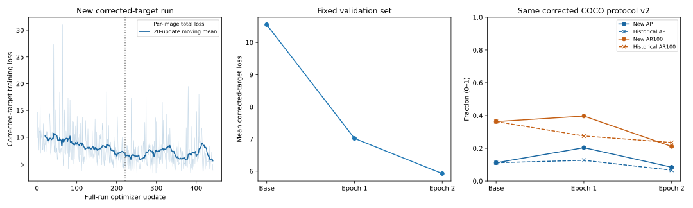

# Stage 4 — Controlled corrected-target restart

Owner authorization D-048, 2026-10-20. Exactly one fresh two-epoch experiment is
authorized, with no automatic retry/tuning, historical checkpoint resume, test
access, promotion or Git publication.

**Completed once, process exit 0:** three discarded pilot updates, then exactly
442 full-run updates and two validations. Corrected epoch 1 improved AP to
**0.203932** and AR100 to **0.396766** versus pretrained **0.111576 / 0.363077**.
Epoch 2 regressed to **0.084500 / 0.211229** despite lower loss. No checkpoint is
promoted. Training stopped after the second epoch and final validation.

Experiment/preflight/comparison evidence:
`runs/training/corrected-retrain-72650648148549ccb8aa8a176f9c5b0b/`.
New trainer run:
`runs/training/taco-312e568703a54f98a7c8f4b87b29cd39/`.
Both new epoch bundles are under that run's `checkpoints/epoch-01/` and
`checkpoints/epoch-02/`; historical bundles remain separate and unchanged.
Branch `feat/stage4-real-image-training` retains the prior uncommitted corrections,
GUI opt-in and owner `config/detection.json` changes. No commit, push or merge.

The existing trainer, adapter, checkpoint verifier, evaluation protocol and
historical compatibility policy remain unchanged. The local execution harness
`work/corrected-retrain/experiment.py` adds only experiment safeguards: preflight
tests with updates blocked, protected-file hashes, exact baseline comparison
before the pilot, original-snapshot-only loading, and an exclusive one-attempt
marker. It invokes the existing trainer with the original fixed arguments and
does not alter targets, gradients, optimizer, sampler or evaluation.

The corrected real-image collator calls `valid_image_loss_targets`, normalizing
COCO boxes by original valid-image dimensions rather than padding. The Stage 3D
adapter passes that same target list to the unchanged native criterion's decoder
and encoder branches. Independent coordinate tests cover both branches and native
proposal/postprocessor oracles. See [coordinate correction](TACO_STAGE_4_COORDINATES.md).

The existing [limited academic-use assessment](TACO_STAGE_4_ACADEMIC_USE.md) and
private v2 rights gate remain mandatory and unchanged. Owner authorization is
not third-party permission, institutional approval or definitive rights clearance.
Only the exact 221 training/47 validation images are authorized for this run.

## Interpretation and next decision

Corrected geometry improved first-epoch detection under the controlled settings:
AP, AP50, AP75 and AR100 exceed both pretrained and historical epoch 1. AP75
improved from 0.135975 pretrained / 0.149016 historical epoch 1 to 0.239987,
supporting better ranked class-aware localization at stricter IoU, not proof
that every box or material label improved. All eight class AP values exceed
pretrained after corrected epoch 1, but wrapper/can/cup/styrofoam recall remains
below pretrained. At score 0.05, it matches 28 annotations, the same as pretrained
and more than historical epoch 1's 17; three additional compatible retained
candidates lie below 0.05. COCO AP and fixed-threshold match counts measure
different behavior.

The first-epoch aggregate gain is sensitive to rare classes. The two bag
annotations produce AP 0.677759; their class alone contributes about 0.055191
of the overall AP gain of 0.092356 versus pretrained. The small-object AP remains
low (0.019802 after epoch 1, 0.036337 after epoch 2), although the earlier models
had zero small-object AP. Positive-only scene selection, 47 validation images,
75 annotations and one seed do not establish generalization or robustness.

The second epoch worsens AP and recall versus epoch 1 and pretrained. Compared
with historical epoch 2, its AP is slightly higher (0.084500 versus 0.066215),
but AR100 is lower (0.211229 versus 0.235395). Bag AP/recall collapse to zero,
styrofoam AP/recall also fall to zero, and cup AP/recall decline; several other
classes improve. These shifts explain the aggregate regression more precisely
than saying every class got worse. Mean decoder and encoder regression losses
decrease, but that does not establish improved held-out detection. Corrected
validation loss falls 7.019476 to 5.926001 while AP declines.

Score suppression is reduced relative to the historical high-score collapse,
but not eliminated relative to pretrained. The new epochs retain 16 and 54
queries >=0.25 (historical: zero each; pretrained: 216), and their maxima exceed
the historical maxima. Both new score medians, P99s and maxima remain below
pretrained. Epoch 2 has a higher maximum and more >=0.25 queries than epoch 1,
yet worse AP/recall; its P99 decreases. Thus a single score summary or threshold
cannot explain the deterioration, and lowering a display threshold is not a
model repair. At 0.25 only 4/9 annotations match in new epochs 1/2, versus
18 pretrained. Counts and scores are not accuracy or calibrated correctness.

**Next decision:** the evidence supports proposing another bounded,
single-variable optimization experiment after owner review; it does not support
extending this run or promoting either checkpoint. A lower-learning-rate
comparison is a plausible proposal for the observed epoch-to-epoch degradation,
with all other variables and corrected protocol held fixed. Its benefit and the
cause of the regression remain unproven; no new learning rate or experiment is
approved or executed here. Human photo/phrase review remains pending, and the
apparent first-epoch advantage needs confirmation beyond this single small
validation set. Await owner review.

## Fixed experiment

Original pretrained Grounding DINO Tiny revision
`a2bb814dd30d776dcf7e30523b00659f4f141c71`; two epochs, 221 training images /
397 annotations, 47 validation images / 75 annotations; batch 1; shortest 256 /
longest 384 with 384-square padding; FP32; AdamW learning rate `1e-5`, weight decay
`1e-4`, `foreach=False`, clip norm 1; seed 42; vision and text backbones frozen.
Existing eight-class prompt, 900 queries, native loss coefficients and Stage 3D
adapter are retained. No augmentation, scheduler, gradient accumulation or workers.
The real-image pilot has three steps; its model/optimizer are discarded before
full training reloads the original snapshot. Historical weights are never loaded
for training. COCO evaluation is the corrected v2 protocol.

The local harness invokes the unchanged trainer with:

```powershell
.venv-training/Scripts/python.exe -B scripts/train_taco.py --rights work/stage4-real/rights.json --epochs 2 --batch-size 1 --shortest-edge 256 --longest-edge 384 --pilot-steps 3 --checkpoint-every 50 --device cuda
```

This records the executed argument set, not authorization to repeat the run.

## Mandatory preflight evidence

- Full guarded discovery: 205 tests, 202 passed, zero failures/errors, three skips.
  All eight independent coordinate tests ran and passed; the two toy optimizer
  tests were deliberately excluded before updates, and one existing Windows
  symlink fixture lacked privilege. Logs and exact test IDs are retained locally.
- Original valid-image target oracles, native decoder/postprocessor coordinates,
  pixel-mask/padding alignment and zero box losses in both encoder/decoder
  branches passed. No optimizer step was allowed during preflight.
- Dataset/split/original-annotation identities, taxonomy, unchanged private rights
  record and bound academic-use assessment passed the existing gates.
- Source fingerprints match the reviewed Step 1B corrections exactly. The
  historical report, both epoch bundles and saved corrected results passed the
  unchanged anchored replay verification.
- Original snapshot hashes, adapter/native-source manifest, FP32 parameters and
  frozen parameter selection matched. Existing `.venv-training` package inventory
  and dependency checks matched the historical environment. Actual CUDA device:
  NVIDIA GeForce GTX 1660 Ti, 6,442,450,944 bytes, PyTorch CUDA 11.8.
- All 221 training and 47 validation images passed actual source hash, stored
  raster identity, dimensions/orientation and corrected collator checks.
- Read-only pretrained validation exactly matched **all metrics, all predictions,
  all 42,300 raw queries and corrected-target loss**, not only rounded AP:
  AP `0.111576016`, AP50 `0.158252880`, validation loss `10.553226`.
- Preflight consumed 315 authorized photo reads (268 geometry checks + 47
  validation), zero optimizer updates and zero test-photo reads. Its lifecycle was
  114.023 seconds; peak allocated/reserved memory 951,008,768 / 1,019,215,872 bytes.
  All protected files remained unchanged.

The PowerShell redirected preflight log contains a `NativeCommandError` wrapper
for tqdm's stderr output; the Python record reached `status=passed` and the terminal
printed `PREFLIGHT PASSED`, with no Python traceback or failed verification.
Training uses direct process output. The harness also compares the trainer's own
fresh baseline exactly before allowing its pilot to begin.

## Same-protocol comparison

All detection metrics are fractions on the 0–1 scale. AP is COCO bbox AP@[.50:.95], AR100 averages recall over the same IoU range. Every row uses corrected protocol `bantai.taco-evaluation.v2`, the same 47 images/75 annotations, score floor zero and top 100 predictions per image.

| Model | AP | AP50 | AP75 | AR100 | Corrected-target validation loss |
| --- | --- | --- | --- | --- | --- |
| Pretrained | 0.111576 | 0.158253 | 0.135975 | 0.363077 | 10.553226 |
| Historical epoch 1 | 0.126627 | 0.176343 | 0.149016 | 0.275363 | 9.312350 |
| Historical epoch 2 | 0.066215 | 0.106098 | 0.073386 | 0.235395 | 10.211304 |
| Corrected epoch 1 | 0.203932 | 0.254720 | 0.239987 | 0.396766 | 7.019476 |
| Corrected epoch 2 | 0.084500 | 0.107561 | 0.095599 | 0.211229 | 5.926001 |

## Scores and fixed-threshold diagnostics

These are model scores, not accuracy or calibrated correctness probabilities. Matches use saved official top-100 candidates, same-class greedy IoU >=0.50; this diagnostic is separate from COCO AP. Each model has 42,300 saved queries.

| Model | Median score | P99 score | Maximum score | Queries >=0.25 | Matched /75 at 0.05 | Matched /75 at 0.25 |
| --- | --- | --- | --- | --- | --- | --- |
| Pretrained | 0.019574 | 0.187558 | 0.596656 | 216 | 28 | 18 |
| Historical epoch 1 | 0.029931 | 0.069502 | 0.184526 | 0 | 17 | 0 |
| Historical epoch 2 | 0.031275 | 0.067896 | 0.123536 | 0 | 14 | 0 |
| Corrected epoch 1 | 0.008768 | 0.107758 | 0.343288 | 16 | 28 | 4 |
| Corrected epoch 2 | 0.008959 | 0.091586 | 0.376415 | 54 | 26 | 9 |

## Class-level AP and recall

Column order: pretrained, historical epochs 1/2, corrected epochs 1/2. Counts are validation annotations, not independent physical-object estimates.

| Class (objects) | Base AP | Hist E1 AP | Hist E2 AP | New E1 AP | New E2 AP |
| --- | --- | --- | --- | --- | --- |
| cigarette (24) | 0.014851 | 0.019802 | 0.024752 | 0.020136 | 0.025458 |
| plastic_bottle (8) | 0.038242 | 0.105851 | 0.044347 | 0.096181 | 0.103595 |
| plastic_bag (2) | 0.236229 | 0.517162 | 0.283663 | 0.677759 | 0.000000 |
| plastic_wrapper (11) | 0.094467 | 0.000071 | 0.001015 | 0.118247 | 0.135371 |
| plastic_film (13) | 0.001574 | 0.000000 | 0.000307 | 0.016310 | 0.026429 |
| drink_can (7) | 0.108416 | 0.011881 | 0.000000 | 0.118812 | 0.118812 |
| plastic_cup (5) | 0.340656 | 0.308746 | 0.175631 | 0.432673 | 0.266337 |
| styrofoam_piece (5) | 0.058173 | 0.049505 | 0.000000 | 0.151337 | 0.000000 |

| Class | Base AR100 | Hist E1 AR100 | Hist E2 AR100 | New E1 AR100 | New E2 AR100 |
| --- | --- | --- | --- | --- | --- |
| cigarette | 0.012500 | 0.016667 | 0.020833 | 0.050000 | 0.079167 |
| plastic_bottle | 0.400000 | 0.600000 | 0.487500 | 0.462500 | 0.337500 |
| plastic_bag | 0.550000 | 0.800000 | 0.800000 | 0.950000 | 0.000000 |
| plastic_wrapper | 0.490909 | 0.009091 | 0.036364 | 0.272727 | 0.372727 |
| plastic_film | 0.076923 | 0.000000 | 0.038462 | 0.384615 | 0.446154 |
| drink_can | 0.214286 | 0.057143 | 0.000000 | 0.114286 | 0.114286 |
| plastic_cup | 0.600000 | 0.480000 | 0.500000 | 0.560000 | 0.340000 |
| styrofoam_piece | 0.560000 | 0.240000 | 0.000000 | 0.380000 | 0.000000 |

## Training losses and curves

Historical training losses use the old padded targets and are not directly comparable. Only the new corrected-target training losses are tabulated here. All validation losses above were computed with corrected targets, including the historical checkpoints.

| New epoch | Updates | Mean training loss | Minimum | Maximum | Update/audit seconds |
| --- | --- | --- | --- | --- | --- |
| 1 | 221 | 8.569587 | 3.699923 | 31.023689 | 115.886556 |
| 2 | 221 | 6.903368 | 3.207014 | 20.759693 | 115.852465 |

| New epoch | Decoder CE | Decoder L1 | Decoder GIoU | Encoder CE | Encoder L1 | Encoder GIoU |
| --- | --- | --- | --- | --- | --- | --- |
| 1 | 1.596428 | 0.035419 | 0.236439 | 1.764385 | 0.081487 | 0.395276 |
| 2 | 1.220535 | 0.029247 | 0.218400 | 1.452690 | 0.064501 | 0.325692 |



## Measured runtime and checkpoint integrity

- Trainer lifecycle: 444.615 seconds; includes preflight, baseline, pilot, training, validation and checkpoint IO.
- Pilot peak allocated/reserved: 2,559,891,968 / 2,722,103,296 bytes.
- Full training/validation peak allocated/reserved: 2,558,043,648 / 2,726,297,600 bytes. PyTorch allocator peaks, not total GPU usage.
- Baseline / epoch-1 / epoch-2 evaluation seconds: 24.175 / 16.702 / 17.451.
- 10 immutable checkpoint bundles passed all recorded file hashes. Final optimizer: 558 parameter states, every state at step 442; RNG states present.
- Exactly 442 sequential full-run updates and seeded once-per-epoch coverage of all 221 training IDs; three separate discarded pilot updates. Trainer photo reads: 854.
- All 471 protected file hashes match the preflight inventory, including authorized original photos, annotations/splits, historical artifacts, snapshot, scripts, configuration and rights evidence.
- Every saved metric table was independently recomputed exactly from saved predictions without model execution.

The three pilot losses were 9.022902, 9.009389 and 10.639625 on different dense
training images; they are wiring/memory checks, not a convergence curve.
The full-run frozen-parameter hashes passed after each epoch. Every step passed
finite-loss/gradient/updated-weight checks and supervised encoder-head update
checks. Final state contains optimizer, Python/NumPy/CPU/CUDA RNG and exact
epoch/batch position; `latest_checkpoint.json` points to epoch 2, step 442.
The strict resume verifier, installed libraries, model architecture and loss
coefficients were not modified.

The comparison audit also checked every contract field against the historical
run: the only differences are the reviewed corrected implementation fingerprints
and the already approved v2 evaluation protocol. Snapshot, prompt, labels,
optimizer settings, seed, packages/runtime, adapter context, corpus and rights
context match. Actual rights-file bytes are separately hashed, retaining the
existing distinction between that file and the legacy gate fingerprint.

Local evidence includes `preflight.json`, `software-results.json`,
`software-tests.txt`, `preflight-geometry.json`, `preflight-baseline.json`,
`protected-before.json`, `training-attempt.json`, `training-baseline-gate.json`,
`training-result.json`, `post-training-preservation.json`, `comparison.json` and
`annotation-diagnostics.json` in the experiment directory. The trainer directory
retains `report.json`, `baseline.json`, `pilot.json`, `steps.jsonl`, both epoch
evaluations, the latest pointer and immutable checkpoint manifests/artifacts.
Exact unrounded values and fingerprints in these files are authoritative.
`work/corrected-retrain/analyze_run.py` performs saved-result-only comparisons,
checks every new checkpoint, reads only the new final optimizer state on CPU,
and produces the numeric loss/metric chart. It does not load model parameters
or rerun inference. All photos, annotations, raw predictions, checkpoints and
rights records remain local; the chart contains only aggregate numeric metrics.
