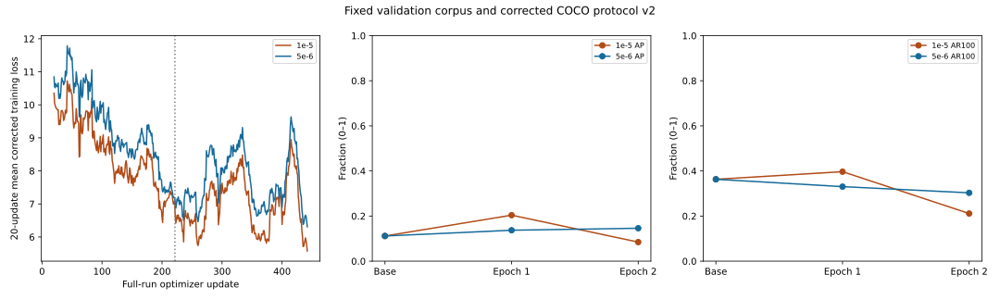

# Stage 4 — Controlled learning-rate experiment, 5e-6

## Objective, result and isolated variable

D-050 authorized 2026-10-21; completed 2026-10-22. Exactly one fresh two-epoch run completed, exit 0,
at learning rate **5e-6**, compared with the corrected **1e-5** reference.
There were three discarded real-image pilot updates and exactly 442 full-run
updates. Training stopped after epoch 2 and final validation. No promotion,
test access, additional tuning, dependency changes, uploads or Git operations.

New run: `runs/training/taco-dd541c3972834a64a16771df44a7e891`.
Experiment/preflight/comparison: `runs/training/lr5e6-7d3cd8dad9064aa9949fb2da4bf421c0`.
Reference run: `runs/training/taco-312e568703a54f98a7c8f4b87b29cd39`.
The reference is the corrected-target experiment, not the earlier flawed-target
historical run. Original epochs and the reference E1 checkpoint are preserved.

The selected learning rate is the only experimental configuration change.
The audited contracts otherwise match exactly after accounting for the explicit
`learning_rate` settings field and the minimal trainer source change. The
[prior diagnostic report](TACO_STAGE_4_CORRECTED_DIAGNOSTICS.md) supplies the
fixed candidate-matching definitions; the [reference report](TACO_STAGE_4_CORRECTED_RETRAIN.md)
supplies the original run evidence. This is one seed/run, not definitive proof
that learning rate caused the earlier regression.

## Measured outcome and interpretation

**5e-6 is better at epoch 2 than 1e-5, but worse at epoch 1; it is not an
overall replacement for the stronger 1e-5 epoch-1 checkpoint.** At epoch 1,
AP/AR100 are 0.137099/0.330432 versus 0.203932/0.396766 for 1e-5.
At epoch 2, they are 0.145952/0.302977 versus 0.084500/0.211229 for 1e-5.
The new epoch-2 differences are +0.061452 AP and +0.091748 AR100 against the
same-epoch reference. All four trained states remain experimental.

Within 5e-6, epoch-2 AP rises by 0.008854, avoiding the prior AP collapse,
but AR100 falls by 0.027455. AP50 and AP75 also fall (0.182086→0.174521 and
0.164359→0.158049). Thus stability improves specifically for aggregate AP,
not uniformly across localization thresholds, recall or classes. Compared with
pretrained, new epoch 2 has higher AP but lower AR100. No validated operating
precision/recall acceptance threshold exists, so this is not evidence of adequate
deployment quality or “acceptable” precision at a selected score cutoff.

Correct-class all900 coverage still declines 32→30 annotations, while any-class
coverage rises 54→56. Top100 correct-class coverage stays 27; top100 any-class
coverage rises 52→53. At epoch 2, all900 same-class coverage equals the 1e-5
reference's 30, and top100 same-class coverage is lower than its 29. Fixed
same-class matches at score 0.05 remain 25→25 and at 0.25 remain 5→5, versus
26/9 in the 1e-5 epoch-2 reference. The lower rate therefore does not resolve
the class-coverage problem or improve every threshold-specific detection count.

Bag and styrofoam no longer collapse to zero AP in epoch 2: they retain
0.252475 and 0.207921, versus zero for both in the 1e-5 epoch-2 reference.
Bottle/cup AP are also higher than that reference; wrapper/film AP are lower,
cigarette AP is slightly lower, and can AP is unchanged. Within the new run,
bag and cup AP still decline in epoch 2, while cigarette/bottle/wrapper/film/can/
styrofoam improve. Only two bag annotations and five styrofoam annotations
support those estimates; changes in a few detections strongly affect macro AP.

Confidence behavior remains mixed. Compared with 1e-5 epoch 2, 5e-6 epoch 2
has higher median/P90/P95/P99 scores but a lower maximum and fewer queries
>=0.25 (15 versus 54). Within 5e-6, the median rises slightly while P90/P95/P99
decline; queries >=0.25 decline 21→15. Score magnitude is not calibrated
correctness, and neither score maxima nor threshold counts establish AP quality.

All losses/gradients/updated weights remain finite, but both experiments already
passed those numerical checks. Every new step still invokes norm-1 clipping.
Training and corrected validation losses decrease across epochs; their values
are higher than the same-epoch 1e-5 losses even though the new epoch-2 AP is
better. This again shows that lower native loss alone does not select the best
detector. The evidence supports learning-rate sensitivity of this optimization
trajectory; it does not establish learning rate as the sole cause of the prior
regression, or rule out seed variance, class imbalance and metric sensitivity.


## Preflight and minimal implementation

The original trainer hardcoded LR 1e-5. `--learning-rate` now defaults to 1e-5,
rejects nonfinite/nonpositive values, and passes the chosen value to each AdamW
creation and immutable settings/optimizer checkpoint context. Weight decay,
clipping, frozen parameter selection and every other optimization parameter
are unchanged. The exact source diff and prior trainer bytes remain local.

Four added regression tests passed: actual AdamW groups/default/frozen filtering,
invalid-rate rejection before dataset access, CLI-to-optimizer/checkpoint context
wiring, and strict context rejection when the learning rate changes. No fixture
optimizer updates were needed. Full guarded discovery: **209 tests, 206 passed,
zero failures/errors, three skips** (two toy optimizer fixtures excluded before
updates; one Windows symlink privilege limitation). All eight coordinate tests ran.

The first read-only preflight process ended mid-validation without a completed
baseline result or any optimizer update. Its initial record/log are preserved;
completed software and 268 image checks were retained. An explicit read-only
continuation rechecked protected inputs, runtime, data, rights and original
snapshot, then ran all 47 validation images to completion. No extra pilot or
training run was created. The partial log shows six completed validation
iterations; its exact photo-read count is unavailable and must not be inferred
from that progress counter.

The completed pretrained check exactly matches all recorded predictions,
42,300 raw queries, metrics and corrected-target loss: AP 0.111576016,
AP50 0.158252880, loss 10.553226. The trainer's own fresh baseline is checked
again before its first pilot update. All 221 training/47 validation originals
passed source hash, raster dimensions/orientation and corrected valid-image target
checks. Actual pinned FP32 model, frozen parameter set, Stage 3D/native-source
manifest, CUDA GTX 1660 Ti, package inventory, dataset/splits/taxonomy and private
rights gate matched the reference. The limited academic-use record remains
unchanged and does not claim permission, institutional approval or definitive
legal clearance; see [the assessment](TACO_STAGE_4_ACADEMIC_USE.md).

Strict checkpoint/resume verification and historical manifests/policies are
unchanged. Source-pinned historical TACO replay entry points correctly reject the
new trainer fingerprint; no policy was silently regenerated. Reference artifacts
are verified with their genuine original contexts. The new run binds its own
source hashes and LR in every immutable checkpoint. Normal BANTAI inference and
the owner's production detection settings are unchanged.

## Exact training configuration

Original Grounding DINO Tiny snapshot revision
`a2bb814dd30d776dcf7e30523b00659f4f141c71`; seed 42; two epochs; 221 training
images/397 annotations and 47 validation images/75 annotations; batch 1; shortest
256/longest 384 with fixed 384-square padding; FP32; AdamW LR 5e-6, weight decay
1e-4, foreach false, gradient clipping norm 1; vision/text backbones frozen;
unchanged eight-class order/prompt/tokenizer, verified Stage 3D adapter, native
loss coefficients and 900 queries; no augmentation, scheduler, gradient
accumulation or workers. Pilot weights/optimizer were discarded and the full
run loaded the original pretrained snapshot again. No fine-tuned state resumed.

Recorded trainer arguments (not authorization to repeat):

```powershell
.venv-training/Scripts/python.exe -B scripts/train_taco.py --rights work/stage4-real/rights.json --epochs 2 --batch-size 1 --learning-rate 5e-6 --shortest-edge 256 --longest-edge 384 --pilot-steps 3 --checkpoint-every 50 --device cuda
```

## Overall same-protocol comparison

Every row uses corrected COCO protocol `bantai.taco-evaluation.v2` on the same
47 validation images/75 annotations, score floor zero, top100 valid predictions,
single argmax class/query, mean ordinary-subword sigmoid scores, no NMS and bbox
IoU .50:.05:.95. Metrics are fractions on [0,1], not accuracy or calibrated score
probabilities. Validation losses all use corrected valid-image targets.


| State | AP | AP50 | AP75 | AR100 | Validation loss |
| --- | --- | --- | --- | --- | --- |
| Pretrained | 0.111576 | 0.158253 | 0.135975 | 0.363077 | 10.553226 |
| 1e-5 E1 | 0.203932 | 0.254720 | 0.239987 | 0.396766 | 7.019476 |
| 1e-5 E2 | 0.084500 | 0.107561 | 0.095599 | 0.211229 | 5.926001 |
| 5e-6 E1 | 0.137099 | 0.182086 | 0.164359 | 0.330432 | 7.520370 |
| 5e-6 E2 | 0.145952 | 0.174521 | 0.158049 | 0.302977 | 6.444531 |

## Per-class AP, AP50 and recall

Validation annotation support is unchanged; rare-class estimates remain unstable.

| Class (annotations) | Pretrained | 1e-5 E1 | 1e-5 E2 | 5e-6 E1 | 5e-6 E2 |
| --- | --- | --- | --- | --- | --- |
| cigarette (24) | 0.014851 | 0.020136 | 0.025458 | 0.020116 | 0.025116 |
| plastic_bottle (8) | 0.038242 | 0.096181 | 0.103595 | 0.078044 | 0.143604 |
| plastic_bag (2) | 0.236229 | 0.677759 | 0.000000 | 0.454455 | 0.252475 |
| plastic_wrapper (11) | 0.094467 | 0.118247 | 0.135371 | 0.026708 | 0.053725 |
| plastic_film (13) | 0.001574 | 0.016310 | 0.026429 | 0.012116 | 0.020279 |
| drink_can (7) | 0.108416 | 0.118812 | 0.118812 | 0.000000 | 0.118812 |
| plastic_cup (5) | 0.340656 | 0.432673 | 0.266337 | 0.388111 | 0.345686 |
| styrofoam_piece (5) | 0.058173 | 0.151337 | 0.000000 | 0.117239 | 0.207921 |

Table metric: **AP**.

| Class (annotations) | Pretrained | 1e-5 E1 | 1e-5 E2 | 5e-6 E1 | 5e-6 E2 |
| --- | --- | --- | --- | --- | --- |
| cigarette (24) | 0.049505 | 0.050588 | 0.053022 | 0.050289 | 0.050681 |
| plastic_bottle (8) | 0.051105 | 0.136787 | 0.111259 | 0.108677 | 0.190193 |
| plastic_bag (2) | 0.297480 | 0.752475 | 0.000000 | 0.504950 | 0.252475 |
| plastic_wrapper (11) | 0.149874 | 0.144790 | 0.199483 | 0.059048 | 0.081801 |
| plastic_film (13) | 0.003556 | 0.026081 | 0.041275 | 0.017178 | 0.026182 |
| drink_can (7) | 0.143564 | 0.148515 | 0.148515 | 0.000000 | 0.148515 |
| plastic_cup (5) | 0.464008 | 0.616146 | 0.306931 | 0.559807 | 0.438401 |
| styrofoam_piece (5) | 0.106931 | 0.162376 | 0.000000 | 0.156739 | 0.207921 |

Table metric: **AP50**.

| Class (annotations) | Pretrained | 1e-5 E1 | 1e-5 E2 | 5e-6 E1 | 5e-6 E2 |
| --- | --- | --- | --- | --- | --- |
| cigarette (24) | 0.012500 | 0.050000 | 0.079167 | 0.033333 | 0.054167 |
| plastic_bottle (8) | 0.400000 | 0.462500 | 0.337500 | 0.462500 | 0.462500 |
| plastic_bag (2) | 0.550000 | 0.950000 | 0.000000 | 0.450000 | 0.500000 |
| plastic_wrapper (11) | 0.490909 | 0.272727 | 0.372727 | 0.254545 | 0.163636 |
| plastic_film (13) | 0.076923 | 0.384615 | 0.446154 | 0.323077 | 0.369231 |
| drink_can (7) | 0.214286 | 0.114286 | 0.114286 | 0.000000 | 0.114286 |
| plastic_cup (5) | 0.600000 | 0.560000 | 0.340000 | 0.580000 | 0.560000 |
| styrofoam_piece (5) | 0.560000 | 0.380000 | 0.000000 | 0.540000 | 0.200000 |

Table metric: **AR100**.

## Correct-class versus any-class candidate coverage

Oracle candidate coverage counts annotations with at least one valid candidate
at IoU >=0.50 or >=0.75, with no score floor; it is not one-to-one recall.
All900 includes weak candidates outside the official top100. Fixed-threshold
matches use score-ranked same-class greedy IoU >=0.50, as in the prior diagnostic
report; this is separate from COCO's multi-IoU matching. None of these diagnostic
thresholds changes official AP evaluation.


| State | Same-class all900 .50/.75 | Any-class all900 .50/.75 | Same-class top100 .50/.75 | Any-class top100 .50/.75 | Matches .05 | Matches .25 |
| --- | --- | --- | --- | --- | --- | --- |
| Pretrained | 32/21 | 53/37 | 28/21 | 48/37 | 28 | 18 |
| 1e-5 E1 | 36/23 | 55/39 | 31/21 | 53/39 | 28 | 4 |
| 1e-5 E2 | 30/17 | 57/41 | 29/16 | 56/39 | 26 | 9 |
| 5e-6 E1 | 32/23 | 54/37 | 27/19 | 52/36 | 25 | 5 |
| 5e-6 E2 | 30/17 | 56/41 | 27/16 | 53/40 | 25 | 5 |

Per-class counts below use IoU >=0.50. “Wrong queries” counts repeated
official-top100 predictions at score >=0.05 with a wrong assigned class against
their best-overlapping annotation. It is not a unique-object count or a
human-confirmed material judgment. Complete 0/.05/.10/.15/.20/.25 diagnostics and
wrong-class pair counts are retained in local JSON.


| Class | State | Same/any all900 | Same/any top100 | Matches .05/.25 | Wrong queries .05 |
| --- | --- | --- | --- | --- | --- |
| cigarette | Pretrained | 3/5 | 1/1 | 1/1 | 0 |
| cigarette | 1e-5 E1 | 5/5 | 4/4 | 2/0 | 1 |
| cigarette | 1e-5 E2 | 8/8 | 7/7 | 5/1 | 1 |
| cigarette | 5e-6 E1 | 3/5 | 2/3 | 1/0 | 0 |
| cigarette | 5e-6 E2 | 5/7 | 4/4 | 3/0 | 1 |
| plastic_bottle | Pretrained | 4/8 | 4/8 | 4/4 | 41 |
| plastic_bottle | 1e-5 E1 | 6/8 | 5/8 | 5/1 | 39 |
| plastic_bottle | 1e-5 E2 | 3/8 | 3/8 | 3/2 | 34 |
| plastic_bottle | 5e-6 E1 | 6/8 | 5/8 | 5/1 | 31 |
| plastic_bottle | 5e-6 E2 | 5/8 | 5/8 | 5/2 | 33 |
| plastic_bag | Pretrained | 2/2 | 2/2 | 2/1 | 18 |
| plastic_bag | 1e-5 E1 | 2/2 | 2/2 | 2/0 | 17 |
| plastic_bag | 1e-5 E2 | 0/2 | 0/2 | 0/0 | 12 |
| plastic_bag | 5e-6 E1 | 2/2 | 1/2 | 1/1 | 15 |
| plastic_bag | 5e-6 E2 | 1/2 | 1/2 | 1/1 | 11 |
| plastic_wrapper | Pretrained | 11/11 | 9/11 | 9/4 | 88 |
| plastic_wrapper | 1e-5 E1 | 6/11 | 5/11 | 4/1 | 86 |
| plastic_wrapper | 1e-5 E2 | 6/11 | 6/11 | 6/3 | 60 |
| plastic_wrapper | 5e-6 E1 | 7/11 | 5/11 | 4/0 | 73 |
| plastic_wrapper | 5e-6 E2 | 3/11 | 3/11 | 3/0 | 67 |
| plastic_film | Pretrained | 2/10 | 2/9 | 2/1 | 47 |
| plastic_film | 1e-5 E1 | 9/12 | 8/11 | 8/0 | 24 |
| plastic_film | 1e-5 E2 | 10/11 | 10/11 | 9/1 | 14 |
| plastic_film | 5e-6 E1 | 6/11 | 6/11 | 6/0 | 32 |
| plastic_film | 5e-6 E2 | 9/11 | 8/11 | 7/0 | 18 |
| drink_can | Pretrained | 2/7 | 2/7 | 2/0 | 81 |
| drink_can | 1e-5 E1 | 1/7 | 1/7 | 1/0 | 65 |
| drink_can | 1e-5 E2 | 1/7 | 1/7 | 1/1 | 41 |
| drink_can | 5e-6 E1 | 0/7 | 0/7 | 0/0 | 59 |
| drink_can | 5e-6 E2 | 1/7 | 1/7 | 1/0 | 53 |
| plastic_cup | Pretrained | 4/5 | 4/5 | 4/3 | 19 |
| plastic_cup | 1e-5 E1 | 4/5 | 4/5 | 4/2 | 14 |
| plastic_cup | 1e-5 E2 | 2/5 | 2/5 | 2/1 | 21 |
| plastic_cup | 5e-6 E1 | 4/5 | 4/5 | 4/2 | 14 |
| plastic_cup | 5e-6 E2 | 4/5 | 4/5 | 4/1 | 13 |
| styrofoam_piece | Pretrained | 4/5 | 4/5 | 4/4 | 48 |
| styrofoam_piece | 1e-5 E1 | 3/5 | 2/5 | 2/0 | 50 |
| styrofoam_piece | 1e-5 E2 | 0/5 | 0/5 | 0/0 | 32 |
| styrofoam_piece | 5e-6 E1 | 4/5 | 4/5 | 4/1 | 40 |
| styrofoam_piece | 5e-6 E2 | 2/5 | 1/5 | 1/1 | 37 |

## Confidence-score behavior

Raw-query distributions use 42,300 winning-class scores per state. Counts use
**>=** (including equality). Sigmoid-derived scores are neither accuracy nor
calibrated correctness probabilities. Per-class groups contain winning assigned
classes and change membership between states; they do not measure the alternate
class logits/margins, which were not saved.


| State | Median | P90 | P95 | P99 | Maximum |
| --- | --- | --- | --- | --- | --- |
| Pretrained | 0.019574 | 0.053525 | 0.081858 | 0.187558 | 0.596656 |
| 1e-5 E1 | 0.008768 | 0.024703 | 0.038765 | 0.107758 | 0.343288 |
| 1e-5 E2 | 0.008959 | 0.024777 | 0.037465 | 0.091586 | 0.376415 |
| 5e-6 E1 | 0.011358 | 0.029667 | 0.044466 | 0.113798 | 0.341122 |
| 5e-6 E2 | 0.011610 | 0.028919 | 0.042770 | 0.099546 | 0.354828 |

| State | >=.05 | >=.10 | >=.15 | >=.20 | >=.25 |
| --- | --- | --- | --- | --- | --- |
| Pretrained | 4740 | 1524 | 723 | 376 | 216 |
| 1e-5 E1 | 1472 | 483 | 206 | 86 | 16 |
| 1e-5 E2 | 1272 | 358 | 177 | 95 | 54 |
| 5e-6 E1 | 1743 | 532 | 218 | 65 | 21 |
| 5e-6 E2 | 1569 | 418 | 164 | 67 | 15 |

| Class median / P99 | Pretrained | 1e-5 E1 | 1e-5 E2 | 5e-6 E1 | 5e-6 E2 |
| --- | --- | --- | --- | --- | --- |
| cigarette | 0.021084 / 0.152067 | 0.007965 / 0.064710 | 0.008920 / 0.066077 | 0.009823 / 0.073287 | 0.010471 / 0.072274 |
| plastic_bottle | 0.019380 / 0.277664 | 0.009432 / 0.206823 | 0.009576 / 0.248308 | 0.011416 / 0.181579 | 0.011606 / 0.173771 |
| plastic_bag | 0.022523 / 0.203323 | 0.009622 / 0.158689 | 0.009241 / 0.065740 | 0.012381 / 0.129505 | 0.012619 / 0.067172 |
| plastic_wrapper | 0.018204 / 0.181197 | 0.009047 / 0.094053 | 0.012726 / 0.236832 | 0.010734 / 0.097359 | 0.012575 / 0.095778 |
| plastic_film | 0.030332 / 0.273868 | 0.009198 / 0.140182 | 0.009117 / 0.145169 | 0.013282 / 0.145323 | 0.012042 / 0.142683 |
| drink_can | 0.044719 / 0.210240 | 0.028594 / 0.215441 | 0.014632 / 0.266029 | 0.030026 / 0.167114 | 0.017990 / 0.217667 |
| plastic_cup | 0.019783 / 0.174150 | 0.010780 / 0.132986 | 0.010801 / 0.152669 | 0.012383 / 0.115227 | 0.013161 / 0.103066 |
| styrofoam_piece | 0.018243 / 0.138189 | 0.008261 / 0.056126 | 0.008177 / 0.056735 | 0.010594 / 0.064864 | 0.011200 / 0.054327 |

## Training behavior, losses and stability

All training/validation losses here use corrected targets. Lower native loss
does not imply better ranked detection AP. The classification/L1/GIoU components
below are unweighted means; the unchanged native coefficients are 2/5/2 for each
decoder/encoder branch. Saved validation evidence contains total loss, not its
component breakdown. Validation components are not inferred from total loss.


| State | Train total | Decoder cls | Decoder L1 | Decoder GIoU | Encoder cls | Encoder L1 | Encoder GIoU |
| --- | --- | --- | --- | --- | --- | --- | --- |
| 1e-5 E1 | 8.569587 | 1.596428 | 0.035419 | 0.236439 | 1.764385 | 0.081487 | 0.395276 |
| 1e-5 E2 | 6.903368 | 1.220535 | 0.029247 | 0.218400 | 1.452690 | 0.064501 | 0.325692 |
| 5e-6 E1 | 9.357347 | 1.786997 | 0.036589 | 0.240249 | 1.927312 | 0.087050 | 0.415019 |
| 5e-6 E2 | 7.653082 | 1.368065 | 0.034094 | 0.230865 | 1.625928 | 0.068516 | 0.345159 |

| 5e-6 epoch | Updates | Train loss min/max | Preclip norm median/max | Clipped steps | Update/audit seconds |
| --- | --- | --- | --- | --- | --- |
| 1 | 221 | 4.049695 / 31.922646 | 119.216133 / 1475.423706 | 221 | 113.772668 |
| 2 | 221 | 3.386027 / 24.059389 | 92.871819 / 494.589111 | 221 | 115.554945 |

Every update passed the existing finite-loss/gradient/updated-weight checks,
positive encoder-probe gradient/update checks and epoch frozen-parameter hashes.
Actual observed optimizer groups were checked at both pilot and full-run creation;
both epoch optimizer state files were read on CPU without restoring training and
contain LR 5e-6, weight decay 1e-4, foreach false and every state at steps 221/442.
Large/clipped gradients alone do not establish instability or that LR is causal.
AP/AR100 and class coverage must be assessed alongside these losses.




## Runtime, checkpoint integrity and preservation

- Trainer lifecycle: 25971.807 seconds, including its own
  coordinate preflight, baseline, pilot, training, validation and checkpoint IO.
  The runtime log records an approximately three-hour wall-clock gap during the
  trainer's coordinate preflight, before any optimizer update. This is elapsed
  lifecycle evidence, not an active-compute or throughput benchmark. Separate
  per-update/audit timings above exclude this gap and most IO/preprocessing.
  After that gap, the trainer's own baseline still matched the recorded outputs
  exactly before its pilot and fresh full-run initialization.
- Pilot peak allocated/reserved: 2,559,891,968 /
  2,722,103,296 bytes.
- Full-run peak allocated/reserved: 2,558,043,648 /
  2,726,297,600 bytes. PyTorch allocator peaks, not total GPU memory.
- Exactly 442 sequential full-run updates, with seeded once-per-epoch coverage of
  all 221 training IDs; three separate discarded pilot updates; 854
  trainer photo reads. Extra read-only preflight reads are recorded separately.
- 10 immutable checkpoint bundles passed all recorded
  artifact hashes. Both epoch bundles have complete optimizer and RNG states;
  final latest pointer is epoch 2, step 442. All five saved COCO metric tables
  recomputed exactly from saved predictions.
- All 612 protected file hashes match the
  preflight inventory, including prior checkpoints/results/diagnostics, source
  dataset, original snapshot, owner configuration and the current qualified code.
- No test split, dataset edits, taxonomy/prompt change, augmentation/rebalancing,
  additional epochs, dependency installation, normal-inference change, checkpoint
  promotion, private-artifact publication or automatic Git operation occurred.

Private evidence includes `prior_train_taco.py`, `source-change.patch`,
`protected-before.json`, `software-results.json`, `software-tests.txt`,
`preflight-before-interruption.json`, `preflight-geometry.json`,
`preflight-continuation.json`, `preflight-baseline.json`, `preflight.json`,
`training-attempt.json`, `baseline-gate.json`, `training-result.json`,
`post-training-preservation.json`, `comparison.json` and `diagnostic-detail.json`.
The trainer run preserves report/baseline/pilot/steps, both full validation
records, latest pointer and checkpoint manifests/artifacts. Exact unrounded JSON
values are authoritative over the tables. No annotated-image export was created;
the SVG contains only aggregate numeric curves. Human photo-level confirmation
is still pending, not implied by metrics.


## Next experiment — proposal only; await owner review

Preserve the 1e-5 epoch-1 checkpoint as the strongest measured aggregate result,
without promoting it. The present evidence does not justify another automatic LR
reduction, a longer run, or combined changes to sampling, resolution or backbones.

The next proposed experiment is a **seed-only replication at fixed LR 5e-6**:
change seed 42 to 43 and retain the same two epochs, original pretrained snapshot,
221/47 split, three-step discarded pilot, batch/resize/padding, frozen backbones,
optimizer/loss, taxonomy/prompt and corrected v2 evaluation. This tests whether
the absence of aggregate AP collapse and the bag/styrofoam retention repeat under
a different stochastic trajectory. Measure both epochs, all class AP/recall,
score-floor-zero same/any-class coverage and unchanged 0.05/0.25 matches.
One additional seed would still give limited uncertainty estimates; it would
not independently identify a unique mechanism or establish superiority across
learning rates. A broader paired-seed study would require separate authorization.

This is a recommendation for owner review, not an approved or implemented
experiment. No further training, test evaluation, checkpoint promotion,
automatic optimization, commit, push or merge follows this completed run.
