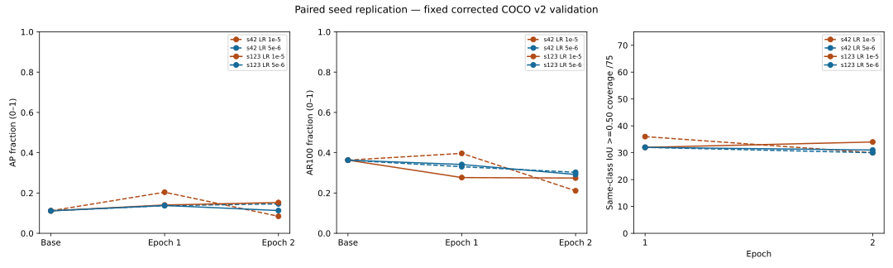

# Stage 4 — Paired random-seed replication

## Objective and completion

D-051, authorized 2026-10-22. Exactly two fresh seed-123 runs completed, one at
LR 1e-5 (A), one at LR 5e-6 (B). Each discarded its three-step real-image pilot,
reloaded the original pinned pretrained model and completed two epochs / 442
full-run updates. Total: **884 full updates plus six discarded pilot updates**.
Both trainer processes exited 0 and passed their final audits. No further run,
optimization, test evaluation or checkpoint promotion followed.

Study: `runs/training/seed123-pair-10acabc298064547bfab6d119a109359`.
The run identifiers below are discovered from recorded local results, rather
than inferred from earlier historical directory names.


| Seed / LR | Completed run | Best epoch by AP |
| --- | --- | --- |
| 42 / 1e-5 | taco-312e568703a54f98a7c8f4b87b29cd39 | 1 |
| 42 / 5e-6 | taco-dd541c3972834a64a16771df44a7e891 | 2 |
| 123 / 1e-5 | taco-4bf521d7529e4fa4b168b96786020844 | 2 |
| 123 / 5e-6 | taco-e7e4008e98a241e19047e14645f06ec1 | 1 |

## Executive conclusions and recommended next decision

**Seed 123 weakens the hypothesis that lowering LR from 1e-5 to 5e-6 reliably
prevents the second-epoch regression.** The seed-42 pattern does not reproduce:
at seed 123, 1e-5 AP improves 0.140478→0.152880, while 5e-6 AP regresses
0.137919→0.113018. At seed 42, the corresponding paths were
0.203932→0.084500 and 0.137099→0.145952. Learning rate still affects the
trajectory, but the direction and size of the effect depend on seed/epoch.
Neither overfitting nor an excessively high learning rate is established as
the unique cause of the earlier failure.

Best AP epoch changes for **both** rates: 1e-5 prefers E1 at seed 42 and E2
at seed 123; 5e-6 prefers E2 at seed 42 and E1 at seed 123. The original
seed-42/1e-5/E1 result (AP 0.203932, AR100 0.396766) remains the highest
measured AP and AR100 in this comparison, preserved without promotion. None
of the new seed-123 states exceeds pretrained AR100 (0.363077). Small validation
support and selecting among several epochs/rates limit generalization claims.

The effect sizes do not support one universal ordering. At E1, changing seed
for 1e-5 changes AP by -0.063454, close to the seed-42 LR effect -0.066833;
the LR effect at seed 123 is only -0.002559. At E2, the 1e-5 seed effect is
+0.068380, larger than either observed E2 LR effect in magnitude
(+0.061452 at seed 42, -0.039861 at seed 123). The 5e-6 seed effect is
much smaller at E1 (+0.000821) but material at E2 (-0.032934). Recall also
shows interaction: lowering LR reduces E1 AR100 at seed 42 but increases it
at seed 123. Its E2 recall advantage has the same sign in both seeds, with
different magnitudes (+0.091748 / +0.017620), despite the AP ranking reversal.
These are descriptive two-seed comparisons, not evidence of statistical
superiority or a calibrated probability of improvement.

Coverage supports a seed-dependent class-assignment explanation at the output
level. At 1e-5, same-class all900 IoU >=0.50 coverage changes 36→30 at seed
42 but 32→34 at seed 123; any-class coverage rises in both (55→57 and 58→59).
At 5e-6, same-class coverage decreases in both seeds (32→30 / 32→31), while
any-class coverage rises (54→56 / 54→57). Thus lower LR does not consistently
repair correct-class coverage. Raw candidate availability is not one-to-one COCO
recall: an annotation can have a useful weak candidate outside official top100,
and COCO also depends on ranking, class averaging and stricter IoU thresholds.

Class changes are mixed rather than universal deterioration. Cigarette, wrapper
and film AP increase in E2 in all four configurations. Bottle AP increases in E2
at 5e-6 for both seeds, but reverses direction between seeds at 1e-5. Cup AP
declines at 1e-5 in both seeds. Bags decline at 5e-6 in both seeds, while at
1e-5 the seed-42 collapse does not recur at seed 123 (AP stays 0.504950).
That retained bag class alone contributes about +0.063119 of the +0.068380
high-LR E2 AP difference between seeds, supported by only two bag annotations.
Styrofoam AP is zero in all seed-123 E2 states, whereas seed-42/5e-6 E2 has
0.207921; that class contributes -0.025990 of the -0.032934 low-LR E2
seed difference. These few-object effects make macro AP especially sensitive;
they do not prove that class imbalance caused the failures.

Scores are not a single explanation. At seed 123, both rates' median and P99
scores decrease from E1 to E2, but 1e-5 AP improves while 5e-6 AP falls.
At 1e-5 the >=0.25 query count rises 26→37; at 5e-6 it falls 25→21.
Fixed >=0.05 matches change 25→26 and 25→25, respectively, while >=0.25
matches rise 6→11 and 6→8. These threshold counts and macro AP answer
different questions. Native training and validation total losses fall in both
new runs, alongside opposite AP changes. Finite updates and lower loss do not
establish better detection, calibrated confidence or an acceptable operating point.

**Recommended next controlled experiment, proposal only:** add a third paired
fixed seed, e.g. **456**, at both existing rates, keeping two epochs and every
other variable unchanged. Predefine comparisons of E1/E2 AP, AR100, per-class
results, same/any coverage and the unchanged 0.05/0.25 matches. This would test
whether the rank reversal and rare-class sensitivity recur before changing
sampling, resolution, loss or architecture. It would require two newly authorized
runs and would still not establish a statistically conclusive winner. Human
material/annotation review remains pending and should inform interpretation.
No third-seed run, new optimization or checkpoint promotion has been implemented.
The current task stops after these two completed runs for owner review.


## Preflight, seed implementation and source integrity

The prior trainer hardcoded seed 42. The minimal seed change adds `--seed`
(default 42), validates the NumPy-compatible unsigned 32-bit integer range,
propagates it to Python/NumPy/PyTorch CPU/CUDA, and records it in settings and
immutable checkpoint context. `epoch_batches` remains unchanged and receives
the selected seed plus its existing epoch offset. The initial pilot load is
seeded; full restart seeds before loading and resets the training stream after
loading, preserving the old default-42 training RNG behavior. Existing
`--learning-rate`, default 1e-5, weight decay, clipping and optimization logic
remain intact. The strict checkpoint/resume verifier and old manifests were not
modified; older source-pinned replay commands still fail closed on a newer trainer
fingerprint. Normal production inference is unchanged.

Five new software fixtures passed without optimizer steps: repeatable independent
Python/NumPy/CPU sequences; explicit CUDA propagation; literal default-42 and
seed-123 ordering oracles/epoch offset; invalid seeds before data access; and
CLI/default/initial load/full restart/sampler/context propagation. The existing
LR tests still pass. Guarded full discovery: **214 tests, 211 passed, zero
failures/errors, three skips** (two toy-update fixtures excluded before optimizer
authorization; one existing Windows symlink privilege fixture). All eight
independent coordinate tests ran, including native encoder/decoder loss targets.

All 221 train/47 validation originals passed source hash, stored-raster size/
orientation and valid-image coordinate preflight. Corpus, annotation identity,
taxonomy, prompt, original snapshot, packages, Python/platform, GPU driver/runtime
and private rights record match the qualified seed-42 reference. Seed 123's
pretrained validation matched **every metric, prediction, raw query and corrected
loss exactly**, including AP 0.111576016 / AP50 0.158252880 / loss 10.553226.
Each actual trainer independently rechecked that baseline before its pilot.

Both new initial models and full-run models matched the same recorded original
pretrained parameter hash. Weak-reference checks confirmed each pilot model and
optimizer were released before the next load. Both full runs started with equal
recorded Python/NumPy/CPU/CUDA RNG fingerprints and used the exact same 442-image
ordering; each epoch contains every one of the 221 training IDs exactly once.
There is no historical model/optimizer/RNG/position restoration.

Only the trainer's reviewed seed-support fingerprint differs from the seed-42
LR trainer. Other five training-source identities remain fixed; the exact prior
source bytes/diff and new source identity are retained locally. Contracts are
compared field by field, allowing only seed/settings, the declared LR and this
reviewed source change. Original data, earlier checkpoints and evidence are
protected by unchanged-file hashes. Owner workflow authorization remains distinct
from permission, institutional approval and definitive rights clearance; the
[limited-use assessment](TACO_STAGE_4_ACADEMIC_USE.md) and private gate are unchanged.

## Fixed experimental configuration

Original Grounding DINO Tiny revision
`a2bb814dd30d776dcf7e30523b00659f4f141c71`; 221 train/47 validation images;
397/75 annotations; corrected valid-image targets; fixed eight-class order/prompt/
tokenizer; native Stage 3D encoder adapter and loss coefficients; 900 queries;
batch 1; FP32; shortest 256/longest 384; 384-square padding; frozen vision/text
backbones; AdamW weight decay 1e-4, foreach false, clip norm 1; no augmentation,
scheduler, accumulation or workers. Both new runs use seed 123. The only
difference **within the seed-123 pair** is LR 1e-5 versus 5e-6. Relative to each
matching seed-42 recipe, seed is the experimental variable.

Recorded commands (evidence, not authorization to repeat):

```powershell
.venv-training/Scripts/python.exe -B scripts/train_taco.py --rights work/stage4-real/rights.json --seed 123 --learning-rate 1e-5 --epochs 2 --batch-size 1 --shortest-edge 256 --longest-edge 384 --pilot-steps 3 --checkpoint-every 50 --device cuda
.venv-training/Scripts/python.exe -B scripts/train_taco.py --rights work/stage4-real/rights.json --seed 123 --learning-rate 5e-6 --epochs 2 --batch-size 1 --shortest-edge 256 --longest-edge 384 --pilot-steps 3 --checkpoint-every 50 --device cuda
```

## Four configurations and epoch performance

All comparisons use corrected COCO protocol `bantai.taco-evaluation.v2`, the same
47 validation images/75 annotations, zero score floor, top100 valid predictions,
one argmax class/query, mean ordinary-subword sigmoid scores, no NMS, COCO bbox
IoU .50:.05:.95. AP/recall are fractions on [0,1], not accuracy or calibrated
probabilities. Pretrained reference is identical in all four runs.


| Seed | 1e-5 E1 AP / AR100 | 1e-5 E2 AP / AR100 | 5e-6 E1 AP / AR100 | 5e-6 E2 AP / AR100 |
| --- | --- | --- | --- | --- |
| 42 | 0.203932 / 0.396766 | 0.084500 / 0.211229 | 0.137099 / 0.330432 | 0.145952 / 0.302977 |
| 123 | 0.140478 / 0.276718 | 0.152880 / 0.274295 | 0.137919 / 0.341559 | 0.113018 / 0.291915 |

| Seed / LR / epoch | AP | AP50 | AP75 | AR100 | Corrected validation loss |
| --- | --- | --- | --- | --- | --- |
| Pretrained | 0.111576 | 0.158253 | 0.135975 | 0.363077 | 10.553226 |
| 42 / 1e-5 / E1 | 0.203932 | 0.254720 | 0.239987 | 0.396766 | 7.019476 |
| 42 / 1e-5 / E2 | 0.084500 | 0.107561 | 0.095599 | 0.211229 | 5.926001 |
| 42 / 5e-6 / E1 | 0.137099 | 0.182086 | 0.164359 | 0.330432 | 7.520370 |
| 42 / 5e-6 / E2 | 0.145952 | 0.174521 | 0.158049 | 0.302977 | 6.444531 |
| 123 / 1e-5 / E1 | 0.140478 | 0.169154 | 0.152226 | 0.276718 | 6.299103 |
| 123 / 1e-5 / E2 | 0.152880 | 0.178946 | 0.164636 | 0.274295 | 5.526925 |
| 123 / 5e-6 / E1 | 0.137919 | 0.176573 | 0.156206 | 0.341559 | 7.427575 |
| 123 / 5e-6 / E2 | 0.113018 | 0.144608 | 0.125368 | 0.291915 | 6.175791 |

## Cross-seed deltas and learning-rate sensitivity

Seed deltas are **seed 123 minus seed 42**, at the same LR and epoch. Coverage
uses score-floor-zero valid candidates and IoU >=0.50. Raw all900 availability is
an annotation-level oracle, not one-to-one recall; official top100 coverage and
fixed 0.05 matches are reported separately.


| LR | Epoch | Delta AP | Delta AR100 | Delta same900 | Delta same100 | Delta matches .05 |
| --- | --- | --- | --- | --- | --- | --- |
| 1e-5 | 1 | -0.063454 | -0.120048 | -4 | -3 | -3 |
| 1e-5 | 2 | +0.068380 | +0.063066 | 4 | 0 | 0 |
| 5e-6 | 1 | +0.000821 | +0.011127 | 0 | 2 | 0 |
| 5e-6 | 2 | -0.032934 | -0.011062 | 1 | 0 | 0 |

LR deltas below are **5e-6 minus 1e-5**, within the same seed and epoch.

| Seed | Epoch | Delta AP | Delta AR100 | Delta same900 |
| --- | --- | --- | --- | --- |
| 42 | 1 | -0.066833 | -0.066334 | -4 |
| 42 | 2 | +0.061452 | +0.091748 | 0 |
| 123 | 1 | -0.002559 | +0.064840 | 0 |
| 123 | 2 | -0.039861 | +0.017620 | -3 |

These are descriptive differences from two seeds, not a statistical test,
confidence interval or proof of superiority. Seed changes both sampling order
and stochastic model training; this study does not isolate their separate effects.
Each seed-123 pair starts with equal RNG state and uses equal image order, but
that alone does not establish deterministic kernels or guarantee every internal
stochastic operation remains identical after model trajectories diverge.

## Per-class AP and recall

Column order is explicit; validation annotation support is fixed and very small
for some classes. AP and recall need not move in the same direction. AP50 values,
all per-class score distributions and matching details are also retained in JSON.


### LR 1e-5 — AP

| Class (annotations) | Pretrained | 42 / 1e-5 / E1 | 42 / 1e-5 / E2 | 123 / 1e-5 / E1 | 123 / 1e-5 / E2 |
| --- | --- | --- | --- | --- | --- |
| cigarette (24) | 0.014851 | 0.020136 | 0.025458 | 0.020507 | 0.034787 |
| plastic_bottle (8) | 0.038242 | 0.096181 | 0.103595 | 0.113039 | 0.055776 |
| plastic_bag (2) | 0.236229 | 0.677759 | 0.000000 | 0.504950 | 0.504950 |
| plastic_wrapper (11) | 0.094467 | 0.118247 | 0.135371 | 0.125683 | 0.160149 |
| plastic_film (13) | 0.001574 | 0.016310 | 0.026429 | 0.015385 | 0.032423 |
| drink_can (7) | 0.108416 | 0.118812 | 0.118812 | 0.000000 | 0.148515 |
| plastic_cup (5) | 0.340656 | 0.432673 | 0.266337 | 0.344260 | 0.286439 |
| styrofoam_piece (5) | 0.058173 | 0.151337 | 0.000000 | 0.000000 | 0.000000 |

### LR 1e-5 — AR100

| Class (annotations) | Pretrained | 42 / 1e-5 / E1 | 42 / 1e-5 / E2 | 123 / 1e-5 / E1 | 123 / 1e-5 / E2 |
| --- | --- | --- | --- | --- | --- |
| cigarette (24) | 0.012500 | 0.050000 | 0.079167 | 0.054167 | 0.112500 |
| plastic_bottle (8) | 0.400000 | 0.462500 | 0.337500 | 0.400000 | 0.162500 |
| plastic_bag (2) | 0.550000 | 0.950000 | 0.000000 | 0.500000 | 0.500000 |
| plastic_wrapper (11) | 0.490909 | 0.272727 | 0.372727 | 0.327273 | 0.327273 |
| plastic_film (13) | 0.076923 | 0.384615 | 0.446154 | 0.392308 | 0.469231 |
| drink_can (7) | 0.214286 | 0.114286 | 0.114286 | 0.000000 | 0.142857 |
| plastic_cup (5) | 0.600000 | 0.560000 | 0.340000 | 0.540000 | 0.480000 |
| styrofoam_piece (5) | 0.560000 | 0.380000 | 0.000000 | 0.000000 | 0.000000 |

### LR 5e-6 — AP

| Class (annotations) | Pretrained | 42 / 5e-6 / E1 | 42 / 5e-6 / E2 | 123 / 5e-6 / E1 | 123 / 5e-6 / E2 |
| --- | --- | --- | --- | --- | --- |
| cigarette (24) | 0.014851 | 0.020116 | 0.025116 | 0.020092 | 0.020285 |
| plastic_bottle (8) | 0.038242 | 0.078044 | 0.143604 | 0.079703 | 0.144865 |
| plastic_bag (2) | 0.236229 | 0.454455 | 0.252475 | 0.504950 | 0.252475 |
| plastic_wrapper (11) | 0.094467 | 0.026708 | 0.053725 | 0.119790 | 0.127833 |
| plastic_film (13) | 0.001574 | 0.012116 | 0.020279 | 0.005826 | 0.010128 |
| drink_can (7) | 0.108416 | 0.000000 | 0.118812 | 0.000000 | 0.000000 |
| plastic_cup (5) | 0.340656 | 0.388111 | 0.345686 | 0.344199 | 0.348562 |
| styrofoam_piece (5) | 0.058173 | 0.117239 | 0.207921 | 0.028793 | 0.000000 |

### LR 5e-6 — AR100

| Class (annotations) | Pretrained | 42 / 5e-6 / E1 | 42 / 5e-6 / E2 | 123 / 5e-6 / E1 | 123 / 5e-6 / E2 |
| --- | --- | --- | --- | --- | --- |
| cigarette (24) | 0.012500 | 0.033333 | 0.054167 | 0.029167 | 0.054167 |
| plastic_bottle (8) | 0.400000 | 0.462500 | 0.462500 | 0.587500 | 0.575000 |
| plastic_bag (2) | 0.550000 | 0.450000 | 0.500000 | 0.500000 | 0.500000 |
| plastic_wrapper (11) | 0.490909 | 0.254545 | 0.163636 | 0.372727 | 0.300000 |
| plastic_film (13) | 0.076923 | 0.323077 | 0.369231 | 0.323077 | 0.346154 |
| drink_can (7) | 0.214286 | 0.000000 | 0.114286 | 0.000000 | 0.000000 |
| plastic_cup (5) | 0.600000 | 0.580000 | 0.560000 | 0.600000 | 0.560000 |
| styrofoam_piece (5) | 0.560000 | 0.540000 | 0.200000 | 0.320000 | 0.000000 |

Class AP changes below are **epoch 2 minus epoch 1** within each configuration; signs identify repeated versus seed-dependent changes.

| Class | 42 / 1e-5 | 42 / 5e-6 | 123 / 1e-5 | 123 / 5e-6 |
| --- | --- | --- | --- | --- |
| cigarette | +0.005322 | +0.005001 | +0.014279 | +0.000193 |
| plastic_bottle | +0.007414 | +0.065560 | -0.057263 | +0.065162 |
| plastic_bag | -0.677759 | -0.201980 | +0.000000 | -0.252475 |
| plastic_wrapper | +0.017124 | +0.027017 | +0.034466 | +0.008043 |
| plastic_film | +0.010119 | +0.008163 | +0.017038 | +0.004301 |
| drink_can | +0.000000 | +0.118812 | +0.148515 | +0.000000 |
| plastic_cup | -0.166337 | -0.042425 | -0.057821 | +0.004363 |
| styrofoam_piece | -0.151337 | +0.090682 | +0.000000 | -0.028793 |

## Candidate coverage and incorrect-class overlaps

The diagnostic definitions/score conditions are unchanged from
[corrected diagnostics](TACO_STAGE_4_CORRECTED_DIAGNOSTICS.md): valid all900 and
official top100 availability at score floor zero, IoU >=0.50 / >=0.75; score-ranked
same-class greedy IoU >=0.50 matches at 0.05/0.25. This matching is separate from
official multi-IoU COCO AP. Incorrect-class overlap counts include repeated
queries and are not independent objects or human-confirmed classification errors.


| State | Same900 .50/.75 | Any900 .50/.75 | Same100 .50/.75 | Any100 .50/.75 | Matches .05/.25 | Wrong queries .05 |
| --- | --- | --- | --- | --- | --- | --- |
| Pretrained | 32/21 | 53/37 | 28/21 | 48/37 | 28/18 | 342 |
| 42 / 1e-5 / E1 | 36/23 | 55/39 | 31/21 | 53/39 | 28/4 | 296 |
| 42 / 1e-5 / E2 | 30/17 | 57/41 | 29/16 | 56/39 | 26/9 | 215 |
| 42 / 5e-6 / E1 | 32/23 | 54/37 | 27/19 | 52/36 | 25/5 | 264 |
| 42 / 5e-6 / E2 | 30/17 | 56/41 | 27/16 | 53/40 | 25/5 | 233 |
| 123 / 1e-5 / E1 | 32/18 | 58/41 | 28/16 | 54/40 | 25/6 | 226 |
| 123 / 1e-5 / E2 | 34/19 | 59/43 | 29/18 | 57/42 | 26/11 | 151 |
| 123 / 5e-6 / E1 | 32/21 | 54/39 | 29/20 | 53/37 | 25/6 | 246 |
| 123 / 5e-6 / E2 | 31/16 | 57/38 | 27/16 | 53/38 | 25/8 | 198 |

| Class | Seed / LR | E1 same/any900 | E2 same/any900 | E1 matches .05/.25 | E2 matches .05/.25 | E1/E2 wrong queries .05 |
| --- | --- | --- | --- | --- | --- | --- |
| cigarette | 42 / 1e-5 | 5/5 | 8/8 | 2/0 | 5/1 | 1/1 |
| cigarette | 42 / 5e-6 | 3/5 | 5/7 | 1/0 | 3/0 | 0/1 |
| cigarette | 123 / 1e-5 | 6/8 | 9/9 | 3/1 | 6/1 | 1/0 |
| cigarette | 123 / 5e-6 | 3/5 | 6/8 | 1/1 | 2/1 | 0/0 |
| plastic_bottle | 42 / 1e-5 | 6/8 | 3/8 | 5/1 | 3/2 | 39/34 |
| plastic_bottle | 42 / 5e-6 | 6/8 | 5/8 | 5/1 | 5/2 | 31/33 |
| plastic_bottle | 123 / 1e-5 | 4/8 | 4/8 | 4/2 | 2/2 | 32/27 |
| plastic_bottle | 123 / 5e-6 | 6/8 | 6/8 | 6/1 | 6/2 | 35/26 |
| plastic_bag | 42 / 1e-5 | 2/2 | 0/2 | 2/0 | 0/0 | 17/12 |
| plastic_bag | 42 / 5e-6 | 2/2 | 1/2 | 1/1 | 1/1 | 15/11 |
| plastic_bag | 123 / 1e-5 | 1/2 | 1/2 | 1/1 | 1/1 | 12/7 |
| plastic_bag | 123 / 5e-6 | 1/2 | 1/2 | 1/1 | 1/1 | 13/12 |
| plastic_wrapper | 42 / 1e-5 | 6/11 | 6/11 | 4/1 | 6/3 | 86/60 |
| plastic_wrapper | 42 / 5e-6 | 7/11 | 3/11 | 4/0 | 3/0 | 73/67 |
| plastic_wrapper | 123 / 1e-5 | 8/11 | 5/11 | 5/0 | 5/4 | 68/43 |
| plastic_wrapper | 123 / 5e-6 | 8/11 | 5/11 | 6/1 | 5/2 | 63/54 |
| plastic_film | 42 / 1e-5 | 9/12 | 10/11 | 8/0 | 9/1 | 24/14 |
| plastic_film | 42 / 5e-6 | 6/11 | 9/11 | 6/0 | 7/0 | 32/18 |
| plastic_film | 123 / 1e-5 | 9/12 | 10/12 | 8/0 | 8/1 | 17/9 |
| plastic_film | 123 / 5e-6 | 7/11 | 8/11 | 5/0 | 7/0 | 32/16 |
| drink_can | 42 / 1e-5 | 1/7 | 1/7 | 1/0 | 1/1 | 65/41 |
| drink_can | 42 / 5e-6 | 0/7 | 1/7 | 0/0 | 1/0 | 59/53 |
| drink_can | 123 / 1e-5 | 0/7 | 1/7 | 0/0 | 1/1 | 51/34 |
| drink_can | 123 / 5e-6 | 0/7 | 0/7 | 0/0 | 0/0 | 56/47 |
| plastic_cup | 42 / 1e-5 | 4/5 | 2/5 | 4/2 | 2/1 | 14/21 |
| plastic_cup | 42 / 5e-6 | 4/5 | 4/5 | 4/2 | 4/1 | 14/13 |
| plastic_cup | 123 / 1e-5 | 4/5 | 3/5 | 4/2 | 3/1 | 13/13 |
| plastic_cup | 123 / 5e-6 | 4/5 | 4/5 | 4/2 | 4/2 | 12/11 |
| styrofoam_piece | 42 / 1e-5 | 3/5 | 0/5 | 2/0 | 0/0 | 50/32 |
| styrofoam_piece | 42 / 5e-6 | 4/5 | 2/5 | 4/1 | 1/1 | 40/37 |
| styrofoam_piece | 123 / 1e-5 | 0/5 | 1/5 | 0/0 | 0/0 | 32/18 |
| styrofoam_piece | 123 / 5e-6 | 3/5 | 1/5 | 2/0 | 0/0 | 35/32 |

## Score distributions

All raw-query summaries have 42,300 winning-class scores per state. Counts use
>= including equality. These are model scores, not calibrated correctness
probabilities or image accuracy. Per-class groups change membership with class
assignment; non-winning class margins were not saved and are not invented.


| State | Min | Median | P90 | P95 | P99 | Max |
| --- | --- | --- | --- | --- | --- | --- |
| Pretrained | 0.000902 | 0.019574 | 0.053525 | 0.081858 | 0.187558 | 0.596656 |
| 42 / 1e-5 / E1 | 0.000888 | 0.008768 | 0.024703 | 0.038765 | 0.107758 | 0.343288 |
| 42 / 1e-5 / E2 | 0.000949 | 0.008959 | 0.024777 | 0.037465 | 0.091586 | 0.376415 |
| 42 / 5e-6 / E1 | 0.000709 | 0.011358 | 0.029667 | 0.044466 | 0.113798 | 0.341122 |
| 42 / 5e-6 / E2 | 0.001081 | 0.011610 | 0.028919 | 0.042770 | 0.099546 | 0.354828 |
| 123 / 1e-5 / E1 | 0.000827 | 0.010990 | 0.027801 | 0.040974 | 0.096743 | 0.355953 |
| 123 / 1e-5 / E2 | 0.000954 | 0.008852 | 0.023990 | 0.035311 | 0.079393 | 0.396704 |
| 123 / 5e-6 / E1 | 0.000824 | 0.012747 | 0.032048 | 0.046514 | 0.109008 | 0.344854 |
| 123 / 5e-6 / E2 | 0.000996 | 0.011343 | 0.027572 | 0.040163 | 0.092980 | 0.359745 |

| State | >=.05 | >=.10 | >=.15 | >=.20 | >=.25 |
| --- | --- | --- | --- | --- | --- |
| Pretrained | 4740 | 1524 | 723 | 376 | 216 |
| 42 / 1e-5 / E1 | 1472 | 483 | 206 | 86 | 16 |
| 42 / 1e-5 / E2 | 1272 | 358 | 177 | 95 | 54 |
| 42 / 5e-6 / E1 | 1743 | 532 | 218 | 65 | 21 |
| 42 / 5e-6 / E2 | 1569 | 418 | 164 | 67 | 15 |
| 123 / 1e-5 / E1 | 1478 | 400 | 178 | 83 | 26 |
| 123 / 1e-5 / E2 | 1068 | 271 | 122 | 62 | 37 |
| 123 / 5e-6 / E1 | 1848 | 516 | 217 | 74 | 25 |
| 123 / 5e-6 / E2 | 1407 | 366 | 156 | 67 | 21 |

## Training/validation losses and numerical behavior

All losses use corrected targets; old flawed padded-target losses are excluded.
Training components are unweighted means; native decoder/encoder coefficients
remain classification 2, L1 5, GIoU 2. Validation records supply total loss only,
so validation component losses cannot be recovered from these saved records.
Finite gradients/weights, positive supervised encoder updates and frozen hashes
passed for every new run. Large preclip norms or falling loss alone do not
establish improved detector quality or numerical instability.


| Config / epoch | Train total | Decoder cls | L1 | GIoU | Encoder cls | L1 | GIoU |
| --- | --- | --- | --- | --- | --- | --- | --- |
| 42 / 1e-5 / E1 | 8.569587 | 1.596428 | 0.035419 | 0.236439 | 1.764385 | 0.081487 | 0.395276 |
| 42 / 1e-5 / E2 | 6.903368 | 1.220535 | 0.029247 | 0.218400 | 1.452690 | 0.064501 | 0.325692 |
| 42 / 5e-6 / E1 | 9.357347 | 1.786997 | 0.036589 | 0.240249 | 1.927312 | 0.087050 | 0.415019 |
| 42 / 5e-6 / E2 | 7.653082 | 1.368065 | 0.034094 | 0.230865 | 1.625928 | 0.068516 | 0.345159 |
| 123 / 1e-5 / E1 | 8.368438 | 1.512988 | 0.035894 | 0.235585 | 1.749636 | 0.080086 | 0.396058 |
| 123 / 1e-5 / E2 | 6.598823 | 1.121973 | 0.032832 | 0.222123 | 1.409086 | 0.060821 | 0.312097 |
| 123 / 5e-6 / E1 | 9.273032 | 1.757561 | 0.036393 | 0.236408 | 1.923055 | 0.084784 | 0.416550 |
| 123 / 5e-6 / E2 | 7.456950 | 1.320235 | 0.034099 | 0.228931 | 1.573228 | 0.070337 | 0.344990 |

| Config / epoch | Preclip norm median / max | Clipped steps | Update/audit seconds |
| --- | --- | --- | --- |
| 42 / 1e-5 / E1 | 114.219307 / 1463.960449 | 221 | 115.886556 |
| 42 / 1e-5 / E2 | 84.110298 / 1619.742065 | 221 | 115.852465 |
| 42 / 5e-6 / E1 | 119.216133 / 1475.423706 | 221 | 113.772668 |
| 42 / 5e-6 / E2 | 92.871819 / 494.589111 | 221 | 115.554945 |
| 123 / 1e-5 / E1 | 104.203423 / 1406.382690 | 221 | 119.357490 |
| 123 / 1e-5 / E2 | 81.326187 / 598.695251 | 221 | 119.819653 |
| 123 / 5e-6 / E1 | 120.521324 / 395.320038 | 221 | 49496.756480 |
| 123 / 5e-6 / E2 | 87.141418 / 1976.060181 | 221 | 467.036612 |



## Memory, execution and checkpoint preservation

Elapsed lifecycle includes image preflight, baseline, pilot, training, evaluation
and checkpoint IO. It is not isolated throughput; the seed-42 5e-6 reference
contains a recorded long pre-update wall-clock gap. Per-update/audit sums above
exclude most preprocessing/IO but can still include wall-clock gaps. The new B
run also records a large elapsed gap within its E1 update/audit timing; its cause
is not established by these logs. Neither timer measures isolated active compute,
and no speed comparison is inferred. Step counts, ordering, weights/RNG starts,
finite-update checks and artifact hashes were verified independently of elapsed
time. Memory values are PyTorch allocator peaks, not
total GPU usage.


| Config | Lifecycle seconds | Pilot allocated / reserved bytes | Full allocated / reserved bytes | Trainer photo reads |
| --- | --- | --- | --- | --- |
| 42 / 1e-5 | 444.615475 | 2559891968 / 2722103296 | 2558043648 / 2726297600 | 854 |
| 42 / 5e-6 | 25971.807138 | 2559891968 / 2722103296 | 2558043648 / 2726297600 | 854 |
| 123 / 1e-5 | 462.949832 | 2559891968 / 2722103296 | 2558043648 / 2726297600 | 854 |
| 123 / 5e-6 | 50254.552692 | 2559891968 / 2722103296 | 2558043648 / 2726297600 | 854 |

All **20 new immutable checkpoint bundles** passed every recorded artifact
hash. Both new epoch-1/epoch-2 optimizer states were read on CPU, never restored:
actual LRs match their run and optimizer steps are 221/442; RNG states are present.
The strict verifier is unchanged. The final latest pointer in each new run is
epoch 2, step 442. All nine saved metric tables recomputed exactly from saved
predictions without extra model execution. All 756
protected file hashes match the preflight inventory, covering original weights,
authorized source data/photos/splits, current code/config/tests, rights evidence,
earlier runs/diagnostics and prior reports. Existing owner modifications remain
intact. No test split, annotation changes, dependencies, inference changes,
uploads, promotion or automatic commits/pushes/merges occurred.

Private evidence includes `preflight.json`, `runtime-check.json`,
`software-results.json`, `software-tests.txt`, `preflight-geometry.json`,
`preflight-baseline.json`, `protected-before.json`, the prior trainer/source diff,
`A-attempt.json`, `A-result.json`, `B-attempt.json`, `B-result.json`,
`comparison.json` and `diagnostic-detail.json`. Each result records seed calls,
both pretrained parameter hashes, pilot-release checks and full-start RNG hashes.
Raw predictions/checkpoints remain local; the SVG contains aggregate numbers.
Human photo-level confirmation remains pending. Exact unrounded JSON values
and hashes are authoritative over rounded documentation.
